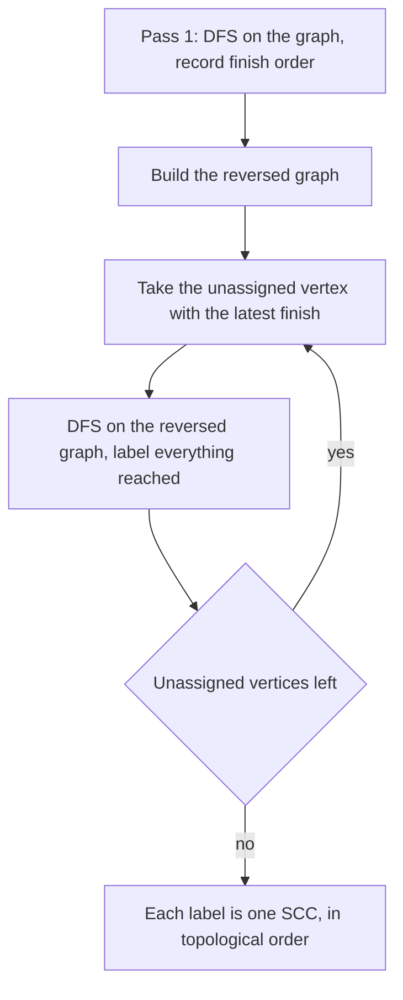

## The hook

A city has only one-way streets. In some neighbourhoods, you can drive around in loops and get from any corner to any other. Between neighbourhoods, the streets may run only one way: you can leave the old town for the docks, but never drive back.

Asking "which neighbourhoods are like that?" splits a directed graph into its loops, and once those loops are shrunk to single points, what is left has no cycles at all. That is a powerful simplification, because DAGs are where topological sort and DP shine.

## The intuition

:::analogy
Think of each neighbourhood as a group of corners connected by one-way streets in which you can always find your way back to where you started. Two corners are in the same neighbourhood when you can drive from the first to the second and also from the second back to the first. Streets that leave a neighbourhood and never come back are the only ones that matter on the city-wide map, and on that map the neighbourhoods line up like stations on a one-way railway.
:::

Each neighbourhood is a [[strongly connected component]]: a largest set of vertices where every vertex reaches every other. Shrinking each component to one vertex gives the [[condensation]], and it is always a DAG, because a cycle between two components would merge them into one.

So every directed graph is "a DAG of cycles". Many problems become easy once the cycles are collapsed:

- reachability questions shrink to the condensation;
- longest-path or best-total questions become DP on a DAG;
- "is the whole graph strongly connected?" becomes "is there exactly one component?".

## How it works

### Kosaraju's algorithm in two passes

[[Kosaraju's algorithm]]:

- **Pass 1.** Run DFS over the whole graph, and push each vertex onto a list when its call finishes, as in the finish-order topological sort of [Socks Before Shoes](article:dsa-topological-sort).
- **Pass 2.** Build the [[transpose graph]], with every edge reversed. Take vertices in decreasing finish time; each one not yet assigned starts a DFS on the transpose, and every vertex that DFS reaches is one component.

### Why the second pass stays inside one neighbourhood

The vertex with the latest finish time lies in a component with no incoming edges from other components in the condensation, a source component. In the transpose, all edges are reversed, so that component becomes a sink: no edges leave it. A DFS started there can only visit its own component, and it visits all of it, because a component is strongly connected in both directions.

Remove that component, and the next unassigned vertex in finish order again sits in a source of what remains. The argument repeats, and each DFS in pass 2 peels off exactly one component.

A useful by-product: components are discovered in topological order of the condensation, source first.

### Tarjan's one-pass alternative

Tarjan's SCC algorithm finds the same components in a single DFS, using discovery times, low-links and a stack, much like the bridge-finding DFS in [The One Road Whose Closure Splits the City](article:dsa-critical-connections). It avoids building the transpose. Kosaraju's is easier to remember and explain in an interview, so it is the one to know first.

### Typical uses

| Problem | Use of SCCs |
|---|---|
| Planets and Kingdoms | Label each vertex with its component |
| Flight Routes Check | Strongly connected overall exactly when there is one component; otherwise print a pair that fails |
| Coin Collector | Sum coins per component, then longest-path DP on the condensation DAG |
| 2-SAT | A formula is satisfiable exactly when no variable shares a component with its negation |



:::insight
Every directed graph is a DAG whose vertices are strongly connected components. Kosaraju's reversed second pass works because the component that finishes last is a source, which becomes a sink once edges are reversed, so each search is trapped inside exactly one component.
:::

## Walk through an example

Eight vertices with edges 0 → 1, 1 → 2, 2 → 0, 2 → 3, 3 → 4, 4 → 5, 5 → 3, 5 → 6, 6 → 7, 7 → 6, 1 → 6.

### Pass 1: finish order

DFS from 0 goes 0 → 1 → 2 → 3 → 4 → 5 → 6 → 7, because each vertex's first unvisited neighbour leads deeper. Vertices finish from the deepest outward: 7, 6, 5, 4, 3, 2, 1, 0. Vertex 0 finishes last.

### Pass 2: DFS on the reversed graph

Reversed edges include 1 → 0, 2 → 1, 0 → 2, 3 → 2, 4 → 3, 5 → 4, 3 → 5, 6 → 5, 7 → 6, 6 → 7 and 6 → 1.

| Start (latest finish first) | Reached in the reversed graph | Component |
|---|---|---|
| 0 | 0, 2, 1 | {0, 1, 2} |
| 1, 2 | already assigned | |
| 3 | 3, 5, 4 (the edge to 2 leads to a finished component) | {3, 4, 5} |
| 4, 5 | already assigned | |
| 6 | 6, 7 (edges to 5 and 1 lead to finished components) | {6, 7} |

Three components. The condensation has edges A → B (2 → 3), A → C (1 → 6) and B → C (5 → 6), where A = {0, 1, 2}, B = {3, 4, 5}, C = {6, 7}. It is a DAG, and the components were found in the topological order A, B, C.

### Coin Collector on the same graph

Coins per vertex 0 to 7: 2, 5, 1, 3, 4, 1, 6, 9. Component totals: A = 8, B = 8, C = 15.

| Component (topological order) | Best total ending here |
|---|---|
| A | 8 |
| B | 8 + 8 = 16, from A |
| C | 15 + max(8 from A, 16 from B) = 31 |

The best route collects 31 coins: walk all of A, cross into B and walk all of it, then cross into C. Inside each component, every coin is reachable and you can always return to the exit you need.

:::try-this
Add the edge 6 → 3. How many components are there now? (6 → 3 lets C reach B, and B already reaches C through 5 → 6, so B and C merge into {3, 4, 5, 6, 7}. A still cannot be reached back from them, so there are two components: {0, 1, 2} and {3, 4, 5, 6, 7}.)
:::

:::warning
Common misconception: "Running a DFS from each vertex in any order on the original graph finds the components." On the original graph, a DFS from 0 reaches all eight vertices, because A can reach B and C, which would lump everything together. The order from pass 1 and the reversed edges in pass 2 are both essential; drop either and the components leak into each other.
:::

## The code

```pseudo
kosaraju(n, adj):
    order = []; seen = all false
    for v in 0..n-1: if not seen[v]: dfs1(v)          # push v to order when it finishes
    radj = reverse every edge
    comp = all -1; c = 0
    for v in reverse(order):
        if comp[v] == -1: dfs2(v, c); c += 1           # label everything reachable in radj
    return comp, c
```

```cpp
#include <bits/stdc++.h>
using namespace std;

struct SCC {
    int n, count = 0;
    vector<vector<int>> adj, radj;
    vector<int> order, comp;
    vector<bool> seen;
    SCC(int n, const vector<array<int, 2>>& edges) : n(n), adj(n), radj(n), comp(n, -1), seen(n, false) {
        for (auto [a, b] : edges) adj[a].push_back(b), radj[b].push_back(a);
        for (int v = 0; v < n; v++) if (!seen[v]) dfs1(v);
        for (int i = n - 1; i >= 0; i--)                 // latest finish first
            if (comp[order[i]] == -1) dfs2(order[i], count++);
    }
    void dfs1(int u) {
        seen[u] = true;
        for (int v : adj[u]) if (!seen[v]) dfs1(v);
        order.push_back(u);                              // finish time
    }
    void dfs2(int u, int c) {
        comp[u] = c;
        for (int v : radj[u]) if (comp[v] == -1) dfs2(v, c);
    }
};

long long coinCollector(int n, const vector<array<int, 2>>& edges, const vector<int>& coins) {
    SCC s(n, edges);
    vector<long long> total(s.count, 0), best(s.count, 0);
    for (int v = 0; v < n; v++) total[s.comp[v]] += coins[v];
    vector<vector<int>> dag(s.count);
    for (auto [a, b] : edges) if (s.comp[a] != s.comp[b]) dag[s.comp[a]].push_back(s.comp[b]);
    long long ans = 0;
    for (int c = 0; c < s.count; c++) {                  // ids are already in topological order
        best[c] += total[c];
        ans = max(ans, best[c]);
        for (int d : dag[c]) best[d] = max(best[d], best[c]);
    }
    return ans;
}

int main() {
    vector<array<int, 2>> e = {{0, 1}, {1, 2}, {2, 0}, {2, 3}, {3, 4}, {4, 5}, {5, 3}, {5, 6}, {6, 7}, {7, 6}, {1, 6}};
    SCC s(8, e);
    cout << s.count << ":";
    for (int c : s.comp) cout << ' ' << c;
    cout << '\n';                                        // 3: 0 0 0 1 1 1 2 2
    cout << coinCollector(8, e, {2, 5, 1, 3, 4, 1, 6, 9}) << '\n';   // 31
    e.push_back({6, 3});
    cout << SCC(8, e).count << '\n';                     // 2
}
```

`coinCollector` relies on the by-product mentioned above: Kosaraju numbers components in topological order of the condensation, so a single loop over component ids is a valid DP order. As usual, deep recursion on 10⁵ vertices needs a larger stack or an iterative DFS.

## Complexity

- **Kosaraju: O(V + E) time,** two DFS passes plus building the transpose; O(V + E) space.
- **Condensation and DP: O(V + E)** more, since each original edge becomes at most one DAG edge.
- **Tarjan's algorithm:** the same O(V + E) in one pass, without the transpose.

## Common mistakes

- **Running the second pass on the original graph** instead of the reversed one.
- **Using increasing finish order** in the second pass; it must start from the vertex that finished last.
- **Confusing SCCs with connected components** of the undirected version of the graph, which ignores edge directions.
- **Forgetting that the condensation can have duplicate edges;** they are harmless for DP but can matter when counting edges.
- **Recursing too deeply** on large inputs.

## Practice problems

*Planets and Kingdoms* asks for each vertex's component label. *Flight Routes Check* asks whether the whole graph is one component and, if not, for a pair of vertices that cannot reach each other in one direction. *Coin Collector* is the condensation plus longest-path DP. Ordering on DAGs is covered in [Socks Before Shoes](article:dsa-topological-sort).

## Key takeaways

- A strongly connected component is a largest set of vertices in a directed graph where every vertex can reach every other.
- Shrinking each component to a single vertex always gives a DAG, called the condensation.
- Kosaraju's algorithm records DFS finish order on the graph, then runs DFS on the reversed graph in decreasing finish order, and each search collects one component.
- The reversed second pass works because the component that finishes last is a source, which becomes a sink once edges are reversed.
- Many directed-graph problems become DP or reachability on the condensation, with components numbered in topological order.
