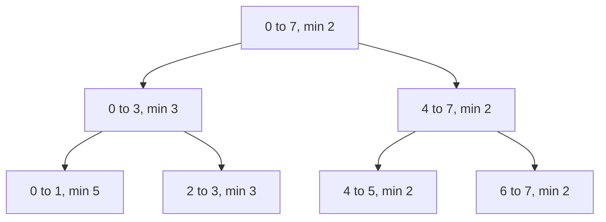

## The hook

A league of eight teams plays a knockout bracket. The bracket records not just the champion, but the winner of every sub-bracket: the left four, the right four, each pair. Now a journalist asks: of teams 2 through 7, who is strongest? The answer can be read from a handful of sub-bracket winners, without replaying a single match.

Fenwick trees handle sums with updates. As soon as the question is a minimum, a maximum, or "the first position where something holds", you need a structure that stores a summary for every segment. That is the segment tree, and for interviews you need three operations: build, point update and range query.

## The intuition

:::analogy
Each match in the bracket reports its winner upwards. The final knows the champion of all eight teams, each semi-final knows the champion of its four, each first-round match knows the better of its two. To answer "who is strongest among teams 2 to 7?", you collect the winners of the few sub-brackets that exactly cover teams 2 to 7 and compare them. If one team's form changes, only the matches on its path to the final need replaying.
:::

The bracket is a [[segment tree]]. Every node has a [[node segment]] [l, r] and stores a summary of a[l..r]. A [[combine function]] builds each parent from its two children: min for the strongest team, + for totals, max for "most rooms free". Any associative operation works.

The tree has n leaves and about log₂ n levels, so:

- an update walks from one leaf to the root: O(log n);
- a query visits O(log n) nodes, because the range is tiled by a few full segments.

## How it works

### Storage and the 4n rule

Use heap-style indexing: the root is node 1, node v has children 2v and 2v + 1. The root covers [0, n - 1], and a node covering [l, r] splits at mid = (l + r) / 2. There are 2n - 1 real nodes, but when n is not a power of two the numbering leaves gaps, and indices can go past 2n. Allocating 4n entries is always enough.

### Build

```
build(v, l, r):
    if l == r: t[v] = a[l]; return
    build(2v, l, mid); build(2v + 1, mid + 1, r)
    t[v] = combine(t[2v], t[2v + 1])
```

Each node is built once: O(n).

### Range query

```
query(v, l, r, ql, qr):
    if [l, r] is outside [ql, qr]: return identity      # 0 for sum, +inf for min
    if [l, r] is inside [ql, qr]: return t[v]
    return combine(query(left half), query(right half))
```

The nodes that return t[v] form the [[canonical decomposition]] of the query range. At each level, at most two nodes are partially covered and recurse further, so a query visits O(log n) nodes.

### Point update

Set the leaf, then recombine every ancestor on the way back up:

```
update(v, l, r, pos, val):
    if l == r: t[v] = val; return
    recurse into the half containing pos
    t[v] = combine(t[2v], t[2v + 1])
```

### Descending the tree: Hotel Queries

CSES *Hotel Queries* has hotels in a row with free rooms, and groups arrive in order; each group takes the first hotel from the left with enough rooms, or none. Store the maximum free rooms per segment. A [[tree descent]] from the root answers "first index with value ≥ x": if the left child's maximum is at least x, go left, otherwise go right. At the leaf, subtract the group's size, and fix the maxima on the way back up. Both steps are O(log n).

| Question | Node stores | Combine | Identity |
|---|---|---|---|
| Range sum with updates | sum | + | 0 |
| Range minimum | min | min | +∞ |
| Range maximum | max | max | -∞ |
| First index with value ≥ x | max | max | descend instead of querying |
| Count of zeros in a range | count | + | 0 |

When the update is "add d to a whole range", you need lazy propagation, which delays updates at internal nodes; it is covered in [A Tournament Bracket for Your Array](article:cp-segment-tree).



:::insight
Store a summary for every segment of a fixed halving of the array. Any range is tiled by O(log n) of those segments, and any single element sits under O(log n) of them, so both questions and changes touch only a logarithmic number of nodes.
:::

## Walk through an example

a = [5, 8, 6, 3, 2, 7, 2, 6], indices 0 to 7, storing minimums.

| Level | Segments and their minimum |
|---|---|
| root | [0, 7]: 2 |
| 1 | [0, 3]: 3, [4, 7]: 2 |
| 2 | [0, 1]: 5, [2, 3]: 3, [4, 5]: 2, [6, 7]: 2 |
| leaves | 5, 8, 6, 3, 2, 7, 2, 6 |

### Query min of [1, 6]

| Node | Relation to [1, 6] | Action |
|---|---|---|
| [0, 7] | partial | recurse |
| [0, 3] | partial | recurse |
| [0, 1] | partial | recurse: [0, 0] outside, [1, 1] inside → 8 |
| [2, 3] | inside | return 3 |
| [4, 7] | partial | recurse |
| [4, 5] | inside | return 2 |
| [6, 7] | partial | recurse: [6, 6] inside → 2, [7, 7] outside |

The canonical decomposition is [1, 1], [2, 3], [4, 5] and [6, 6], and the minimum is min(8, 3, 2, 2) = 2.

### Update a[4] = 9, then query again

The path from leaf 4 to the root is [4, 4], [4, 5], [4, 7], [0, 7]. Their minimums become 9, 7, 2 and 2. Querying [1, 6] now gives min(8, 3, 7, 2) = 2, from a[6]. Querying [1, 5] gives min(8, 3, 7) = 3.

### Hotel Queries

Free rooms [2, 5, 1, 4, 3]; groups of 3, 4, 2, 5 and 1 arrive in order.

| Group | Descent | Hotel (1-indexed) | Rooms after |
|---|---|---|---|
| 3 | left half max 5 ≥ 3, go left; first fit is hotel 2 | 2 | 2, 2, 1, 4, 3 |
| 4 | left half max 2 < 4, go right; first fit is hotel 4 | 4 | 2, 2, 1, 0, 3 |
| 2 | left half max 2 ≥ 2; hotel 1 | 1 | 0, 2, 1, 0, 3 |
| 5 | root max 3 < 5 | none, 0 | unchanged |
| 1 | left half max 2 ≥ 1; hotel 2 | 2 | 0, 1, 1, 0, 3 |

Output: 2 4 1 0 2.

:::try-this
For n = 6, which node indices does the recursive tree use, and what is the largest? (Root 1 covers [0, 5]; 2 covers [0, 2], 3 covers [3, 5]; 4 covers [0, 1], 5 covers [2, 2], 6 covers [3, 4], 7 covers [5, 5]; 8 and 9 are the leaves under 4, and 12 and 13 the leaves under 6. The largest index is 13, more than 2n = 12, which is why 2n slots are not enough and 4n is used.)
:::

:::warning
Common misconception: "A segment tree needs exactly 2n - 1 array slots." The tree has 2n - 1 nodes, but heap-style numbering with children 2v and 2v + 1 skips indices when n is not a power of two, as the n = 6 example shows. Allocating 2n crashes or corrupts memory on such inputs; 4n is the safe allocation for the recursive version.
:::

## The code

```pseudo
build(v, l, r)                                # t[v] = combine of children
update(v, l, r, pos, val)                     # leaf, then recombine ancestors
query(v, l, r, ql, qr)                        # identity outside, t[v] inside, else split
first_at_least(v, l, r, x):                   # tree stores max
    if t[v] < x: return none
    if l == r: return l
    if t[2v] >= x: return first_at_least(2v, l, mid, x)
    return first_at_least(2v + 1, mid + 1, r, x)
```

```cpp
#include <bits/stdc++.h>
using namespace std;

struct SegTree {                                         // range minimum, point assignment
    int n;
    vector<int> t;
    explicit SegTree(const vector<int>& a) : n(a.size()), t(4 * a.size(), INT_MAX) { build(1, 0, n - 1, a); }
    void build(int v, int l, int r, const vector<int>& a) {
        if (l == r) { t[v] = a[l]; return; }
        int m = (l + r) / 2;
        build(2 * v, l, m, a), build(2 * v + 1, m + 1, r, a);
        t[v] = min(t[2 * v], t[2 * v + 1]);
    }
    void update(int v, int l, int r, int pos, int val) {
        if (l == r) { t[v] = val; return; }
        int m = (l + r) / 2;
        if (pos <= m) update(2 * v, l, m, pos, val); else update(2 * v + 1, m + 1, r, pos, val);
        t[v] = min(t[2 * v], t[2 * v + 1]);
    }
    int query(int v, int l, int r, int ql, int qr) const {
        if (qr < l || r < ql) return INT_MAX;               // outside: identity for min
        if (ql <= l && r <= qr) return t[v];                // inside: stored answer
        int m = (l + r) / 2;
        return min(query(2 * v, l, m, ql, qr), query(2 * v + 1, m + 1, r, ql, qr));
    }
    void set(int pos, int val) { update(1, 0, n - 1, pos, val); }
    int minOf(int l, int r) const { return query(1, 0, n - 1, l, r); }
};

struct MaxTree {                                         // for Hotel Queries
    int n;
    vector<int> t;
    explicit MaxTree(const vector<int>& a) : n(a.size()), t(4 * a.size(), 0) { build(1, 0, n - 1, a); }
    void build(int v, int l, int r, const vector<int>& a) {
        if (l == r) { t[v] = a[l]; return; }
        int m = (l + r) / 2;
        build(2 * v, l, m, a), build(2 * v + 1, m + 1, r, a);
        t[v] = max(t[2 * v], t[2 * v + 1]);
    }
    int take(int v, int l, int r, int x) {               // first index with value >= x, reduce it by x
        if (t[v] < x) return -1;
        if (l == r) { t[v] -= x; return l; }
        int m = (l + r) / 2;
        int res = t[2 * v] >= x ? take(2 * v, l, m, x) : take(2 * v + 1, m + 1, r, x);
        t[v] = max(t[2 * v], t[2 * v + 1]);
        return res;
    }
};

int main() {
    SegTree st({5, 8, 6, 3, 2, 7, 2, 6});
    cout << st.minOf(1, 6) << ' ';
    st.set(4, 9);
    cout << st.minOf(1, 6) << ' ' << st.minOf(1, 5) << '\n';     // 2 2 3
    MaxTree hotels({2, 5, 1, 4, 3});
    for (int g : {3, 4, 2, 5, 1}) cout << hotels.take(1, 0, 4, g) + 1 << ' ';
    cout << '\n';                                                // 2 4 1 0 2
}
```

## Complexity

- **Build: O(n) time.**
- **Point update and range query: O(log n)** each.
- **Tree descent: O(log n),** one root-to-leaf path plus the fix-up on the way back.
- **Space: O(n),** allocated as 4n entries for the recursive layout.

## Common mistakes

- **Allocating 2n** for the recursive layout, which overflows when n is not a power of two.
- **Returning the wrong identity** for out-of-range nodes, such as 0 for a minimum query.
- **Forgetting to recombine** after an update, leaving stale summaries above the changed leaf.
- **Off-by-one on the split:** children are [l, mid] and [mid + 1, r]; using [mid, r] loops forever on two-element segments.
- **Using a segment tree for static sums,** where prefix sums are simpler and O(1) per query.
- **Range updates without lazy propagation,** which degrade to O(n) per update.

## Practice problems

*Range Sum Query - Mutable* is a sum tree, also solvable with a Fenwick tree from [A Pyramid of Savings Jars](article:dsa-fenwick-tree). *Dynamic Range Minimum Queries* is the min tree with point assignment. *Hotel Queries* is the descent on a max tree. For lazy propagation and contest-level variants, continue with [A Tournament Bracket for Your Array](article:cp-segment-tree), and for the halving idea behind it all, [Splitting a Big Job Between Two Teams, Again and Again](article:dsa-divide-and-conquer).

## Key takeaways

- A segment tree stores a summary such as the sum, minimum or maximum for every segment in a fixed halving of the array.
- A range query combines O(log n) nodes whose segments exactly tile the range, returning an identity value for nodes outside it.
- A point update changes one leaf and recombines its O(log n) ancestors.
- The recursive layout with children 2v and 2v + 1 needs up to 4n slots, because the numbering skips indices when n is not a power of two.
- Walking down from the root using the stored summaries finds positions such as the first value at least x in O(log n).
