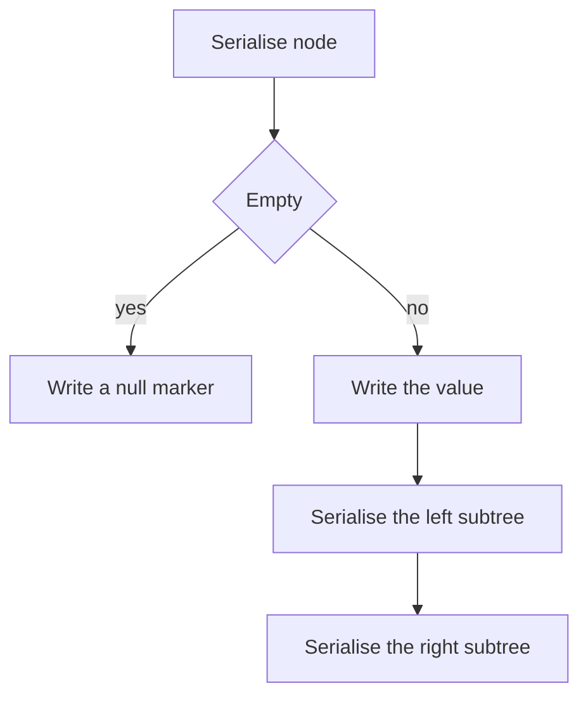

## The hook

A tree lives in memory as nodes connected by pointers. Pointers mean nothing on disk or across a network, so to save a tree to a file, send it to another server or cache it, you must turn it into a flat string, and later turn the string back into exactly the same tree.

That is [[serialisation]], and *Serialize and Deserialize Binary Tree* is a classic hard interview question because you design the format yourself. The trick that makes it simple is to write down the missing children too. The same encoding then doubles as a fingerprint for spotting identical subtrees.

## The problem

Write two functions: one that turns any binary tree into a string, and one that turns that string back into the same tree. Any format is allowed, as long as the round trip is exact.

```text
      1
     / \
    2   3
     \  / \
     4 5   6
```

| Encoding | String |
|---|---|
| preorder with null markers | 1,2,#,4,#,#,3,5,#,#,6,#,# |
| level order with null markers, trailing markers dropped | 1,2,3,#,4,5,6 |

## The obvious approach

Write the preorder and the inorder lists, then rebuild with the method from [Rebuilding a Family Tree From Two Lists](article:dsa-tree-construction). That works only if the values are distinct, and it stores two lists. With repeated values, such as a tree full of 1s, the inorder list cannot tell you where the root is.

## The key insight

:::analogy
Picture packing a hanging mobile into a box so someone else can rebuild it. You work from the top: write down the first item, then pack everything hanging from its left hook, then everything from its right hook. When a hook is empty, you write "empty" instead of leaving nothing. The person unpacking reads your list in order, hanging each item and filling hooks left before right; an "empty" note tells them to stop going down that side.
:::

Each "empty" note is a [[null marker]]. With markers, a single preorder traversal fixes the shape completely, because the reader always knows when a subtree is finished: it is finished exactly when both of its hooks have been closed.

- **Serialise:** preorder. Write the value, then serialise the left subtree, then the right; write # for an empty subtree. Separate [[token|tokens]] with commas, because values can have several digits or a minus sign.
- **[[Deserialisation|Deserialise]]:** read tokens in order with a shared position. A # means "empty, return null". Otherwise create a node, then build its left subtree from the following tokens, then its right subtree.

A binary tree with n nodes has n + 1 empty child slots, so the string has 2n + 1 tokens. Both directions touch each token once: O(n).

### The level-order alternative

LeetCode prints trees in level order: write the nodes level by level with # for missing children, then drop the trailing #s. To deserialise, use a queue: take the next node from the queue and give it the next two tokens as its left and right children, adding real children to the queue. It is a little longer to code but matches how trees are usually displayed.

### A BST needs no markers

For a binary search tree, the ordering rule tells the reader where each subtree ends. Serialise in preorder without markers, then rebuild with bounds, as in [Rebuilding a Family Tree From Two Lists](article:dsa-tree-construction). The string has only n tokens, which is what *Serialize and Deserialize BST* rewards.

### Serialisation as a fingerprint

The preorder encoding with markers is a [[canonical form]]: two subtrees get the same string exactly when they have the same shape and values. *Find Duplicate Subtrees* serialises every subtree bottom-up, counts the strings in a hash map, and reports a subtree the second time its string appears.



:::insight
Writing a marker for every missing child turns one traversal into a complete description of the tree, because the reader always knows when each subtree is finished. That makes serialisation one preorder pass and deserialisation one pass with a shared read position.
:::

## Walk through an example

### Serialising the tree above

| Visit | Writes | String so far |
|---|---|---|
| 1 | 1 | 1 |
| 2 | 2 | 1,2 |
| 2's left | # | 1,2,# |
| 4 | 4, then #, # for its children | 1,2,#,4,#,# |
| 3 | 3 | 1,2,#,4,#,#,3 |
| 5 | 5,#,# | ...,3,5,#,# |
| 6 | 6,#,# | 1,2,#,4,#,#,3,5,#,#,6,#,# |

Six nodes, seven markers, thirteen tokens.

### Deserialising it back

| Token | Action | Waiting to be filled |
|---|---|---|
| 1 | create 1; build its left | 1's left, then 1's right |
| 2 | create 2 as 1's left; build its left | 2's left, 2's right, 1's right |
| # | 2's left is empty | 2's right, 1's right |
| 4 | create 4 as 2's right | 4's left, 4's right, 1's right |
| #, # | 4 is a leaf; 2 is complete | 1's right |
| 3 | create 3 as 1's right | 3's left, 3's right |
| 5, #, # | 5 is 3's left leaf | 3's right |
| 6, #, # | 6 is 3's right leaf; done | nothing |

In mobile terms, each # closed an empty hook, and the reader always knew which hook came next.

### Finding duplicate subtrees

For the tree 5 with left child 3 (left child 1) and right child 7 (left child 3 with its own left child 1, right child 1), the bottom-up encodings include "1,#,#" three times and "3,1,#,#,#" twice. So the duplicate subtrees are rooted at a 1 and at a 3, each reported once.

:::try-this
Write the preorder-with-markers encoding of a root 7 whose only child is a right child 8. Then of a root 7 whose only child is a left child 8. (Right child: 7,#,8,#,#. Left child: 7,8,#,#,#. The two strings differ, which is exactly why the markers are needed.)
:::

:::warning
Common misconception: "Separate tokens? Just concatenate the digits." Without delimiters, the string "123" could be one node 123, or 1 and 23, or 12 and 3. Use a delimiter such as a comma, and remember values can be negative, so the parser must handle a leading minus sign.
:::

## The code

```pseudo
serialise(node, out):
    if node is empty: out.append("#"); return
    out.append(node.value)
    serialise(node.left, out); serialise(node.right, out)

deserialise(tokens):
    pos = 0
    build():
        t = tokens[pos]; pos += 1
        if t == "#": return empty
        node = new node(t)
        node.left = build(); node.right = build()
        return node
    return build()
```

```cpp
#include <bits/stdc++.h>
using namespace std;

struct Node {
    int val;
    Node *left = nullptr, *right = nullptr;
    Node(int v, Node* l = nullptr, Node* r = nullptr) : val(v), left(l), right(r) {}
};

void ser(Node* n, string& out) {
    if (!out.empty()) out += ',';
    if (!n) { out += '#'; return; }                      // an empty hook
    out += to_string(n->val);
    ser(n->left, out), ser(n->right, out);
}

Node* deser(const string& s) {
    vector<string> tok;
    stringstream ss(s);
    for (string t; getline(ss, t, ',');) tok.push_back(t);
    size_t pos = 0;
    function<Node*()> build = [&]() -> Node* {
        const string& t = tok[pos++];
        if (t == "#") return nullptr;
        Node* n = new Node(stoi(t));                    // stoi handles a leading minus
        n->left = build();
        n->right = build();
        return n;
    };
    return build();
}

string levelOrder(Node* root) {                          // LeetCode-style, trailing markers dropped
    vector<string> out;
    queue<Node*> q;
    q.push(root);
    while (!q.empty()) {
        Node* n = q.front(); q.pop();
        if (!n) { out.push_back("#"); continue; }
        out.push_back(to_string(n->val));
        q.push(n->left), q.push(n->right);
    }
    while (!out.empty() && out.back() == "#") out.pop_back();
    string s;
    for (size_t i = 0; i < out.size(); i++) s += (i ? "," : "") + out[i];
    return s;
}

string keyOf(Node* n, unordered_map<string, int>& seen, vector<int>& dups) {
    if (!n) return "#";
    string k = to_string(n->val) + "," + keyOf(n->left, seen, dups) + "," + keyOf(n->right, seen, dups);
    if (++seen[k] == 2) dups.push_back(n->val);         // report a shape the second time it appears
    return k;
}

int main() {
    Node* t = new Node(1, new Node(2, nullptr, new Node(4)), new Node(3, new Node(5), new Node(6)));
    string s;
    ser(t, s);
    cout << s << '\n';                                  // 1,2,#,4,#,#,3,5,#,#,6,#,#
    string back;
    ser(deser(s), back);
    cout << (back == s) << ' ' << levelOrder(t) << '\n';   // 1 1,2,3,#,4,5,6
    Node* neg = new Node(-7, nullptr, new Node(12));
    string sn;
    ser(neg, sn);
    cout << sn << ' ' << deser(sn)->right->val << '\n';    // -7,#,12,#,# 12

    Node* d = new Node(5, new Node(3, new Node(1)), new Node(7, new Node(3, new Node(1)), new Node(1)));
    unordered_map<string, int> seen;
    vector<int> dups;
    keyOf(d, seen, dups);
    sort(dups.begin(), dups.end());
    for (int v : dups) cout << v << ' ';
    cout << '\n';                                        // 1 3
}
```

The round-trip test serialises, deserialises and serialises again, and checks the two strings match, which is a simple way to test any serialiser. The negative-value test checks that the parser handles a minus sign.

## Complexity

- **Serialise and deserialise: O(n) time** each, with 2n + 1 tokens for n nodes, and O(n) space for the string plus O(h) recursion.
- **BST without markers: O(n) time,** n tokens, using the bounds method to rebuild.
- **Find Duplicate Subtrees with string keys: O(n²)** in the worst case, because the keys themselves can be long. Replacing each subtree's string with a small integer id, assigned through a map from (value, left id, right id), brings it to O(n) expected.

## Common mistakes

- **Leaving out null markers,** which makes different shapes produce the same string.
- **No delimiter between tokens,** so multi-digit and negative values become ambiguous.
- **Rebuilding the right subtree before the left** when the encoding was written left first.
- **Using a fresh position in each recursive call** instead of one shared read position.
- **Very deep trees overflowing the recursion,** for example a chain of 10⁵ nodes; an iterative version with an explicit stack, or the level-order format, avoids it.
- **Trusting string keys to be cheap** in Find Duplicate Subtrees on large trees.

## Practice problems

*Construct String from Binary Tree* is a warm-up: a preorder encoding with brackets that omits unnecessary empty pairs. *Serialize and Deserialize Binary Tree* is the walkthrough. *Serialize and Deserialize BST* drops the markers by using the ordering rule. *Find Duplicate Subtrees* uses the encoding as a key in a hash map.

## Key takeaways

- Serialising a binary tree in preorder with a marker for every missing child describes its shape exactly, so one traversal is enough.
- Deserialisation reads the tokens in the same order with one shared position: a marker returns null, and a value creates a node and builds its left subtree then its right subtree.
- A tree with n nodes has n + 1 empty child slots, so the encoding has 2n + 1 tokens and both directions take O(n) time.
- Tokens need a delimiter so that multi-digit and negative values are unambiguous.
- Because the encoding is canonical, equal strings mean identical subtrees, which turns duplicate-subtree detection into hash-map counting.
