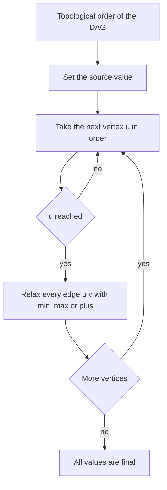

## The hook

Rain falls on a hillside crossed by channels. Water only flows downhill, so it can never come back to a spot it has left. To know the cheapest way for water to reach the valley floor, you could simply work from the top of the hill down, one level at a time, and at each spot you would already know everything about the spots above it.

Graphs with no cycles behave exactly like that hillside. Dijkstra needs non-negative weights, Bellman-Ford needs V rounds, but on a DAG one pass in the right order is enough for shortest paths, longest paths and path counts, with any edge weights at all.

## The intuition

:::analogy
Water on the hillside never flows uphill. So if you visit spots from the highest to the lowest, by the time you reach a spot, every channel that can feed it has already been visited, and its best route is settled. You simply look at each channel leaving the spot and tell the spot below: "here is a route to you through me". Nothing can arrive later and change the answer, because nothing below can send water back up.
:::

"Highest to lowest" is a topological order, from [Socks Before Shoes](article:dsa-topological-sort). Processing vertices in that order and relaxing every outgoing edge is [[DAG relaxation]]. When a vertex is processed, all its predecessors are done, so its distance is final. Each edge is relaxed exactly once: O(V + E).

Because no distance is ever revised, the sign of the weights does not matter. And because a DAG has no cycles, every path is automatically simple, so the same loop with max instead of min gives the [[longest path]], a problem that is very hard on general graphs.

## How it works

### One loop, three answers

Initialise the source, then for each vertex u in topological order, for each edge u → v of weight w:

| Goal | Start value | Update |
|---|---|---|
| Shortest path | dist[src] = 0, others ∞ | dist[v] = min(dist[v], dist[u] + w) |
| Longest path | best[src] = 0, others -∞ | best[v] = max(best[v], best[u] + w) |
| [[Path counting]] | ways[src] = 1, others 0 | ways[v] += ways[u] |

Skip vertices whose value is still the "unreached" start value, so that -∞ or ∞ never leaks into sums. Record a parent on each improvement to rebuild the path.

### Memoised DFS: the same DP from the other end

Instead of an explicit topological order, write a recursive function best(u) = the answer for paths starting at u, which calls best(v) for each edge u → v and stores the result. This [[memoised DFS]] computes each vertex once and each edge once, so it is also O(V + E). It is the natural style when the graph is implicit.

### Implicit DAGs: Longest Increasing Path in a Matrix

In *Longest Increasing Path in a Matrix*, you may move up, down, left or right to a strictly larger value, and want the longest path. Strictly increasing values mean a path can never return to a cell, so the moves form an [[implicit DAG]]. Memoised DFS gives lip(r, c) = 1 + the largest lip of any larger neighbour, and the answer is the largest lip over all cells. No visited array is needed for cycles, because there are none.

### Longest Flight Route and Game Routes

CSES *Longest Flight Route* asks for the route from city 1 to city n that visits the most cities, and the route itself, in a flight network with no cycles. Run longest path with every edge of weight 1, starting only from city 1, and print IMPOSSIBLE if n is never reached. *Game Routes* counts the routes from 1 to n modulo 10⁹ + 7 with the ways update.

### Why this fails with cycles

If the graph has a cycle, there is no topological order, and Kahn's algorithm leaves the cycle's vertices out. Running the loop anyway silently ignores them. Longest path with a positive cycle is unbounded, and shortest path with a negative cycle is too, which is why Bellman-Ford exists. Always confirm the graph is a DAG, or that the problem guarantees it.



:::insight
In topological order, every vertex is processed after everything that can reach it, so one relaxation per edge settles all distances. That single fact makes shortest paths with negative weights, longest paths and path counts all linear-time on a DAG.
:::

## Walk through an example

A DAG with vertices 0 to 5 and weighted edges 0 → 1 (3), 0 → 2 (6), 1 → 2 (-2), 1 → 3 (4), 2 → 3 (1), 2 → 4 (5), 3 → 4 (-3), 3 → 5 (2), 4 → 5 (4). Topological order: 0, 1, 2, 3, 4, 5. Source 0.

| Process | Shortest after relaxing its edges | Longest after relaxing its edges | Ways after |
|---|---|---|---|
| 0 | 1 = 3, 2 = 6 | 1 = 3, 2 = 6 | 1: 1, 2: 1 |
| 1 | 2 = min(6, 3 - 2) = 1, 3 = 7 | 2 stays 6, 3 = 7 | 2: 2, 3: 1 |
| 2 | 3 = min(7, 2) = 2, 4 = 6 | 3 = max(7, 7) = 7, 4 = 11 | 3: 3, 4: 2 |
| 3 | 4 = min(6, -1) = -1, 5 = 4 | 4 stays 11, 5 = 9 | 4: 5, 5: 3 |
| 4 | 5 = min(4, 3) = 3 | 5 = max(9, 15) = 15 | 5: 8 |
| 5 | | | |

Final values:

| Vertex | 0 | 1 | 2 | 3 | 4 | 5 |
|---|---|---|---|---|---|---|
| Shortest | 0 | 3 | 1 | 2 | -1 | 3 |
| Longest | 0 | 3 | 6 | 7 | 11 | 15 |
| Number of paths | 1 | 1 | 2 | 3 | 5 | 8 |

The shortest route to 5 is 0 → 1 → 2 → 3 → 4 → 5, costing 3 - 2 + 1 - 3 + 4 = 3, and it uses both negative edges. The longest is 0 → 2 → 4 → 5, worth 6 + 5 + 4 = 15. The path counts grow like Fibonacci numbers because each vertex here is reached from the two before it.

### Longest increasing path in a spiral

```
7 8 9
6 1 2
5 4 3
```

| lip values | c0 | c1 | c2 |
|---|---|---|---|
| r0 | 3 | 2 | 1 |
| r1 | 4 | 9 | 8 |
| r2 | 5 | 6 | 7 |

The centre, 1, starts a path through every cell: 1, 2, 3, 4, 5, 6, 7, 8, 9, so the answer is 9. The 9 itself has lip 1, since nothing is larger. Each value was computed once, from its larger neighbours.

:::try-this
In the weighted DAG, change the edge 3 → 4 from -3 to 6. What are the new shortest and longest distances to 5? (Shortest: 4 is now min(6, 2 + 6) = 6 through 2, and 5 = min(2 + 2, 6 + 4) = 4 through 3. Longest: 4 = max(11, 7 + 6) = 13, so 5 = max(7 + 2, 13 + 4) = 17, along 0 → 1 → 3 → 4 → 5 or 0 → 2 → 3 → 4 → 5, both worth 7 + 6 + 4.)
:::

:::warning
Common misconception: "Longest path is just shortest path with negated weights, so Dijkstra solves it." Negating creates negative edges, which Dijkstra cannot handle, and on graphs with cycles it creates negative cycles. Negation works only together with an algorithm that tolerates negative weights, and on a DAG the simplest such algorithm is topological-order relaxation with max.
:::

## The code

```pseudo
dag_paths(n, edges, src):
    order = topological_order(n, edges)
    dist = [inf] * n; best = [-inf] * n; ways = [0] * n
    dist[src] = 0; best[src] = 0; ways[src] = 1
    for u in order:
        if ways[u] == 0: continue             # not reachable from src
        for (v, w) in adj[u]:
            dist[v] = min(dist[v], dist[u] + w)
            best[v] = max(best[v], best[u] + w)
            ways[v] += ways[u]

lip(r, c):                                    # memoised DFS on an implicit DAG
    if memo[r][c]: return memo[r][c]
    memo[r][c] = 1 + max(lip(neighbour) for larger neighbours, or 0)
    return memo[r][c]
```

```cpp
#include <bits/stdc++.h>
using namespace std;
using ll = long long;
const ll INF = LLONG_MAX / 4;

struct DagPaths {
    vector<ll> shortest, longest, ways;
    DagPaths(int n, const vector<array<int, 3>>& edges, int src)
        : shortest(n, INF), longest(n, -INF), ways(n, 0) {
        vector<vector<pair<int, int>>> adj(n);
        vector<int> indeg(n, 0), order;
        for (auto& [u, v, w] : edges) adj[u].push_back({v, w}), indeg[v]++;
        queue<int> q;
        for (int v = 0; v < n; v++) if (!indeg[v]) q.push(v);
        while (!q.empty()) {                                   // Kahn's topological order
            int u = q.front(); q.pop();
            order.push_back(u);
            for (auto [v, w] : adj[u]) if (--indeg[v] == 0) q.push(v);
        }
        shortest[src] = longest[src] = 0, ways[src] = 1;
        for (int u : order) {
            if (!ways[u]) continue;                            // unreachable from src
            for (auto [v, w] : adj[u]) {
                shortest[v] = min(shortest[v], shortest[u] + w);
                longest[v] = max(longest[v], longest[u] + w);
                ways[v] += ways[u];
            }
        }
    }
};

int longestIncreasingPath(const vector<vector<int>>& m) {
    int R = m.size(), C = m[0].size(), best = 0;
    vector<vector<int>> memo(R, vector<int>(C, 0));
    int dr[] = {1, -1, 0, 0}, dc[] = {0, 0, 1, -1};
    function<int(int, int)> lip = [&](int r, int c) {
        if (memo[r][c]) return memo[r][c];
        int b = 1;
        for (int k = 0; k < 4; k++) {
            int a = r + dr[k], d = c + dc[k];
            if (a >= 0 && d >= 0 && a < R && d < C && m[a][d] > m[r][c]) b = max(b, 1 + lip(a, d));
        }
        return memo[r][c] = b;
    };
    for (int r = 0; r < R; r++)
        for (int c = 0; c < C; c++) best = max(best, lip(r, c));
    return best;
}

int main() {
    vector<array<int, 3>> e = {{0, 1, 3}, {0, 2, 6}, {1, 2, -2}, {1, 3, 4}, {2, 3, 1},
                               {2, 4, 5}, {3, 4, -3}, {3, 5, 2}, {4, 5, 4}};
    DagPaths d(6, e, 0);
    for (ll x : d.shortest) cout << x << ' ';
    cout << '\n';                                              // 0 3 1 2 -1 3
    for (ll x : d.longest) cout << x << ' ';
    cout << '\n';                                              // 0 3 6 7 11 15
    for (ll x : d.ways) cout << x << ' ';
    cout << '\n';                                              // 1 1 2 3 5 8
    cout << longestIncreasingPath({{7, 8, 9}, {6, 1, 2}, {5, 4, 3}}) << '\n';   // 9
}
```

The reachability check `if (!ways[u])` does double duty: an unreached vertex has no paths, so its infinite shortest and longest values are never added to.

## Complexity

- **DAG relaxation: O(V + E) time,** one topological sort and one relaxation per edge; O(V + E) space.
- **Memoised DFS: O(V + E)** as well, with recursion depth up to the longest path; on a 200 × 200 matrix that can reach 40,000 nested calls, usually fine, but an iterative order by value avoids the risk.
- **Compared with general graphs:** Bellman-Ford needs O(V × E) for negative weights, and longest simple path on general graphs has no known efficient algorithm.

## Common mistakes

- **Running the loop on a graph with cycles,** where some vertices never enter the order.
- **Relaxing from unreached vertices,** which adds weights to ±∞ and can overflow.
- **Using Dijkstra with negated weights** for longest paths.
- **Forgetting the modulus** when counting paths, as in Game Routes, where counts grow exponentially.
- **Adding a visited array for cycles** in Longest Increasing Path, which is unnecessary, and wrong if it blocks cells from being reused as parts of different paths.

## Practice problems

*Longest Flight Route* is longest path with weight 1 per flight and path reconstruction. *Game Routes* is path counting modulo a prime. *Longest Increasing Path in a Matrix* is memoised DFS on an implicit DAG. *Parallel Courses III* is the critical-path version, where each vertex has a duration. The order itself comes from [Socks Before Shoes](article:dsa-topological-sort), and the DP mindset from [Dynamic Programming Is Just Careful Recursion](article:dsa-dp-intro).

## Key takeaways

- On a DAG, processing vertices in topological order and relaxing each outgoing edge once finalises every shortest distance in O(V + E).
- Negative edge weights are fine on a DAG, because each vertex is processed only after all its predecessors are final.
- Replacing min with max gives longest paths, and replacing relaxation with addition counts paths, using the same loop.
- Memoised DFS is the same dynamic program written recursively, and it suits implicit DAGs such as strictly increasing moves in a matrix.
- The method depends on the graph having no cycles, so confirm that before using it.
