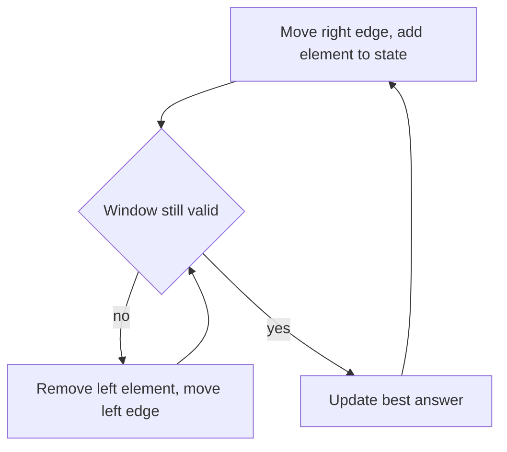

## The hook

"Find the longest substring without repeating characters." A brute force checks every substring: about n²/2 of them, each checked for repeats. On a string of 100,000 characters, that is billions of steps.

There is a way to read the string once, left to right, keeping only a small summary of what is currently "in view". Each character is added once and removed at most once. The billions become a hundred thousand.

## The intuition

:::analogy
Picture a caterpillar crawling along a branch. Its head stretches forward to eat the next leaf. When its body is too long or holds something it should not, its tail pulls in. The caterpillar never crawls backward, and at every moment it covers one unbroken stretch of the branch.
:::

That stretch is the [[window]]: everything between a left index (the tail) and a right index (the head). You keep a [[window state]], like a running sum or a count of each character, and update it as elements enter at the head and leave at the tail. Because the caterpillar only moves forward, the work is linear.

The cue in the problem statement is almost always the same: a **contiguous** subarray or substring, plus "longest", "shortest", "at most", or "exactly k".

## How it works

### Fixed-size window

When the window always holds exactly k elements, slide it one step at a time: add the new element on the right, remove the old one on the left. A [[fixed-size window]] sum costs O(1) per step instead of O(k).

### Variable-size window

A [[variable-size window]] follows one loop shape:



- **Longest valid window:** grow the right edge every step; shrink from the left while the window breaks the rule; then record the length.
- **Shortest valid window:** grow until the window becomes valid; then shrink while it stays valid, recording the length at each step.

:::insight
A sliding window works when validity is monotonic: if a window is invalid, every bigger window containing it is also invalid. That is what makes it safe to throw away the left elements for good. Check this property before you commit to the pattern.
:::

### "Exactly k" is two "at most" windows

Some problems ask for the number of subarrays with **exactly** k distinct values. Exactly-k windows are not monotonic, but at-most-k windows are. The trick: count subarrays with at most k distinct values, subtract those with at most k − 1, and what remains has exactly k.

For each right edge, every window ending there with its left end anywhere from `left` to `right` is valid, because shrinking a valid window keeps it valid. So you add `right - left + 1` to the count in one step. For `[1, 2, 1, 2, 3]`, there are 12 subarrays with at most 2 distinct values and 5 with at most 1, so 12 − 5 = 7 have exactly 2.

### Choosing the window state

The state is whatever lets you answer "is the window valid?" in O(1) after each change:

| Problem shape | State | Valid when |
|---|---|---|
| sum at least or at most a target, non-negative values | running sum | compare the sum |
| no repeated characters | last index per character, or counts | no count above 1 |
| at most k zeros, or k replacements | count of the bad elements | count ≤ k |
| at most k distinct values | hash map of counts plus its size | size ≤ k |
| window contains every needed character | need counts plus a "missing" counter | missing = 0 |
| fixed window matching an anagram | 26 counts plus a "matches" counter | all 26 counts agree |

## Walk through an example

Longest substring without repeating characters in `"abcabcbb"`. State: the last index where each character was seen. Rule: no character twice in the window.

| right | char | Repeat inside window? | left after fix | Window | Best |
|---|---|---|---|---|---|
| 0 | a | no | 0 | a | 1 |
| 1 | b | no | 0 | ab | 2 |
| 2 | c | no | 0 | abc | 3 |
| 3 | a | yes, a at 0 | 1 | bca | 3 |
| 4 | b | yes, b at 1 | 2 | cab | 3 |
| 5 | c | yes, c at 2 | 3 | abc | 3 |
| 6 | b | yes, b at 4 | 5 | cb | 3 |
| 7 | b | yes, b at 6 | 7 | b | 3 |

Answer: 3. Notice the shortcut: instead of removing characters one by one, we can jump `left` straight past the previous occurrence, as long as we never move it backward.

### A shortest window: smallest subarray with sum at least 7

For `[2, 3, 1, 2, 4, 3]`, grow the head until the sum reaches 7, then pull in the tail as long as the sum stays at least 7, recording the length each time.

| right | Sum after adding | Valid windows recorded while shrinking | Best |
|---|---|---|---|
| 0 to 2 | 2, 5, 6 | none yet | none |
| 3 | 8 | [2, 3, 1, 2] length 4 | 4 |
| 4 | 10 | [3, 1, 2, 4] length 4, then [1, 2, 4] length 3 | 3 |
| 5 | 9 | [2, 4, 3] length 3, then [4, 3] length 2 | 2 |

The answer is 2. The caterpillar stretched to find a valid stretch, then squeezed it as short as it could before stretching again.

### At most k zeros: Max Consecutive Ones III

For `[1, 1, 1, 0, 0, 0, 1, 1, 1, 1, 0]` with k = 2, the state is the number of zeros in the window. The window grows to `[1, 1, 1, 0, 0]` (length 5). The third zero at index 5 makes it invalid, so the tail moves past index 3, the first zero. Later the window `[0, 0, 1, 1, 1, 1]` from index 4 to 9 reaches length 6, which is the answer.

:::try-this
Use a fixed window of size 3 on `[2, 1, 5, 1, 3, 2]` to find the largest sum. Start with 2 + 1 + 5 = 8, then each step add the new number and subtract the one leaving. You should see sums 8, 7, 9, 6, so the answer is 9.
:::

## The code

```pseudo
longest_without_repeat(s):
    last = map from character to last index seen
    left = 0, best = 0
    for right in 0 .. len(s)-1:
        c = s[right]
        if c in last and last[c] >= left:
            left = last[c] + 1          // jump past the repeat
        last[c] = right
        best = max(best, right - left + 1)
    return best
```

```cpp
#include <bits/stdc++.h>
using namespace std;

int longestWithoutRepeat(const string& s) {
    vector<int> last(256, -1);
    int left = 0, best = 0;
    for (int right = 0; right < (int)s.size(); right++) {
        unsigned char c = s[right];
        if (last[c] >= left) left = last[c] + 1;
        last[c] = right;
        best = max(best, right - left + 1);
    }
    return best;
}

int maxSumFixed(const vector<int>& a, int k) {
    long long sum = 0, best;
    for (int i = 0; i < k; i++) sum += a[i];
    best = sum;
    for (int i = k; i < (int)a.size(); i++) {
        sum += a[i] - a[i - k];
        best = max(best, sum);
    }
    return (int)best;
}

int minLenAtLeast(const vector<int>& a, int target) {        // shortest window, non-negative values
    int best = INT_MAX, left = 0;
    long long sum = 0;
    for (int right = 0; right < (int)a.size(); right++) {
        sum += a[right];
        while (sum >= target) {                               // record while still valid, then shrink
            best = min(best, right - left + 1);
            sum -= a[left++];
        }
    }
    return best == INT_MAX ? 0 : best;
}

long long atMostKDistinct(const vector<int>& a, int k) {
    unordered_map<int, int> cnt;
    long long res = 0;
    for (int left = 0, right = 0; right < (int)a.size(); right++) {
        cnt[a[right]]++;
        while ((int)cnt.size() > k)
            if (--cnt[a[left++]] == 0) cnt.erase(a[left - 1]);
        res += right - left + 1;                              // every window ending at right
    }
    return res;
}

string minWindow(const string& s, const string& t) {
    vector<int> need(128, 0);
    for (char c : t) need[c]++;
    int missing = t.size(), left = 0, bestL = 0, bestLen = INT_MAX;
    for (int right = 0; right < (int)s.size(); right++) {
        if (need[s[right]]-- > 0) missing--;                  // a needed character arrived
        while (missing == 0) {
            if (right - left + 1 < bestLen) bestLen = right - left + 1, bestL = left;
            if (++need[s[left++]] > 0) missing++;             // a needed character left
        }
    }
    return bestLen == INT_MAX ? "" : s.substr(bestL, bestLen);
}

int main() {
    cout << longestWithoutRepeat("abcabcbb") << '\n';                          // 3
    cout << maxSumFixed({2, 1, 5, 1, 3, 2}, 3) << '\n';                        // 9
    cout << minLenAtLeast({2, 3, 1, 2, 4, 3}, 7) << '\n';                      // 2
    vector<int> b = {1, 2, 1, 2, 3};
    cout << atMostKDistinct(b, 2) - atMostKDistinct(b, 1) << '\n';             // 7
    cout << minWindow("ADOBECODEBANC", "ABC") << '\n';                         // BANC
}
```

## Complexity

- **Time:** O(n). The right edge visits each element once, and the left edge only moves forward, so it visits each element at most once in total. The nested `while` is [[amortised]] O(1) per step.
- **Space:** O(k), where k is the size of the window state: 256 counters for characters, or a hash map of distinct values in the window.

## Common mistakes

:::warning
Common misconception: "every subarray problem is a sliding window." The pattern needs monotonic validity. With negative numbers, "shortest subarray with sum at least k" breaks it, because shrinking can raise the sum. That problem needs prefix sums plus a monotonic deque instead.
:::

- **Shrinking with `if` instead of `while`.** One new element can require removing several.
- **Moving `left` backward** when jumping past a repeat. Only jump if the repeat is inside the current window (`last[c] >= left`).
- **Updating the answer at the wrong moment.** For "longest", record after fixing the window; for "shortest", record while it is still valid, before shrinking further.
- **Forgetting to undo state** when an element leaves: decrement its count, subtract it from the sum.
- **Rechecking validity by scanning the window,** which makes each step O(k). Keep a counter such as "missing characters" so validity is O(1).
- **Trying to count "exactly k" directly.** Use at most k minus at most k − 1.

## Practice problems

Start with *Maximum Average Subarray I* for the fixed window. *Longest Substring Without Repeating Characters* is the walkthrough above. *Max Consecutive Ones III* is "longest window with at most k zeros". *Permutation in String* is a fixed window compared with character counts. *Minimum Size Subarray Sum* is the shortest-window shape on numbers, traced above.

*Minimum Window Substring* is the classic shortest-window problem on strings and a favourite at top companies; the code above uses a single `missing` counter so validity is checked in O(1). For counting windows, try *Subarrays with K Different Integers* on LeetCode with the at-most trick.

## Key takeaways

- A sliding window keeps a summary of a contiguous stretch and updates it as elements enter on the right and leave on the left.
- Fixed windows slide one step at a time; variable windows grow on the right and shrink on the left while the window is invalid, or, for shortest windows, while it stays valid.
- Each element enters once and leaves at most once, so the whole scan is O(n) even with a nested while loop.
- The pattern needs monotonic validity: if a window is invalid, every larger window containing it is invalid too.
- Contiguous plus longest, shortest or at most k is the cue; negative numbers are the warning sign to switch to prefix sums.
