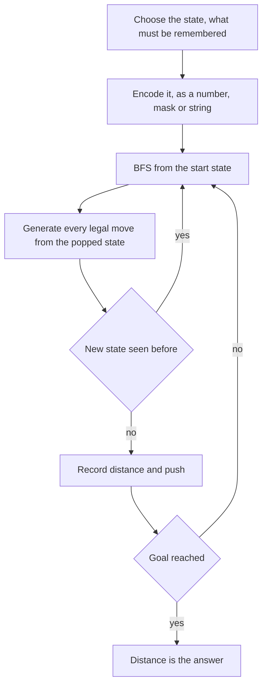

## The hook

A child plays Snakes and Ladders and wonders: if I could choose every roll, how few turns would it take to win? Each roll leads to up to six squares, ladders throw you forward, snakes drag you back. After one roll you are on one of six squares; after two rolls, on one of a few dozen.

Those growing sets of squares are BFS layers. The same picture solves puzzles that look nothing like a board game: a robot collecting keys, a sliding tile puzzle, a combination lock. In each one, the art is deciding what a "square" really is.

## The problem

*Snakes and Ladders* gives an n × n board whose squares are numbered 1 to n² starting at the bottom-left, with rows alternating direction. Each cell holds -1, or the destination of a snake or ladder that starts there. From square s you choose a roll of 1 to 6, move to s + roll (not past n²), and if that square has a snake or ladder you must take it, once. Return the fewest rolls to reach n², or -1.

On the 4 × 4 board below, with ladders 3 → 10 and 8 → 14 and snakes 12 → 2 and 15 → 5, the answer is 2.

```
16 15 14 13
 9 10 11 12
 8  7  6  5
 1  2  3  4
```

## The obvious approach

Simulate greedily: always take the biggest roll, or the roll that lands on a ladder. Greedy fails easily: the biggest roll may land on a snake, and a smaller roll onto a ladder may beat several big ones. Trying every sequence of rolls is 6 to the power of the number of rolls.

The real trap is quieter: reading board[r][c] for square s. The input array has row 0 at the top, while square 1 is at the bottom-left, and every second row runs backwards. Most wrong answers on this problem come from that conversion, not from the search.

## The key insight

:::analogy
Picture every square you could possibly be on after one roll, lit up on the board. Now light up every square you could be on after two rolls, skipping squares already lit, and so on, ring after ring. The first ring that lights the final square tells you the fewest rolls. Snakes and ladders do not change the idea; they just teleport a lit square somewhere else before it joins the ring.
:::

Each square is a vertex; each roll is an edge of cost one, after following any snake or ladder. BFS from square 1 finds the fewest rolls, as in [Ripples on a Pond: Breadth-First Search](article:dsa-bfs). The only special work is converting square numbers to array positions under [[boustrophedon numbering]]:

- q = (s - 1) / n is the row from the bottom, so the array row is n - 1 - q;
- rem = (s - 1) % n is the position within that row;
- the column is rem when q is even (left to right), and n - 1 - rem when q is odd.

### Beyond boards: BFS over states

Many puzzles are BFS on a [[state graph]]: each vertex is a full description of the position, and each edge is one move.

| Puzzle | State | Moves per state | Number of states |
|---|---|---|---|
| Snakes and Ladders | square number | up to 6 | n² |
| Open the Lock | four-digit string | 8 | 10,000 |
| Shortest Path to Get All Keys | (row, column, keys held) | 4 | R × C × 2^K |
| Sliding Puzzle on 2 × 3 | arrangement as a string | 2 or 3 | 720 |

### Keys as a bitmask

In *Shortest Path to Get All Keys*, a grid has walls, keys a to f and locks A to F; a lock opens only if you hold its key. Standing on a cell with key a is a different situation from standing there without it, so the state must include the keys. With at most six keys, a [[key bitmask]] of 6 bits holds them: picking up key i sets bit i, and a lock is passable when its bit is set. BFS over (row, column, mask) stops at the first state whose mask has every key.

### Sliding Puzzle as strings

*Sliding Puzzle* is a 2 × 3 board with tiles 1 to 5 and a blank. A move slides a neighbouring tile into the blank. Write the board as a string such as "123450", precompute which positions are adjacent to each position, and BFS over strings.

There are only 6! = 720 arrangements, so the search is instant. Half of them can never reach the goal, because of a [[parity invariant]]: no move changes a certain parity of the arrangement, and BFS discovers that by simply running out of states and returning -1.



:::insight
A puzzle becomes a shortest-path problem once you write down exactly what a position is. If every move costs the same, BFS over those positions gives the fewest moves, and the size of the state space tells you immediately whether that is fast enough.
:::

## Walk through an example

### Snakes and Ladders on the 4 × 4 board

Ladders 3 → 10 and 8 → 14, snakes 12 → 2 and 15 → 5.

| Rolls | Squares reached for the first time |
|---|---|
| 0 | 1 |
| 1 | 2, 4, 5, 6, 7, 10 (rolling 2 lands on 3 and climbs to 10) |
| 2 | 9, 11, 13, 14, 16 |

Square 16 is reached in 2 rolls: roll 2 from square 1, land on 3, climb to 10; then roll 6 from 10 to 16. Rolling 1 from square 7 onto 8 also climbs to 14, but that takes two rolls to reach 14 rather than to finish. Rolling onto 12 or 15 slides you back down, and BFS never prefers those squares because they are discovered no earlier than where they lead.

The ladder at 3 sits in array row 3 (the bottom), column 2; the snake at 12 sits in array row 1, column 3, because square 12 ends the third row from the bottom, which runs left to right, while the ladder at 8 sits in array row 2, column 0, at the left end of a row that runs right to left.

### Keys

```
@ . . A . b
. # . # # #
a . . . . .
```

Start at @, key a in the bottom-left, lock A blocking the only way to key b.

| Phase | Path | Steps |
|---|---|---|
| Get a | down twice to (2, 0) | 2 |
| To the lock | back up, right along the top to A at (0, 3), now open | 5 more, total 7 |
| Get b | (0, 4), then (0, 5) | 2 more, total 9 |

BFS returns 9. Before picking up key a, the state (0, 2, no keys) cannot step onto A; after, the state (0, 2, mask with a) can. They are different vertices, which is exactly why the mask is in the state.

### Sliding Puzzle

| Start | Fewest moves to "123450" |
|---|---|
| "123045" | 2 (slide 4 left, then 5 left) |
| "312450" | 14 |
| "123540" | -1, impossible by parity |

:::try-this
On the 4 × 4 board, remove the ladder at 3. What is the fewest number of rolls now? (From 1 you can reach 2 to 7 in one roll; 8 still climbs to 14. From 7 a roll of 1 hits 8 and climbs to 14, and from 14 a roll of 2 reaches 16. From 10 or 11 you could also finish, but 10 and 11 now take two rolls to reach. So the answer is 3, for example 1 → 7 → 14 → 16.)
:::

:::warning
Common misconception: "Mark a square visited when you land on it before taking the ladder." The square that counts is the one you end up on after the snake or ladder, because that is where your next roll starts. Marking the ladder's foot instead can block a later roll that lands there and must also climb, or record the wrong distance for the top.
:::

## The code

```pseudo
snakes_and_ladders(board):
    dist[1] = 0; queue = [1]
    while queue:
        s = queue.pop_front()
        for roll in 1..6:
            t = s + roll; if t > n*n: break
            (r, c) = position(t)                 # zigzag conversion
            if board[r][c] != -1: t = board[r][c]
            if t not seen: dist[t] = dist[s] + 1; if t == n*n: return dist[t]; push t
    return -1

keys_bfs(grid):                               # state (r, c, mask)
    push (start, mask 0); seen (start, 0)
    pop (r, c, mask, d); if mask == all keys: return d
    for each neighbour: skip walls; skip locks whose key bit is 0
        new mask = mask with the key's bit if the cell is a key
        push unseen (nr, nc, new mask, d + 1)
```

```cpp
#include <bits/stdc++.h>
using namespace std;

int snakesAndLadders(const vector<vector<int>>& board) {
    int n = board.size();
    auto pos = [&](int s) {                                   // square number -> (row, col)
        int q = (s - 1) / n, rem = (s - 1) % n;
        return pair<int, int>{n - 1 - q, q % 2 == 0 ? rem : n - 1 - rem};
    };
    vector<int> dist(n * n + 1, -1);
    queue<int> qu;
    dist[1] = 0, qu.push(1);
    while (!qu.empty()) {
        int s = qu.front(); qu.pop();
        if (s == n * n) return dist[s];
        for (int roll = 1; roll <= 6 && s + roll <= n * n; roll++) {
            auto [r, c] = pos(s + roll);
            int t = board[r][c] == -1 ? s + roll : board[r][c];   // follow a snake or ladder once
            if (dist[t] == -1) dist[t] = dist[s] + 1, qu.push(t);
        }
    }
    return -1;
}

int allKeys(const vector<string>& g) {
    int R = g.size(), C = g[0].size(), K = 0, sr = 0, sc = 0;
    for (int r = 0; r < R; r++)
        for (int c = 0; c < C; c++) {
            if (g[r][c] == '@') sr = r, sc = c;
            if (islower(g[r][c])) K = max(K, g[r][c] - 'a' + 1);
        }
    int full = (1 << K) - 1;
    vector<vector<vector<bool>>> seen(R, vector<vector<bool>>(C, vector<bool>(1 << K, false)));
    queue<array<int, 4>> q;                                   // r, c, mask, steps
    q.push({sr, sc, 0, 0}), seen[sr][sc][0] = true;
    int dr[] = {1, -1, 0, 0}, dc[] = {0, 0, 1, -1};
    while (!q.empty()) {
        auto [r, c, m, d] = q.front(); q.pop();
        if (m == full) return d;
        for (int k = 0; k < 4; k++) {
            int a = r + dr[k], b = c + dc[k];
            if (a < 0 || b < 0 || a >= R || b >= C || g[a][b] == '#') continue;
            char ch = g[a][b];
            if (isupper(ch) && !((m >> (ch - 'A')) & 1)) continue;  // locked
            int nm = islower(ch) ? (m | 1 << (ch - 'a')) : m;
            if (!seen[a][b][nm]) seen[a][b][nm] = true, q.push({a, b, nm, d + 1});
        }
    }
    return -1;
}

int slidingPuzzle(const vector<vector<int>>& b) {
    string s;
    for (auto& row : b) for (int x : row) s += char('0' + x);
    const vector<vector<int>> nb = {{1, 3}, {0, 2, 4}, {1, 5}, {0, 4}, {1, 3, 5}, {2, 4}};
    unordered_map<string, int> dist{{s, 0}};
    queue<string> q;
    q.push(s);
    while (!q.empty()) {
        string u = q.front(); q.pop();
        if (u == "123450") return dist[u];
        int z = u.find('0');
        for (int j : nb[z]) {
            string v = u;
            swap(v[z], v[j]);
            if (!dist.count(v)) dist[v] = dist[u] + 1, q.push(v);
        }
    }
    return -1;                                                // unreachable by parity
}

int main() {
    vector<vector<int>> board = {{-1, 5, -1, -1}, {-1, -1, -1, 2}, {14, -1, -1, -1}, {-1, -1, 10, -1}};
    cout << snakesAndLadders(board) << ' ';
    board[3][2] = -1;                                         // remove the ladder at square 3
    cout << snakesAndLadders(board) << '\n';                  // 2 3
    cout << allKeys({"@..A.b", ".#.###", "a....."}) << '\n';  // 9
    cout << slidingPuzzle({{1, 2, 3}, {0, 4, 5}}) << ' ' << slidingPuzzle({{3, 1, 2}, {4, 5, 0}}) << ' '
         << slidingPuzzle({{1, 2, 3}, {5, 4, 0}}) << '\n';    // 2 14 -1
}
```

The board array is written exactly as LeetCode gives it, top row first: the 5 in the top row is the snake from square 15, and the 14 in the third row is the ladder from square 8.

## Complexity

- **Snakes and Ladders: O(n² × 6)** time and O(n²) space.
- **All keys: O(R × C × 2^K × 4)** time and O(R × C × 2^K) space; with K ≤ 6 that is at most 64 copies of the grid.
- **Sliding Puzzle: O(6! × 3)** moves, effectively constant.
- **General rule:** BFS costs states × moves per state, so estimate the state count before coding.

## Common mistakes

- **Getting the zigzag conversion wrong,** especially forgetting that the array's row 0 is the top of the board.
- **Following chains of snakes and ladders.** The rule is to take at most one per roll, even if the destination starts another.
- **Marking the foot of a ladder as visited** instead of the square you end on.
- **Leaving keys out of the state,** or using a 2D visited array, which blocks returning to a cell after picking up a key.
- **Building the full state space up front** instead of generating neighbours while searching.
- **Expecting every sliding puzzle to be solvable;** half of all arrangements cannot reach the goal.

## Practice problems

*Snakes and Ladders* is BFS with the board conversion. *Shortest Path to Get All Keys* adds a key bitmask to every state. *Sliding Puzzle* is BFS over 720 strings. *Open the Lock* is the same idea over four-digit codes, covered in [Changing One Letter at a Time](article:dsa-word-ladder), and grids with extra state are in [A Robot Vacuum Mapping the Room](article:dsa-grid-graph-tricks).

## Key takeaways

- Snakes and Ladders is BFS where each square is a vertex and each of the six rolls is an edge, after following at most one snake or ladder.
- Most bugs come from converting square numbers to array positions, since the array's top row is the board's last row and alternate rows run backwards.
- Puzzles become shortest-path problems once a full position is encoded as a state such as a number, a bitmask or a string.
- When extra information such as collected keys changes the legal moves, it must be part of the state and of the visited set.
- The cost of state BFS is the number of states times the moves per state, so estimate that product before writing code.
