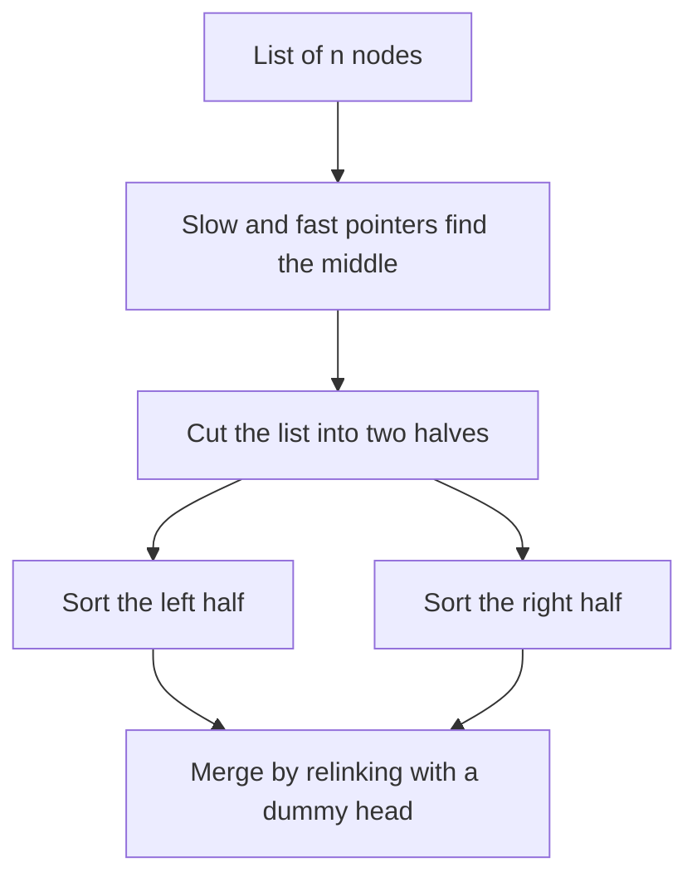

## The hook

Sorting an array is a library call. Sorting a linked list in O(n log n) time with no extra array is an interview question, because the tools you know from arrays do not fit. Quicksort wants to jump to any index; heap sort wants array positions; insertion sort is O(n²).

Merge sort, on the other hand, fits linked lists better than it fits arrays. Merging two sorted lists only ever looks at their fronts and can be done by relinking nodes, with no buffer at all. The only parts that need care are finding the middle and cutting the list there.

## The problem

Sort a singly linked list in ascending order in O(n log n) time. The follow-up asks for O(1) extra space. Related problems:

| Problem | Input | Output |
|---|---|---|
| Merge Two Sorted Lists | 1 → 4 → 6 and 2 → 3 | 1 → 2 → 3 → 4 → 6 |
| Sort List | 4 → 2 → 1 → 3 | 1 → 2 → 3 → 4 |
| Insertion Sort List | 4 → 2 → 1 → 3 | 1 → 2 → 3 → 4, in O(n²) |
| Merge k Sorted Lists | 1 → 5 → 9, 2 → 3, 4 → 8 | 1 → 2 → 3 → 4 → 5 → 8 → 9 |

## The obvious approach

Copy the values into an array, sort it and write them back. It is O(n log n) but uses O(n) extra memory and changes values instead of nodes. Insertion sort works on the list directly, inserting each node into a sorted prefix, but every insertion walks the prefix, so it is O(n²) on reversed input.

## The key insight

:::analogy
Picture a deck of exam papers threaded on a string. Find the middle paper, snip the string just before it, and you have two half-decks. Sort each half the same way. Then merge: look at the top paper of each half, move the smaller one onto the output string, and repeat. You never needed a table to spread the papers out; snipping and re-threading the string was enough.
:::

That is merge sort on a list, in three moves:

- **Find the middle** with slow and fast pointers: slow moves one step, fast two. When fast reaches the end, slow is at the middle.
- **[[Cut]]** the list there by setting the next pointer of the node before the right half to null. Forgetting this is the classic bug: the "left half" still runs into the right half.
- **[[Relinking merge]]**: keep a dummy head and a tail pointer; repeatedly attach the smaller front node to the tail and advance that list. When one list runs out, attach the rest of the other in one step.

The recursive version is [[top-down merge sort]], which uses O(log n) stack frames. For O(1) extra space, go [[bottom-up merge sort]]: merge runs of size 1 into sorted pairs, pairs into runs of 4, and so on, walking the list once per round and cutting runs off as you go.



:::insight
Merging only ever looks at the fronts of two lists and can relink nodes in place, so merge sort needs no buffer on linked lists. The two things that matter are finding the middle with fast and slow pointers and actually cutting the list there.
:::

## Walk through an example

### Top-down on 4 → 2 → 1 → 3

| Step | Lists |
|---|---|
| Split | 4 → 2 and 1 → 3 |
| Split again | 4, 2 and 1, 3 |
| Merge pairs | 2 → 4 and 1 → 3 |
| Merge | take 1 (1 < 2), take 2 (2 < 3), take 3 (3 < 4), attach the rest: 4 |
| Result | 1 → 2 → 3 → 4 |

For the split of 4 → 2 → 1 → 3, slow starts at 4 and fast at 2 (one ahead, so even lengths split evenly). After one step slow is at 2 and fast is on the last node, 3, so the loop stops and the cut goes after 2.

### Bottom-up on 5 → 1 → 4 → 2 → 3

| Round | Run size | Merges | List after the round |
|---|---|---|---|
| 1 | 1 | (5, 1), (4, 2), (3) | 1 5 2 4 3 |
| 2 | 2 | (1 5, 2 4), (3) | 1 2 4 5 3 |
| 3 | 4 | (1 2 4 5, 3) | 1 2 3 4 5 |

Each round walks the list once, cutting off two runs, merging them and attaching the result to the growing output. There are about log₂ n rounds, and no recursion.

### Merging k sorted lists

For 1 → 5 → 9, 2 → 3 and 4 → 8, put each list's front into a min-heap: 1, 2, 4. Pop 1 and push its successor 5: the heap holds 2, 4, 5.

Pop 2, push 3. Pop 3; its list is empty, push nothing. Continue, and the output is 1 → 2 → 3 → 4 → 5 → 8 → 9. The heap never holds more than k nodes, which is why this [[k-way merge]] costs O(N log k). An alternative is to merge the lists in pairs, like the rounds of bottom-up merge sort, also O(N log k).

:::try-this
Merge 1 → 4 → 6 and 2 → 3 by relinking. Which node is attached at each step? (1, then 2 because 2 < 4, then 3 because 3 < 4, then the second list is empty, so attach the rest of the first list, 4 → 6, in one step: 1 → 2 → 3 → 4 → 6.)
:::

:::warning
Common misconception: "Find the middle with slow and fast both starting at the head." For a two-node list that leaves slow on the second node, so the left half is both nodes and the right half is empty, and the recursion never shrinks. Start fast one node ahead, or cut before slow, so that every split makes both halves strictly smaller.
:::

## The code

```pseudo
merge(a, b):
    dummy; tail = dummy
    while a and b:
        if a.val <= b.val: tail.next = a; a = a.next
        else: tail.next = b; b = b.next
        tail = tail.next
    tail.next = a or b
    return dummy.next

sort(head):
    if head is null or head.next is null: return head
    slow = head; fast = head.next
    while fast and fast.next: slow = slow.next; fast = fast.next.next
    right = slow.next; slow.next = null              # the cut
    return merge(sort(head), sort(right))

merge_k(lists):
    heap of (value, node) for each non-empty list
    while heap not empty: pop the smallest, attach it, push its next if any
```

```cpp
#include <bits/stdc++.h>
using namespace std;

struct Node {
    int val;
    Node* next;
    Node(int v, Node* n = nullptr) : val(v), next(n) {}
};

Node* build(const vector<int>& v) {
    Node* h = nullptr;
    for (int i = (int)v.size() - 1; i >= 0; i--) h = new Node(v[i], h);
    return h;
}
void print(Node* h) {
    for (; h; h = h->next) cout << h->val << (h->next ? " " : "");
    cout << '\n';
}

Node* mergeLists(Node* a, Node* b) {
    Node dummy(0);
    Node* tail = &dummy;
    while (a && b) {
        if (a->val <= b->val) tail->next = a, a = a->next;   // <= keeps it stable
        else tail->next = b, b = b->next;
        tail = tail->next;
    }
    tail->next = a ? a : b;                                 // attach the rest in one step
    return dummy.next;
}

Node* sortTopDown(Node* head) {
    if (!head || !head->next) return head;
    Node *slow = head, *fast = head->next;                  // fast one ahead: halves always shrink
    while (fast && fast->next) slow = slow->next, fast = fast->next->next;
    Node* right = slow->next;
    slow->next = nullptr;                                   // the cut
    return mergeLists(sortTopDown(head), sortTopDown(right));
}

Node* cutAfter(Node* h, int k) {                            // keep k nodes, return the rest
    for (int i = 1; h && i < k; i++) h = h->next;
    if (!h) return nullptr;
    Node* rest = h->next;
    h->next = nullptr;
    return rest;
}

Node* sortBottomUp(Node* head) {                            // O(1) extra space
    int n = 0;
    for (Node* p = head; p; p = p->next) n++;
    Node dummy(0, head);
    for (int size = 1; size < n; size *= 2) {
        Node *tail = &dummy, *cur = dummy.next;
        while (cur) {
            Node* left = cur;
            Node* right = cutAfter(left, size);
            cur = cutAfter(right, size);
            tail->next = mergeLists(left, right);
            while (tail->next) tail = tail->next;           // move to the end of the merged run
        }
    }
    return dummy.next;
}

Node* insertionSort(Node* head) {                           // O(n^2), for comparison
    Node dummy(0);
    while (head) {
        Node* nx = head->next;
        Node* p = &dummy;
        while (p->next && p->next->val < head->val) p = p->next;
        head->next = p->next, p->next = head;
        head = nx;
    }
    return dummy.next;
}

Node* mergeK(const vector<Node*>& lists) {
    auto cmp = [](Node* a, Node* b) { return a->val > b->val; };
    priority_queue<Node*, vector<Node*>, decltype(cmp)> pq(cmp);
    for (Node* l : lists) if (l) pq.push(l);
    Node dummy(0);
    Node* tail = &dummy;
    while (!pq.empty()) {
        Node* x = pq.top();
        pq.pop();
        tail = tail->next = x;
        if (x->next) pq.push(x->next);                      // the next front of that list
    }
    return dummy.next;
}

int main() {
    print(mergeLists(build({1, 4, 6}), build({2, 3})));                        // 1 2 3 4 6
    print(sortTopDown(build({4, 2, 1, 3})));                                   // 1 2 3 4
    print(sortBottomUp(build({5, 1, 4, 2, 3})));                               // 1 2 3 4 5
    print(insertionSort(build({4, 2, 1, 3})));                                 // 1 2 3 4
    print(mergeK({build({1, 5, 9}), build({2, 3}), build({4, 8})}));           // 1 2 3 4 5 8 9
}
```

The bottom-up version walks to the end of each merged run to find where the next one attaches. That adds another pass per round but keeps the total O(n log n), and it is the version that meets the O(1)-space follow-up. The array version of the same algorithm, including how merging counts inversions, is in [Merging Two Piles of Exam Papers](article:dsa-merge-sort-inversions).

## Complexity

- **Top-down merge sort: O(n log n) time, O(log n) stack space.** log n levels of splitting, and each level's merges touch n nodes.
- **Bottom-up merge sort: O(n log n) time, O(1) extra space.** log n rounds of linear passes.
- **Insertion sort on a list: O(n²) time in the worst case, O(1) space,** but O(n) on nearly sorted input.
- **Merge k lists with a heap: O(N log k) time, O(k) space** for N nodes in total.

## Common mistakes

- **Not cutting the list** before recursing, which leaves the halves joined and recurses forever.
- **Splitting a two-node list into two and zero,** by starting slow and fast at the same node without cutting before slow.
- **Allocating new nodes in the merge** instead of relinking the existing ones.
- **Forgetting to attach the leftover list** after one side runs out.
- **Losing the tail** in bottom-up merge sort, so merged runs are not connected to each other.
- **Merging k lists one after another into a growing result,** which is O(N k); use a heap or pairwise merging.

## Practice problems

*Merge Two Sorted Lists* is the relinking merge on its own. *Insertion Sort List* is the simple O(n²) method and a good contrast. *Sort List* is the main problem; solve it top-down first, then bottom-up for the O(1)-space follow-up. *Merge k Sorted Lists* uses a min-heap of list fronts, the same structure as in [The Triage Nurse Who Always Knows Who Is Next](article:dsa-heap-basics).

## Key takeaways

- Merge sort suits linked lists because merging two sorted lists only reads their fronts and can relink nodes without any buffer.
- Find the middle with slow and fast pointers and cut the list there, so each recursive call really gets a smaller list.
- Top-down merge sort uses O(log n) recursion stack; bottom-up merge sort merges runs of size 1, 2, 4 and so on iteratively in O(1) extra space.
- Insertion sort on a list is simple but O(n²) in the worst case, so it fits only nearly sorted or tiny inputs.
- Merging k sorted lists with a min-heap of their current fronts costs O(N log k) for N nodes in total.
