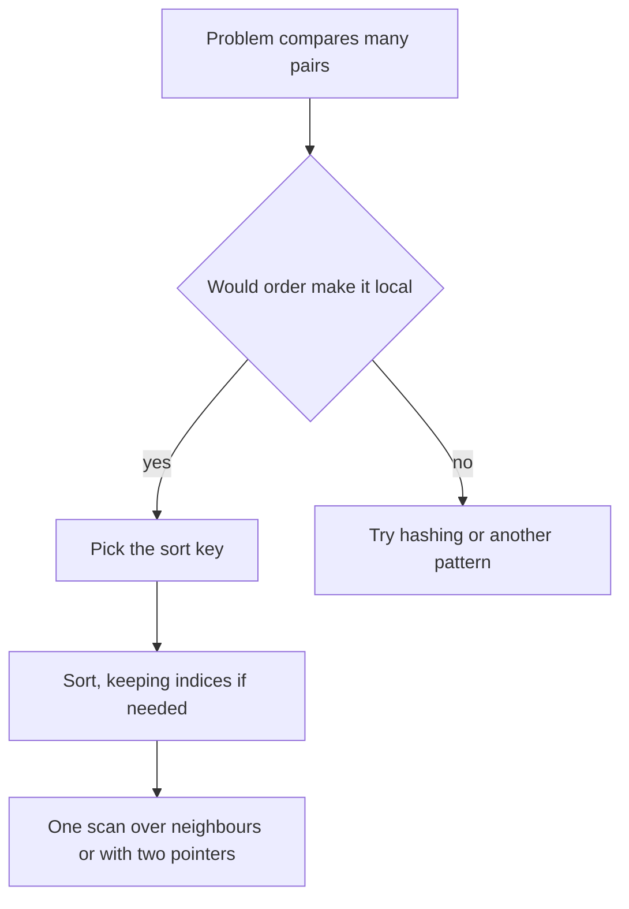

## The hook

"Find the two numbers in this list that are closest together." The brute force compares every pair: about n²/2 comparisons. Now sort the list first. The closest pair is suddenly sitting side by side, and one pass finds it.

You rarely need to write a sorting algorithm in an interview. What you need is the reflex to ask: would this problem become easy if the data were in order? Surprisingly often, the answer is yes.

## The intuition

:::analogy
Think of a sports teacher picking teams from a scattered crowd of students. Comparing everyone with everyone is chaos. But ask them to line up by height first, and suddenly every question is easy: the tallest are at one end, similar heights stand side by side, and anyone looking for "the next tallest" just looks one place along the line.
:::

Sorting costs O(n log n) once. In exchange, it creates structure: neighbours are similar, ranges are contiguous, and the smallest and largest sit at known places. Many O(n²) "compare everything" ideas collapse into O(n) scans over that line.

## How it works

The pattern has three steps:

- **Choose the [[sort key]]:**: what order makes the problem simple? Value, end time, length, ratio?
- **Sort**, with a [[comparator]] if the key is not the natural order.
- **Scan** the sorted data once, often with a running variable, two pointers or a greedy choice.



### What order gives you

- **Neighbours are closest.** Minimum difference, merging duplicates, grouping equal values.
- **Ranges become contiguous.** Counting values in [a, b] becomes two binary searches.
- **Greedy choices become safe.** Interval scheduling sorts by end time; task problems often sort by deadline or ratio.
- **Two pointers become possible.** Pair sums need sorted input, as in [Two Fingers on a Sorted List](article:dsa-two-pointers).

### Comparators that do not lie

A comparator returns true when the first argument must come first. It must be a [[strict weak ordering]]: in particular, it must return false when the two elements are equal. `return a < b;` is fine; `return a <= b;` is a bug that can crash `std::sort`.

When equal keys must keep their original order, use a [[stable sort]] (`stable_sort` in C++).

:::insight
Before reaching for nested loops, ask what order would make the answer local. If the answer only depends on neighbours, or on a prefix of the sorted data, one sort plus one scan replaces the quadratic search.
:::

## Walk through an example

**Largest Number**: arrange `[3, 30, 34, 5, 9]` to form the largest number.

Sorting numerically gives 3, 5, 9, 30, 34 in some direction, which is wrong: we want 9534330. The right [[sort key]] is the concatenation itself: put a before b if the string `a + b` is larger than `b + a`.

| Compare | a + b | b + a | Who goes first |
|---|---|---|---|
| 3 vs 30 | "330" | "303" | 3 |
| 3 vs 34 | "334" | "343" | 34 |
| 9 vs 5 | "95" | "59" | 9 |
| 34 vs 5 | "345" | "534" | 5 |

Sorted order: 9, 5, 34, 3, 30, giving "9534330". Notice the custom comparator did all the thinking; the scan is just joining strings.

:::try-this
Find the minimum absolute difference in `[40, 11, 26, 27, 2]` by sorting first. (Sorted: 2, 11, 26, 27, 40. Neighbour differences: 9, 15, 1, 13. The minimum is 1, between 26 and 27.)
:::

## The code

```pseudo
largest_number(nums):
    strs = nums as strings
    sort strs so that a comes before b when a + b > b + a
    result = join(strs)
    if result starts with "0": return "0"
    return result

min_difference(a):
    sort a
    return min over i of (a[i+1] - a[i])
```

```cpp
#include <bits/stdc++.h>
using namespace std;

string largestNumber(const vector<int>& nums) {
    vector<string> s;
    for (int x : nums) s.push_back(to_string(x));
    sort(s.begin(), s.end(), [](const string& a, const string& b) { return a + b > b + a; });
    string r;
    for (auto& x : s) r += x;
    return r[0] == '0' ? "0" : r;
}

vector<int> frequencySort(vector<int> a) {                   // rarest first, ties: larger value first
    unordered_map<int, int> cnt;
    for (int x : a) cnt[x]++;
    sort(a.begin(), a.end(), [&](int x, int y) {
        return make_pair(cnt[x], -x) < make_pair(cnt[y], -y);
    });
    return a;
}

int carFleet(int target, const vector<int>& pos, const vector<int>& speed) {
    vector<pair<int, int>> cars;
    for (size_t i = 0; i < pos.size(); i++) cars.push_back({pos[i], speed[i]});
    sort(cars.rbegin(), cars.rend());                         // closest to the target first
    int fleets = 0;
    double slowest = 0;                                       // arrival time of the fleet ahead
    for (auto [p, v] : cars) {
        double t = double(target - p) / v;
        if (t > slowest) fleets++, slowest = t;               // cannot catch up: a new fleet
    }
    return fleets;
}

int numBoats(vector<int> w, int limit) {
    sort(w.begin(), w.end());
    int boats = 0;
    for (int l = 0, r = (int)w.size() - 1; l <= r; r--, boats++)
        if (w[l] + w[r] <= limit) l++;                        // the lightest rides with the heaviest
    return boats;
}

int main() {
    cout << largestNumber({3, 30, 34, 5, 9}) << '\n';        // 9534330

    // Sorting indices by value, keeping original positions.
    vector<int> v = {40, 11, 26, 27, 2};
    vector<int> idx(v.size());
    iota(idx.begin(), idx.end(), 0);
    sort(idx.begin(), idx.end(), [&](int i, int j) { return v[i] < v[j]; });
    for (int i : idx) cout << i << ':' << v[i] << ' ';
    cout << '\n';                                            // 4:2 1:11 2:26 3:27 0:40

    for (int x : frequencySort({1, 1, 2, 2, 2, 3})) cout << x << ' ';
    cout << '\n';                                            // 3 1 1 2 2 2
    cout << carFleet(12, {10, 8, 0, 5, 3}, {2, 4, 1, 1, 3}) << ' '
         << numBoats({3, 2, 2, 1}, 3) << '\n';               // 3 3
}
```

The second half shows an [[index sort]]: sort positions by their values, so you know where each sorted value came from.

### Sorting by more than one key

Many problems sort by one thing, then break ties by another. *Sort Array by Increasing Frequency* wants values ordered by how often they appear, rarest first, and equal frequencies ordered from the largest value down. Compare tuples: the key for x is (count of x, −x), and C++ compares pairs and tuples one field at a time. For [1, 1, 2, 2, 2, 3], the keys are (2, −1), (3, −2) and (1, −3), so the order is 3, then the two 1s, then the three 2s: [3, 1, 1, 2, 2, 2].

### Car Fleet: sorting reveals the structure

Cars drive towards a target at 12 and can never pass each other; a fast car that catches a slower one joins its fleet. Sort cars by position, closest to the target first, and compute each car's arrival time if it drove alone. A car whose lone time is no greater than the fleet ahead of it catches up and joins; a slower car starts a new fleet.

| Position | Speed | Time alone to reach 12 | Compared with the slowest fleet ahead | Fleets |
|---|---|---|---|---|
| 10 | 2 | 1.0 | none ahead | 1 |
| 8 | 4 | 1.0 | 1.0, catches up | 1 |
| 5 | 1 | 7.0 | slower than 1.0, new fleet | 2 |
| 3 | 3 | 3.0 | 7.0, catches up | 2 |
| 0 | 1 | 12.0 | slower than 7.0, new fleet | 3 |

Three fleets. Without sorting, deciding who catches whom would mean comparing every pair of cars; in order, each car only looks at the fleet directly ahead.

### Sort, then two pointers: Boats to Save People

Each boat carries at most two people and a weight limit, here 3. Sort the weights [3, 2, 2, 1] to [1, 2, 2, 3]. Pair the heaviest remaining person with the lightest if they fit together; otherwise the heaviest goes alone. 3 goes alone (3 + 1 > 3), then 2 and 1 share, then the last 2 goes alone: 3 boats. Sorting is what makes "pair the heaviest with the lightest" a safe greedy choice.

### When not to compare at all

If values are small integers, say exam scores from 0 to 100, you can skip comparison sorting: count how many times each value appears, then walk the counts in order, in O(n + k) for k possible values. [Sorting Mail Into Pigeonholes](article:dsa-counting-bucket-sort) covers counting, radix and bucket sort. And if you only need the relative order of huge values, not the values themselves, [Renaming Huge Numbers as 1, 2, 3](article:cp-coordinate-compression) sorts once and replaces each value by its rank.

## Complexity

- **Time:** O(n log n) for the sort with simple keys, then usually O(n) for the scan. With string keys as in Largest Number, each comparison costs up to the string length.
- **Space:** `std::sort` works in place with O(log n) extra stack; `stable_sort` may use O(n). Index sorting adds an O(n) array of indices.

## Common mistakes

:::warning
Common misconception: "sorting destroys the information I need." It destroys the original order, but you can keep it by sorting pairs of (value, index) or sorting indices. Many "return the original positions" problems are exactly that.
:::

- **`<=` in a comparator**, which breaks strict weak ordering.
- **Sorting when order must be preserved**, as in subarray problems, where the original sequence matters.
- **Forgetting the all-zeros case** in Largest Number, which would print "000".
- **Sorting inside a loop**, turning O(n log n) into O(n² log n) without noticing.
- **Calling `cnt[x]` inside a comparator** on a map that might insert new keys; build the counts first, as the code does, so every lookup finds an existing key.
- **Comparing floating-point times with `==`** in problems like Car Fleet. The strict `>` test avoids needing equality, and exact fractions with cross-multiplication avoid rounding entirely.

## Practice problems

*Minimum Absolute Difference* and *Distinct Numbers* are sort-then-scan in their simplest form. *Merge Intervals* sorts intervals by start time, after which every overlap is between neighbours. *Largest Number* is all about the comparator. *Car Fleet* sorts cars by position and scans from the front, a nice example of sorting revealing the structure. *Boats to Save People* combines a sort with two pointers.

## Key takeaways

- Sorting once, in O(n log n), often turns a quadratic compare-everything problem into a single linear scan.
- In sorted order, the closest values are neighbours, ranges are contiguous, and greedy and two-pointer methods become valid.
- The real skill is choosing the sort key, which may be a custom rule such as comparing concatenations.
- Comparators must return false for equal elements; use stable_sort when equal elements must keep their order.
- Sort indices or (value, index) pairs when the answer must refer to original positions.
