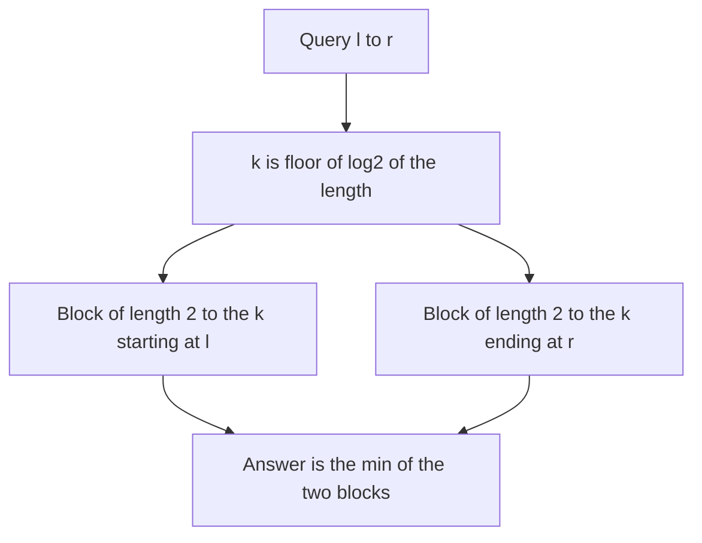

## The hook

A long coastline is watched by lookouts, each covering a stretch of a fixed length. A ship's captain asks, "what is the lowest cliff between mile 1 and mile 6?". Two lookouts happen to cover miles 1 to 4 and miles 3 to 6. Each reports the lowest cliff on its stretch, and the lower of the two reports is the answer, even though both lookouts watched miles 3 and 4.

When an array never changes and you face up to a million minimum queries, that idea gives answers in O(1) each, faster than a segment tree's O(log n), for the price of an O(n log n) table built once.

## The intuition

:::analogy
Station a lookout at every mile for stretches of length 1, 2, 4, 8 and so on, each writing down the lowest cliff on their stretch. For any question, pick the longest stretch length that fits inside the asked range, and ask two lookouts of that length: one whose stretch starts at the left end of the range, and one whose stretch ends at the right end. Together they cover the whole range. They may both watch the middle, but the lowest cliff is the lowest cliff, whoever reports it, so the overlap does no harm.
:::

The lookouts' notes form a [[sparse table]]: st[k][i] = min of a[i .. i + 2^k - 1]. The table is built by [[doubling]]: a block of length 2^k is two blocks of length 2^(k-1), so

st[k][i] = min(st[k-1][i], st[k-1][i + 2^(k-1)]).

A query uses the [[floor log]] k = ⌊log₂(r - l + 1)⌋ and two blocks of length 2^k:

min(a[l..r]) = min(st[k][l], st[k][r - 2^k + 1]).

The overlap is safe only because min is an [[idempotent operation]]: min(x, x) = x.

## How it works

### Build

- st[0][i] = a[i].
- For k = 1, 2, ... while 2^k ≤ n: for each i with i + 2^k ≤ n, st[k][i] = combine(st[k-1][i], st[k-1][i + 2^(k-1)]).
- Precompute lg[len] = ⌊log₂ len⌋ for len = 1..n with lg[1] = 0 and lg[len] = lg[len / 2] + 1, or use the compiler's count-leading-zeros builtin.

There are about log₂ n levels of n entries: O(n log n) time and space.

### Query

k = lg[r - l + 1], then combine st[k][l] and st[k][r - 2^k + 1]. Two lookups, one combine: O(1).

### Which operations work

| Operation | Idempotent? | O(1) query with two overlapping blocks? |
|---|---|---|
| min, max | yes | yes |
| gcd | yes, gcd(x, x) = x | yes |
| bitwise AND, OR | yes | yes |
| sum, product, XOR | no | no: use O(log n) disjoint blocks, or prefix sums for sums |

For sums with a static array, plain prefix sums are simpler and O(1), as in CSES *Static Range Sum Queries*. A sparse table can still answer sums by walking the binary digits of the length and adding disjoint blocks, but there is rarely a reason to.

### Sparse table, segment tree or deque?

| Situation | Best tool |
|---|---|
| Static array, many min or max queries | sparse table: O(1) per query |
| Array with point updates | segment tree: O(log n) per update and query |
| Windows of one fixed size sliding left to right | monotonic deque: O(n) total |
| Static array, sums | prefix sums |

*Sliding Window Maximum* can be solved with a sparse table, since every window is a range, but the deque from [The Queue Where Taller Latecomers Push In](article:dsa-queue-deque) is O(n) and uses O(k) memory, so it is the better answer there.



:::insight
Any range can be covered by two power-of-two blocks of the same length, one anchored at each end. When the operation does not care about counting an element twice, as with min or max, those two precomputed blocks answer the query in O(1).
:::

## Walk through an example

a = [4, 6, 1, 5, 7, 3, 8, 2], indices 0 to 7.

| k | Block length | st[k][i] for i = 0, 1, ... |
|---|---|---|
| 0 | 1 | 4, 6, 1, 5, 7, 3, 8, 2 |
| 1 | 2 | 4, 1, 1, 5, 3, 3, 2 |
| 2 | 4 | 1, 1, 1, 3, 2 |
| 3 | 8 | 1 |

For example, st[2][3] = min(st[1][3], st[1][5]) = min(5, 3) = 3, the minimum of a[3..6] = 5, 7, 3, 8.

### Queries

| Query | Length | k | Blocks | Answer |
|---|---|---|---|---|
| min a[1..6] | 6 | 2 | [1, 4] → 1 and [3, 6] → 3 | 1 |
| min a[3..7] | 5 | 2 | [3, 6] → 3 and [4, 7] → 2 | 2 |
| min a[2..2] | 1 | 0 | [2, 2] twice → 1 | 1 |
| min a[0..7] | 8 | 3 | [0, 7] twice → 1 | 1 |

In the first query, positions 3 and 4 are covered by both blocks. The minimum is unaffected; a sum would have counted 5 + 7 twice.

:::try-this
Using the table above, what is min a[4..6], and which blocks does the query use? (Length 3, so k = 1 and blocks of length 2: [4, 5] gives st[1][4] = 3 and [5, 6] gives st[1][5] = 3. Both report the 3 at position 5, and the answer is 3. Position 5 is in both blocks.)
:::

:::warning
Common misconception: "A sparse table answers any range query in O(1)." Only idempotent operations allow the two overlapping blocks. For a range sum, the overlap double-counts, and the O(1) formula gives a wrong answer: on a[1..6] above it would return 6 + 1 + 5 + 7 plus 5 + 7 + 3 + 8, counting 5 and 7 twice. Use prefix sums, or disjoint blocks in O(log n).
:::

## The code

```pseudo
build(a):
    st[0] = a
    for k in 1 .. while 2^k <= n:
        for i in 0 .. n - 2^k:
            st[k][i] = min(st[k-1][i], st[k-1][i + 2^(k-1)])
    lg[1] = 0; for len in 2..n: lg[len] = lg[len / 2] + 1

query(l, r):
    k = lg[r - l + 1]
    return min(st[k][l], st[k][r - 2^k + 1])
```

```cpp
#include <bits/stdc++.h>
using namespace std;

struct SparseMin {
    vector<vector<int>> st;
    vector<int> lg;
    explicit SparseMin(const vector<int>& a) {
        int n = a.size();
        lg.assign(n + 1, 0);
        for (int len = 2; len <= n; len++) lg[len] = lg[len / 2] + 1;
        st.assign(lg[n] + 1, vector<int>(n));
        st[0] = a;
        for (int k = 1; k <= lg[n]; k++)
            for (int i = 0; i + (1 << k) <= n; i++)
                st[k][i] = min(st[k - 1][i], st[k - 1][i + (1 << (k - 1))]);   // doubling
    }
    int query(int l, int r) const {                                            // inclusive
        int k = lg[r - l + 1];
        return min(st[k][l], st[k][r - (1 << k) + 1]);                         // two overlapping blocks
    }
};

int main() {
    SparseMin sm({4, 6, 1, 5, 7, 3, 8, 2});
    cout << sm.query(1, 6) << ' ' << sm.query(3, 7) << ' ' << sm.query(2, 2) << ' '
         << sm.query(0, 7) << ' ' << sm.query(4, 6) << '\n';                    // 1 2 1 1 3

    mt19937 rng(1);                                                            // check against brute force
    vector<int> a(200);
    for (int& x : a) x = rng() % 1000;
    SparseMin big(a);
    int bad = 0;
    for (int t = 0; t < 5000; t++) {
        int l = rng() % 200, r = rng() % 200;
        if (l > r) swap(l, r);
        if (big.query(l, r) != *min_element(a.begin() + l, a.begin() + r + 1)) bad++;
    }
    cout << bad << '\n';                                                       // 0
}
```

## Complexity

- **Build: O(n log n) time and space,** about 20 levels for n = 10⁶.
- **Query: O(1),** two lookups and one comparison.
- **Updates: not supported;** a single change can affect O(n) entries across levels, so rebuild or use a segment tree.
- **Memory note:** for n = 2 × 10⁵ with 32-bit values, the table is about 18 × 2 × 10⁵ × 4 bytes, roughly 14 MB.

## Common mistakes

- **Using the O(1) formula for sums or XOR,** which double-counts the overlap.
- **Computing log₂ with floating point** at query time; precompute lg or use a bit builtin to avoid rounding errors.
- **Off-by-one in the second block:** it starts at r - 2^k + 1, not r - 2^k.
- **Building levels beyond what fits,** reading st[k-1][i + 2^(k-1)] past the end of the array.
- **Choosing a sparse table when the array changes,** where a segment tree is the right tool.

## Practice problems

*Static Range Minimum Queries* is the sparse table in its pure form. *Sliding Window Maximum* can use a sparse table for max, though the monotonic deque is better. *Static Range Sum Queries* is the contrast: sums are not idempotent, so prefix sums from [Answering a Million Range Questions Instantly](article:dsa-prefix-sums) are the right tool. For ranges with updates, see [Asking a Bracket Who Won Any Stretch](article:dsa-segment-tree-basics).

## Key takeaways

- A sparse table stores the minimum of every block whose length is a power of two, built level by level from two blocks of half the length.
- Any range [l, r] is covered by two blocks of length 2^k, where k = ⌊log₂(r - l + 1)⌋, one starting at l and one ending at r.
- Overlapping blocks are safe for idempotent operations such as min, max, gcd, AND and OR, which gives O(1) queries.
- Sums are not idempotent, so they need prefix sums or disjoint blocks instead.
- Sparse tables are for static arrays; any update calls for a segment tree.
