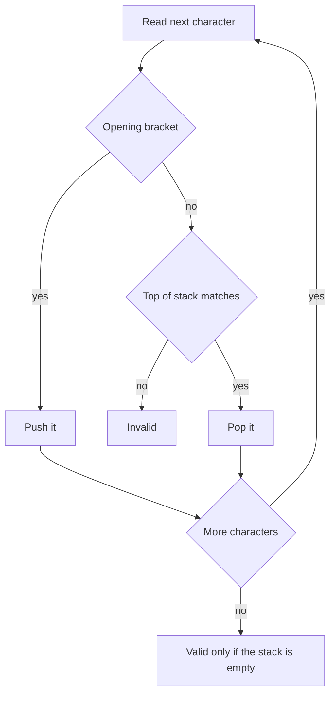

## The hook

Your code editor knows instantly when a bracket is missing. A calculator app turns "2 + 3 × 4" into 14, not 20. The undo button in every editor steps back through your changes in reverse order. Different features, one data structure underneath: the stack.

Stacks are simple enough to explain in a sentence and powerful enough to parse programming languages. In interviews, the skill is recognising when a problem has the shape a stack fits: things that open and must close in reverse order.

## The intuition

:::analogy
Think of a stack of plates in a canteen. You can only put a plate on top, and you can only take the top plate off. The plate you put down last is the first one anyone picks up. Nobody digs into the middle of the pile.
:::

That is a [[stack]]: [[push and pop]] at one end, last in first out, or [[LIFO]]. Whenever the most recent thing you started is the first thing you must finish, a stack is the natural fit.

## How it works

### Pattern 1: matching pairs

Brackets, HTML tags and nested function calls all have [[nesting]]: whatever opened last must close first. Scan left to right:

- On an opening bracket, push it.
- On a closing bracket, the top of the stack must be its matching opener; pop it. If the stack is empty or the top does not match, the string is invalid.
- At the end, the stack must be empty: nothing left unclosed.



### Pattern 2: evaluating expressions

In [[Reverse Polish notation]], operators come after their operands: "3 4 +" means 3 + 4. Evaluation is a pure stack routine: push numbers; on an operator, pop two values, apply it, push the result. Ordinary expressions with precedence can be evaluated with two stacks, one for numbers and one for operators, which is how many calculators and parsers work.

### Pattern 3: remember state to come back to

Undo history, browser back buttons, and decoding nested strings like `3[a2[c]]` all push the current state before going deeper, then pop to restore it when the inner part finishes.

The call stack of every program works the same way: each function call pushes a frame, and returning pops it. That is why any recursive solution can be rewritten with an explicit stack, which is useful when recursion would go too deep. Depth-first search on a graph is the classic example: push the starting node, then repeatedly pop a node and push its unvisited neighbours.

### Pattern 4: augmenting a stack

Problems like Min Stack ask for extra queries in O(1). Store, with each pushed value, the minimum of everything at or below it. The top then always knows the current minimum, and popping automatically restores the previous one.

:::insight
A stack is the right tool when the most recently opened thing must be dealt with first. Brackets, nested calls, undo and "go back" all share that shape. Spot the nesting and the stack solution usually writes itself.
:::

## Walk through an example

**Valid brackets** for `"{[()]}("`:

| Char | Action | Stack after |
|---|---|---|
| { | push | { |
| [ | push | { [ |
| ( | push | { [ ( |
| ) | top is ( : pop | { [ |
| ] | top is [ : pop | { |
| } | top is { : pop | (empty) |
| ( | push | ( |
| end | stack not empty | **invalid** |

**Min Stack**: push 5, push 3, push 7, pop, then ask for the minimum.

| Operation | Stack (value, min so far) | getMin |
|---|---|---|
| push 5 | (5,5) | 5 |
| push 3 | (5,5) (3,3) | 3 |
| push 7 | (5,5) (3,3) (7,3) | 3 |
| pop | (5,5) (3,3) | 3 |

**Simplify Path** for `"/a/./b/../../c/"`: split on slashes and treat folder names as a stack. Skip empty parts and ".", push a name, and pop on "..":

| Part | Action | Stack after |
|---|---|---|
| a | push | a |
| . | stay | a |
| b | push | a b |
| .. | pop | a |
| .. | pop | (empty) |
| c | push | c |

Joining the stack gives "/c". Each ".." takes the top plate off the pile, the folder you entered most recently. A ".." on an empty stack stays at the root, because you cannot go above "/".

**Longest Valid Parentheses** for `")()())"` pushes **indices**, starting with −1 as a base. Push the index of each "(". On ")", pop; if the stack is now empty, push the current index as the new base; otherwise the valid stretch ending here runs from just after the new top to the current index.

| i | Char | Stack after (indices) | Valid length ending here | Best |
|---|---|---|---|---|
| 0 | ) | 0 (new base) | | 0 |
| 1 | ( | 0 1 | | 0 |
| 2 | ) | 0 | 2 − 0 = 2 | 2 |
| 3 | ( | 0 3 | | 2 |
| 4 | ) | 0 | 4 − 0 = 4 | 4 |
| 5 | ) | 5 (new base) | | 4 |

The answer is 4, for "()()". Like writing a number on each canteen plate, storing indices instead of characters is what lets the stack measure lengths, the same reason monotonic stacks store indices.

:::try-this
Evaluate the RPN expression `5 1 2 + 4 * + 3 -` with a stack. (Push 5, 1, 2; + gives 3; push 4; * gives 12; + gives 17; push 3; − gives 14.)
:::

## The code

```pseudo
is_valid(s):
    stack = empty
    pairs = { ')': '(', ']': '[', '}': '{' }
    for c in s:
        if c is an opening bracket: push c
        else:
            if stack is empty or top != pairs[c]: return false
            pop
    return stack is empty

min_stack: each entry stores (value, min of value and previous min)
```

```cpp
#include <bits/stdc++.h>
using namespace std;

bool isValid(const string& s) {
    stack<char> st;
    for (char c : s) {
        if (c == '(' || c == '[' || c == '{') { st.push(c); continue; }
        char need = c == ')' ? '(' : c == ']' ? '[' : '{';
        if (st.empty() || st.top() != need) return false;
        st.pop();
    }
    return st.empty();
}

struct MinStack {
    vector<pair<int, int>> st;  // (value, minimum so far)
    void push(int x) { st.push_back({x, st.empty() ? x : min(x, st.back().second)}); }
    void pop() { st.pop_back(); }
    int top() const { return st.back().first; }
    int getMin() const { return st.back().second; }
};

long long evalRPN(const vector<string>& tokens) {
    vector<long long> st;
    for (const string& t : tokens) {
        if (t.size() == 1 && string("+-*/").find(t[0]) != string::npos) {
            long long b = st.back(); st.pop_back();               // popped first: the right operand
            long long a = st.back(); st.pop_back();
            st.push_back(t[0] == '+' ? a + b : t[0] == '-' ? a - b : t[0] == '*' ? a * b : a / b);
        } else st.push_back(stoll(t));
    }
    return st.back();
}

string simplifyPath(const string& path) {
    vector<string> st;
    stringstream ss(path);
    string part;
    while (getline(ss, part, '/')) {
        if (part.empty() || part == ".") continue;
        if (part == "..") { if (!st.empty()) st.pop_back(); }   // cannot go above the root
        else st.push_back(part);
    }
    string out;
    for (auto& p : st) out += "/" + p;
    return out.empty() ? "/" : out;
}

int longestValidParentheses(const string& s) {
    vector<int> st = {-1};                                     // base index
    int best = 0;
    for (int i = 0; i < (int)s.size(); i++) {
        if (s[i] == '(') { st.push_back(i); continue; }
        st.pop_back();
        if (st.empty()) st.push_back(i);                      // unmatched ')': new base
        else best = max(best, i - st.back());
    }
    return best;
}

int main() {
    cout << isValid("{[()]}") << isValid("{[()]}(") << '\n';                         // 10
    MinStack m;
    m.push(5); m.push(3); m.push(7); m.pop();
    cout << m.getMin() << '\n';                                                      // 3
    cout << evalRPN({"5", "1", "2", "+", "4", "*", "+", "3", "-"}) << '\n';           // 14
    cout << simplifyPath("/a/./b/../../c/") << ' ' << simplifyPath("/../") << '\n';  // /c /
    cout << longestValidParentheses(")()())") << ' ' << longestValidParentheses("(()") << '\n';   // 4 2
}
```

## Complexity

- **Bracket check, RPN evaluation, decoding:** O(n) time for one left-to-right scan, O(n) space in the worst case (all openers).
- **Min Stack:** O(1) per operation, at the cost of storing one extra number per element.

## Common mistakes

:::warning
Common misconception: "count the brackets: if opens equal closes, it is valid." Counts ignore order and type. ")(" has equal counts and is invalid, and "([)]" has matching counts of each type but closes in the wrong order. Only a stack checks both.
:::

- **Popping an empty stack** when a closer appears first; check for empty before `top()` or `pop()`.
- **Forgetting the final empty check**, which accepts strings with unclosed openers.
- **Operand order in RPN**: for "a b −", the first popped value is b; compute a − b, not b − a.
- **Using recursion for deep nesting** where an explicit stack avoids stack overflow on very deep inputs.
- **Storing characters when you need lengths,** as in Longest Valid Parentheses; store indices and keep a base index below them.
- **Popping on ".." at the root** in Simplify Path, which must simply stay at "/".

### Interview follow-ups

**"Can you validate brackets in O(1) extra space?"** With only one bracket type, yes: a counter that must never go negative and ends at 0. With several types you need the stack to remember which closer is expected.

**"Design a stack that returns the minimum in O(1)."** Store pairs (value, minimum so far), or keep a second stack of minimums pushed whenever the new value is ≤ the current minimum. Both give O(1) push, pop and getMin.

**"Implement a queue using two stacks."** Push into an in-stack; to pop, if the out-stack is empty, move everything across, then pop from it. Each element moves at most once, so operations are amortised O(1).

## Practice problems

*Valid Parentheses* is pattern 1 directly.

*Evaluate Reverse Polish Notation* is pattern 2. *Decode String* pushes the current count and string before each `[` and pops after `]`.

*Simplify Path* treats folders as a stack, popping on "..". *Min Stack* is pattern 4. *Longest Valid Parentheses* is the hard version of pattern 1, with an index stack. Next comes the monotonic stack, which uses the same structure to answer "next greater element" questions in linear time.

## Key takeaways

- A stack adds and removes items at the top only, so the last item pushed is the first one popped.
- Use a stack whenever nested things open and must close in reverse order, such as brackets, tags and function calls.
- Expression evaluation in Reverse Polish notation is push numbers, pop two on each operator, push the result.
- Augment each stack entry with extra information, like the running minimum, to answer queries in O(1).
- Check for an empty stack before popping and require it to be empty at the end when validating brackets.
