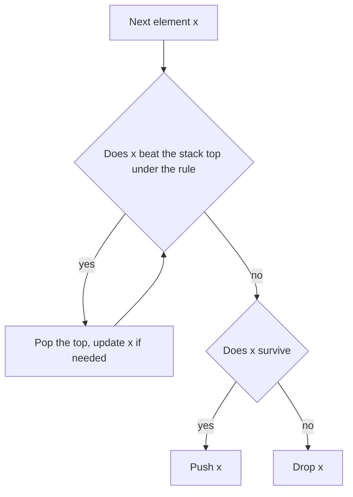

## The hook

Cars from a slip road merge one at a time into a single lane. Each new car can only interact with the car directly in front of it, the last one that merged. Sometimes it pushes that car out of the lane, then the one in front of that, until something stops it. The lane only ever changes at its back end.

A whole family of interview problems behaves like that lane: asteroids destroying each other, stock prices swallowing earlier lower prices, and digits or letters being dropped to make the smallest possible result. Each is a short loop over a stack, and each has one edge case that breaks naive code.

## The problem

Four problems, each solved by one pass over the input with a stack:

| Problem | Example | Answer |
|---|---|---|
| Asteroid Collision | [3, −2, 4, −6, 1], sign is direction, size is magnitude | [−6, 1] |
| Online Stock Span | prices 30, 20, 25, 40, 10, 35 | spans 1, 1, 2, 4, 1, 2 |
| Remove K Digits | "52819", k = 2 | "219" |
| Remove Duplicate Letters | "dbacbd" | "acbd" |

In the asteroid problem, positive means moving right and negative means moving left; when two meet, the smaller explodes, and equal sizes both explode.

## The obvious approach

Simulate directly with nested loops: for asteroids, repeatedly scan for a neighbouring pair moving towards each other and resolve it; for spans, walk back from each day while prices are lower; for digits, try every way of removing k digits. These are O(n²) or exponential. The common fix is to notice that each new element only ever interacts with the most recent survivors, which is exactly what a stack holds.

## The key insight

:::analogy
Picture the single lane again. The lane is a stack: the back of the lane is the top. A new car arrives and looks only at the car in front. If it is stronger, it shoves that car off the road and looks at the next one. If it is weaker, it is the one that leaves. Either way, everything further up the lane is untouched, because the cars in front never look backwards.
:::

That lane is a [[simulation stack]]. Each of the four problems is a rule for what happens at the back of the lane:

- **Asteroids:** a collision happens only when the top moves right and the newcomer moves left. While that is true, the smaller one explodes; equal sizes both explode.
- **Stock span:** keep pairs (price, span). A new price pops every earlier price that is at most it, adding their spans to its own, because those days are now covered. Its [[span]] is 1 plus the popped spans.
- **Remove K digits:** for the smallest number, an earlier digit should be removed whenever a smaller digit arrives after it. That is [[greedy removal]]: pop while the top is larger than the new digit and deletions remain, then push. Leftover deletions remove from the end, and leading zeros are stripped.
- **Remove duplicate letters:** for the [[lexicographically smallest]] answer that keeps each letter exactly once, pop a larger top letter only if it appears again later, using each letter's [[last occurrence]], and skip letters already in the stack.



:::insight
When each new element interacts only with the most recent survivors, keep the survivors on a stack. Every element is pushed once and popped at most once, so the simulation is linear however many collisions or removals happen.
:::

## Walk through an example

### Asteroids [3, −2, 4, −6, 1]

| Asteroid | Stack before | What happens | Stack after |
|---|---|---|---|
| 3 | | moves right, push | 3 |
| −2 | 3 | meets 3; 2 < 3, so −2 explodes | 3 |
| 4 | 3 | moves right, no collision | 3, 4 |
| −6 | 3, 4 | meets 4: 4 explodes; meets 3: 3 explodes; nothing left moving right | −6 |
| 1 | −6 | moving apart from −6, push | −6, 1 |

The survivors are [−6, 1]. Note the last row: a right-moving asteroid behind a left-moving one never collides, because they fly apart. On the lane, the −6 car pushed two cars off the road and then found an empty lane in front of it.

### Stock spans for 30, 20, 25, 40, 10, 35

| Price | Popped (price, span) | Span | Stack after |
|---|---|---|---|
| 30 | | 1 | (30, 1) |
| 20 | | 1 | (30, 1), (20, 1) |
| 25 | (20, 1) | 1 + 1 = 2 | (30, 1), (25, 2) |
| 40 | (25, 2), (30, 1) | 1 + 2 + 1 = 4 | (40, 4) |
| 10 | | 1 | (40, 4), (10, 1) |
| 35 | (10, 1) | 2 | (40, 4), (35, 2) |

The spans are 1, 1, 2, 4, 1, 2. Merging the popped spans is what keeps it linear: the price 40 never has to look at the 20 again, because the 25 already counted it.

### Remove K Digits on "52819" with k = 2

| Digit | Stack before | Pops (k left) | Stack after |
|---|---|---|---|
| 5 | | | 5 |
| 2 | 5 | pop 5 (k = 1) | 2 |
| 8 | 2 | | 2 8 |
| 1 | 2 8 | pop 8 (k = 0) | 2 1 |
| 9 | 2 1 | no deletions left | 2 1 9 |

The answer is "219". Each pop removed a digit that had a smaller digit right after it, which is exactly the digit whose removal shrinks the number most at that point.

### Remove Duplicate Letters on "dbacbd"

The last occurrences are d at 5, b at 4, a at 2 and c at 3.

| i | Letter | Stack before | Pops | Stack after |
|---|---|---|---|---|
| 0 | d | | | d |
| 1 | b | d | d is larger and appears again at 5: pop | b |
| 2 | a | b | b is larger and appears again at 4: pop | a |
| 3 | c | a | | a c |
| 4 | b | a c | c is larger but never appears again: keep | a c b |
| 5 | d | a c b | | a c b d |

The answer is "acbd".

:::try-this
Remove K Digits on "112" with k = 1. Does any pop happen inside the loop, and what is the answer? (No: the digits never decrease, so nothing is popped. The leftover deletion removes from the end, leaving "11".)
:::

:::warning
Common misconception: "Remove K Digits just removes the k largest digits." Position matters more than size. For "52819" with k = 2, removing the two largest digits, 9 and 8, gives 521, but greedy removal gives 219. A digit should go when a smaller digit comes right after it, because the earlier position carries more weight.
:::

## The code

```pseudo
asteroids(a):
    st = []
    for x in a:
        alive = true
        while alive and x < 0 and st not empty and st.top > 0:
            if st.top < -x: st.pop()                 # top explodes, keep checking
            else if st.top == -x: st.pop(); alive = false
            else: alive = false                      # x explodes
        if alive: st.push(x)

remove_k_digits(num, k):
    st = []
    for d in num:
        while k > 0 and st not empty and st.top > d: st.pop(); k -= 1
        st.push(d)
    drop k digits from the end; strip leading zeros; return result or "0"
```

```cpp
#include <bits/stdc++.h>
using namespace std;

vector<int> asteroidCollision(const vector<int>& a) {
    vector<int> st;
    for (int x : a) {
        bool alive = true;
        while (alive && x < 0 && !st.empty() && st.back() > 0) {   // only right-then-left collide
            if (st.back() < -x) st.pop_back();                     // the top explodes
            else if (st.back() == -x) st.pop_back(), alive = false;   // both explode
            else alive = false;                                   // x explodes
        }
        if (alive) st.push_back(x);
    }
    return st;
}

class StockSpanner {
    vector<pair<int, int>> st;                                    // (price, span)
public:
    int next(int price) {
        int span = 1;
        while (!st.empty() && st.back().first <= price) span += st.back().second, st.pop_back();
        st.push_back({price, span});
        return span;
    }
};

string removeKdigits(const string& num, int k) {
    string st;
    for (char d : num) {
        while (k > 0 && !st.empty() && st.back() > d) st.pop_back(), k--;   // a smaller digit follows
        st.push_back(d);
    }
    st.resize(st.size() - k);                                     // leftover deletions from the end
    size_t i = st.find_first_not_of('0');                         // strip leading zeros
    return i == string::npos ? "0" : st.substr(i);
}

string removeDuplicateLetters(const string& s) {
    array<int, 26> last{};
    for (int i = 0; i < (int)s.size(); i++) last[s[i] - 'a'] = i;
    array<bool, 26> inStack{};
    string st;
    for (int i = 0; i < (int)s.size(); i++) {
        int c = s[i] - 'a';
        if (inStack[c]) continue;
        while (!st.empty() && st.back() > s[i] && last[st.back() - 'a'] > i)   // a later copy exists
            inStack[st.back() - 'a'] = false, st.pop_back();
        st.push_back(s[i]), inStack[c] = true;
    }
    return st;
}

void print(const vector<int>& v) {
    cout << '[';
    for (size_t i = 0; i < v.size(); i++) cout << v[i] << (i + 1 < v.size() ? " " : "");
    cout << "] ";
}

int main() {
    print(asteroidCollision({3, -2, 4, -6, 1}));
    print(asteroidCollision({8, -8}));
    print(asteroidCollision({-2, -1, 1, 2}));
    cout << '\n';                                                 // [-6 1] [] [-2 -1 1 2]
    StockSpanner sp;
    for (int p : {30, 20, 25, 40, 10, 35}) cout << sp.next(p) << ' ';
    cout << '\n';                                                 // 1 1 2 4 1 2
    cout << removeKdigits("52819", 2) << ' ' << removeKdigits("30200", 1) << ' '
         << removeKdigits("9", 1) << ' ' << removeKdigits("112", 1) << '\n';   // 219 200 0 11
    cout << removeDuplicateLetters("dbacbd") << ' ' << removeDuplicateLetters("bcabc") << '\n';   // acbd abc
}
```

The stock spanner is the "previous greater element" idea from [Who Can See Over the Crowd](article:dsa-monotonic-stack), answered online one price at a time.

## Complexity

- **All four problems: O(n) time.** Each element is pushed once and popped at most once.
- **Space: O(n)** for the stack in the worst case, for example an increasing price sequence or asteroids that never collide.
- **Remove Duplicate Letters:** O(n) time and O(1) extra space beyond the output for a fixed 26-letter alphabet.

## Common mistakes

- **Colliding asteroids that move apart,** a left-mover on the stack and a right-mover arriving.
- **Forgetting the equal-size case,** where both asteroids explode and the newcomer must not be pushed.
- **Recomputing spans by walking back** instead of merging popped spans, which is O(n²) on decreasing then increasing prices.
- **Not using leftover deletions** in Remove K Digits when the digits never decrease.
- **Leading zeros and empty results.** "10" with k = 2 must return "0", not an empty string.
- **Popping a letter with no later copy** in Remove Duplicate Letters, which drops it from the answer.

## Practice problems

*Asteroid Collision* is the pure lane simulation. *Online Stock Span* is the merged-span stack, the streaming form of previous greater element. *Remove K Digits* is greedy removal with a monotonic stack and the leading-zero trap. *Remove Duplicate Letters* adds the "only drop it if it comes back later" condition, and is the hardest of the four.

## Key takeaways

- When each new element interacts only with the most recent survivors, a stack holds those survivors and the simulation runs in O(n).
- In Asteroid Collision, only a right-moving top and a left-moving newcomer collide, and equal sizes destroy both.
- A stock span stack stores (price, span) pairs and merges the spans of popped lower prices, so each day is counted once.
- Removing k digits for the smallest number pops a digit whenever a smaller one follows, then removes leftovers from the end and strips leading zeros.
- For the smallest string with each letter once, pop a larger letter only if its last occurrence is still ahead, so it can be added back later.
