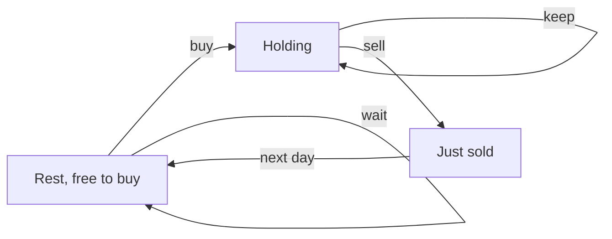

## The hook

A trader looks back over a week of prices and asks the classic question: what is the most I could have made? With one trade, it is the biggest rise from a low to a later high. With unlimited trades, it is every upward step. Then the rules get fiddly: a fee per trade, a forced day of rest after each sale, at most two trades, at most k trades.

Each rule sounds like it needs a new algorithm. It does not. Every version is the same idea: at the end of each day you are in one of a few situations, and a few lines update the best profit for each situation from yesterday's.

## The intuition

:::analogy
Think of a switch on the wall with three positions: OFF (no share, free to buy), ON (holding a share), and a spring-loaded COOLING position the switch drops into right after you sell. From OFF you may flip to ON by buying. From ON you may flip to COOLING by selling. COOLING always springs back to OFF the next day, and you may also just leave the switch where it is. Each day, for each position, keep only the best profit that could leave the switch there.
:::

That is [[state machine DP]]. The positions are the states, the allowed flips are the [[transition]]s, and each day every state takes the best of the transitions that lead into it. Two facts make it cheap:

- each day needs only yesterday's values, so a handful of variables suffices;
- the number of states is tiny, so the whole thing is O(n).

The [[holding state]] stores profit minus the price paid, so it is usually negative, and selling adds the day's price back.

## How it works

### The basic machine: unlimited transactions

Two states:

- hold = max(hold, cash - price): keep holding, or buy today;
- cash = max(cash, hold + price): stay out, or sell today.

Start with cash = 0 and hold = -∞ (you cannot hold before the first day). The answer is cash at the end. This gives the sum of every upward step, the same as the greedy.

### Add a fee

Charge the fee once per transaction, on the sale: cash = max(cash, hold + price - fee). Small rises are no longer worth trading, and the machine automatically merges nearby rises into one longer hold.

### Add a cooldown

Split "not holding" into two states: sold today, which leads into the [[cooldown state]] tomorrow, and resting, which is free to buy.

| State at end of day | Comes from | Formula |
|---|---|---|
| hold | hold yesterday, or buy from rest | max(hold, rest - price) |
| sold | sell from hold | hold + price |
| rest | rest yesterday, or the day after a sale | max(rest, sold) |

All three right-hand sides use yesterday's values, so compute the new triple from the old one before overwriting. The answer is max(sold, rest).

### Limit the number of transactions

With at most k transactions, add a [[transaction count state]]: buy[j] and sell[j] for j = 1..k, where j counts buys made so far.

- buy[j] = max(buy[j], sell[j - 1] - price): the j-th buy starts from the profit after j - 1 complete trades;
- sell[j] = max(sell[j], buy[j] + price).

Start with buy[j] = -∞ and sell[j] = 0. The answer is sell[k]. *Best Time to Buy and Sell Stock III* is k = 2, and *IV* is general k. If k is at least n / 2, the limit cannot bind, because each transaction needs at least two days, so use the unlimited version and avoid an O(n × k) table.

| Problem | States per day | Update cost |
|---|---|---|
| One transaction | min price so far, best profit | O(1) |
| Unlimited | hold, cash | O(1) |
| With fee | hold, cash | O(1) |
| With cooldown | hold, sold, rest | O(1) |
| At most k | buy[1..k], sell[1..k] | O(k) |



:::insight
Draw the situations you can be in at the end of a day and the moves between them. Each situation becomes one variable, each arrow becomes one term in a max, and every rule about fees, cooldowns or transaction limits is just a change to the drawing.
:::

## Walk through an example

Prices: 3, 1, 4, 2, 6, 3, 5.

### Cooldown machine

| Day | Price | hold | sold | rest |
|---|---|---|---|---|
| 1 | 3 | -3 | none | 0 |
| 2 | 1 | -1 (buy at 1) | -2 | 0 |
| 3 | 4 | -1 | 3 (sell at 4) | 0 |
| 4 | 2 | -1 | 1 | 3 |
| 5 | 6 | -1 | 5 (sell at 6) | 3 |
| 6 | 3 | 0 (buy at 3 after resting) | 2 | 5 |
| 7 | 5 | 0 | 5 | 5 |

Best: 5. One way is buy at 1 and sell at 6. Another is buy at 1, sell at 4, rest on day 4, then the machine sees that rebuying at 3 on day 6 and selling at 5 also ends at 5. The cooldown blocked the tempting "sell at 4, buy at 2 the next day" plan, which would have made 3 + 4 = 7.

### Other rules on the same prices

| Rule | Best profit | One best plan |
|---|---|---|
| One transaction | 5 | buy 1, sell 6 |
| Two transactions | 7 | 1 → 4, then 2 → 6 |
| Three or more transactions | 9 | 1 → 4, 2 → 6, 3 → 5 |
| Unlimited | 9 | every upward step: 3 + 4 + 2 |
| Fee of 2 per transaction | 3 | buy 1, sell 6, minus 2; or 1 → 4 and 2 → 6 minus 4 |
| Cooldown of one day | 5 | buy 1, sell 6 |

:::try-this
With a fee of 1 instead of 2, what is the best profit on these prices? (Three trades earn 3 + 4 + 2 - 3 = 6. Two trades, 1 → 4 and 2 → 6, earn 7 - 2 = 5. One trade, 1 → 6, earns 4. The machine finds 6.)
:::

:::warning
Common misconception: "Update hold and cash in place, one after the other, and it is fine." For the unlimited and fee versions, using today's new cash in today's hold only lets you sell and rebuy on the same day, which never changes the profit, so it is harmless. With a cooldown it breaks the rule: buying from a rest value that already includes today's sale lets you buy the day after selling. Compute the new values from yesterday's copies.
:::

## The code

```pseudo
cooldown(prices):
    hold = -inf; sold = -inf; rest = 0
    for p in prices:
        (hold, sold, rest) = (max(hold, rest - p), hold + p, max(rest, sold))
    return max(sold, rest)

at_most_k(prices, k):
    buy[1..k] = -inf; sell[0..k] = 0
    for p in prices:
        for j in 1..k:
            buy[j] = max(buy[j], sell[j-1] - p)
            sell[j] = max(sell[j], buy[j] + p)
    return sell[k]
```

```cpp
#include <bits/stdc++.h>
using namespace std;
const long long NEG = LLONG_MIN / 4;

long long withCooldown(const vector<int>& p) {
    long long hold = NEG, sold = NEG, rest = 0;
    for (int x : p) {
        long long h = max(hold, rest - x), s = hold + x, r = max(rest, sold);   // from yesterday
        hold = h, sold = s, rest = r;
    }
    return max(sold, rest);
}

long long withFee(const vector<int>& p, int fee) {
    long long cash = 0, hold = NEG;
    for (int x : p) {
        long long c = max(cash, hold + x - fee), h = max(hold, cash - x);
        cash = c, hold = h;
    }
    return cash;
}

long long atMostK(const vector<int>& p, int k) {
    int n = p.size();
    if (2 * k >= n) {                                      // the limit cannot bind
        long long s = 0;
        for (int i = 1; i < n; i++) s += max(0, p[i] - p[i - 1]);
        return s;
    }
    vector<long long> buy(k + 1, NEG), sell(k + 1, 0);
    for (int x : p)
        for (int j = 1; j <= k; j++) {
            buy[j] = max(buy[j], sell[j - 1] - x);         // j-th buy after j - 1 sales
            sell[j] = max(sell[j], buy[j] + x);
        }
    return sell[k];
}

int main() {
    vector<int> p = {3, 1, 4, 2, 6, 3, 5};
    cout << withCooldown(p) << ' ' << withFee(p, 2) << ' ' << withFee(p, 1) << '\n';   // 5 3 6
    for (int k = 0; k <= 4; k++) cout << atMostK(p, k) << ' ';
    cout << '\n';                                                                     // 0 5 7 9 9
}
```

In `atMostK`, updating buy[j] and sell[j] in place within one day is safe: it can only add a same-day buy and sell, which earns nothing. The cooldown version is the one where yesterday's values must be kept separate.

## Complexity

- **Unlimited, fee and cooldown: O(n) time, O(1) space.**
- **At most k transactions: O(n × k) time, O(k) space,** or O(n) when k ≥ n / 2.
- **Compared with brute force,** which tries every set of buy and sell days, this is the difference between exponential and linear.

## Common mistakes

- **Starting hold at 0,** which pretends you own a free share before the first day; start at minus infinity.
- **Updating cooldown states in place,** which allows buying the day after a sale.
- **Charging the fee on both buy and sell.**
- **Building an n × k table for huge k,** when k ≥ n / 2 means the unlimited answer.
- **Overflow when starting from INT_MIN** and adding a price; use a safely large negative 64-bit value.
- **Adding more states than needed,** such as separate states for each day of holding, which only slows the code.

## Practice problems

*With Cooldown* is the three-state machine. *With Transaction Fee* is two states with the fee on each sale. *III* is the k = 2 case, and *IV* is general k with the n / 2 shortcut. The earlier one-dimensional DP habits are in [Stairs, Robbers and Secret Codes](article:dsa-dp-1d), and the same "best so far" thinking for a single trade appears in [The Gambler Who Knows When to Walk Away](article:dsa-kadane).

## Key takeaways

- Stock-trading problems become state machine DP: each day ends in one of a few states, and each state keeps the best profit that can leave you there.
- Unlimited trading needs two states, hold and cash, and a fee is subtracted once per transaction, usually on the sale.
- A cooldown splits not-holding into just sold and resting, and only resting may buy.
- At most k transactions adds an index j for the number of buys, with buy[j] built from sell[j - 1].
- When k is at least half the number of days, the limit cannot bind and the unlimited answer applies.
