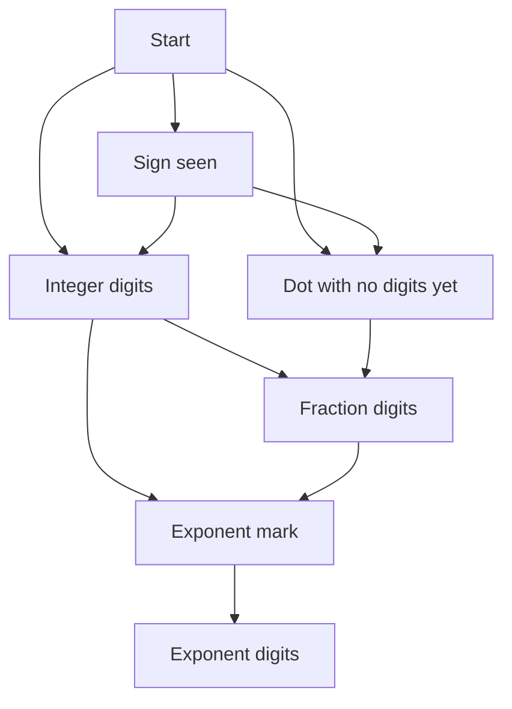

## The hook

"Convert this string to an integer." It sounds like a one-liner until the interviewer asks what happens with leading spaces, a plus sign, letters after the digits, or a value bigger than any int. Parsing questions are rarely about algorithms. They test whether you can read input carefully, one character at a time, without missing an edge case.

They also show up everywhere in real code: reading log lines, version numbers, configuration files and user input. Four reusable techniques cover nearly all of them: compressing runs, splitting into tokens, reading in phases, and validating with a state machine.

## The intuition

:::analogy
Picture a cashier reading a crumpled receipt aloud, line by line. Her finger moves along the text and never goes back. She knows what she expects next: first the item name, then the quantity, then the price. Stray spaces she skips. A smudge where a digit should be means the line is unreadable. And when the same item appears five times in a row, she just says "five of those".
:::

Every technique below is that cashier.

- Her finger is a [[cursor]], an index that only moves forward.
- "Five of those" is [[run-length encoding]].
- Splitting the receipt into items and prices is tokenising: cutting the string into [[token|tokens]].
- "First the name, then the quantity, then the price" is reading in [[phase|phases]].
- Deciding whether a line is readable at all is a [[state machine]].

## How it works

### Technique 1: run-length encoding with two pointers

*String Compression* replaces each run of equal characters with the character and, if the run is longer than 1, its length written digit by digit. It must happen in place and return the new length.

Use a read pointer and a write pointer, as in [Two Fingers on a Sorted List](article:dsa-two-pointers). The read pointer finds the end of the current run. The write pointer writes the character and then the digits of the run length. Because the compressed form of a run is never longer than the run itself, the write pointer never overtakes the read pointer, so nothing unread is overwritten.

### Technique 2: tokenising

Many problems are "split, then work on the pieces". *Reverse Words in a String* splits on spaces and must ignore leading, trailing and repeated spaces. *Compare Version Numbers* splits on dots and compares the pieces as integers, so 1.01 equals 1.001 and missing pieces count as 0.

The safe loop has the same shape every time:

- skip delimiters;
- if the end is reached, stop;
- read characters until the next delimiter, and that slice is a token.

`stringstream >> word` does the first two steps for whitespace in C++, and is fine in interviews unless they ask for O(1) extra space.

### Technique 3: phases, for atoi

*String to Integer (atoi)* reads in strict phases and never goes back:

| Phase | Accept | Then |
|---|---|---|
| Leading spaces | ' ' | skip them |
| Sign | at most one '+' or '−' | remember it |
| Digits | '0' to '9' | build the number, clamping on overflow |
| Anything else | | stop and return what you have |

The hard part is [[overflow clamping]]. Building `result = result * 10 + d` in a 32-bit int overflows before you can check it. Either build in a 64-bit integer and clamp as soon as it passes the limit, or check before multiplying: if `result > (INT_MAX - d) / 10`, the next step would overflow.

### Technique 4: a state machine, for Valid Number

*Valid Number* asks whether a string like "−123.456e789" is a valid number. The grammar is: an optional sign, then digits with at most one dot and at least one digit somewhere, then optionally an 'e' or 'E' followed by an optional sign and at least one digit.

A state machine names each situation the cashier can be in and says which characters may come next:



Read the picture like this. Digits loop on themselves in the integer, fraction and exponent states. A dot moves from integer digits to the fraction, or from start or sign to "dot with no digits yet". An exponent mark is allowed only after at least one digit, and a sign is allowed right after it. The string is valid if it ends in integer digits, fraction digits or exponent digits, never in start, sign, a lone dot or right after the 'e'.

You can code the machine as a transition table, but in practice three flags capture the same states: `seenDigit`, `seenDot` and `seenExp`. Each character either fits the current situation and updates a flag, or makes the string invalid.

| Character | Allowed when | Then |
|---|---|---|
| digit | always | seenDigit = true |
| '+' or '−' | at the start, or right after 'e' | nothing |
| '.' | no dot yet and no exponent yet | seenDot = true |
| 'e' or 'E' | no exponent yet and seenDigit | seenExp = true, seenDigit = false |
| anything else | never | invalid |

At the end the string is valid exactly when seenDigit is true. Resetting seenDigit at the 'e' is what forces digits after the exponent mark.

:::insight
A parser is a cursor plus a small amount of state that says what may come next. Write that state down explicitly, as phases or as flags, and every edge case becomes a row in a table instead of a surprise.
:::

## Walk through an example

### Compressing [a, a, b, b, c, c, c]

| Run | Read range | Written | Array prefix after writing | write |
|---|---|---|---|---|
| a × 2 | 0 to 1 | a, 2 | a 2 | 2 |
| b × 2 | 2 to 3 | b, 2 | a 2 b 2 | 4 |
| c × 3 | 4 to 6 | c, 3 | a 2 b 2 c 3 | 6 |

The returned length is 6. For [a, b × 12] the runs are a × 1, written as a alone, and b × 12, written as b, 1, 2, so the length is 4.

### atoi on five inputs

| Input | Spaces skipped | Sign | Digits read | Stops at | Result |
|---|---|---|---|---|---|
| "   -42" | 3 | − | 42 | end | −42 |
| "4193 with words" | 0 | + | 4193 | ' ' | 4193 |
| "-91283472332" | 0 | − | passes the limit | clamp | −2147483648 |
| "+-12" | 0 | + | none | '−' | 0 |
| "words 987" | 0 | + | none | 'w' | 0 |

Look at the third row closely. The digits keep coming, and partway through, the magnitude exceeds 2147483648. The cashier stops there and reads out the smallest 32-bit value; she does not keep adding digits to a number that has already overflowed.

### Valid Number with the flags

Take "−3.5e+7":

| Char | Rule | seenDigit | seenDot | seenExp |
|---|---|---|---|---|
| − | sign at start | false | false | false |
| 3 | digit | true | false | false |
| . | first dot, no exponent | true | true | false |
| 5 | digit | true | true | false |
| e | first exponent, after a digit | false | true | true |
| + | sign right after e | false | true | true |
| 7 | digit | true | true | true |

It ends with seenDigit true: valid. Now "1e": after the 'e', seenDigit is false and nothing follows, so it is invalid. And "99e2.5": the dot after the exponent breaks the rule "no exponent yet", so it is invalid.

:::try-this
Using the flag rules, decide whether ".", "4." and "-.9" are valid numbers. ("." ends with seenDigit false: invalid. "4." has a digit and one dot: valid. "-.9" has a sign at the start, a dot, then a digit: valid.)
:::

:::warning
Common misconception: "Just use stoi or a regular expression." Library functions follow their own rules: stoi throws on overflow instead of clamping, and it accepts things a given problem may reject. Interviewers ask these questions to see your own careful parse. Use the library only when the problem's rules match it exactly and you can say so.
:::

## The code

```pseudo
compress(chars):
    read = 0; write = 0
    while read < n:
        start = read
        while read < n and chars[read] == chars[start]: read += 1
        chars[write] = chars[start]; write += 1
        if read - start > 1:
            for each digit d of (read - start): chars[write] = d; write += 1
    return write

my_atoi(s):
    i = 0; skip spaces
    sign = +1; if s[i] is + or -: set sign; i += 1
    result = 0
    while s[i] is a digit:
        if result * 10 + digit would pass the 32-bit limit: return the clamped limit
        result = result * 10 + digit; i += 1
    return sign * result

is_number(s):
    digit = dot = exp = false
    for each position i, character c:
        if c is a digit: digit = true
        else if c is + or -: valid only if i == 0 or s[i-1] is e or E
        else if c is '.': valid only if not dot and not exp; dot = true
        else if c is e or E: valid only if not exp and digit; exp = true; digit = false
        else: invalid
    return digit
```

```cpp
#include <bits/stdc++.h>
using namespace std;

// In-place run-length compression; returns the new length.
int compress(vector<char>& ch) {
    int n = ch.size(), read = 0, write = 0;
    while (read < n) {
        int start = read;
        while (read < n && ch[read] == ch[start]) read++;
        ch[write++] = ch[start];
        if (read - start > 1)
            for (char d : to_string(read - start)) ch[write++] = d;   // 12 becomes '1', '2'
    }
    return write;
}

// Split on spaces, ignoring extra spaces, and reverse the word order.
string reverseWords(const string& s) {
    vector<string> words;
    int i = 0, n = s.size();
    while (i < n) {
        while (i < n && s[i] == ' ') i++;            // skip delimiters
        if (i == n) break;
        int j = i;
        while (j < n && s[j] != ' ') j++;            // one token is s[i, j)
        words.push_back(s.substr(i, j - i));
        i = j;
    }
    string out;
    for (int k = words.size() - 1; k >= 0; k--) out += words[k] + (k ? " " : "");
    return out;
}

// Compare dot-separated versions numerically; missing parts count as 0.
int compareVersion(const string& a, const string& b) {
    int i = 0, j = 0;
    while (i < (int)a.size() || j < (int)b.size()) {
        long long x = 0, y = 0;
        while (i < (int)a.size() && a[i] != '.') x = x * 10 + (a[i++] - '0');
        while (j < (int)b.size() && b[j] != '.') y = y * 10 + (b[j++] - '0');
        if (x != y) return x < y ? -1 : 1;
        i++, j++;                                    // step over the dots
    }
    return 0;
}

// atoi: spaces, optional sign, digits; clamp to 32 bits.
int myAtoi(const string& s) {
    int i = 0, n = s.size(), sign = 1;
    while (i < n && s[i] == ' ') i++;
    if (i < n && (s[i] == '+' || s[i] == '-')) sign = (s[i++] == '-') ? -1 : 1;
    long long result = 0;
    while (i < n && isdigit((unsigned char)s[i])) {
        result = result * 10 + (s[i++] - '0');
        if (sign * result > INT_MAX) return INT_MAX;   // stop as soon as the limit is passed
        if (sign * result < INT_MIN) return INT_MIN;
    }
    return sign * result;
}

// Valid Number with three flags standing in for the state machine.
bool isNumber(const string& s) {
    bool digit = false, dot = false, exp = false;
    for (int i = 0; i < (int)s.size(); i++) {
        char c = s[i];
        if (isdigit((unsigned char)c)) digit = true;
        else if (c == '+' || c == '-') { if (i > 0 && s[i - 1] != 'e' && s[i - 1] != 'E') return false; }
        else if (c == '.') { if (dot || exp) return false; dot = true; }
        else if (c == 'e' || c == 'E') { if (exp || !digit) return false; exp = true; digit = false; }
        else return false;
    }
    return digit;
}

int main() {
    vector<char> a = {'a', 'a', 'b', 'b', 'c', 'c', 'c'};
    int len = compress(a);
    cout << len << ' ' << string(a.begin(), a.begin() + len) << '\n';   // 6 a2b2c3
    vector<char> b = {'a', 'b', 'b', 'b', 'b', 'b', 'b', 'b', 'b', 'b', 'b', 'b', 'b'};
    len = compress(b);
    cout << len << ' ' << string(b.begin(), b.begin() + len) << '\n';   // 4 ab12
    cout << '[' << reverseWords("  the sky  is blue ") << "]\n";       // [blue is sky the]
    cout << compareVersion("1.01", "1.001") << ' ' << compareVersion("1.0", "1.0.0") << ' '
         << compareVersion("0.1", "1.1") << '\n';                        // 0 0 -1
    for (string t : {"   -42", "4193 with words", "-91283472332", "+-12", "words 987"})
        cout << myAtoi(t) << ' ';
    cout << '\n';                                    // -42 4193 -2147483648 0 0
    for (string t : {"-3.5e+7", "1e", "99e2.5", ".", "4.", "-.9", "e3", "--6"})
        cout << isNumber(t);
    cout << '\n';                                    // 10001100
}
```

`myAtoi` builds in a 64-bit integer and checks after every digit, so the moment the value passes the 32-bit range it returns the limit. A 64-bit value cannot overflow in between, because it is at most about 2.1 billion times 10 plus 9 at the moment of the check.

## Complexity

- **Compression: O(n) time, O(1) extra space.** Each character is read once and written at most once.
- **Tokenising: O(n) time.** Every character is visited a constant number of times; the tokens themselves take O(n) space unless you work in place, for example by reversing the whole string and then each word.
- **atoi and Valid Number: O(n) time, O(1) space.** One forward pass of the cursor with a few variables of state.

## Common mistakes

- **Writing the count as one character** in compression. A run of 12 must become '1', '2', not the character with code 12.
- **Writing "1" for single characters.** In *String Compression*, runs of length 1 get no count. *Count and Say* is the opposite: it always writes the count.
- **Overflow in atoi** from computing `result * 10 + d` in a 32-bit int before checking.
- **Accepting two signs** like "+-12", or a sign after digits.
- **Comparing version pieces as strings,** so "01" and "1" look different, or failing on different numbers of pieces.
- **Treating "1e" or "." as valid.** At least one digit is needed before the end, and after an 'e' the digit count starts again.
- **Splitting with repeated delimiters** and producing empty tokens, then printing extra spaces.

## Practice problems

Start with *String Compression*, the two-pointer run-length encoding, and *Count and Say*, where you apply run-length reading repeatedly to build each term from the last. *Reverse Words in a String* and *Compare Version Numbers* drill tokenising with awkward delimiters. *String to Integer (atoi)* is the phase-by-phase parse with overflow. *Valid Number* is the state machine; draw the states before you code, then compress them into flags. For more general string tools, see [Mirrors, Anagrams and Letter Counts](article:dsa-string-patterns).

## Key takeaways

- A parser keeps a cursor that only moves forward plus a small amount of state that says what may come next.
- Run-length encoding in place uses a read pointer to find each run and a write pointer for the character and the digits of its length.
- Tokenising follows one loop shape: skip delimiters, stop at the end, then read one token up to the next delimiter.
- atoi reads in phases, spaces then sign then digits, and must clamp to the 32-bit range before the value can overflow.
- Validation problems are state machines; drawing the states first turns every edge case into an explicit rule, and a few flags can implement them.
