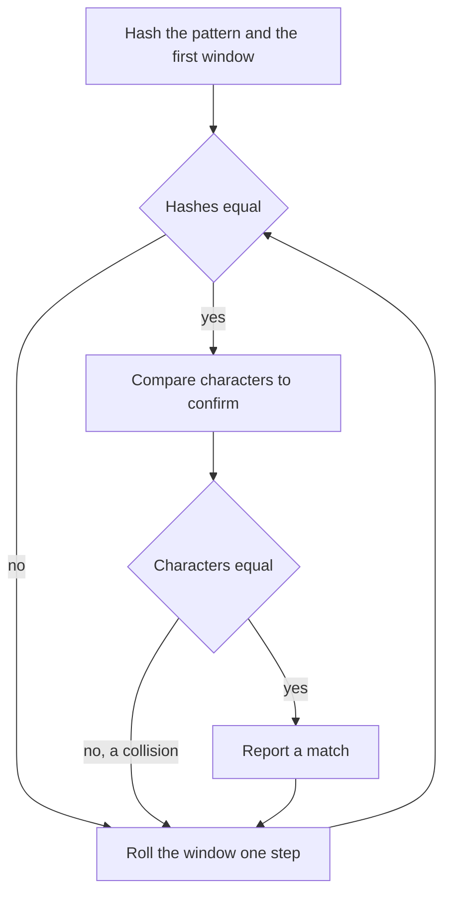

## The hook

A proofreader looks for a word on a page by sliding a paper stencil with the word cut out of it along each line. At every position they peer through all the letters to check. Most positions fail on the first letter, but a nasty page full of near-misses can make them check almost every letter at every position.

Computers face the same problem in every "find" box, every plagiarism checker and every DNA search. The brute force is fine for short words. For long patterns, or many windows, a cleverer idea compares one number per position instead of m letters, and updates that number in constant time as the stencil slides.

## The intuition

:::analogy
Instead of peering through every hole in the stencil, give each stretch of text a fingerprint: a single number computed from its letters. Compare the stencil's fingerprint with the page's fingerprint at each position, and only peer through the holes when the fingerprints agree. The trick that makes it fast: when the stencil slides one letter to the right, the new fingerprint is computed from the old one by removing the letter that left and adding the letter that entered, without looking at the letters in between.
:::

The fingerprint is a [[polynomial hash]]: the window read as a number in base B, reduced modulo M. Sliding it is a [[rolling hash]]:

h_new = ((h_old - s[i] × B^(m-1)) × B + s[i + m]) mod M.

Comparing fingerprints and confirming on a match is [[Rabin-Karp]]. The confirmation is not optional: a [[hash collision]] can make two different strings share a fingerprint, especially when M is small.

## How it works

### The naive matcher

For each start i from 0 to n - m, compare `t[i..i+m)` with p character by character. Average inputs fail fast, but text "aaaa...a" with pattern "aa...ab" makes each shift compare m characters: O(n × m).

### Rabin-Karp step by step

- Map characters to numbers, for example a = 1 to z = 26. Avoid mapping any letter to 0, or "a" and "aa" could collide trivially.
- Compute the pattern's hash and the first window's hash in O(m), and B^(m-1) mod M once.
- For each shift, compare hashes; if equal, compare characters; then roll the hash forward in O(1).

Expected time is O(n + m): one O(1) roll per shift, plus O(m) checks only on hash matches, which are rare when M is large and the text has few true matches.

### Choosing B and M, and handling collisions

| Choice | Effect |
|---|---|
| M around 10⁹ | a random pair collides with probability about 1 in 10⁹; fine with confirmation |
| M = 2⁶¹ - 1 with 128-bit multiplication | collisions are very unlikely even without checking every match |
| Two hashes with different (B, M) | roughly squares the safety of one hash |
| Fixed, well-known B and M | anti-hash tests on contest sites can break them; pick B at random at start-up |
| Subtraction in the roll | add M before taking the modulus so the value never goes negative |

The contest-depth treatment of prefix hashes, comparing any two substrings in O(1), is in [A Fingerprint for Every Substring](article:cp-string-hashing).

### When an exact code exists: Repeated DNA Sequences

*Repeated DNA Sequences* asks for every 10-letter window that appears more than once in a string of A, C, G and T. Four letters need 2 bits each, so a 10-letter window is a 20-bit number, and every distinct window gets a distinct number: an [[exact encoding]] with no collisions at all. Roll it like a hash: shift left by 2, OR in the new letter, and mask to 20 bits.

### Binary search plus hashing: Longest Duplicate Substring

*Longest Duplicate Substring* asks for the longest substring that occurs at least twice. If some length L has a duplicate, every shorter length does too (take a prefix of it), so binary search on L. For each guess, roll a hash over all windows of length L and look for a repeat in a hash set, confirming the characters on a hit. Each check is O(n), so the whole search is O(n log n).



:::insight
A rolling hash turns each window into one number that updates in O(1) as the window slides, so comparing a pattern against every position costs one number comparison each. Because different strings can share a hash, equal hashes are a hint to check, not a proof.
:::

## Walk through an example

Text "abracadabra", pattern "cad", with a = 1, ..., z = 26, B = 26 and M = 101.

hash("cad") = (3 × 26² + 1 × 26 + 4) mod 101 = 38.

| Shift | Window | Rolling hash | Equal to 38? |
|---|---|---|---|
| 0 | abr | 39 | no |
| 1 | bra | 3 | no |
| 2 | rac | 77 | no |
| 3 | aca | 48 | no |
| 4 | cad | **38** | yes, confirm: match at 4 |
| 5 | ada | 74 | no |
| 6 | dab | 5 | no |
| 7 | abr | 39 | no |
| 8 | bra | 3 | no |

Each hash after the first was computed from the one before. For example, from "abr" (39) to "bra": remove 1 × 26² for the leaving 'a', multiply by 26, add 1 for the entering 'a', all mod 101, giving 3.

### A collision on purpose

With the tiny modulus M = 79, hash("bra") and hash("cad") are equal. Rabin-Karp would see equal hashes at shifts 1 and 8, compare characters, find "bra" ≠ "cad", and move on. Without the confirmation step, it would report two false matches. Real moduli are far larger, which makes collisions rare, but never impossible.

### DNA windows

In "ACGTTACGTTGACGTTACGTTG", the 10-letter windows that appear more than once are "ACGTTACGTT" and "CGTTACGTTG". Each is a 20-bit number, found in a hash set of seen codes with no collision checks.

### Longest duplicate

For "abcabcbabc", binary search tries lengths and finds that 3 works ("abc" appears three times) but 4 does not, so the answer is "abc". For "mississippi" the answer is "issi", whose two copies overlap.

:::try-this
With B = 26 and M = 101, roll the hash from "aca" (48) to "cad". (Remove 'a': 48 - 1 × 26² mod 101. 26² = 676 = 6 × 101 + 70, so subtract 70: 48 - 70 = -22, which is 79 after adding 101. Multiply by 26: 79 × 26 = 2054 = 20 × 101 + 34, so 34. Add 'd' = 4: 38, matching hash("cad").)
:::

:::warning
Common misconception: "If two hashes are equal, the strings are equal." Hashing maps infinitely many strings onto M values, so collisions must exist. With M = 79, "bra" and "cad" collide. Always confirm with a character comparison, or use a large modulus or double hashing when confirmation is too costly, and know which risk you are taking.
:::

## The code

```pseudo
rabin_karp(t, p):
    hp = hash(p); h = hash(t[0..m)); pw = B^(m-1) mod M
    for i in 0 .. n-m:
        if h == hp and t[i..i+m) == p: report i
        if i + m < n: h = ((h - t[i]*pw) * B + t[i+m]) mod M     # keep it non-negative
```

```cpp
#include <bits/stdc++.h>
using namespace std;
using ull = unsigned long long;

vector<int> rabinKarp(const string& t, const string& p, ull B = 26, ull M = 1000000007ULL) {
    int n = t.size(), m = p.size();
    vector<int> found;
    if (m > n) return found;
    auto val = [](char c) { return ull(c - 'a' + 1); };       // never 0
    ull hp = 0, h = 0, pw = 1;
    for (int i = 0; i < m; i++) {
        hp = (hp * B + val(p[i])) % M;
        h = (h * B + val(t[i])) % M;
        if (i) pw = pw * B % M;
    }
    for (int i = 0; i + m <= n; i++) {
        if (h == hp && t.compare(i, m, p) == 0) found.push_back(i);   // confirm on a hit
        if (i + m < n) h = ((h + M - val(t[i]) * pw % M) * B + val(t[i + m])) % M;
    }
    return found;
}

vector<string> repeatedDna(const string& s) {
    auto code = [](char c) { return c == 'A' ? 0 : c == 'C' ? 1 : c == 'G' ? 2 : 3; };
    unordered_map<int, int> seen;
    vector<string> out;
    int x = 0;
    for (int i = 0; i < (int)s.size(); i++) {
        x = ((x << 2) | code(s[i])) & ((1 << 20) - 1);         // exact 20-bit window
        if (i >= 9 && ++seen[x] == 2) out.push_back(s.substr(i - 9, 10));
    }
    return out;
}

const ull MOD = (1ULL << 61) - 1;
ull mulmod(ull a, ull b) {
    __uint128_t r = (__uint128_t)a * b;
    ull x = (ull)(r & MOD) + (ull)(r >> 61);
    return x >= MOD ? x - MOD : x;
}

int duplicateOfLength(const string& s, int L, ull B) {         // start of a repeat, or -1
    ull h = 0, pw = 1;
    for (int i = 0; i < L; i++) h = (mulmod(h, B) + s[i]) % MOD, pw = mulmod(pw, B);
    unordered_map<ull, vector<int>> seen{{h, {0}}};
    for (int i = 1; i + L <= (int)s.size(); i++) {
        h = (mulmod(h, B) + MOD - mulmod(s[i - 1], pw) + s[i + L - 1]) % MOD;
        for (int j : seen[h]) if (s.compare(j, L, s, i, L) == 0) return i;
        seen[h].push_back(i);
    }
    return -1;
}

string longestDupSubstring(const string& s) {
    ull B = 911382323;                                         // a large base; randomise in contests
    int lo = 1, hi = s.size() - 1, start = -1, len = 0;
    while (lo <= hi) {                                         // longest L that has a repeat
        int mid = (lo + hi) / 2, at = duplicateOfLength(s, mid, B);
        if (at != -1) start = at, len = mid, lo = mid + 1;
        else hi = mid - 1;
    }
    return start == -1 ? "" : s.substr(start, len);
}

int main() {
    for (int i : rabinKarp("abracadabra", "cad")) cout << i << ' ';
    for (int i : rabinKarp("abracadabra", "bra", 26, 79)) cout << i << ' ';
    cout << '\n';                                              // 4 1 8
    for (auto& w : repeatedDna("ACGTTACGTTGACGTTACGTTG")) cout << w << ' ';
    cout << '\n';                                              // ACGTTACGTT CGTTACGTTG
    cout << longestDupSubstring("abcabcbabc") << ' ' << longestDupSubstring("mississippi") << '\n';   // abc issi
}
```

The second call uses the tiny modulus 79 on purpose: the "bra" windows are true matches, and the "cad" window, which collides with them, is rejected by the character check.

## Complexity

- **Naive matching: O(n × m)** worst case, O(1) extra space.
- **Rabin-Karp: O(n + m) expected,** with O(m) per confirmed match; a deliberately collision-heavy input with a small modulus can push it back to O(n × m).
- **Repeated DNA: O(n) time,** with a hash set of up to n codes.
- **Longest Duplicate Substring: O(n log n) expected,** O(n) space per binary-search step.

## Common mistakes

- **Skipping the confirmation** on equal hashes.
- **Negative values** after subtracting the leaving character; add M before the modulus.
- **Overflow** when multiplying two values near 10⁹ in 32-bit arithmetic; use 64-bit, or 128-bit for a 61-bit modulus.
- **Mapping a character to 0,** which makes strings that differ only by leading zero-valued characters collide.
- **Recomputing every window's hash from scratch,** which is O(n × m) again.
- **Using a fixed public base and modulus on contest sites** that may include anti-hash tests; choose the base at random.

## Practice problems

*Find the Index of the First Occurrence in a String* is the basic matcher; solve it naively, then with Rabin-Karp. *Repeated DNA Sequences* uses an exact rolling code. *Longest Duplicate Substring* combines binary search with rolling hashes. The next step, a matcher that never re-reads text and needs no hashing, is KMP, and the string basics are in [Mirrors, Anagrams and Letter Counts](article:dsa-string-patterns).

## Key takeaways

- Naive string matching compares the pattern at every position and costs O(n × m) in the worst case.
- A polynomial rolling hash gives each window one number that updates in O(1) as the window slides by one character.
- Rabin-Karp compares hashes and confirms with a character check, because different strings can share a hash.
- Large moduli, 128-bit arithmetic or two independent hashes make collisions rare, but only confirmation makes them harmless.
- When the alphabet is tiny, an exact bit encoding avoids collisions entirely, and binary search on length plus hashing finds the longest repeated substring in O(n log n).
