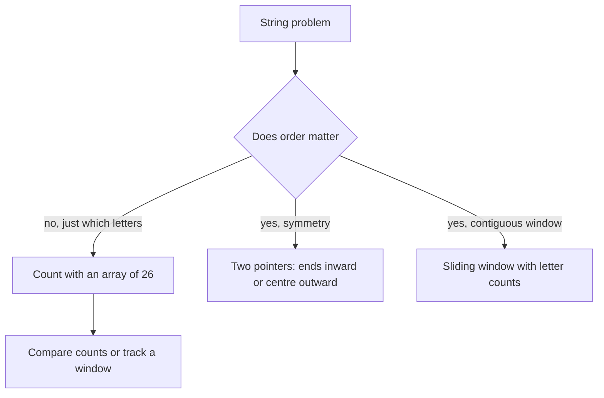

## The hook

String questions look endless: anagrams, palindromes, "longest substring with at most k changes", "group words that are rearrangements of each other". Then you notice something. Almost all of them reduce to two tools you already know: counting letters, and two pointers moving in from the ends or out from the middle.

Learn those two tools in their string form, plus one performance trap, and a whole category of interview questions turns routine.

## The intuition

:::analogy
Think of a mirror placed at the middle of a word. If the word is a palindrome, the left half's reflection matches the right half exactly. To check, you can stand at both ends and walk inward, comparing letters, or stand at the mirror and walk outward. And to check whether two words are anagrams, you do not care about order at all: you just pour each word's letters into a row of 26 labelled cups and see whether the cups match.
:::

The cups are a [[frequency array]]. Walking from both ends toward the mirror, or outward from it, is two pointers applied to strings.

## How it works

### Tool 1: count letters

When the alphabet is small, say 26 lowercase letters, an array of 26 counters beats a hash map: it is faster, simpler and uses constant space. For [[anagram]]s, add one per letter of the first word and subtract one per letter of the second. All zeros means the words match. The same cups also answer "can these letters form a palindrome?": at most one cup may hold an odd count.

The same counts power sliding-window string problems: keep counts for the letters inside the window and update them as characters enter and leave, as in [The Caterpillar That Reads Arrays in One Pass](article:dsa-sliding-window).

### Tool 2: walk with two pointers

- **Is it a [[palindrome]]?** Put pointers at both ends, compare, move inward. Stop at the first mismatch.
- **Longest palindromic substring?** Use [[expand around centre]]: for each possible centre, grow outward while the letters on both sides match. Odd-length palindromes centre on a character; even-length ones centre between two characters, so there are 2n − 1 centres.



:::insight
Ask whether order matters. If it does not, anagrams, permutations, "can be rearranged into", count letters and compare counts. If it does, use pointers: from both ends for a whole-string check, from a centre for substrings, or a window for contiguous ranges.
:::

### The performance trap

In many languages strings are an [[immutable string]] type, and even in C++ the expression `s = s + c` builds a brand-new string each time. Doing that n times copies 1 + 2 + ... + n characters: O(n²). Append in place with `s += c` or `s.push_back(c)`, which is amortised O(1), or collect pieces and join once.

## Walk through an example

**Longest palindromic substring** of `"cbbd"` with expand around centre.

| Centre | Type | Expansion | Palindrome found |
|---|---|---|---|
| c (0) | odd | c | "c", length 1 |
| between c and b | even | c ≠ b | none |
| b (1) | odd | b; then c vs b differ | "b" |
| between b and b | even | b = b; then c vs d differ | **"bb", length 2** |
| b (2) | odd | b; then b vs d differ | "b" |
| between b and d | even | b ≠ d | none |
| d (3) | odd | d | "d" |

Answer: "bb". An approach that only tried characters as centres would miss it, because "bb" is centred between two letters.

:::try-this
Check whether "rat" and "tar" are anagrams with one array of 26 cups. Then check "rat" and "car". (rat/tar: r, a, t each go +1 then −1, all cups end at 0, anagrams. rat/car: t stays +1 and c ends at −1, not anagrams.)
:::

## The code

```pseudo
is_anagram(s, t):
    if len(s) != len(t): return false
    cnt = [0] * 26
    for i in range: cnt[s[i]] += 1; cnt[t[i]] -= 1
    return all cnt == 0

longest_palindrome(s):
    best = (0, 1)                        // start, length
    for c in 0 .. len(s)-1:
        for (l, r) in [(c, c), (c, c+1)]:      // odd and even centres
            while l >= 0 and r < len(s) and s[l] == s[r]: l -= 1; r += 1
            if r - l - 1 > best.length: best = (l + 1, r - l - 1)
    return s[best.start : best.start + best.length]
```

```cpp
#include <bits/stdc++.h>
using namespace std;

bool isAnagram(const string& s, const string& t) {
    if (s.size() != t.size()) return false;
    array<int, 26> cnt{};
    for (size_t i = 0; i < s.size(); i++) { cnt[s[i] - 'a']++; cnt[t[i] - 'a']--; }
    for (int c : cnt) if (c != 0) return false;
    return true;
}

string longestPalindrome(const string& s) {
    int n = s.size(), start = 0, len = n ? 1 : 0;
    for (int c = 0; c < n; c++) {
        for (int k = 0; k < 2; k++) {
            int l = c, r = c + k;
            while (l >= 0 && r < n && s[l] == s[r]) { l--; r++; }
            if (r - l - 1 > len) { len = r - l - 1; start = l + 1; }
        }
    }
    return s.substr(start, len);
}

int main() {
    cout << isAnagram("listen", "silent") << ' ' << longestPalindrome("cbbd") << '\n';  // 1 bb
}
```

## Complexity

- **Anagram check:** O(n) time, O(1) space with a fixed 26-letter alphabet.
- **Palindrome check with two pointers:** O(n) time, O(1) space.
- **Expand around centre:** O(n²) time in the worst case, such as "aaaa...", O(1) space. Manacher's algorithm, covered in the CP subject, does it in O(n).

## Common mistakes

:::warning
Common misconception: "a hash map is always the right way to count characters." For a small fixed alphabet, an array of 26 or 128 counters is faster and simpler. Use a hash map when the alphabet is large or unknown, such as Unicode words.
:::

- **Forgetting even-length centres** in palindrome problems.
- **Off-by-one when recovering the substring** after expansion: the palindrome is from l + 1 to r − 1.
- **Assuming lowercase only** when the input may contain capitals, digits or spaces; normalise first, as in Valid Palindrome.
- **Building strings with `s = s + c`** in a loop, which is quadratic.

## Practice problems

*Valid Anagram* and *Valid Palindrome* are the two tools in their purest form. *Longest Palindromic Substring* and *Palindromic Substrings* use expand around centre; the second counts every expansion step. *Longest Repeating Character Replacement* combines letter counts with a sliding window: the window is valid while its length minus its most frequent letter's count is at most k.

## Key takeaways

- Many string problems reduce to two tools: counting letters, and two pointers that move inward from the ends or outward from a centre.
- For a small fixed alphabet, an array of 26 counters is the fastest way to compare letter counts, as in anagram checks.
- Expand around each of the 2n − 1 centres to find palindromic substrings, remembering that even-length palindromes centre between letters.
- Combine letter counts with a sliding window for contiguous substring problems.
- Append to strings in place; building with s = s + c in a loop is quadratic.
