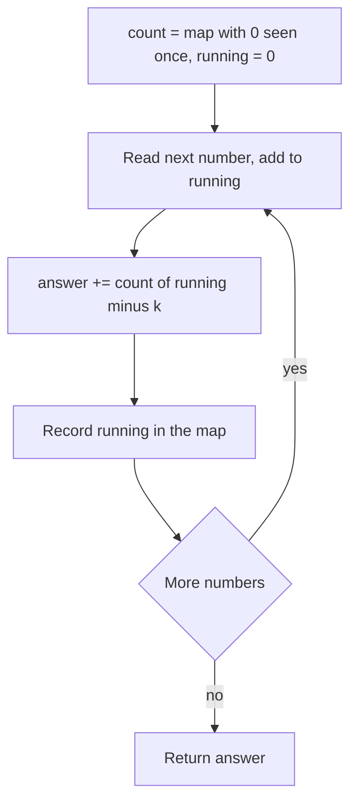

## The hook

"Count the subarrays whose sum equals k." With only positive numbers, a sliding window solves it in one pass. Add a single negative number, and the window falls apart: growing it might shrink the sum, so you no longer know which end to move.

The fix combines two tools you already have, prefix sums and a hash map, into a one-pass algorithm that does not care about signs. It is a favourite interview question precisely because it tests whether you can combine patterns.

## The problem

Given an integer array `nums`, which may contain negative numbers and zeros, and an integer `k`, return the number of non-empty contiguous [[subarray|subarrays]] whose elements sum to exactly k.

Example: `nums = [1, 2, 3]`, `k = 3`. The subarrays [1, 2] and [3] both sum to 3, so the answer is 2.

## The obvious approach

Try every start i and extend the end j, keeping a running sum: O(n²) subarrays, each updated in O(1). Correct, but about 5 × 10⁹ steps for n = 10⁵.

The sliding window from [The Caterpillar That Reads Arrays in One Pass](article:dsa-sliding-window) would be O(n), but it needs sums to grow when the window grows. With negatives, that is false.

## The key insight

:::analogy
Think of a car's odometer. To check whether some stretch of your trip covered exactly 30 km, you do not re-drive any part. At each moment, you look at the current reading, say 112, and ask your notebook: "did the odometer ever read 82?" Every time it did, the stretch from then to now was exactly 30 km. The notebook records every reading you have passed, and how many times.
:::

With a [[prefix sum]] P, the sum of a subarray ending at j and starting after position i is P[j] − P[i]. We want that to equal k, so we need earlier prefix sums equal to P[j] − k, the [[complement]].

Walk left to right, keeping a [[frequency map]] of every prefix sum seen so far. At each j, add `count[P[j] − k]` to the answer, then record P[j]. Negative numbers just make the odometer go backwards sometimes; the notebook does not care.

:::insight
Turn "find a subarray with property X" into "find an earlier prefix that pairs with the current one". Then a hash map of earlier prefixes answers each step in O(1), whatever the signs of the numbers.
:::



## Walk through an example

`nums = [1, −1, 2, 1, −2, 1]`, k = 2. The map starts as {0: 1}.

| j | value | running P | P − k | count[P − k] | answer | map after |
|---|---|---|---|---|---|---|
| 0 | 1 | 1 | −1 | 0 | 0 | {0:1, 1:1} |
| 1 | −1 | 0 | −2 | 0 | 0 | {0:2, 1:1} |
| 2 | 2 | 2 | 0 | 2 | 2 | {0:2, 1:1, 2:1} |
| 3 | 1 | 3 | 1 | 1 | 3 | {..., 3:1} |
| 4 | −2 | 1 | −1 | 0 | 3 | {..., 1:2} |
| 5 | 1 | 2 | 0 | 2 | 5 | {..., 2:2} |

Answer: 5. For example at j = 2, the two earlier prefixes equal to 0 give subarrays [1, −1, 2] and [2].

:::try-this
Using the table, list the subarrays found at j = 3 and j = 5. (j = 3 pairs with the prefix 1 at j = 0, giving [−1, 2, 1]. j = 5 pairs with the two prefixes equal to 0, at the start and at j = 1, giving [1, −1, 2, 1, −2, 1] and [2, 1, −2, 1].)
:::

### Why order of operations matters

At each step, look up first and record second. Looking up `running − k` before adding `running` to the map ensures that every pair uses an earlier prefix and a later one, which corresponds to a real, non-empty subarray. If you recorded first, then with k = 0 every position would match itself and count an empty subarray. In odometer terms: you only compare the current reading with readings you passed earlier, never with the one you are reading right now.

### One template, many keys

The walkthrough's machine has three dials: what you add to the running value, what you look up, and what you store for each key. Turning them gives a whole family of problems:

| Problem | Add per element | Look up | Store per key |
|---|---|---|---|
| Count subarrays with sum k | the value | running − k | how many times seen |
| Longest subarray with sum k | the value | running − k | first index seen |
| Sum divisible by k | the value, mod k | the same remainder | how many times seen |
| Sum a multiple of k, length at least 2 | the value, mod k | the same remainder | first index seen |
| Equal 0s and 1s | +1 for 1, −1 for 0 | the same running value | first index seen |
| Exactly k odd numbers | 1 if odd, else 0 | running − k | how many times seen |

Two rules decide the last column. To **count** subarrays, store how many times each key appeared. To find the **longest**, keep a [[first-occurrence map]]: store only the first index where each key appeared, because the earliest start gives the longest stretch.

### Longest subarray with sum k

For `[1, −1, 5, −2, 3]` and k = 3, store the first index of every prefix, with prefix 0 at index −1:

| i | Value | Prefix P | Look up P − k | First index of P − k | Longest so far |
|---|---|---|---|---|---|
| 0 | 1 | 1 | −2 | none | 0 |
| 1 | −1 | 0 | −3 | none | 0 |
| 2 | 5 | 5 | 2 | none | 0 |
| 3 | −2 | 3 | 0 | −1 | 4 |
| 4 | 3 | 6 | 3 | 3 | 4 |

The answer is 4, the subarray [1, −1, 5, −2]. Notice that prefix 0 appears again at index 1, but only the first index, −1, is kept. On the odometer, you want the earliest time it read 82, not the latest.

### Exactly k odd numbers

*Count Number of Nice Subarrays* asks how many subarrays contain exactly k odd numbers. Replace each value by 1 if odd and 0 if even, and you are counting subarrays with sum k. For `[1, 1, 2, 1, 1]` and k = 3, that is `[1, 1, 0, 1, 1]`, and there are 2 such subarrays: [1, 1, 2, 1] and [1, 2, 1, 1].

### Continuous Subarray Sum: a length condition

*Continuous Subarray Sum* asks whether some subarray of length at least 2 has a sum that is a multiple of k. Track the prefix modulo k and store the **first** index of each remainder. A repeat at distance at least 2 is a yes. For `[23, 2, 4, 6, 7]` and k = 6, the remainders are 5, 1 and then 5 again at index 2. The first 5 was at index 0, distance 2, so [2, 4] sums to 6: true.

### When everything is positive

If all values are positive, the running total only grows, and a sliding window or a binary search over the prefix array also works with O(1) or no extra memory. The hash map is what you need once negatives or zeros appear, or when you are counting rather than finding.

## The code

```pseudo
count_subarrays(nums, k):
    count = map with {0: 1}
    running = 0, answer = 0
    for x in nums:
        running += x
        answer += count.get(running - k, 0)
        count[running] += 1
    return answer
```

```cpp
#include <bits/stdc++.h>
using namespace std;

long long subarraySum(const vector<int>& nums, long long k) {
    unordered_map<long long, long long> cnt;
    cnt[0] = 1;
    long long running = 0, answer = 0;
    for (int x : nums) {
        running += x;
        auto it = cnt.find(running - k);
        if (it != cnt.end()) answer += it->second;
        cnt[running]++;
    }
    return answer;
}

int longestWithSum(const vector<int>& nums, long long k) {
    unordered_map<long long, int> first{{0, -1}};          // prefix -> first index
    long long running = 0;
    int best = 0;
    for (int i = 0; i < (int)nums.size(); i++) {
        running += nums[i];
        auto it = first.find(running - k);
        if (it != first.end()) best = max(best, i - it->second);
        first.emplace(running, i);                          // keeps the first index only
    }
    return best;
}

long long niceSubarrays(const vector<int>& nums, int k) {   // exactly k odd numbers
    vector<int> odd;
    for (int x : nums) odd.push_back(x % 2 != 0);
    return subarraySum(odd, k);
}

bool multipleOfK(const vector<int>& nums, int k) {          // length at least 2
    unordered_map<int, int> first{{0, -1}};                 // remainder -> first index
    int rem = 0;
    for (int i = 0; i < (int)nums.size(); i++) {
        rem = (rem + nums[i]) % k;
        auto it = first.find(rem);
        if (it == first.end()) first[rem] = i;
        else if (i - it->second >= 2) return true;
    }
    return false;
}

int main() {
    cout << subarraySum({1, 2, 3}, 3) << '\n';                 // 2
    cout << subarraySum({1, -1, 2, 1, -2, 1}, 2) << '\n';      // 5
    cout << longestWithSum({1, -1, 5, -2, 3}, 3) << '\n';      // 4
    cout << niceSubarrays({1, 1, 2, 1, 1}, 3) << '\n';         // 2
    cout << multipleOfK({23, 2, 4, 6, 7}, 6) << '\n';          // 1
}
```

## Complexity

- **Time:** O(n) on average, one hash lookup and one update per element.
- **Space:** O(n) for the map of prefix sums.

## Common mistakes

:::warning
Common misconception: "reach for a sliding window whenever you see 'subarray sum'." Windows need all-positive (or otherwise monotonic) values. With negatives or zeros and an exact target, use prefix sums with a hash map.
:::

- **Forgetting `{0: 1}`**, which misses every subarray starting at index 0.
- **Recording the prefix before looking it up**, which can count an empty subarray when k = 0.
- **Overflow** in running sums of large values; use long long.
- **Using `cnt[running - k]`** to read in C++, which inserts zero entries; use `find` instead.
- **Storing the latest index instead of the first** when the question asks for the longest subarray.
- **Ignoring a length condition,** as in Continuous Subarray Sum, where a single element that is a multiple of k does not count.

## Practice problems

*Subarray Sum Equals K* and *Subarray Sums II* (CSES) are this walkthrough. *Subarray Divisibility* and *Continuous Subarray Sum* change the key to the prefix sum modulo k: two prefixes with equal remainders bound a stretch divisible by k. *Contiguous Array* turns 0s into −1s, then looks for subarrays summing to 0. *Count Number of Nice Subarrays* turns odd numbers into 1s and evens into 0s.

## Key takeaways

- The sum of a subarray is the difference of two prefix sums, so a target sum k means finding an earlier prefix equal to the current prefix minus k.
- A hash map counting earlier prefix sums answers that in O(1) per step, giving an O(n) algorithm.
- Seed the map with prefix 0 seen once so subarrays starting at index 0 are counted.
- Unlike a sliding window, this works with negative numbers and zeros.
- Changing what you add, what you look up and what you store, such as remainders or first indices, solves the divisibility, longest-subarray and balance variants with the same loop.
