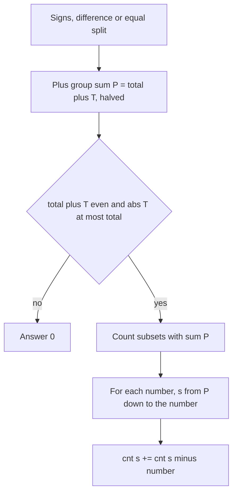

## The hook

Five friends' dishes arrive on one bill, and two of them are paying, with each dish going on one tab or the other. One says, "I'll pay exactly ₹5 of this": how many different ways can the dishes be assigned so that works out?

Then someone points at the free glass of water on the bill, priced ₹0. It changes nothing about the total, but it doubles the *number of ways*, because it can go on either tab. That one detail, a zero that silently doubles a count, is where most solutions to this family break. How do you count the splits without missing it?

## The problem

Three interview questions turn out to be one:

1. **Count subsets with sum P.** Given non-negative integers, how many subsets add up to exactly P?
2. **Target Sum.** Put a + or − in front of every number. How many sign assignments make the expression equal a target T?
3. **Partitions with a given difference.** Split the numbers into two groups so that the first group's sum minus the second's equals D. How many splits exist? (This one appears on several practice sites under the name *Count Partitions with Given Difference*.)

The boolean cousin, *Partition Equal Subset Sum*, asks only whether a split into two equal halves exists. [Packing a Backpack With a Weight Limit](article:dsa-knapsack-01) answered that yes/no question. Here you count.

## The obvious approach

Try every assignment. Each number goes in or out, or gets + or −, so there are 2ⁿ options. With n = 20 that is about a million and fine; with n = 40 it is about a trillion and hopeless.

A memoised recursion on (index, running sum) is better. It works, but the running sum can be negative in Target Sum, so you need an offset or a hash map, and the state space is about n × (2 × total + 1). The cleaner route is to change the question first.

## The key insight

:::analogy
Think of the bill again. Every dish lands on *my tab* or *your tab*. If I know the total bill and I know how much more I am paying than you, then I know my tab exactly: my tab is half of (total plus the difference). So "count the ways to make my tab exactly that amount" answers every version. And a ₹0 dish can go on either tab without changing a single rupee, so it doubles whatever count you had.
:::

Write it as algebra. In Target Sum, the numbers with + form the [[plus group]] with sum P, and the rest sum to total − P. Then:

$$P - (\text{total} - P) = T \quad\Rightarrow\quad P = \frac{\text{total} + T}{2}$$

Here total is the sum of all numbers, T is the target, and P is the sum the plus group must have. Partitions with difference D are the same with D in place of T. Now both are a [[subset sum]] count, and two quick checks come first:

- **[[Parity check]]:** if total + T is odd, P is not an integer, so the answer is 0.
- **Range check:** if |T| > total, no assignment reaches it, so the answer is 0.

The count itself is a [[counting DP]] over items and sums:

| Part | Definition |
|---|---|
| State | cnt[i][s] = number of subsets of the first i numbers that sum to s |
| Transition | cnt[i][s] = cnt[i − 1][s] (leave item i) + cnt[i − 1][s − a_i] (take it, if s ≥ a_i) |
| Base case | cnt[0][0] = 1 (the empty subset); cnt[0][s] = 0 for s > 0 |
| Answer | cnt[n][P] |

Notice what the base case does *not* say: it does not set cnt[i][0] = 1 for every i. With a zero in the array, the number of subsets summing to 0 is 2 to the power of the zeros seen so far, and the transition computes that by itself when s runs all the way down to 0.

:::insight
Counting subsets is the 0/1 knapsack table with "or" replaced by "+". Every other question in this family is a one-line algebra step that turns into a target P, followed by two cheap checks: is total + T even, and is |T| at most total.
:::



## Walk through an example

Target Sum with nums = [2, 1, 0, 3, 2] and T = 2. The total is 8, so P = (8 + 2) / 2 = **5**. Fill the 1D table, looping s from P down to the current number (down to 0 for the zero):

| after number | s=0 | 1 | 2 | 3 | 4 | 5 |
|---|---|---|---|---|---|---|
| start | 1 | 0 | 0 | 0 | 0 | 0 |
| 2 | 1 | 0 | 1 | 0 | 0 | 0 |
| 1 | 1 | 1 | 1 | 1 | 0 | 0 |
| 0 | 2 | 2 | 2 | 2 | 0 | 0 |
| 3 | 2 | 2 | 2 | 4 | 2 | 2 |
| 2 | 2 | 2 | 4 | 6 | 4 | 6 |

Answer **6**. Read the interesting rows:

- The **0** row doubles every entry: each subset can take the zero or leave it.
- At **3**, s = 3 becomes 2 + cnt[0] = 2 + 2 = 4: the two old ways to make 3 (2 + 1, with or without the zero) plus the two ways to make 0 followed by taking the 3.
- At the last **2**, s = 5 becomes 2 + cnt[3] = 2 + 4 = 6.

Check by meaning: without the zero, the subsets summing to 5 are {2, 3}, {3, 2'} and {2, 1, 2'}. That is 3, and the zero doubles it to 6. Each one is a sign assignment: for {2, 3}, the expression is +2 − 1 + 3 − 2 = 2, with ±0 on the zero.

**The zero bug, traced.** A common 2D template sets cnt[i][0] = 1 for every row and loops s from 1. On the same input it ends with 5, not 6, because the zero never gets to double the "sum 0" column. Every later cell that reads that column inherits the missing count.

**Space optimisation.** The table above already is the space-optimised version: one array of size P + 1, overwritten item by item. Looping s *downwards* is what keeps it 0/1. If you loop upwards, cnt[s − x] may already include the current item, so an item could be counted twice in one subset.

**Partitions with difference.** nums = [4, 1, 3, 2, 2] and D = 2. The total is 12, so the larger group must sum to (12 + 2) / 2 = 7. The subsets summing to 7 are {4, 3}, {4, 1, 2}, {4, 1, 2'} and {3, 2, 2'}, so there are **4** splits.

:::try-this
nums = [3, 1, 4, 2, 2]. How many subsets sum to half the total, and how many ways are there to split the array into two equal halves? (Total 12, half 6. Subsets: {4, 2}, {4, 2'}, {3, 1, 2}, {3, 1, 2'}, so 4. Each split appears twice, as a subset and its complement, so there are 2 splits.)
:::

## The code

```pseudo
count_subsets(nums, P):
    cnt = [1] + [0] * P
    for x in nums:
        for s from P down to x:          // includes s = 0 when x = 0
            cnt[s] += cnt[s - x]
    return cnt[P]

target_sum(nums, T):
    total = sum(nums)
    if abs(T) > total or (total + T) is odd: return 0
    return count_subsets(nums, (total + T) / 2)

can_partition(nums):
    total = sum(nums)
    return total is even and count_subsets(nums, total / 2) > 0
```

```cpp
#include <bits/stdc++.h>
using namespace std;

long long countSubsets(const vector<int>& nums, int P) {
    vector<long long> cnt(P + 1, 0);
    cnt[0] = 1;
    for (int x : nums)
        for (int s = P; s >= x; s--) cnt[s] += cnt[s - x];   // zero: s runs down to 0
    return cnt[P];
}

long long targetSum(const vector<int>& nums, int T) {
    int total = accumulate(nums.begin(), nums.end(), 0);
    if (abs(T) > total || (total + T) % 2 != 0) return 0;
    return countSubsets(nums, (total + T) / 2);
}

bool canPartition(const vector<int>& nums) {
    int total = accumulate(nums.begin(), nums.end(), 0);
    return total % 2 == 0 && countSubsets(nums, total / 2) > 0;
}

int main() {
    cout << targetSum({2, 1, 0, 3, 2}, 2) << '\n';          // 6
    cout << targetSum({4, 1, 3, 2, 2}, 2) << '\n';          // 4 (difference 2)
    cout << targetSum({2, 1, 0, 3, 2}, 3) << '\n';          // 0 (parity)
    vector<int> eq = {3, 1, 4, 2, 2};
    cout << countSubsets(eq, 6) << ' ' << countSubsets(eq, 6) / 2 << ' '
         << canPartition(eq) << '\n';                         // 4 2 1
}
```

Partitions with difference D is just `targetSum(nums, D)`: the algebra is identical.

## Complexity

- **Time:** O(n × P). Each of the n numbers updates at most P + 1 entries. Since P ≤ total, this is O(n × total).
- **Space:** O(P) for the single array. The 2D table costs O(n × P) and is only needed if you must list the subsets themselves.
- Like knapsack, this is pseudo-polynomial: it is fast when the sum is small (a few thousand to around 10⁵), not when the numbers are huge.

## Common mistakes

:::warning
Common misconception: "zeros don't matter because they don't change the sum." They don't change the sum, but each zero doubles the number of subsets reaching it. Initialising cnt[i][0] = 1 for every row, or starting the sum loop at 1, silently drops those doublings. Either let the loop run down to s = 0, or strip the zeros, count the rest, and multiply by 2 to the power of the number of zeros.
:::

- **Skipping the parity and range checks.** (total + T) / 2 with an odd numerator truncates in C++ and can return a count for a target that is impossible. A negative T with |T| > total can make P negative and index out of bounds.
- **Counting each equal split twice.** Subsets and their complements both reach total / 2. To count splits, divide by 2. Under a modulus, as in *Two Sets II*, multiply by the inverse of 2 or simply fix the last number in one group and count subsets of the rest.
- **Looping sums upwards.** That reuses an item inside one subset and counts multisets, which is the unbounded variant.
- **Overflow.** Counts grow exponentially with n. Use 64-bit integers, or the modulus the problem gives.
- **Mixing up "how many" and "whether".** A boolean table cannot be summed later. If the follow-up asks for a count, the table must hold counts from the start.

## Practice problems

Start with *Partition Equal Subset Sum*, the yes/no warm-up, and solve it with the counting table to see that "count > 0" answers it. Then *Target Sum*, where the plus-group algebra and the zero handling both matter. *Last Stone Weight II* uses the same reachable-sums table to find the closest split to half. Finish with *Two Sets II* on CSES, which needs a modulus and the divide-by-two step for counting splits instead of subsets.

## Key takeaways

- Counting subsets with a given sum is the 0/1 knapsack table with addition in place of "or", filled with the sum loop running downwards.
- Target Sum and partitions with a given difference both reduce to counting subsets whose sum is half of total plus the target.
- Check that total plus the target is even and that the target's absolute value is at most the total before building any table.
- A zero doubles the count of every subset, so the base case must be only cnt[0] = 1 and the loop must reach s = 0.
- Counting two-group splits instead of subsets means dividing by two, because each split appears once from each side.
