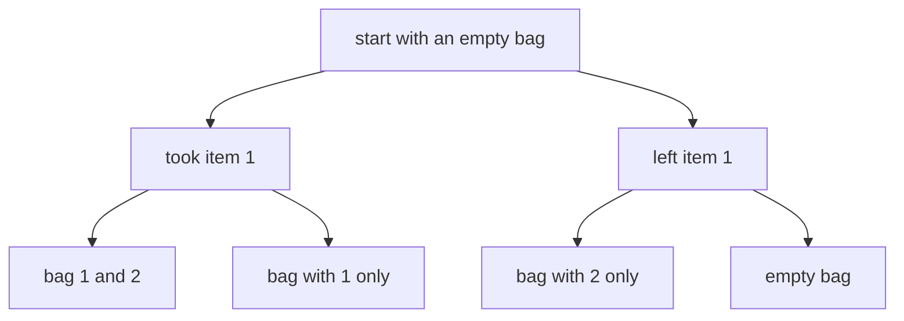

## The hook

You are packing for a trip with a camera, a book and a jacket, and you want to list every possible bag you could carry. Taking nothing counts, taking everything counts. How many bags are there, and how do you write them all down without missing one or listing one twice?

Now swap the question: three friends must sit in three seats in a row. How many seatings are there? Questions like these sit inside many interview problems: all combinations of letters, every way to split a string, every team of k people, every route through a small graph. They all use the same machine, and once it clicks, a whole family of "generate all..." problems becomes routine.

## The intuition

:::analogy
Imagine packing the bag item by item in a fixed order. You pick up the camera and decide: take it or leave it. Then the book: take it or leave it. Then the jacket. Every series of three decisions gives one bag, and every bag comes from exactly one series of decisions. To try the other choice for the jacket, you take the jacket back out of the bag first.
:::

Draw those decisions as a tree and you have the [[recursion tree]] for generating subsets. Each level is one item, each edge is "take" or "leave", and each leaf is one finished bag. With two items it looks like this:



The bag you carry down the tree is the [[path]]: the choices made so far. Going down a "take" edge puts an item in the bag. Coming back up takes it out again, so the bag is exactly as it was before you tried the other branch. That put-in, recurse, take-out rhythm is [[backtracking]], and it is the whole pattern.

Two counts follow straight from the picture:

| What you generate | Choices per level | Leaves | For n = 3 | For n = 10 |
|---|---|---|---|---|
| [[Subset|Subsets]] | 2 at every level | 2^n | 8 | 1,024 |
| [[Permutation|Permutations]] | n, then n − 1, then ... | n! | 6 | 3,628,800 |

These numbers are why constraints matter. If n is at most about 20, generating all subsets is fine: 2^20 is about a million.

Permutations explode faster: 10! is about 3.6 million, but 12! is about 479 million. When a problem says n ≤ 8 or n ≤ 10, the setter is often inviting you to try every permutation.

## How it works

### Subsets, version 1: take or leave

The function `go(i)` decides the fate of item i, given the bag so far.

- **Base case:** if i equals n, every item has been decided, so record a copy of the bag.
- **Take:** put a[i] in the bag and call `go(i + 1)`.
- **Leave:** take a[i] back out and call `go(i + 1)` again.

Every leaf of the tree is a subset, so exactly 2^n subsets are recorded.

### Subsets, version 2: the start-index loop

A second shape is often more convenient. Here every node of the tree, not only the leaves, is a subset. `go(start)` records the current bag, then for each index i from start to n − 1, puts a[i] in, calls `go(i + 1)`, and takes it out.

Because the next choice always comes from indices after i, each subset is built in increasing index order exactly once. This shape is what you extend for "subsets of size k" (stop when the bag has k items) and for removing duplicates.

### Subsets, version 3: bitmasks

With n ≤ 20 or so, you can skip recursion. Every integer `mask` from 0 to 2^n − 1 is a subset: bit j set means "take item j". It is the same take-or-leave decision, written as n bits. See [A Row of Light Switches Inside Every Number](article:dsa-bit-basics) for the bit tricks.

### Permutations: filling seats

For permutations, the levels are seats, not items. At seat k you choose which remaining item sits there.

- **Used-array style:** keep a `used[]` flag per item. At each level, try every unused item: mark it, put it on the path, recurse, then unmark it and pop it.
- **Swap style:** keep the array itself as the state. Positions 0 to k − 1 are already seated. For each i from k to n − 1, swap a[i] into seat k, recurse on k + 1, then swap back.

Swap style uses no extra array, but it changes the order of the remaining items, which matters once you need duplicate handling or sorted output. The used-array style keeps the input order and is easier to extend.

:::insight
Every generator in this family is the same three lines: make a choice, recurse, undo the choice. What changes is only what a "choice" is: take or leave an item, which index comes next, or which item sits in the next seat.
:::

### Duplicates: sort, then skip equal siblings

With input [1, 2, 2], plain take-or-leave produces [1, 2] twice, once with each 2. The fix has two parts:

1. **Sort the input,** so equal values sit next to each other.
2. **Skip equal siblings.** At one level of the start-index loop, if a[i] equals a[i − 1] and i is not the first choice at this level (i > start), skip it. You already explored "the next value is 2" with the first copy.

This [[sibling skip]] only blocks the same value at the same level. The second 2 can still be chosen at a deeper level, after the first 2, so [2, 2] is still produced once.

For permutations of [1, 1, 2], the rule is: skip a[i] if it equals a[i − 1] and the earlier copy is not currently used. That forces equal copies to be placed in their original order, so swapping two identical 1s never creates a "new" arrangement.

:::warning
Common misconception: "Duplicates are easy, just put the results in a set." That works for tiny inputs, but you still generate every duplicate first. With many repeated values the duplicates can outnumber the real answers by a huge factor, and the hashing of whole vectors costs extra time. The sibling skip never creates a duplicate in the first place.
:::

## Walk through an example

### Take-or-leave on [1, 2, 3]

The left branch is "take", so the first leaf reached is the full bag.

| Order reached | Decisions for 1, 2, 3 | Subset recorded |
|---|---|---|
| 1 | take, take, take | [1, 2, 3] |
| 2 | take, take, leave | [1, 2] |
| 3 | take, leave, take | [1, 3] |
| 4 | take, leave, leave | [1] |
| 5 | leave, take, take | [2, 3] |
| 6 | leave, take, leave | [2] |
| 7 | leave, leave, take | [3] |
| 8 | leave, leave, leave | [] |

Read the decision column with take = 1 and leave = 0 and you get 111, 110, 101 and so on, counting down from 7 to 0 in binary. The recursion and the bitmask loop are the same enumeration in different clothes.

### Start-index loop on [1, 2, 2], with the sibling skip

| Call | Bag recorded | Loop tries | Skipped |
|---|---|---|---|
| go(0) | [] | 1 at i = 0, 2 at i = 1 | i = 2, because 2 equals a[1] and i > start |
| go(1) | [1] | 2 at i = 1 | i = 2, same reason |
| go(2) | [1, 2] | 2 at i = 2 | nothing: i = start, so this 2 is allowed |
| go(3) | [1, 2, 2] | nothing left | |
| go(2) | [2] | 2 at i = 2 | nothing: i = start |
| go(3) | [2, 2] | nothing left | |

Six subsets: [], [1], [1, 2], [1, 2, 2], [2], [2, 2]. Without the skip you would get eight, with [1, 2] and [2] each appearing twice. In bag terms: when you are deciding "which item goes in next", two identical books are the same choice, so you only try one of them at each step.

### Swap permutations of [1, 2, 3]

| Seat 0 gets | Array after the swap | Seat 1 gets | Results |
|---|---|---|---|
| 1, swap a[0] with a[0] | [1, 2, 3] | 2, then 3 | [1, 2, 3], [1, 3, 2] |
| 2, swap a[0] with a[1] | [2, 1, 3] | 1, then 3 | [2, 1, 3], [2, 3, 1] |
| 3, swap a[0] with a[2] | [3, 2, 1] | 2, then 1 | [3, 2, 1], [3, 1, 2] |

After each row, swapping back restores [1, 2, 3] before the next candidate is tried. Notice the last row comes out as [3, 2, 1] before [3, 1, 2]: swap style does not produce sorted order. If a problem wants lexicographic output, use the used-array style on sorted input.

:::try-this
Using the used-array rule "skip a[i] if a[i] equals a[i − 1] and a[i − 1] is not used", list the permutations of the sorted input [1, 1, 2]. Which choice gets skipped at the very first level? (Results: [1, 1, 2], [1, 2, 1], [2, 1, 1]. At the first level, the second 1 is skipped, because the first 1 is equal and not used, so a 1 in seat 0 has already been explored.)
:::

## The code

```pseudo
subsets_take_leave(i):
    if i == n: record a copy of path; return
    path.push(a[i]); subsets_take_leave(i + 1); path.pop()   # take
    subsets_take_leave(i + 1)                                # leave

subsets_no_dup(start):            # a is sorted
    record a copy of path
    for i from start to n - 1:
        if i > start and a[i] == a[i - 1]: continue          # sibling skip
        path.push(a[i]); subsets_no_dup(i + 1); path.pop()

perm_swap(k):
    if k == n: record a copy of a; return
    for i from k to n - 1:
        swap a[k], a[i]; perm_swap(k + 1); swap a[k], a[i]

perm_no_dup():                    # a is sorted
    if path has n items: record a copy of path; return
    for i from 0 to n - 1:
        if used[i]: continue
        if i > 0 and a[i] == a[i - 1] and not used[i - 1]: continue
        used[i] = true; path.push(a[i])
        perm_no_dup()
        used[i] = false; path.pop()
```

```cpp
#include <bits/stdc++.h>
using namespace std;

vector<vector<int>> res;
vector<int> path;

// Take-or-leave: one decision per item, a subset at every leaf.
void subsetsTakeLeave(const vector<int>& a, int i) {
    if (i == (int)a.size()) { res.push_back(path); return; }
    path.push_back(a[i]);          // take a[i]
    subsetsTakeLeave(a, i + 1);
    path.pop_back();               // leave a[i]
    subsetsTakeLeave(a, i + 1);
}

// Start-index loop on sorted input: every node is a subset; skip equal siblings.
void subsetsNoDup(const vector<int>& a, int start) {
    res.push_back(path);
    for (int i = start; i < (int)a.size(); i++) {
        if (i > start && a[i] == a[i - 1]) continue;   // same value already tried here
        path.push_back(a[i]);
        subsetsNoDup(a, i + 1);
        path.pop_back();
    }
}

// Swap-based permutations: fix position k by swapping each candidate into it.
void permSwap(vector<int>& a, int k) {
    if (k == (int)a.size()) { res.push_back(a); return; }
    for (int i = k; i < (int)a.size(); i++) {
        swap(a[k], a[i]);
        permSwap(a, k + 1);
        swap(a[k], a[i]);          // undo, so the next candidate sees the same array
    }
}

// Used-array permutations on sorted input, skipping duplicate choices.
void permNoDup(const vector<int>& a, vector<bool>& used) {
    if (path.size() == a.size()) { res.push_back(path); return; }
    for (int i = 0; i < (int)a.size(); i++) {
        if (used[i]) continue;
        if (i > 0 && a[i] == a[i - 1] && !used[i - 1]) continue;   // equal copies go in order
        used[i] = true; path.push_back(a[i]);
        permNoDup(a, used);
        used[i] = false; path.pop_back();
    }
}

void show(const string& name) {
    cout << name << " (" << res.size() << "):";
    for (auto& v : res) {
        cout << " [";
        for (int j = 0; j < (int)v.size(); j++) cout << (j ? "," : "") << v[j];
        cout << "]";
    }
    cout << '\n';
    res.clear();
}

int main() {
    vector<int> a = {1, 2, 3};
    subsetsTakeLeave(a, 0); show("take-or-leave");
    // [1,2,3] [1,2] [1,3] [1] [2,3] [2] [3] []
    subsetsNoDup(a, 0); show("start-index");
    // [] [1] [1,2] [1,2,3] [1,3] [2] [2,3] [3]
    vector<int> b = {1, 2, 2};
    subsetsNoDup(b, 0); show("subsets of 1,2,2");
    // [] [1] [1,2] [1,2,2] [2] [2,2]
    permSwap(a, 0); show("swap perms");
    // [1,2,3] [1,3,2] [2,1,3] [2,3,1] [3,2,1] [3,1,2]
    vector<int> c = {1, 1, 2};
    vector<bool> used(3, false);
    permNoDup(c, used); show("perms of 1,1,2");
    // [1,1,2] [1,2,1] [2,1,1]
    for (int mask = 0; mask < (1 << 3); mask++) {        // bitmask subsets
        cout << '{';
        for (int j = 0; j < 3; j++) if (mask >> j & 1) cout << a[j];
        cout << '}';
    }
    cout << '\n';  // {}{1}{2}{12}{3}{13}{23}{123}
}
```

`res.push_back(path)` copies the vector, which is exactly what you want. In languages where lists are references, such as Python or Java, you must copy explicitly (`path[:]`, `new ArrayList<>(path)`), or every stored answer will be the same list.

C++ also has `next_permutation`, which steps a sorted array through all distinct permutations in lexicographic order and handles duplicates for free. It is ideal in contests, but interviewers usually want to see the recursion. [The Toolbox Every Fast Solution Is Built From](article:dsa-cpp-stl-toolkit) covers it with the other STL helpers.

## Complexity

- **Subsets: O(n · 2^n) time.** There are 2^n subsets, and copying each one into the output costs up to n. The recursion itself makes about 2^(n+1) calls.
- **Permutations: O(n · n!) time.** There are n! leaves, each copied at cost n. The internal nodes add up to a constant factor more, since n! dominates the sum n!/1! + n!/2! + ...
- **Space: O(n) extra.** The recursion is n levels deep and the path holds at most n items. The output itself is O(n · 2^n) or O(n · n!), and you cannot avoid it if the problem asks for every answer.
- **With duplicates,** the time is proportional to the number of distinct answers times n, because the sibling skip prunes every duplicate branch at its root. For [1, 1, 2] that is 3 permutations instead of 6.

## Common mistakes

- **Storing the shared path, not a copy.** In Java or Python, appending `path` itself means all answers end up identical, usually empty. Copy at record time.
- **Forgetting to undo.** A missing `pop_back`, `used[i] = false` or swap-back leaks one branch's choice into the next. The outputs look plausible but are wrong, and the bug only shows with three or more items.
- **Sibling skip without sorting.** The skip compares neighbours, so the input must be sorted first, or equal values that are apart are never detected.
- **i > 0 instead of i > start** in Subsets II. That also skips the second 2 at deeper levels, so [2, 2] and [1, 2, 2] disappear.
- **Wrong condition in Permutations II.** The standard rule is `a[i] == a[i - 1] && !used[i - 1]`. Writing it with `used[i - 1]` also works, but mixing the two in one solution, or dropping the `used` part, loses valid answers.
- **Assuming swap style gives sorted output.** It does not, as the last row of the trace showed.
- **Ignoring the constraint cues.** If n is 30, generating 2^30 subsets is over a billion. The problem wants something smarter, often dynamic programming or meet in the middle.

## Practice problems

Start with *Subsets* using both take-or-leave and the start-index loop, then do it a third time with bitmasks. *Subsets II* adds the sort and the sibling skip.

*Permutations* is the seat-filling version; write it in used-array and swap style. *Permutations II* is the duplicate-aware version and the most common interview follow-up. *Combinations* is the start-index loop stopped at size k.

*Creating Strings* on CSES asks for all distinct rearrangements of a string in sorted order, a good test of duplicate handling, and a place where `next_permutation` is a fine shortcut. The next article, on the general backtracking template, adds pruning to this same machine.

## Key takeaways

- Generating subsets and permutations is one pattern: make a choice, recurse on the rest, then undo the choice so the next option starts from the same state.
- Subsets come from a take-or-leave decision per item, giving 2^n of them, while permutations come from choosing which remaining item fills each seat, giving n! of them.
- Small constraints such as n ≤ 20 for subsets or n ≤ 10 for permutations are a strong hint that full enumeration is intended.
- To avoid duplicate outputs, sort the input and skip a value equal to the previous one at the same level, instead of filtering duplicates afterwards.
- Record a copy of the current path, never the shared path itself, and always undo every change on the way back up.
