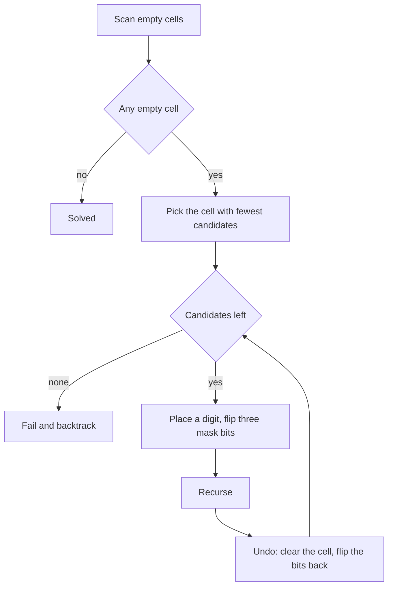

## The hook

When you solve a crossword, you do not start at 1 Across and grind through the clues in order. You start with the clue where you have the most letters filled in, the one with the fewest possible answers. A sure answer there gives you letters in the crossing clues, which narrows those down in turn.

A Sudoku solver can do the same. A plain backtracking solver that fills cells left to right does solve every puzzle, eventually. On the puzzle used below it made 1,010 recursive calls. Choosing the most constrained cell first, and checking constraints with bitmasks instead of scanning, solved the same puzzle in 70.

## The problem

Fill a 9 by 9 grid so that every row, every column and every 3 by 3 box contains each digit 1 to 9 exactly once, given some digits already placed. *Valid Sudoku* asks only whether the given digits break any rule. *Sudoku Solver* asks you to fill the grid.

The puzzle in the walkthrough, with dots for empty cells:

```text
53.8..2..
.....1.86
....9..3.
3..2...17
.....5.2.
8..1..543
.57...892
.98....6.
4.3.....1
```

## The obvious approach

Find the first empty cell, try digits 1 to 9, check the row, column and box by scanning them, recurse, and undo on failure. It is correct, and it is the right first answer, but it has two costs. Every check scans up to 27 cells, and the cell order ignores how constrained each cell is, so the solver can wander deep into a branch that a crowded cell elsewhere would have rejected immediately.

## The key insight

:::analogy
Picture a crossword where every clue lists how many answers still fit. You always fill the clue with the shortest list. If a clue has exactly one answer, you write it in without guessing. If some clue's list is empty, you know an earlier guess was wrong and you rub it out at once, instead of discovering the problem twenty clues later.
:::

Sudoku is a [[constraint satisfaction]] problem, and two improvements follow from the crossword:

- **Constant-time candidates.** Keep one bitmask per row, column and box, where bit d means "digit d is used here". The [[candidate set]] of an empty cell is the set of digits used in none of its three groups: the complement of rowM[r] | colM[c] | boxM[box], restricted to bits 1 to 9. The [[box index]] is (r / 3) × 3 + c / 3. Placing or removing a digit flips one bit in each of the three masks.
- **[[Most constrained cell]] first.** Before branching, scan the empty cells and pick the one with the fewest candidates, counted with a population count. A cell with one candidate is a [[forced move]]: no guessing at all. A cell with zero candidates ends the branch immediately.

The search is still the backtracking template from [Chalk Marks You Rub Out on the Way Back](article:dsa-backtracking-template): choose a digit, recurse, undo. Only the bookkeeping and the order changed.



:::insight
In constraint problems, the order of decisions matters as much as the checks. Fill the most constrained choice first, so forced moves happen without guessing and impossible branches fail at the top of the tree instead of deep inside it.
:::

## Walk through an example

### Reading candidates from the masks

Take the empty cell at row 0, column 2.

| Group | Digits already there |
|---|---|
| row 0 | 5, 3, 8, 2 |
| column 2 | 7, 8, 3 |
| box 0 | 5, 3 |
| union | 2, 3, 5, 7, 8 |

The candidates are the digits in none of them: 1, 4, 6 and 9. The masks compute this union with two OR operations and one complement, instead of scanning 27 cells.

Now scan every empty cell for the smallest candidate set. Two cells have exactly one candidate at the start, and the first of them, row 0 column 7, can only be 7, because 1, 2, 3, 4, 5, 6, 8 and 9 already appear in its row, column or box. That is a forced move: the solver writes 7 there without branching, exactly like the crossword clue with a single possible answer.

### How much the order matters

The same solver, run twice on the puzzle above:

| Cell choice | Recursive calls | Result |
|---|---|---|
| first empty cell, left to right | 1,010 | solved |
| most constrained cell | 70 | solved, same grid |

The solution found both times:

```text
531864279
972351486
684792135
345286917
719435628
826179543
157643892
298517364
463928751
```

Every row, column and box contains 1 to 9 exactly once. The solver with the crossword rule needed about one fourteenth of the calls, and the gap grows quickly on harder puzzles, where a bad cell order can mean millions of calls.

### Checking a board: Valid Sudoku

*Valid Sudoku* uses the same masks without any search. Walk every filled cell; if its digit's bit is already set in its row, column or box mask, the board breaks a rule; otherwise set the three bits. One pass over 81 cells.

:::try-this
Which box holds cell (7, 1), and which holds (2, 8)? (Box (7 / 3) × 3 + 1 / 3 = 6, the bottom-left box. Box (2 / 3) × 3 + 8 / 3 = 2, the top-right box.)
:::

:::warning
Common misconception: "Undoing is only clearing the cell." With bitmasks, the cell, the row mask, the column mask and the box mask all changed when you placed the digit. Forgetting to flip any of them back leaves a digit "used" in a group where it no longer appears, and the solver will reject valid moves later.
:::

## The code

```pseudo
solve():
    choose the empty cell with the fewest candidates
    if there is no empty cell: return true
    for each candidate digit d of that cell:
        place d; set bit d in its row, column and box masks
        if solve(): return true
        remove d; clear the three bits
    return false

candidates(r, c) = digits 1..9 not set in rowM[r] | colM[c] | boxM[box(r, c)]
```

```cpp
#include <bits/stdc++.h>
using namespace std;

struct Sudoku {
    vector<string> g;
    int rowM[9] = {}, colM[9] = {}, boxM[9] = {};          // bit d set: digit d already used
    long long calls = 0;
    bool mrv;                                              // most constrained cell first?
    static int box(int r, int c) { return r / 3 * 3 + c / 3; }
    Sudoku(vector<string> grid, bool useMrv) : g(grid), mrv(useMrv) {
        for (int r = 0; r < 9; r++)
            for (int c = 0; c < 9; c++)
                if (g[r][c] != '.') toggle(r, c, g[r][c] - '0');
    }
    void toggle(int r, int c, int d) { rowM[r] ^= 1 << d, colM[c] ^= 1 << d, boxM[box(r, c)] ^= 1 << d; }
    int candidates(int r, int c) const { return ~(rowM[r] | colM[c] | boxM[box(r, c)]) & 0x3FE; }   // bits 1..9
    pair<int, int> pickCell() const {
        int br = -1, bc = -1, best = 10;
        for (int r = 0; r < 9; r++)
            for (int c = 0; c < 9; c++) {
                if (g[r][c] != '.') continue;
                if (!mrv) return {r, c};                    // plain order: first empty cell
                int k = __builtin_popcount(candidates(r, c));
                if (k < best) best = k, br = r, bc = c;
            }
        return {br, bc};
    }
    bool solve() {
        calls++;
        auto [r, c] = pickCell();
        if (r == -1) return true;                           // no empty cell left: solved
        for (int m = candidates(r, c); m; m &= m - 1) {
            int d = __builtin_ctz(m);                       // lowest candidate digit
            g[r][c] = '0' + d, toggle(r, c, d);             // choose
            if (solve()) return true;                       // explore
            g[r][c] = '.', toggle(r, c, d);                 // undo all four changes
        }
        return false;
    }
};

bool isValidSudoku(const vector<string>& g) {
    int rowM[9] = {}, colM[9] = {}, boxM[9] = {};
    for (int r = 0; r < 9; r++)
        for (int c = 0; c < 9; c++) {
            if (g[r][c] == '.') continue;
            int bit = 1 << (g[r][c] - '0'), b = r / 3 * 3 + c / 3;
            if ((rowM[r] | colM[c] | boxM[b]) & bit) return false;   // digit already in a group
            rowM[r] |= bit, colM[c] |= bit, boxM[b] |= bit;
        }
    return true;
}

int main() {
    vector<string> puzzle = {"53.8..2..", ".....1.86", "....9..3.", "3..2...17", ".....5.2.",
                             "8..1..543", ".57...892", ".98....6.", "4.3.....1"};
    cout << isValidSudoku(puzzle) << '\n';                  // 1
    Sudoku fast(puzzle, true), plain(puzzle, false);
    cout << fast.solve() << ' ' << fast.calls << '\n';      // 1 70
    cout << plain.solve() << ' ' << plain.calls << '\n';    // 1 1010
    for (auto& row : fast.g) cout << row << ' ';
    cout << '\n';   // 531864279 972351486 684792135 345286917 719435628 826179543 157643892 298517364 463928751
    vector<string> bad = puzzle;
    bad[0][2] = '5';                                        // a second 5 in row 0
    cout << isValidSudoku(bad) << '\n';                     // 0
}
```

`m &= m - 1` clears the lowest set bit, so the loop visits each candidate digit once, and `__builtin_ctz` gives that digit's position. These bit tricks are explained in [A Row of Light Switches Inside Every Number](article:dsa-bit-basics).

## Complexity

- **Worst case: exponential,** as for any general Sudoku solver; there are puzzles designed to be hard for simple search.
- **In practice: fast.** Each call scans 81 cells to pick the most constrained one, O(1) for a fixed board, and the search tree stays small because forced moves and empty candidate sets cut it early.
- **Space: O(1)** for a 9 by 9 board: the grid, 27 masks and a recursion at most 81 deep.
- **Valid Sudoku: O(81),** one pass.

## Common mistakes

- **Wrong box index,** for example r / 3 + c / 3, which maps different boxes to the same number.
- **Not undoing the masks** along with the cell.
- **Scanning rows, columns and boxes on every check** instead of keeping masks, which makes each call far more expensive.
- **Continuing after a cell has zero candidates,** instead of returning false at once.
- **Off-by-one in masks:** using bit 0 for digit 1 in one place and bit 1 in another. Pick one convention; the code uses bit d for digit d.
- **Treating Valid Sudoku as solvability.** It only checks the given digits; a valid-looking board can still have no solution.

## Practice problems

*Valid Sudoku* is the mask bookkeeping on its own. *Sudoku Solver* is the full search; write it first with the plain cell order, then add the most constrained rule and count the calls. *Word Search II* is another constrained grid search, where a trie of the words plays the role of the candidate sets by cutting off paths that no word can continue; see [Autocomplete in Your Pocket](article:dsa-tries).

## Key takeaways

- Sudoku is backtracking over empty cells: place a digit, recurse, and undo the placement on failure.
- One bitmask per row, column and box gives each cell's candidates in O(1) as the digits used in none of its three groups.
- The box of cell (r, c) is (r / 3) × 3 + c / 3, and undoing a placement must restore the cell and all three masks.
- Choosing the empty cell with the fewest candidates first turns forced moves into non-guesses and makes impossible branches fail early.
- The same solver needed 1,010 calls with plain left-to-right order and 70 with the most constrained cell rule on the puzzle above.
