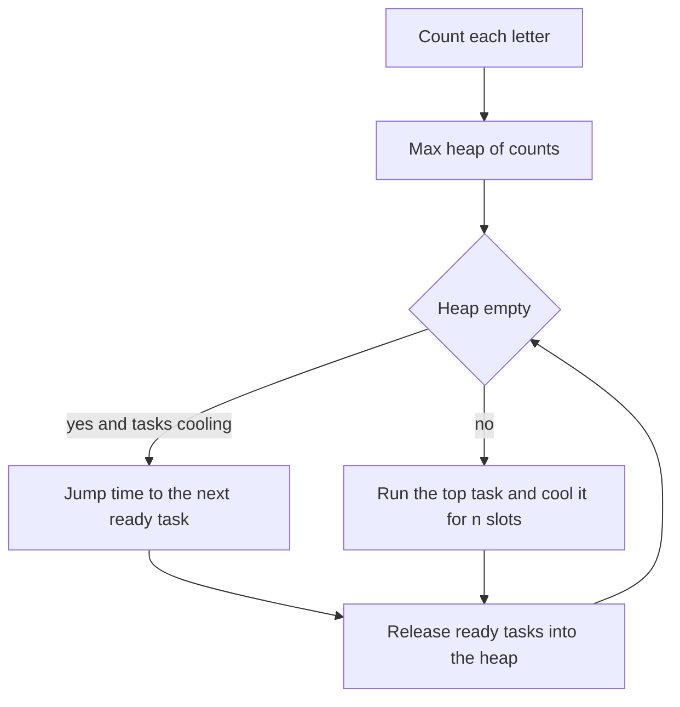

## The hook

A chef works a single stove with a stack of orders. Each pan, once used, must cool before it can go back on the flame, or the next dish in it burns. The chef cannot sit idle while a pan cools if another dish is ready, but sometimes every remaining pan is still hot and there is nothing to do except wait.

How long until every order is out? The answer turns out to depend almost entirely on one dish: the one with the most orders.

## The problem

You are given a list of tasks, each labelled with a capital letter, and a [[cooldown]] n. Each time slot runs one task or stays idle. Two runs of the same letter must be separated by at least n slots. Tasks can run in any order. Return the fewest slots needed to run every task.

For tasks A A A B B C and n = 2, one valid schedule is A B C A B idle A, which uses 7 slots.

## The obvious approach

Simulate slot by slot. At each slot, try every letter, pick any one that is ready, and run it. This can fail badly: picking a rare letter early leaves the common letter bunched at the end, where it forces [[idle slot]]s between its copies.

| Strategy on A A A B B C, n = 2 | Schedule | Slots |
|---|---|---|
| Rare letters first | C B A idle B A idle idle A | 9 |
| Most frequent first | A B C A B idle A | 7 |

The order of choice matters, so the question is which choice to make and how to be sure it is the best.

## The key insight

:::analogy
The dish with the most orders is the bottleneck. Its pan must cool n slots between uses, so the chef should start it immediately and keep returning to it the moment it is cool. Every other dish is cooked while that pan cools, filling the gaps instead of creating new ones.
:::

Lay out the most frequent task as a [[frame]]. If A appears m times, its copies sit in m rows of width n + 1, and the last row is cut short after A:

```
A _ _
A _ _
A
```

Every task appearing m times also needs a seat in the last row; call that number of tied tasks countMax. Everything else fills the blank seats.

- **Lower bound 1, in sketch form:** the frame has (m - 1) × (n + 1) + countMax slots, and no schedule can be shorter, because the first and last copy of A are at least (m - 1) × (n + 1) apart and every tied task finishes in or after A's last row.
- **Lower bound 2:** every task needs its own slot, so at least len(tasks) slots.
- **Both are reachable.** Fill the frame column by column with the remaining tasks grouped by letter. Copies of one letter land in different rows, at least n + 1 apart. If there are more tasks than blanks, make the rows wider; equal letters only move further apart, and no slot is idle.

So the answer is max(len(tasks), (m - 1) × (n + 1) + countMax). This is [[most frequent first]] turned into arithmetic.

:::insight
Idle time exists only because the most frequent task cannot be spread out any further. If the other tasks can fill its gaps, there is no idle time at all and the answer is the task count.
:::

### The simulation, and why it must jump

The formula answers this exact problem, but variants (weights, logging the schedule, tasks arriving over time) need the simulation:

- a max-heap of remaining counts for tasks that are ready;
- a queue of tasks cooling down, each with the time it becomes ready;
- at each step, release ready tasks from the queue, then run the top of the heap.

When the heap is empty but tasks are still cooling, jump time straight to the queue front's ready time instead of stepping through idle slots one at a time. The jump keeps the loop linear in the number of tasks, even when n is huge.



### Cousin 1: Reorganize String

Rearrange a string so no two adjacent characters are equal. This is the cooldown problem with n = 1, without idle slots allowed. The frame says it is possible exactly when the most frequent character appears at most (len + 1) / 2 times, rounded down. To build it, pop the most frequent character, append it, and hold it out of the heap for one round so it cannot repeat immediately.

### Cousin 2: Course Schedule III

Courses have a duration and a deadline, and you take them one at a time. Maximise the number of courses finished by their deadlines. Sort by deadline and add each course, keeping a [[regret heap]] of durations taken. If the total time passes the current deadline, remove the longest course taken so far. Removing any course costs one from the count, so removing the longest frees the most time for the future, which is an exchange argument.

## Walk through an example

### The formula on three inputs

| Tasks | n | m | countMax | Frame | Tasks | Answer |
|---|---|---|---|---|---|---|
| A A A B B C | 2 | 3 | 1 | 2 × 3 + 1 = 7 | 6 | 7 |
| A A A B B B C | 2 | 3 | 2 | 2 × 3 + 2 = 8 | 7 | 8 |
| A A A B B C C | 1 | 3 | 1 | 2 × 2 + 1 = 5 | 7 | 7 |

In the third row the other tasks overflow the frame, and a schedule such as A B A C A B C has no idle slot.

### The heap simulation on A A A B B B C, n = 2

Ties are broken alphabetically to keep the table readable.

| Time | Released from cooling | Runs | Left after | Cooling (letter, count, ready at) |
|---|---|---|---|---|
| 0 | | A | A2 B3 C1 | A 2 at 3 |
| 1 | | B | B2 C1 | A 2 at 3, B 2 at 4 |
| 2 | | C | | A 2 at 3, B 2 at 4 |
| 3 | A | A | | B 2 at 4, A 1 at 6 |
| 4 | B | B | | A 1 at 6, B 1 at 7 |
| 5 | nothing ready | jump to 6 | | |
| 6 | A | A | | B 1 at 7 |
| 7 | B | B | | |

The last task runs at time 7, so 8 slots, matching the formula. The jump at time 5 is the one idle slot.

### Course Schedule III

Courses as (duration, deadline): (3, 5), (2, 4), (4, 6), (1, 7), (5, 9), (2, 10).

| Course (by deadline) | Time after adding | Over deadline? | Drop | Taken durations |
|---|---|---|---|---|
| (2, 4) | 2 | no | | 2 |
| (3, 5) | 5 | no | | 2, 3 |
| (4, 6) | 9 | yes | 4 | 2, 3 |
| (1, 7) | 6 | no | | 1, 2, 3 |
| (5, 9) | 11 | yes | 5 | 1, 2, 3 |
| (2, 10) | 8 | no | | 1, 2, 2, 3 |

Four courses. Checking all 64 subsets by brute force also gives 4.

:::try-this
Can "aabbbcc" be reorganized, and what does the heap method produce? (The most frequent letter, b, appears 3 times out of 7, and 3 ≤ (7 + 1) / 2 = 4, so yes. Popping the most frequent each round while holding back the previous letter gives "babcabc" when ties go to the earlier letter. The C++ below breaks ties toward the later letter and gives "bcbacba". Both have no two neighbours equal.)
:::

:::warning
Common misconception: "The answer is (m - 1) × (n + 1) + 1." That forgets every other task tied for the maximum count, which also needs a seat in the last row; A A A B B B with n = 2 needs 8 slots, not 7. It also forgets the max with the task count, which matters whenever the other tasks overflow the frame.
:::

## The code

```pseudo
least_interval(tasks, n):
    m = highest count; tied = number of letters with count m
    return max(len(tasks), (m - 1) * (n + 1) + tied)

simulate(tasks, n):
    ready = max-heap of counts; cooling = queue of (count, ready_time); t = 0
    while ready or cooling:
        move every cooling task with ready_time <= t into ready
        if ready is empty: t = cooling.front.ready_time; continue      # jump over idle slots
        c = ready.pop() - 1
        if c > 0: cooling.push((c, t + n + 1))
        t += 1
    return t

schedule_courses(courses):
    sort by deadline; taken = max-heap; time = 0
    for (d, deadline):
        taken.push(d); time += d
        if time > deadline: time -= taken.pop()                        # drop the longest
    return size(taken)
```

```cpp
#include <bits/stdc++.h>
using namespace std;

int leastIntervalFormula(const string& tasks, int n) {
    array<int, 26> f{};
    for (char c : tasks) f[c - 'A']++;
    int m = *max_element(f.begin(), f.end());
    int tied = count(f.begin(), f.end(), m);
    return max((int)tasks.size(), (m - 1) * (n + 1) + tied);
}

long long leastIntervalHeap(const string& tasks, int n) {
    array<int, 26> f{};
    for (char c : tasks) f[c - 'A']++;
    priority_queue<int> ready;
    for (int x : f) if (x) ready.push(x);
    queue<pair<int, long long>> cooling;                         // (count left, ready time)
    long long t = 0;
    while (!ready.empty() || !cooling.empty()) {
        while (!cooling.empty() && cooling.front().second <= t)
            ready.push(cooling.front().first), cooling.pop();
        if (ready.empty()) { t = cooling.front().second; continue; }   // skip idle slots
        int c = ready.top() - 1;
        ready.pop();
        if (c > 0) cooling.push({c, t + n + 1});
        t++;
    }
    return t;
}

string reorganize(const string& s) {
    array<int, 26> f{};
    for (char c : s) f[c - 'a']++;
    priority_queue<pair<int, char>> pq;
    for (int i = 0; i < 26; i++) if (f[i]) pq.push({f[i], char('a' + i)});
    string out;
    pair<int, char> held = {0, 0};                               // used last round
    while (!pq.empty()) {
        auto [cnt, ch] = pq.top();
        pq.pop();
        out += ch;
        if (held.first > 0) pq.push(held);
        held = {cnt - 1, ch};
    }
    return out.size() == s.size() ? out : "";
}

int scheduleCourse(vector<pair<int, int>> courses) {             // (duration, deadline)
    sort(courses.begin(), courses.end(), [](auto& a, auto& b) { return a.second < b.second; });
    priority_queue<int> taken;
    long long time = 0;
    for (auto& [d, dl] : courses) {
        taken.push(d), time += d;
        if (time > dl) time -= taken.top(), taken.pop();         // drop the longest so far
    }
    return taken.size();
}

int main() {
    cout << leastIntervalFormula("AAABBC", 2) << ' ' << leastIntervalFormula("AAABBBC", 2)
         << ' ' << leastIntervalFormula("AAABBCC", 1) << '\n';                  // 7 8 7
    cout << leastIntervalHeap("AAABBBC", 2) << ' ' << leastIntervalHeap("AB", 1000000) << '\n';  // 8 2
    cout << reorganize("aabbbcc") << ' ' << reorganize("aaabc") << " [" << reorganize("aaab") << "]\n";  // bcbacba acaba []
    cout << scheduleCourse({{3, 5}, {2, 4}, {4, 6}, {1, 7}, {5, 9}, {2, 10}}) << '\n';   // 4
}
```

The call `leastIntervalHeap("AB", 1000000)` shows why the jump matters: two different tasks need only 2 slots, and the loop never steps through a million idle slots to find that out.

## Complexity

- **Formula: O(len) time,** O(1) space for 26 counters.
- **Simulation: O(len × log 26)**, because each task is pushed and popped a constant number of times and the jump removes idle iterations; O(1) space for 26 letters.
- **Reorganize String: O(len × log 26),** O(1) extra space.
- **Course Schedule III: O(c log c)** for c courses, for the sort and heap, and O(c) space.

## Common mistakes

- **Forgetting tied maximum tasks** in the last row of the frame.
- **Forgetting the max with the task count,** which gives an answer smaller than the number of tasks.
- **Stepping through idle slots one by one** in the simulation, which is slow when n is large; jump time instead.
- **Off-by-one in the cooldown.** A task run at time t is ready again at t + n + 1, not t + n.
- **In Reorganize String, pushing the just-used character straight back,** which lets it be picked twice in a row.
- **In Course Schedule III, sorting by duration instead of deadline,** which breaks the check that each prefix finishes on time.

## Practice problems

*Task Scheduler* is the frame and the formula; implement the heap simulation too, since follow-up questions often need it. *Reorganize String* is the same frame with n = 1 and no idle slots. *Course Schedule III* swaps the cooldown for deadlines and adds the regret heap. The greedy proof style used throughout is in [A Bus Conductor Who Never Reseats Anyone](article:dsa-greedy-exchange), and the heap itself in [The Triage Nurse Who Always Knows Who Is Next](article:dsa-heap-basics).

## Key takeaways

- The most frequent task builds a frame of (m - 1) rows of width n + 1 plus a last row holding every task tied for the maximum.
- The fewest slots is the larger of that frame size and the number of tasks, because extra tasks can widen rows without creating idle time.
- The heap simulation runs the most frequent ready task, cools it in a queue until t + n + 1, and jumps time forward when nothing is ready.
- Reorganize String is the same problem with a cooldown of one, possible exactly when the top count is at most half the length rounded up.
- Course Schedule III sorts by deadline and, when time runs over, drops the longest course taken, which keeps the count while freeing the most time.
