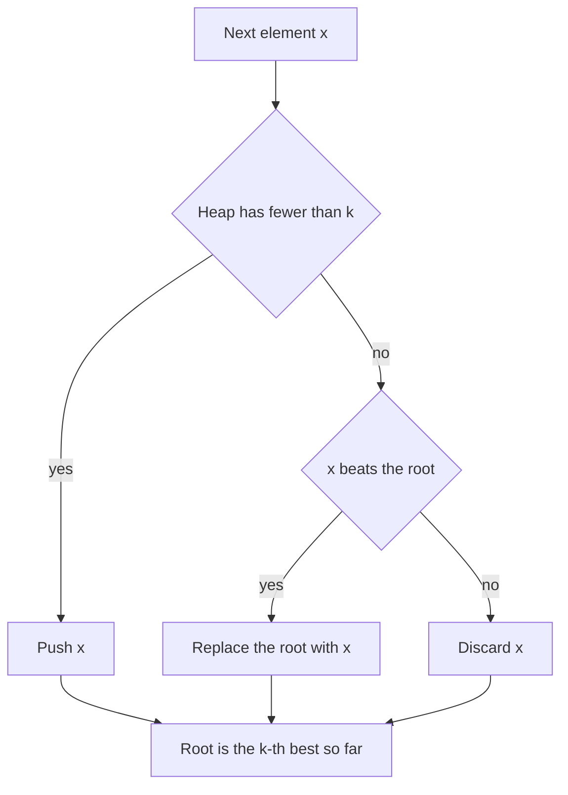

## The hook

A music app wants the ten most played songs out of a hundred million plays streaming in all day. Sorting every song by play count works once, but it is O(n log n), and the counts keep changing. Keeping only a small leaderboard of the current top ten, and asking each new song "do you beat the weakest one on the board?", is far cheaper.

That leaderboard is a heap of size k, one of the most used patterns in interviews and in production systems. It answers "k largest", "k most frequent", "k closest" and "k-th largest so far" in O(n log k) time and O(k) memory, which for small k is almost linear.

## The intuition

:::analogy
Picture a talent show with exactly k chairs on stage for the current finalists. When a new contestant performs, the judges look only at the weakest finalist on stage. If the newcomer is better, the weakest one leaves and the newcomer takes a chair; otherwise the newcomer goes home. The judges never compare the newcomer with everyone, only with the person in the weakest chair.
:::

The chairs are a [[bounded heap]] of size k, and the weakest finalist sits at the root. To keep the k largest, use a [[min-heap]]: its root is the smallest of the current top k, the [[threshold]] a newcomer must beat.

- **Heap not full:** push the element.
- **Heap full and the element beats the root:** pop the root and push the element, or replace the root in one step.
- **Otherwise:** discard the element.

After all elements, the heap holds the k largest, and its root is the k-th largest.

For the k smallest, flip everything: a max-heap whose root is the largest of the current k smallest.

## How it works

### Cost

Each element causes at most one push or one replace on a heap of at most k elements: O(log k). Over n elements, O(n log k) time and O(k) memory. For k = 10 and n = 10⁸, log k is about 3, so it is nearly a single pass.

### Streams

Because the heap only ever holds k elements, it works on a [[streaming]] input you cannot store. *Kth Largest Element in a Stream* is the leaderboard itself: after each new number, the root is the answer.

### Ranking by something else

The same pattern works for any score: frequency, distance, profit. For *Top K Frequent Elements*, count frequencies with a hash map, then run the bounded heap over (count, value) pairs. For *K Closest Points to Origin*, use squared distance as the score and keep the k smallest with a max-heap.

### Choosing between heap, quickselect and buckets

| Method | Time | Memory | Works on a stream? |
|---|---|---|---|
| sort everything | O(n log n) | O(n) | no |
| bounded heap of size k | O(n log k) | O(k) | yes |
| quickselect | O(n) expected | O(n), rearranges the input | no |
| bucket by frequency | O(n) | O(n) | no, needs all counts first |

Quickselect, described in [Finding the Median Without Sorting the Crowd](article:dsa-quickselect), wins on a single in-memory array. The heap wins on streams, on small k and when you need the answer updated after every element.

### A frontier of candidates: k smallest pair sums

*Find K Pairs with Smallest Sums* has two sorted arrays and asks for the k pairs (one from each) with the smallest sums. There can be n × m pairs, far too many to list. But with sorted arrays, pair (i, j + 1) is never smaller than (i, j). So keep a [[frontier]] heap: start with (i, 0) for the first k values of the first array, pop the smallest, and push its neighbour (i, j + 1). Each pop gives the next smallest pair, and the heap never holds more than k candidates.



:::insight
To keep the best k, store the k best in a heap whose root is the weakest of them. Every newcomer is compared only with that root, so each element costs O(log k) and memory stays at k, whatever the input size.
:::

## Walk through an example

Find the 3 largest of [5, 1, 9, 3, 7, 8, 2] with a min-heap of size 3.

| Element | Action | Heap contents | Root, the 3rd largest so far |
|---|---|---|---|
| 5 | push | 5 | 5 |
| 1 | push | 1, 5 | 1 |
| 9 | push, now full | 1, 5, 9 | 1 |
| 3 | 3 > 1: replace the root | 3, 5, 9 | 3 |
| 7 | 7 > 3: replace | 5, 7, 9 | 5 |
| 8 | 8 > 5: replace | 7, 8, 9 | 7 |
| 2 | 2 < 7: discard | 7, 8, 9 | 7 |

The 3 largest are 7, 8 and 9, and the 3rd largest is 7. On the talent show, the weakest chair changed hands four times; the 2 at the end did not even get a comparison beyond the weakest chair.

### Four smallest pair sums

For nums1 = [1, 4, 9] and nums2 = [2, 3, 8], start the heap with (1, 2), (4, 2) and (9, 2), with sums 3, 6 and 11.

| Pop | Pair | Sum | Pushed next |
|---|---|---|---|
| 1 | (1, 2) | 3 | (1, 3), sum 4 |
| 2 | (1, 3) | 4 | (1, 8), sum 9 |
| 3 | (4, 2) | 6 | (4, 3), sum 7 |
| 4 | (4, 3) | 7 | (4, 8), sum 12 |

The four smallest pairs are (1, 2), (1, 3), (4, 2) and (4, 3), with sums 3, 4, 6 and 7, and the heap never held more than three pairs.

:::try-this
Run *Kth Largest Element in a Stream* with k = 2 on the stream 4, 1, 6, 2, 8. What is the answer after each number? (After 4: only one element, so the 2nd largest does not exist yet. After 1: heap 1, 4, root 1. After 6: replace 1, heap 4, 6, root 4. After 2: discard, root 4. After 8: replace 4, heap 6, 8, root 6.)
:::

:::warning
Common misconception: "Push everything into a max-heap and pop k times." That works, but it costs O(n + k log n) time and O(n) memory, and it cannot run on a stream you cannot store. A bounded min-heap of size k uses O(k) memory and O(n log k) time, and gives the current answer after every element.
:::

## The code

```pseudo
top_k_largest(items, k):
    heap = empty min-heap
    for x in items:
        if size(heap) < k: push x
        else if x > heap.root: pop; push x
    return heap                       # heap.root is the k-th largest

k_smallest_pairs(A, B, k):            # A and B sorted
    heap = (A[i] + B[0], i, 0) for i in 0 .. min(k, |A|) - 1
    repeat k times while heap not empty:
        (s, i, j) = pop; output (A[i], B[j])
        if j + 1 < |B|: push (A[i] + B[j + 1], i, j + 1)
```

```cpp
#include <bits/stdc++.h>
using namespace std;

vector<int> topKLargest(const vector<int>& a, int k) {
    priority_queue<int, vector<int>, greater<int>> heap;    // min-heap: root is the weakest finalist
    for (int x : a) {
        if ((int)heap.size() < k) heap.push(x);
        else if (x > heap.top()) heap.pop(), heap.push(x);
    }
    vector<int> out;
    while (!heap.empty()) out.push_back(heap.top()), heap.pop();
    return out;                                              // ascending; out[0] is the k-th largest
}

vector<int> topKFrequent(const vector<int>& a, int k) {
    unordered_map<int, int> cnt;
    for (int x : a) cnt[x]++;
    priority_queue<pair<int, int>, vector<pair<int, int>>, greater<>> heap;   // (count, value)
    for (auto& [v, c] : cnt) {
        heap.push({c, v});
        if ((int)heap.size() > k) heap.pop();                // drop the least frequent
    }
    vector<int> out;
    while (!heap.empty()) out.push_back(heap.top().second), heap.pop();
    reverse(out.begin(), out.end());                         // most frequent first
    return out;
}

vector<pair<int, int>> kSmallestPairs(const vector<int>& A, const vector<int>& B, int k) {
    using T = tuple<long long, int, int>;
    priority_queue<T, vector<T>, greater<T>> heap;
    for (int i = 0; i < (int)A.size() && i < k; i++) heap.push({(long long)A[i] + B[0], i, 0});
    vector<pair<int, int>> out;
    while (!heap.empty() && (int)out.size() < k) {
        auto [s, i, j] = heap.top(); heap.pop();
        out.push_back({A[i], B[j]});
        if (j + 1 < (int)B.size()) heap.push({(long long)A[i] + B[j + 1], i, j + 1});   // the next neighbour
    }
    return out;
}

int main() {
    for (int x : topKLargest({5, 1, 9, 3, 7, 8, 2}, 3)) cout << x << ' ';
    cout << '\n';                                            // 7 8 9
    for (int x : topKFrequent({4, 4, 4, 1, 1, 2, 2, 2, 2, 3}, 2)) cout << x << ' ';
    cout << '\n';                                            // 2 4
    for (auto [x, y] : kSmallestPairs({1, 4, 9}, {2, 3, 8}, 4)) cout << '(' << x << ',' << y << ") ";
    cout << '\n';                                            // (1,2) (1,3) (4,2) (4,3)
    priority_queue<int, vector<int>, greater<int>> stream;   // Kth Largest in a Stream, k = 2
    for (int x : {4, 1, 6, 2, 8}) {
        stream.push(x);
        if (stream.size() > 2) stream.pop();
        cout << (stream.size() == 2 ? to_string(stream.top()) : string("-")) << ' ';
    }
    cout << '\n';                                            // - 1 4 4 6
}
```

`topKFrequent` pushes first and pops when the heap exceeds k, a shorter way to write the same rule. The heap itself, and how `priority_queue` orders elements, is explained in [The Triage Nurse Who Always Knows Who Is Next](article:dsa-heap-basics).

## Complexity

- **Top k of n elements: O(n log k) time, O(k) space.**
- **Top K Frequent: O(n) to count plus O(d log k)** for d distinct values, O(d) space for the counts.
- **K smallest pairs: O(k log k) time,** since the heap holds at most k candidates and there are k pops; O(k) space.
- **Kth Largest in a Stream: O(log k) per new element.**

## Common mistakes

- **Using a max-heap of all n elements** when a bounded min-heap of size k is enough.
- **Using the wrong heap direction:** keep the k largest with a min-heap, the k smallest with a max-heap.
- **Forgetting that C++'s priority_queue is a max-heap by default;** pass `greater<>` for a min-heap.
- **Returning the heap in heap order** when the problem asks for sorted output; pop it into a list and reverse if needed.
- **Pushing every pair** in Find K Pairs with Smallest Sums, which is O(n m log(n m)).
- **Overflow in pair sums or squared distances;** use 64-bit.

## Practice problems

*Kth Largest Element in a Stream* is the leaderboard itself. *Kth Largest Element in an Array* can be solved with the heap or with quickselect; compare the two. *Top K Frequent Elements* adds counting first. *K Closest Points to Origin* ranks by squared distance and keeps the smallest. *Find K Pairs with Smallest Sums* uses a frontier heap instead of a fixed set of candidates.

## Key takeaways

- To keep the k best elements, store them in a heap whose root is the weakest of the k, a min-heap for the k largest and a max-heap for the k smallest.
- Each new element is compared only with the root and causes at most one O(log k) operation, so the total is O(n log k) time with O(k) memory.
- After processing everything, or at any point in a stream, the heap's root is the k-th best element so far.
- The same pattern ranks by any score, such as frequency or distance, after computing the scores.
- When candidates come in sorted order, as in the k smallest pair sums, a frontier heap that adds each candidate's next neighbour finds the answers without listing all pairs.
