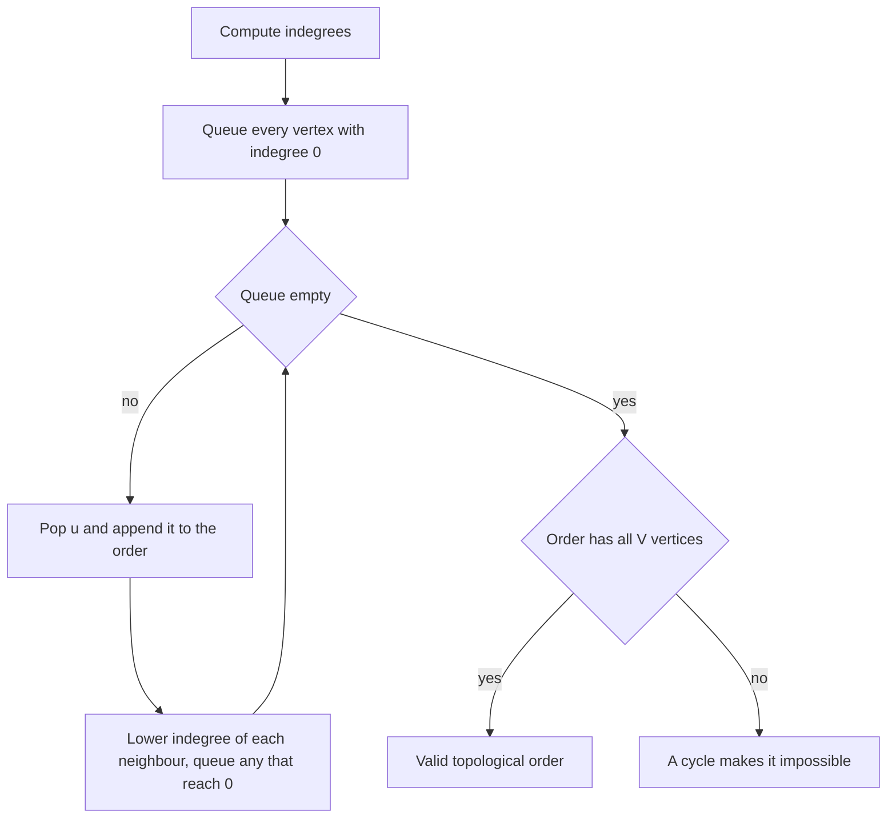

## The hook

Getting dressed has rules. Socks before shoes, trousers before shoes, trousers and shirt before the belt, the belt before the jacket. The watch can go on whenever you like. Nobody writes these rules down, yet everybody finds an order that works every morning.

Build systems, spreadsheets, course plans and package managers all face the same question with thousands of items: given "this must come before that", produce an order that respects every rule, or prove that none exists.

## The intuition

:::analogy
Picture the clothes laid out on the bed, each with a sticky note saying how many items must go on before it. Anything whose note says zero can be put on right now: socks, trousers, shirt, watch. Put one on, then walk over to everything that was waiting for it and cross one off their notes. When a note reaches zero, that item joins the "ready" pile. Keep dressing from the ready pile until the bed is empty. If items are left on the bed and none says zero, two of them are waiting for each other, and no order can ever work.
:::

The rules form a directed graph: an edge from socks to shoes means "socks first". An order in which every edge points forward is a [[topological order]]. One exists exactly when the graph is a [[DAG]], a directed graph with no cycles: a cycle such as "shirt before jacket, jacket before shirt" can never be satisfied.

The sticky note is each vertex's [[indegree]], the number of edges pointing into it. The dressing procedure above is [[Kahn's algorithm]], and there is a second, equally standard method built on DFS. Both run in O(V + E).

## How it works

### Method 1: Kahn's algorithm (BFS-style)

- Compute every vertex's indegree.
- Put every vertex with indegree zero into a queue. This includes vertices with no edges at all, like the watch.
- Repeatedly pop a vertex, append it to the order, and decrement the indegree of each out-neighbour; push any neighbour that reaches zero.
- If the order holds all V vertices, it is a topological order. Otherwise the leftover vertices sit on a cycle or behind one.

Kahn's algorithm detects impossibility for free, which is why it is the usual choice in interviews. Swapping the queue for a min-heap gives the lexicographically smallest order, at an extra log factor.

### Method 2: reversed DFS finish order

Run a DFS from every unvisited vertex, and record each vertex when its call finishes, after all its out-neighbours are done. Reverse that list.

Why this works: take any edge u → v. When the DFS at u examines v, either v is new, so its whole call finishes inside u's call, or v already finished. In a DAG, v cannot be "in progress", because that would mean v reaches u and u → v closes a cycle. Either way, v finishes before u, so in the reversed [[finish order]] u comes first.

The "in progress" case is exactly the three-colour cycle check from [When the Rumour Comes Back to You](article:dsa-cycle-detection): finding an edge to a grey vertex means a cycle, and no order exists.

| | Kahn's algorithm | DFS finish order |
|---|---|---|
| Data structure | Queue and indegree array | Recursion or explicit stack, colour array |
| Detects a cycle by | Output shorter than V | Edge to an in-progress (grey) vertex |
| Natural extras | Smallest-first order with a heap; layers for parallel scheduling | Fits naturally with other DFS work such as SCCs |
| Risk | Forgetting isolated vertices | Stack overflow on very deep graphs |

### Running DP on top of the order

A topological order lets you process each vertex after all of its prerequisites, which is exactly what a dynamic program on a DAG needs. In *Parallel Courses III*, each course takes some months, any number can be studied at once, and prerequisites must finish first:

- finish[v] = duration[v] + the largest finish among v's prerequisites, or just duration[v] if it has none;
- the answer is the largest finish over all vertices.

That largest value is the length of the [[critical path]]: the chain of dependencies that cannot be shortened by adding more helpers.

### Alien Dictionary, the classic premium variant

LeetCode's *Alien Dictionary* is a premium problem, but the idea is worth knowing. You are given words sorted in an unknown alphabet. Compare each adjacent pair of words: the first position where they differ gives one edge, "this letter comes before that letter". Topologically sort the letters. Two traps decide the problem:

- if a longer word appears before its own prefix, as "abc" before "ab", the input is invalid;
- letters that appear in no edge must still be in the output.

The free *Verifying an Alien Dictionary* practises the comparison step with a known alphabet.



:::insight
A topological order exists exactly when the dependency graph has no cycle. Kahn's algorithm builds it by always taking something with nothing left to wait for; DFS builds it backwards, because a task finishes only after everything that depends on it has been explored.
:::

## Walk through an example

Clothes, numbered 0 to 6: socks, trousers, shirt, watch, shoes, belt, jacket. Rules: socks → shoes, trousers → shoes, trousers → belt, shirt → belt, belt → jacket, shirt → jacket.

Starting indegrees: shoes 2, belt 2, jacket 2, everything else 0.

### Kahn's algorithm

| Pop | Indegrees lowered | Newly zero | Queue after |
|---|---|---|---|
| socks | shoes 2 → 1 | | trousers, shirt, watch |
| trousers | shoes 1 → 0, belt 2 → 1 | shoes | shirt, watch, shoes |
| shirt | belt 1 → 0, jacket 2 → 1 | belt | watch, shoes, belt |
| watch | | | shoes, belt |
| shoes | | | belt |
| belt | jacket 1 → 0 | jacket | jacket |
| jacket | | | empty |

Order: socks, trousers, shirt, watch, shoes, belt, jacket. All 7 items appear, so no cycle. Check one rule: belt (position 6) comes before jacket (position 7).

### DFS finish order

Starting DFS from vertex 0, then from each unvisited vertex in index order, the finish order is shoes, socks, jacket, belt, trousers, shirt, watch. Reversed: watch, shirt, trousers, belt, jacket, socks, shoes. A different order from Kahn's, and equally valid: a DAG usually has many topological orders.

### Adding a cycle

Add the silly rule jacket → shirt. Now shirt waits for jacket and jacket waits for shirt. Kahn's algorithm outputs socks, trousers, watch and shoes; shirt, belt and jacket never reach indegree zero. Four of seven, so no order exists, and the three stuck items show where the problem is: belt is not on the cycle itself, but it waits behind it.

### Critical path with parallel dressers

A film crew dresses an actor with several dressers working at once. Durations in minutes: socks 2, trousers 3, shirt 1, watch 1, shoes 4, belt 2, jacket 5.

| Item (topological order) | Prerequisites' finishes | Finish |
|---|---|---|
| socks | | 2 |
| trousers | | 3 |
| shirt | | 1 |
| watch | | 1 |
| shoes | socks 2, trousers 3 | 3 + 4 = 7 |
| belt | trousers 3, shirt 1 | 3 + 2 = 5 |
| jacket | belt 5, shirt 1 | 5 + 5 = 10 |

Everything is done at minute 10. The critical path is trousers → belt → jacket, 3 + 2 + 5 minutes; no number of extra dressers can beat it.

:::try-this
Using Kahn's algorithm with a min-heap instead of a queue, so the smallest-numbered ready vertex is always taken first, what order do you get for the clothes graph? (Ready at the start: 0, 1, 2, 3. Take 0 socks; take 1 trousers, which frees 4 shoes; take 2 shirt, which frees 5 belt; then 3 watch, 4 shoes, 5 belt, which frees 6 jacket, then 6. The order is 0, 1, 2, 3, 4, 5, 6, the same as before only because the numbering already respects the rules.)
:::

:::warning
Common misconception: "A topological order is just a DFS preorder." Preorder can put a vertex before something it depends on. With edges a → c and b → c, starting the DFS at a gives preorder a, c, b, which places c before its prerequisite b. Only the reversed finish order, or Kahn's algorithm, is guaranteed correct.
:::

## The code

```pseudo
kahn(n, edges):
    indeg = [0] * n; for (u, v) in edges: adj[u].add(v); indeg[v] += 1
    queue = every v with indeg[v] == 0        # includes isolated vertices
    order = []
    while queue:
        u = queue.pop_front(); order.append(u)
        for v in adj[u]:
            indeg[v] -= 1
            if indeg[v] == 0: queue.push(v)
    return order if len(order) == n else "impossible"

dfs_topo(u):                                  # colour: 0 new, 1 in progress, 2 done
    colour[u] = 1
    for v in adj[u]:
        if colour[v] == 1: cycle found
        if colour[v] == 0: dfs_topo(v)
    colour[u] = 2; finished.append(u)
# answer: reverse(finished)
```

```cpp
#include <bits/stdc++.h>
using namespace std;

vector<int> kahn(int n, const vector<array<int, 2>>& edges) {
    vector<vector<int>> adj(n);
    vector<int> indeg(n, 0), order;
    for (auto& [u, v] : edges) adj[u].push_back(v), indeg[v]++;
    queue<int> q;
    for (int v = 0; v < n; v++) if (indeg[v] == 0) q.push(v);   // isolated vertices too
    while (!q.empty()) {
        int u = q.front(); q.pop();
        order.push_back(u);
        for (int v : adj[u]) if (--indeg[v] == 0) q.push(v);
    }
    return order;                                              // size < n means a cycle
}

struct DfsTopo {
    vector<vector<int>> adj;
    vector<int> colour, finished;
    bool cycle = false;
    DfsTopo(int n, const vector<array<int, 2>>& edges) : adj(n), colour(n, 0) {
        for (auto& [u, v] : edges) adj[u].push_back(v);
        for (int v = 0; v < n; v++) if (colour[v] == 0) dfs(v);
        reverse(finished.begin(), finished.end());
    }
    void dfs(int u) {
        colour[u] = 1;                                         // in progress
        for (int v : adj[u]) {
            if (colour[v] == 1) cycle = true;                  // back edge
            else if (colour[v] == 0) dfs(v);
        }
        colour[u] = 2;
        finished.push_back(u);
    }
};

long long criticalPath(int n, const vector<array<int, 2>>& edges, const vector<int>& dur) {
    vector<vector<int>> adj(n);
    for (auto& [u, v] : edges) adj[u].push_back(v);
    vector<long long> finish(n, 0);                            // best prerequisite finish so far
    long long best = 0;
    for (int u : kahn(n, edges)) {
        finish[u] += dur[u];                                   // all prerequisites are done
        best = max(best, finish[u]);
        for (int v : adj[u]) finish[v] = max(finish[v], finish[u]);
    }
    return best;
}

int main() {
    vector<array<int, 2>> e = {{0, 4}, {1, 4}, {1, 5}, {2, 5}, {5, 6}, {2, 6}};
    for (int v : kahn(7, e)) cout << v << ' ';
    cout << '\n';                                              // 0 1 2 3 4 5 6
    DfsTopo d(7, e);
    for (int v : d.finished) cout << v << ' ';
    cout << d.cycle << '\n';                                   // 3 2 1 5 6 0 4 0
    auto withCycle = e;
    withCycle.push_back({6, 2});
    cout << kahn(7, withCycle).size() << ' ' << DfsTopo(7, withCycle).cycle << '\n';   // 4 1
    cout << criticalPath(7, e, {2, 3, 1, 1, 4, 2, 5}) << '\n';                         // 10
}
```

The DFS line prints 3 2 1 5 6 0 4, which is watch, shirt, trousers, belt, jacket, socks, shoes, the reversed finish order from the walkthrough, followed by 0 for "no cycle". `criticalPath` only makes sense when `kahn` returns all n vertices; in a real solution, check that first.

## Complexity

- **Kahn's algorithm: O(V + E) time,** since each vertex is queued once and each edge lowers one indegree once; O(V + E) space for the adjacency list.
- **DFS finish order: O(V + E) time,** O(V) recursion depth in the worst case, which can overflow on a long chain of 10⁵ or more vertices; switch to Kahn's or an explicit stack there.
- **Smallest-first order with a heap: O((V + E) log V).**
- **Critical path DP: O(V + E)** on top of the order.

## Common mistakes

- **Forgetting vertices with no edges,** which never get pushed if you only scan edge endpoints.
- **Reversing edge direction.** "Course a requires course b" is the edge b → a; reading it the other way returns the order backwards.
- **Not checking the output size** in Kahn's algorithm, and returning a partial order when a cycle exists.
- **Using DFS preorder** instead of reversed finish order.
- **Using undirected cycle logic** (visited plus parent) on a directed graph, which reports false cycles.
- **In Alien Dictionary, missing the prefix rule** and letters that appear in no comparison.

## Practice problems

*Course Schedule II* and the CSES *Course Schedule* ask for the order itself or "impossible". *Find All Possible Recipes from Given Supplies* is Kahn's algorithm with string names and supplies as starting vertices. *Parallel Courses III* is the critical-path DP. *Verifying an Alien Dictionary* practises the word comparison that the premium Alien Dictionary turns into edges. The graph basics are in [Every Problem Is a Map of Roads](article:dsa-graph-representation), and the queue mechanics in [Ripples on a Pond: Breadth-First Search](article:dsa-bfs).

## Key takeaways

- A topological order lists a directed graph's vertices so every edge points forward, and it exists exactly when the graph has no directed cycle.
- Kahn's algorithm repeatedly outputs a vertex of indegree zero and lowers its neighbours' indegrees; an output shorter than V proves a cycle.
- Reversing the order in which DFS finishes vertices also gives a topological order, because every edge's target finishes before its source in a DAG.
- Every vertex with indegree zero must start in the queue, including vertices that appear in no edge.
- Processing vertices in topological order lets a DP use finished prerequisites, as in the critical path where each finish is its duration plus the slowest prerequisite.
