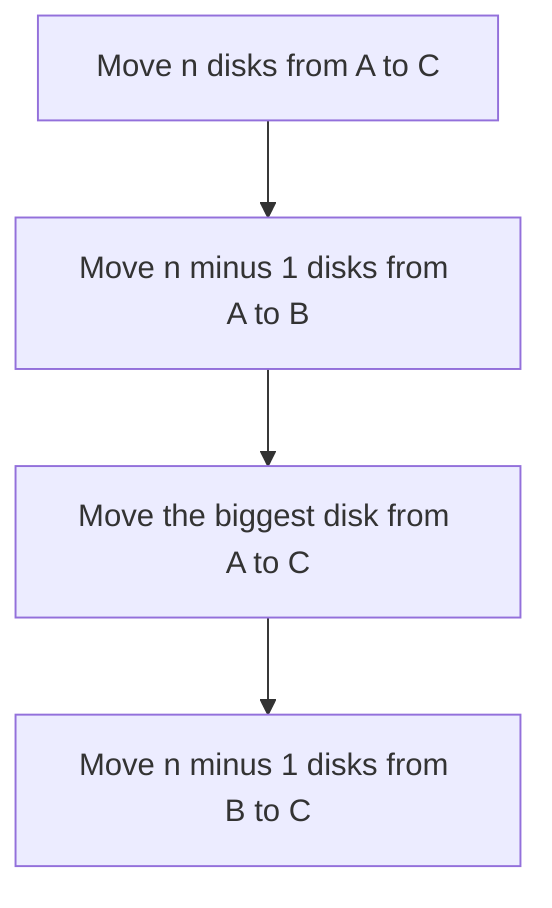

## The hook

You have a stack of plates on one table, biggest at the bottom, and must move it to another table. You may carry one plate at a time, and you may never put a bigger plate on a smaller one. There is one spare table. Try it with three plates and it takes some thought. Try it with eight and it feels impossible to plan.

The [[Tower of Hanoi]], published by the French mathematician Édouard Lucas in 1883, is the classic exercise in not planning at all. Its solution is three lines of recursion, and the only way to write it is to trust that the smaller case already works.

## The problem

Move n disks from peg 1 to peg 3, using peg 2 as the [[spare peg]], one disk at a time, never placing a larger disk on a smaller one. Print the moves. *Tower of Hanoi* on CSES asks for the minimum number of moves and the moves themselves.

| Disks | Minimum moves |
|---|---|
| 1 | 1 |
| 2 | 3 |
| 3 | 7 |
| 10 | 1,023 |
| 20 | 1,048,575 |

## The obvious approach

Simulate: keep three stacks, and at each step search for a legal move that "makes progress". There is no simple rule for what progress means, and a search over states grows like 3ⁿ. People who try to trace the moves by hand for n = 5 usually get lost.

## The key insight

:::analogy
Picture yourself in charge of only the biggest plate. You do not care how the smaller plates move. You simply ask a helper: "Please move the top n − 1 plates to the spare table." When they finish, you carry the big plate to the target table. Then you ask the helper again: "Now move those n − 1 plates from the spare table onto the big one." The helper does the same thing with the second-biggest plate and their own helper, and so on, until someone is asked to move zero plates.
:::

That is the whole algorithm:

$$\text{hanoi}(n, \text{from}, \text{via}, \text{to}) = \text{hanoi}(n-1, \text{from}, \text{to}, \text{via}),\ \text{move disk } n,\ \text{hanoi}(n-1, \text{via}, \text{from}, \text{to})$$

Here n is the number of disks to move, `from` is where they are, `to` is where they must go and `via` is the spare peg. Notice how the roles of the pegs rotate: the first recursive call moves the small stack out of the way onto the spare peg, using the target as its own spare.

You do not verify the recursive calls by tracing them. You check two things only: the base case, moving zero disks does nothing, and the step, if the helper can move n − 1 disks correctly then the three lines move n disks correctly. That is the [[recursive leap of faith]] from [Trusting the Function You Are Still Writing](article:dsa-recursion-basics).

### Counting the moves

Let T(n) be the number of moves. The three lines give T(n) = 2T(n − 1) + 1 with T(0) = 0, so T(n) = 1, 3, 7, 15, ..., that is, 2ⁿ − 1.

And no method can do better. The largest disk has to move at least once. At the moment it moves, every other disk must be stacked on the third peg, which takes at least T(n − 1) moves, and afterwards they must all be moved back on top of it, at least T(n − 1) more. So any solution needs at least 2T(n − 1) + 1 moves, and the recursion achieves exactly that.



:::insight
Solve the problem for the biggest piece and delegate everything smaller to the same function. If the base case is right and the step is right, the recursion is right, and you never need to trace the full sequence of moves.
:::

## Walk through an example

Three disks from peg 1 to peg 3. Disk 1 is the smallest.

| Move | Disk | From | To | Which call it belongs to |
|---|---|---|---|---|
| 1 | 1 | 1 | 3 | moving disks 1 and 2 out of the way, to peg 2 |
| 2 | 2 | 1 | 2 | |
| 3 | 1 | 3 | 2 | |
| 4 | 3 | 1 | 3 | the biggest disk moves once |
| 5 | 1 | 2 | 1 | moving disks 1 and 2 back on top, to peg 3 |
| 6 | 2 | 2 | 3 | |
| 7 | 1 | 1 | 3 | |

Seven moves, 2³ − 1. Moves 1 to 3 and 5 to 7 are each a full 2-disk solution with the pegs relabelled: the solution is [[self-similar]]. In plate terms, you only ever made one decision, move the big plate in the middle; your helpers made all the others.

### The same shape: Gray code

A [[Gray code]] lists all n-bit numbers so that neighbours differ in exactly one bit. Build it like Hanoi builds its moves: take the list for n − 1 bits with a 0 in front, then the same list reversed with a 1 in front. For 3 bits: 000, 001, 011, 010, 110, 111, 101, 100. Reversing the second half means the two middle codes, 010 and 110, differ only in the new first bit. The same list comes from the formula i XOR (i >> 1) for i = 0 to 2ⁿ − 1.

### The same shape: K-th Symbol in Grammar

Row 1 is "0", and each row replaces every 0 with "01" and every 1 with "10": 0, 01, 0110, 01101001. To find the k-th symbol of row n without building the row, note that the first half of row n is row n − 1 and the second half is row n − 1 with every bit flipped. So recurse on the half that contains k. The 5th symbol of row 4 is in the second half, at position 1 of that half, so it is the flip of row 3's first symbol, 0, giving 1.

:::try-this
How many times does the smallest disk move in the 3-disk solution, and on which move numbers? (Four times, on moves 1, 3, 5 and 7. In every Hanoi solution the smallest disk moves on every odd-numbered move, which is the basis of an iterative version.)
:::

:::warning
Common misconception: "To be sure the recursion works, I should trace it all the way down." Tracing every call for n = 5 means following 31 moves and 63 calls, and it is how people get lost. Check the base case and check that the step is correct assuming the smaller call works. That is a complete argument, the same as a proof by induction.
:::

## The code

```pseudo
hanoi(n, from, via, to):
    if n == 0: return
    hanoi(n - 1, from, to, via)       # park the smaller stack on the spare peg
    print move disk n from "from" to "to"
    hanoi(n - 1, via, from, to)       # bring the smaller stack back on top

gray(n):
    if n == 0: return [""]
    g = gray(n - 1)
    return ["0" + x for x in g] + ["1" + x for x in reversed(g)]
```

```cpp
#include <bits/stdc++.h>
using namespace std;

void hanoi(int n, int from, int via, int to, vector<pair<int, int>>& moves) {
    if (n == 0) return;
    hanoi(n - 1, from, to, via, moves);              // the helper parks n - 1 disks
    moves.push_back({from, to});                     // the biggest disk moves once
    hanoi(n - 1, via, from, to, moves);              // the helper brings them back on top
}

vector<int> grayCode(int n) {
    vector<int> g = {0};
    for (int bit = 0; bit < n; bit++)
        for (int i = (int)g.size() - 1; i >= 0; i--) g.push_back(g[i] | 1 << bit);   // reflect, add the new bit
    return g;
}

int kthSymbol(int n, long long k) {                  // row n, position k, both 1-based
    if (n == 1) return 0;
    long long half = 1LL << (n - 2);
    return k <= half ? kthSymbol(n - 1, k) : 1 - kthSymbol(n - 1, k - half);   // second half is flipped
}

int main() {
    vector<pair<int, int>> moves;
    hanoi(3, 1, 2, 3, moves);
    cout << moves.size() << ':';
    for (auto [a, b] : moves) cout << ' ' << a << b;
    cout << '\n';                                    // 7: 13 12 32 13 21 23 13
    moves.clear();
    hanoi(10, 1, 2, 3, moves);
    cout << moves.size() << '\n';                    // 1023
    for (int x : grayCode(3)) cout << x << ' ';
    cout << '\n';                                    // 0 1 3 2 6 7 5 4
    cout << kthSymbol(4, 5) << ' ' << kthSymbol(30, 434991989) << '\n';   // 1 0
}
```

The iterative `grayCode` builds the same reflected list as the recursive definition: for each new bit, it appends the current list in reverse with that bit set. `kthSymbol` handles row 30, which has over 500 million symbols, in 29 steps, because it never builds a row.

## Complexity

- **Tower of Hanoi: O(2ⁿ) time,** because there are 2ⁿ − 1 moves and each is printed once; this is optimal, as the lower-bound argument shows. O(n) recursion depth.
- **Gray code: O(2ⁿ) time and space,** one entry per n-bit number.
- **K-th symbol: O(n) time,** one step per row.

## Common mistakes

- **Mixing up the peg roles** in the two recursive calls; the first moves from the source to the spare, the second from the spare to the target.
- **A missing or wrong base case,** such as stopping at n = 1 but calling with n = 0 elsewhere.
- **Overflowing the move count** for large n; 2ⁿ − 1 needs 64-bit integers beyond n = 31.
- **Printing too much:** the CSES problem allows n up to 16, so 65,535 moves are fine, but do not try n = 40.
- **Forgetting to reverse** the second half when building a Gray code, which breaks the one-bit rule at the middle.
- **Building whole rows** for K-th Symbol, which runs out of memory for large n.

## Practice problems

*Tower of Hanoi* on CSES is the walkthrough: print 2ⁿ − 1 and the moves. *Gray Code* reuses the reflect-and-prefix construction. *K-th Symbol in Grammar* uses the same "a row is two halves of the previous row" structure to answer a single query in O(n). All three are exercises in writing recursion from the structure of the answer, not from a simulation.

## Key takeaways

- The Tower of Hanoi moves n disks by moving n − 1 disks to the spare peg, moving the largest disk, then moving the n − 1 disks back on top of it.
- The move count satisfies T(n) = 2T(n − 1) + 1, so it is 2ⁿ − 1, and no solution can use fewer moves.
- Check a recursive function by its base case and its step, assuming smaller calls work, rather than by tracing every call.
- A reflected Gray code is built the same way: the (n − 1)-bit list with 0 in front, then the same list reversed with 1 in front.
- When an answer is built from smaller copies of itself, as in K-th Symbol in Grammar, you can answer a single query by recursing into the one part that contains it.
