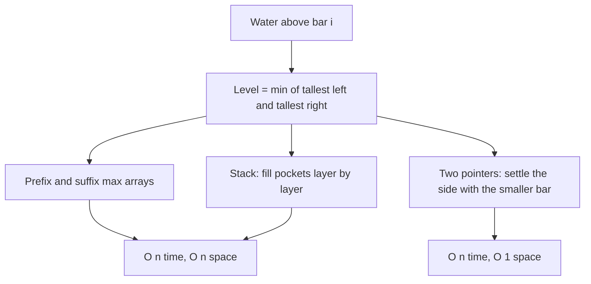

## The hook

A row of buildings of different heights stands side by side, each one unit wide. It rains hard. How many units of water stay trapped in the gaps between them after the rain stops?

*Trapping Rain Water* is one of the most famous hard interview problems, and for good reason. The brute force is easy, the optimal solution is short, and getting from one to the other needs one clean observation. Once you see that observation, three different O(n) solutions follow from it, and interviewers often ask for more than one. This walkthrough builds all three from the same idea.

## The problem

You are given an [[elevation map]]: an array of n non-negative integers, the heights of bars of width 1. Compute the total units of water trapped after raining. Water can only be held where taller bars on both sides contain it; anything above the edges spills off.

## The obvious approach

For each bar, scan left to find the tallest bar on that side and scan right to find the tallest bar on that side. The water above it is the smaller of those two heights minus its own height, or zero. Sum over all bars.

This is correct and it captures the whole idea, but each bar scans the entire array: O(n²). For n = 10⁵ that is 10¹⁰ steps. The work being repeated is "tallest to my left" and "tallest to my right", which are the same running maximums recomputed for every bar.

## The key insight

:::analogy
Picture potholes in a road between buildings after a storm. The water in a pothole rises until it would spill over the lower of the two walls that hold it in. It does not matter how tall the taller wall is; water escapes over the shorter one. So the depth of the puddle above any spot is "the shorter of the tallest wall on my left and the tallest wall on my right", minus the height of the ground at that spot.
:::

In symbols, for bar i:

$$\text{water}_i = \min(\text{maxLeft}_i, \text{maxRight}_i) - h_i$$

where maxLeft includes h_i itself, so the result is never negative. The quantity min(maxLeft, maxRight) is the [[water level]], and the smaller of the two walls is the [[bottleneck wall]]. Every solution below is a different way of computing those two maximums without rescanning.

### Way 1: prefix and suffix maxima

Precompute a [[prefix maximum]] array left_max and a [[suffix maximum]] array right_max in two passes. Then one more pass sums min(left_max[i], right_max[i]) − h[i]. Three linear passes, O(n) time and O(n) extra space.

### Way 2: two pointers

You do not need both full arrays. Put pointer `l` at the start and `r` at the end, tracking left_max and right_max seen so far.

- If h[l] < h[r]: settle bar l. Update left_max with h[l], add left_max − h[l], and move l right.
- Otherwise, settle bar r the same way using right_max, and move r left.

Why is settling bar l with left_max alone correct? Its true level is min(left_max, maxRight). Every left bar the pointer has passed was smaller than some bar on the right at the time, and h[l] itself is smaller than h[r]. So left_max is smaller than some wall on the right, which means left_max ≤ maxRight and the minimum is left_max. The left side is the bottleneck, and we already know it exactly. The mirror argument settles bar r.

Each bar is settled once, so this is O(n) time and O(1) space. It is the same moving-inward idea as [Two Fingers on a Sorted List](article:dsa-two-pointers): always move the side you can already decide.

### Way 3: a monotonic stack

Instead of computing water column by column, compute it layer by layer. Keep a stack of indices with decreasing heights, as in [Who Can See Over the Crowd](article:dsa-monotonic-stack). When a bar taller than the stack top arrives, the top is the floor of a pocket. Pop it; the new top is the pocket's left wall and the current bar is its right wall. Add (min(left wall, right wall) − floor) × (distance between walls − 1). O(n) time, O(n) space.



:::insight
Water above a bar depends on only two numbers: the tallest wall to its left and the tallest wall to its right, and only the shorter one matters. Every efficient solution is a way to know that shorter wall without rescanning the array.
:::

## Walk through an example

Heights **[0, 2, 0, 4, 1, 0, 3, 1]**.

**Way 1, prefix and suffix maxima:**

| i | 0 | 1 | 2 | 3 | 4 | 5 | 6 | 7 |
|---|---|---|---|---|---|---|---|---|
| h | 0 | 2 | 0 | 4 | 1 | 0 | 3 | 1 |
| left_max | 0 | 2 | 2 | 4 | 4 | 4 | 4 | 4 |
| right_max | 4 | 4 | 4 | 4 | 3 | 3 | 3 | 1 |
| level = min | 0 | 2 | 2 | 4 | 3 | 3 | 3 | 1 |
| water | 0 | 0 | 2 | 0 | 2 | 3 | 0 | 0 |

Total: 2 + 2 + 3 = **7**.

**Way 2, two pointers:**

| Step | Compare | Settle | max on that side | Water added | Total |
|---|---|---|---|---|---|
| 1 | h[0]=0 < h[7]=1 | index 0 | left_max = 0 | 0 | 0 |
| 2 | h[1]=2 ≥ h[7]=1 | index 7 | right_max = 1 | 0 | 0 |
| 3 | h[1]=2 < h[6]=3 | index 1 | left_max = 2 | 0 | 0 |
| 4 | h[2]=0 < h[6]=3 | index 2 | left_max = 2 | 2 | 2 |
| 5 | h[3]=4 ≥ h[6]=3 | index 6 | right_max = 3 | 0 | 2 |
| 6 | h[3]=4 ≥ h[5]=0 | index 5 | right_max = 3 | 3 | 5 |
| 7 | h[3]=4 ≥ h[4]=1 | index 4 | right_max = 3 | 2 | 7 |

The pointers meet at index 3, the tallest bar, which never holds water. Total **7**.

**Way 3, stack:** the pocket at index 2 (between walls at 1 and 3) holds (2 − 0) × 1 = 2. When the bar at 6 arrives, it pops index 5 (floor 0, walls at 4 and 6): (1 − 0) × 1 = 1, then index 4 (floor 1, walls at 3 and 6): (3 − 1) × 2 = 4. Total 2 + 1 + 4 = **7**. The stack splits the water into horizontal layers instead of columns, but the sum is the same.

:::try-this
Compute the trapped water for [3, 0, 1, 3, 0, 2] using the level formula. (left_max = [3, 3, 3, 3, 3, 3], right_max = [3, 3, 3, 3, 2, 2]. Water = [0, 3, 2, 0, 2, 0], total 7.)
:::

## The code

```pseudo
trap(h):                                   // two pointers, O(1) space
    l = 0; r = n - 1
    left_max = right_max = 0; total = 0
    while l < r:
        if h[l] < h[r]:
            left_max = max(left_max, h[l])
            total += left_max - h[l]
            l += 1
        else:
            right_max = max(right_max, h[r])
            total += right_max - h[r]
            r -= 1
    return total
```

```cpp
#include <bits/stdc++.h>
using namespace std;

long long trapPrefix(const vector<int>& h) {
    int n = h.size();
    vector<int> L(n), R(n);
    for (int i = 0; i < n; i++) L[i] = max(h[i], i ? L[i - 1] : 0);
    for (int i = n - 1; i >= 0; i--) R[i] = max(h[i], i + 1 < n ? R[i + 1] : 0);
    long long total = 0;
    for (int i = 0; i < n; i++) total += min(L[i], R[i]) - h[i];
    return total;
}

long long trapTwoPointers(const vector<int>& h) {
    int l = 0, r = (int)h.size() - 1, lm = 0, rm = 0;
    long long total = 0;
    while (l < r) {
        if (h[l] < h[r]) { lm = max(lm, h[l]); total += lm - h[l]; l++; }
        else             { rm = max(rm, h[r]); total += rm - h[r]; r--; }
    }
    return total;
}

int main() {
    vector<int> h = {0, 2, 0, 4, 1, 0, 3, 1};
    cout << trapPrefix(h) << ' ' << trapTwoPointers(h) << '\n';              // 7 7
    cout << trapTwoPointers({3, 0, 1, 3, 0, 2}) << '\n';                     // 7
}
```

## Complexity

- **Brute force:** O(n²) time, O(1) space.
- **Prefix and suffix maxima:** O(n) time, O(n) space.
- **Two pointers:** O(n) time, O(1) space, usually the answer interviewers hope for.
- **Monotonic stack:** O(n) time, O(n) space; useful when you need the water pocket by pocket.

## Common mistakes

:::warning
Common misconception: "this is the same as Container With Most Water." *Container With Most Water* picks two thin lines and maximises the single rectangle between them, ignoring everything in between; for the example above its answer is 10, from the lines at indices 1 and 6. *Trapping Rain Water* treats bars as solid and sums the water above every bar. Both use two pointers, but the reasoning for which pointer to move is different.
:::

- **Updating the max after adding water**: update left_max with h[l] first, so the added amount is never negative.
- **Moving the wrong pointer**: always settle the side with the smaller current bar; that side's bottleneck is already known.
- **Off-by-one in the stack version**: the pocket width is right − left − 1, the bars strictly between the walls.
- **Overflow**: with n up to 10⁵ and heights up to 10⁵, the total can exceed 2³¹; use a 64-bit total.

## Practice problems

*Trapping Rain Water* is the walkthrough; be ready to code the two-pointer version and explain the other two. *Container With Most Water* is the classic look-alike, worth solving right after to feel the difference. *Trapping Rain Water II* lifts the problem to a 2D grid: water level is now decided by the lowest point on the boundary around a region, found by processing cells from the outside in with a min-heap.

## Key takeaways

- Water above a bar equals the smaller of the tallest bar to its left and the tallest bar to its right, minus the bar's own height.
- Precomputing prefix and suffix maximums turns the O(n²) brute force into three O(n) passes.
- Two pointers settle the side with the smaller current bar, because its bottleneck is already known, giving O(n) time and O(1) space.
- A monotonic stack computes the same total layer by layer, using each popped bar's neighbours as the pocket's walls.
- Container With Most Water maximises one rectangle between two lines, which is a different problem despite the similar setting.
