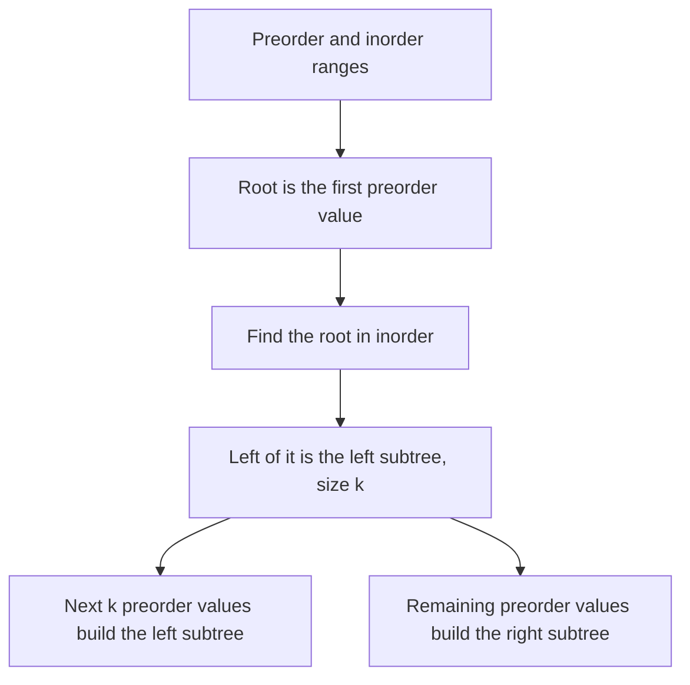

## The hook

An archivist finds two lists of the same family. One was written by a clerk who always noted a parent before their children, oldest child first. The other was written left to right across a family portrait. Neither list alone shows who is whose child. Together, they pin down the whole family tree.

That is the classic interview problem of rebuilding a binary tree from two traversals. It is a neat lesson in what each traversal order tells you, and the efficient solution is a small divide-and-conquer with one hash map that turns O(n²) into O(n).

## The intuition

:::analogy
Picture the two lists side by side. The clerk's list always starts with the head of the family, so you know the root immediately. Find that person in the portrait list: everyone to their left in the portrait belongs to the left branch of the family, and everyone to their right to the right branch. Now you know how many people are in each branch, so you can cut the clerk's list into the same two groups and repeat the trick on each branch.
:::

The clerk's list is [[preorder]], node before its subtrees, so its first element is the root. The portrait list is [[inorder]], left subtree, then node, then right subtree, so the root's position splits it into the left and right subtrees. The size of the left part tells you how much of the preorder list belongs to the left subtree.



## How it works

### Preorder plus inorder

Recursive build over a preorder range and an inorder range of the same size:

- the root is the first value of the preorder range;
- find its position in the inorder range, using an [[index map]] built once;
- the left subtree has k values, where k is the root's offset inside the inorder range;
- build the left subtree from the next k preorder values and the inorder values left of the root;
- build the right subtree from the rest of both ranges.

A neater implementation walks a single global pointer through preorder: each call takes the next preorder value as its root, then builds its left subtree from the inorder values left of the root and its right subtree from those to the right. The inorder bounds alone tell each call when to stop.

### Postorder plus inorder

[[Postorder]] puts the root last. Walk postorder from the end: the last value is the root, and because postorder ends with "right subtree, node", the values just before the root belong to the right subtree. So build the right subtree before the left one.

### A BST from preorder alone

For a binary search tree, the inorder list is just the sorted values, so preorder alone determines the tree. Better still, you do not need to sort. Walk preorder with a pointer and give each call an [[upper bound]]: a call takes the next value as its root if it is below its bound, builds the left subtree with the root as the new bound, then the right subtree with its own bound. A value too large to fit stops the current call and is left for an ancestor's right side. Each value is read once: O(n).

### When two lists are not enough

Preorder plus postorder cannot always rebuild a tree. A root 1 with a single child 2 gives preorder [1, 2] and postorder [2, 1] whether 2 is the left or the right child. Inorder is what tells left from right. And all of this assumes distinct values; with duplicates, the root's position in the inorder list is ambiguous.

:::insight
Preorder or postorder tells you which value is the root; inorder tells you which values are on each side of it. Combining the two splits the problem into two smaller copies, and an index map makes each split O(1).
:::

## Walk through an example

Preorder [1, 2, 4, 5, 3, 6] and inorder [4, 2, 5, 1, 3, 6].

| Call | Root (next preorder) | Inorder range | Left part | Right part |
|---|---|---|---|---|
| 1 | 1 | 4 2 5 1 3 6 | 4 2 5 | 3 6 |
| 2 | 2 | 4 2 5 | 4 | 5 |
| 3 | 4 | 4 | empty | empty |
| 4 | 5 | 5 | empty | empty |
| 5 | 3 | 3 6 | empty | 6 |
| 6 | 6 | 6 | empty | empty |

The rebuilt tree:

```text
      1
     / \
    2   3
   / \   \
  4   5   6
```

Its postorder is [4, 5, 2, 6, 3, 1], and building from postorder plus inorder gives the same tree, reading postorder from the right: 1 is the root, then 3 builds the right subtree first, with 6 as its right child, and so on.

### A BST from preorder [10, 5, 2, 7, 15, 20]

| Value | Bound of the call that takes it | Placed as |
|---|---|---|
| 10 | +∞ | root |
| 5 | 10 | left child of 10 |
| 2 | 5 | left child of 5 |
| 7 | 10, since 7 > 5 ends the left calls of 5 | right child of 5 |
| 15 | +∞, since 15 > 10 ends the left side of the root | right child of 10 |
| 20 | +∞ | right child of 15 |

The tree is 10 with left subtree 5 (children 2 and 7) and right subtree 15 (right child 20), and its inorder traversal is the sorted list 2, 5, 7, 10, 15, 20.

:::try-this
Rebuild the tree with preorder [3, 1, 2] and inorder [1, 2, 3]. What is the shape? (The root is 3. In inorder, 1 and 2 are both left of 3, so the left subtree has 2 nodes and the right one is empty. Recursing: the next root is 1, with nothing left of it and 2 to its right. So 3 has left child 1, and 1 has right child 2.)
:::

:::warning
Common misconception: "Scanning inorder for the root is fine, it is only one loop." It runs once per node. On a skewed tree, such as a chain where every node has only a left child, each scan covers almost the whole range, and the total is O(n²). Build a value-to-index map once and every lookup is O(1).
:::

## The code

```pseudo
build(preorder, inorder):
    pos = map from each value to its inorder index
    next = 0
    make(lo, hi):                     # inorder range [lo, hi]
        if lo > hi: return empty
        root = preorder[next]; next += 1
        mid = pos[root]
        root.left = make(lo, mid - 1)
        root.right = make(mid + 1, hi)
        return root
    return make(0, n - 1)

bst_from_preorder(pre):
    next = 0
    make(bound):
        if next == n or pre[next] > bound: return empty
        root = pre[next]; next += 1
        root.left = make(root.value); root.right = make(bound)
        return root
    return make(+infinity)
```

```cpp
#include <bits/stdc++.h>
using namespace std;

struct Node {
    int val;
    Node *left = nullptr, *right = nullptr;
    Node(int v) : val(v) {}
};

Node* fromPreIn(const vector<int>& pre, const vector<int>& in) {
    unordered_map<int, int> pos;                       // value -> inorder index
    for (int i = 0; i < (int)in.size(); i++) pos[in[i]] = i;
    int next = 0;
    function<Node*(int, int)> make = [&](int lo, int hi) -> Node* {
        if (lo > hi) return nullptr;
        Node* root = new Node(pre[next++]);            // the next preorder value is this subtree's root
        int mid = pos[root->val];
        root->left = make(lo, mid - 1);                // left of the root in inorder
        root->right = make(mid + 1, hi);
        return root;
    };
    return make(0, (int)in.size() - 1);
}

Node* fromPostIn(const vector<int>& post, const vector<int>& in) {
    unordered_map<int, int> pos;
    for (int i = 0; i < (int)in.size(); i++) pos[in[i]] = i;
    int next = (int)post.size() - 1;                   // read postorder from the end
    function<Node*(int, int)> make = [&](int lo, int hi) -> Node* {
        if (lo > hi) return nullptr;
        Node* root = new Node(post[next--]);
        int mid = pos[root->val];
        root->right = make(mid + 1, hi);               // right subtree first
        root->left = make(lo, mid - 1);
        return root;
    };
    return make(0, (int)in.size() - 1);
}

Node* bstFromPreorder(const vector<int>& pre) {
    int next = 0;
    function<Node*(long long)> make = [&](long long bound) -> Node* {
        if (next == (int)pre.size() || pre[next] > bound) return nullptr;   // belongs to an ancestor
        Node* root = new Node(pre[next++]);
        root->left = make(root->val);
        root->right = make(bound);
        return root;
    };
    return make(LLONG_MAX);
}

void preorder(Node* n, vector<int>& out) { if (n) out.push_back(n->val), preorder(n->left, out), preorder(n->right, out); }
void postorder(Node* n, vector<int>& out) { if (n) postorder(n->left, out), postorder(n->right, out), out.push_back(n->val); }
void inorder(Node* n, vector<int>& out) { if (n) inorder(n->left, out), out.push_back(n->val), inorder(n->right, out); }

void show(const vector<int>& v) { for (int x : v) cout << x << ' '; cout << '\n'; }

int main() {
    Node* t = fromPreIn({1, 2, 4, 5, 3, 6}, {4, 2, 5, 1, 3, 6});
    vector<int> a, b;
    postorder(t, a);
    show(a);                                          // 4 5 2 6 3 1
    Node* u = fromPostIn({4, 5, 2, 6, 3, 1}, {4, 2, 5, 1, 3, 6});
    preorder(u, b);
    show(b);                                          // 1 2 4 5 3 6
    Node* bst = bstFromPreorder({10, 5, 2, 7, 15, 20});
    vector<int> c, d;
    inorder(bst, c), preorder(bst, d);
    show(c);                                          // 2 5 7 10 15 20
    show(d);                                          // 10 5 2 7 15 20
    cout << bst->left->right->val << ' ' << bst->right->right->val << '\n';   // 7 20
    Node* s = fromPreIn({3, 1, 2}, {1, 2, 3});
    cout << s->left->val << ' ' << s->left->right->val << ' ' << (s->right == nullptr) << '\n';   // 1 2 1
}
```

The tests rebuild a tree and print a different traversal of it, which checks the shape, not just the values. Turning a tree into a string and back, with null markers so one traversal is enough, is the subject of *Serialize and Deserialize Binary Tree*, covered in the next walkthrough in this track.

## Complexity

- **Preorder or postorder plus inorder: O(n) time** with the index map, O(n) space for the map and the tree, O(h) recursion.
- **Without the map: O(n²)** in the worst case, from scanning for the root at every node.
- **BST from preorder with bounds: O(n),** each value read once. Inserting values one by one instead costs O(n log n) on average and O(n²) on sorted input.

## Common mistakes

- **Scanning inorder for the root** instead of using a map.
- **Building the left subtree first from postorder,** which reads the wrong values; postorder from the end gives the right subtree first.
- **Off-by-one in the ranges,** such as including the root in a subtree's inorder range.
- **Assuming distinct values** without checking; duplicate values make the inorder split ambiguous.
- **Expecting preorder plus postorder to be enough** for every tree.
- **Using int bounds** for the BST build that cannot represent "no limit"; use a wider type or a flag.

## Practice problems

*Construct Binary Tree from Preorder and Inorder Traversal* is the walkthrough. *Construct Binary Tree from Inorder and Postorder Traversal* flips the order of the recursive calls. *Construct Binary Search Tree from Preorder Traversal* uses bounds instead of inorder. *Serialize and Deserialize Binary Tree* asks for an encoding of your own, where null markers make a single traversal enough. Traversal orders are explained in [Four Ways to Tour a Family Tree](article:dsa-tree-traversals).

## Key takeaways

- Preorder gives the root first and postorder gives it last, while inorder places the root between its left and right subtrees.
- Combining preorder or postorder with inorder rebuilds a tree with distinct values by recursively splitting both lists around each root.
- A map from value to inorder index finds each root's position in O(1), making the build O(n) instead of O(n²).
- A BST can be rebuilt from preorder alone by giving each call an upper bound and reading each value once.
- Preorder and postorder together cannot distinguish a node's only child as left or right, so they do not determine a binary tree in general.
