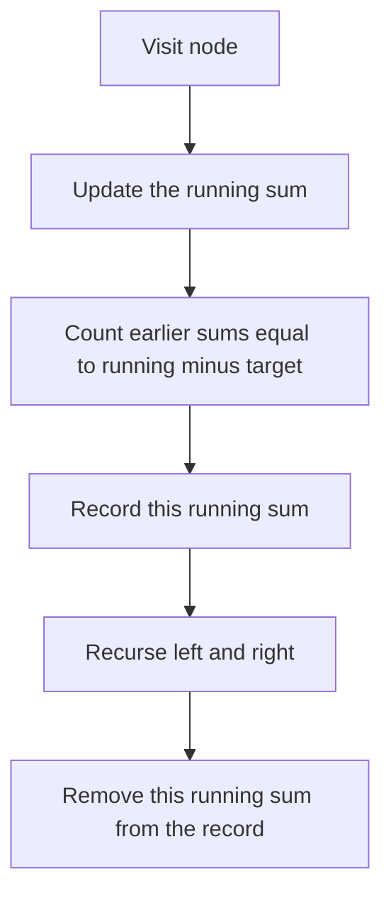

## The hook

A hiker stands on a summit with a map of trails that branch downhill, and a notebook. Down each trail she writes the height change of every stretch. At the bottom of a trail she checks the total. When she climbs back up to a fork to try another branch, she rubs out the stretches she has just undone, so her notebook always describes exactly the trail from the summit to where she stands.

Tree path problems are that hike. Some ask about trails from the summit to the bottom, some about any stretch going downhill, some build a number from the digits along the way. They all share one rule: whatever you record on the way down must be removed on the way back up.

## The intuition

:::analogy
Picture the hiker's notebook as the only memory she has. Going down a trail, she adds a line. Reaching the bottom, she checks whether the trail meets the target. Turning back, she erases the last line before taking a different branch at the fork. If she ever forgot to erase, her notebook would describe a trail that does not exist, half of one branch and half of another.
:::

The notebook is the [[path state]]. Three common shapes:

- **[[Root-to-leaf path]] questions,** such as "is there a path with sum 22" or "list them all": carry a [[running sum]] down, and a path list if you need to output paths.
- **Numbers along a path,** such as digits 1 → 2 → 3 forming 123: carry the number so far, multiplying by 10 at each step.
- **[[Downward path]] questions,** where a path may start and end at any nodes as long as it goes down: carry a [[prefix-sum counter]] of the running sums on the current path, exactly like counting subarrays with a target sum.

## How it works

### Root-to-leaf sums and lists

Pass `target − value` down, or the running sum. At a leaf, check it. To list paths, push the node's value onto a shared list before recursing and pop it after both children return. Checking at leaves only matters: a node with one child is not the end of a root-to-leaf path.

### Numbers along the path

Pass `number = number × 10 + digit` down. At a leaf, add the number to the total. No undo is needed when the state is passed by value, because each call has its own copy.

### Any downward path with a target sum

A downward path from just below an ancestor A down to node X has sum running(X) − running(A). So the number of such paths ending at X with sum T is the number of ancestors on the current path whose running sum is running(X) − T. That is the trick from [Counting Subarrays That Add Up to K](article:dsa-subarray-sum-k), applied to the path from the root:

- before recursing into X's children, add `count[running − T]` to the answer and increase `count[running]`;
- after both children return, decrease `count[running]` so other branches do not see it.

Start with `count[0] = 1`, so paths that begin at the root are counted.



:::insight
A tree path from the root is just an array that grows and shrinks as the recursion moves, so array techniques such as prefix sums work on it, provided you undo every change to the path state when the recursion leaves a node.
:::

## Walk through an example

The tree:

```text
          1
         / \
        2   3
       / \   \
      4   1   -1
     /          \
   -2            2
```

### Root-to-leaf paths with sum 5 (Path Sum II)

| Path | Sum | Leaf? | Recorded? |
|---|---|---|---|
| 1, 2, 4, −2 | 5 | yes | yes |
| 1, 2, 1 | 4 | yes | no |
| 1, 3, −1, 2 | 5 | yes | yes |

Two paths. After recording [1, 2, 4, −2], the code pops −2 and 4 on the way back to node 2, so the list is [1, 2] when it explores the right child 1. In hiking terms, the notebook is rubbed back to "summit, then 2" before the next trail.

### Downward paths with sum 3 (Path Sum III)

The running sums down each branch are 1, 3, 7, 5 on the left-most trail, 1, 3, 4 on the middle one, and 1, 4, 3, 5 on the right.

| Node | Running sum | Looking for running − 3 | Earlier sums on this path | New paths ending here |
|---|---|---|---|---|
| 1 | 1 | −2 | 0 | 0 |
| 2 | 3 | 0 | 0, 1 | 1: the path 1, 2 |
| 4 | 7 | 4 | 0, 1, 3 | 0 |
| −2 | 5 | 2 | 0, 1, 3, 7 | 0 |
| 1 (child of 2) | 4 | 1 | 0, 1, 3 | 1: the path 2, 1 |
| 3 | 4 | 1 | 0, 1 | 1: the path 3 |
| −1 | 3 | 0 | 0, 1, 4 | 1: the path 1, 3, −1 |
| 2 (bottom right) | 5 | 2 | 0, 1, 4, 3 | 0 |

Four downward paths sum to 3: [1, 2], [2, 1], [3] and [1, 3, −1]. Look at the row for node 3: the running sums 3 and 7 from the left branch are not in its "earlier sums" column, because they were removed on the way back. If they had stayed, the counter would see the left branch's 3 and count a "path" from node 2 across to node −1, which does not exist.

### Sum Root to Leaf Numbers

For the tree 1 with children 2 and 4, where 2 has child 3 and 4 has children 5 and 6, the numbers are 123, 145 and 146, so the total is 414. Each call passes `number × 10 + digit` down; at node 4 the number is 14, and its children make 145 and 146.

:::try-this
In the example tree, which root-to-leaf paths sum to 4, and what does Path Sum (the yes or no version) return for target 4? (Only 1, 2, 1 sums to 4; the others sum to 5. So Path Sum returns true.)
:::

:::warning
Common misconception: "In Path Sum III, add the running sum to the counter and leave it there; the counter just grows." The counter must describe only the current root-to-node path. A running sum from one branch is not an ancestor of nodes in another branch, so leaving it in place counts paths that would have to jump sideways through the tree. Decrement it when the recursion leaves the node.
:::

## The code

```pseudo
path_sum_ii(node, remaining, path):
    if node is empty: return
    path.push(node.val)
    if node is a leaf and remaining == node.val: record a copy of path
    path_sum_ii(node.left, remaining - node.val, path)
    path_sum_ii(node.right, remaining - node.val, path)
    path.pop()                                   # rub out the last stretch

path_sum_iii(node, running):
    if node is empty: return
    running += node.val
    answer += count[running - target]
    count[running] += 1
    path_sum_iii(node.left, running); path_sum_iii(node.right, running)
    count[running] -= 1                          # leave the path
```

```cpp
#include <bits/stdc++.h>
using namespace std;

struct Node {
    int val;
    Node *left = nullptr, *right = nullptr;
    Node(int v, Node* l = nullptr, Node* r = nullptr) : val(v), left(l), right(r) {}
};

void pathSumII(Node* n, int remaining, vector<int>& path, vector<vector<int>>& out) {
    if (!n) return;
    path.push_back(n->val);
    if (!n->left && !n->right && remaining == n->val) out.push_back(path);   // a leaf that hits the target
    pathSumII(n->left, remaining - n->val, path, out);
    pathSumII(n->right, remaining - n->val, path, out);
    path.pop_back();                                    // undo before the sibling branch
}

long long pathSumIII(Node* n, long long running, long long target, unordered_map<long long, int>& cnt) {
    if (!n) return 0;
    running += n->val;
    long long found = cnt.count(running - target) ? cnt[running - target] : 0;
    cnt[running]++;
    found += pathSumIII(n->left, running, target, cnt) + pathSumIII(n->right, running, target, cnt);
    cnt[running]--;                                     // this sum leaves the path
    return found;
}

int sumNumbers(Node* n, int number) {
    if (!n) return 0;
    number = number * 10 + n->val;
    if (!n->left && !n->right) return number;
    return sumNumbers(n->left, number) + sumNumbers(n->right, number);
}

void binaryTreePaths(Node* n, string s, vector<string>& out) {
    if (!n) return;
    s += (s.empty() ? "" : "->") + to_string(n->val);
    if (!n->left && !n->right) { out.push_back(s); return; }
    binaryTreePaths(n->left, s, out), binaryTreePaths(n->right, s, out);   // s is a copy: no undo needed
}

int main() {
    Node* root = new Node(1, new Node(2, new Node(4, new Node(-2)), new Node(1)),
                             new Node(3, nullptr, new Node(-1, nullptr, new Node(2))));
    vector<int> path;
    vector<vector<int>> out;
    pathSumII(root, 5, path, out);
    for (auto& p : out) { for (int x : p) cout << x << ' '; cout << "| "; }
    cout << '\n';                                                   // 1 2 4 -2 | 1 3 -1 2 |
    unordered_map<long long, int> cnt{{0, 1}};
    cout << pathSumIII(root, 0, 3, cnt) << '\n';                    // 4
    Node* digits = new Node(1, new Node(2, new Node(3)), new Node(4, new Node(5), new Node(6)));
    cout << sumNumbers(digits, 0) << '\n';                          // 414
    vector<string> paths;
    binaryTreePaths(digits, "", paths);
    for (auto& p : paths) cout << p << ' ';
    cout << '\n';                                                   // 1->2->3 1->4->5 1->4->6
}
```

`binaryTreePaths` passes the string by value, so each call has its own copy and nothing needs undoing; `pathSumII` shares one vector and pops. Both are correct; sharing is cheaper for long paths, copying is simpler. The bottom-up and top-down directions used here are introduced in [Managers Summarising Their Teams' Reports](article:dsa-tree-recursion).

## Complexity

- **Path Sum and Sum Root to Leaf Numbers: O(n) time,** O(h) space.
- **Path Sum II and Binary Tree Paths: O(n · h)** in the worst case, because each recorded path costs up to h to copy; the search itself is O(n).
- **Path Sum III with the prefix-sum counter: O(n) time,** O(h) space for the counter and recursion. The brute force, starting a search from every node, is O(n · h), which is O(n²) on a chain.

## Common mistakes

- **Checking the target at non-leaf nodes** for root-to-leaf questions.
- **Forgetting to pop** from a shared path list, which leaks values into sibling paths.
- **Forgetting to decrement the counter** in Path Sum III.
- **Missing `count[0] = 1`,** which loses paths that start at the root.
- **Overflow** in running sums or in numbers built from long paths; use 64-bit values.
- **Treating "any path" and "downward path" as the same;** paths that bend through a node, as in the maximum path sum problem, need a different technique.

## Practice problems

*Path Sum* and *Binary Tree Paths* are the warm-ups. *Path Sum II* lists every root-to-leaf path with the target, with a shared list that must be popped. *Sum Root to Leaf Numbers* builds numbers along the path. *Path Sum III* is the prefix-sum counter on a tree, the hardest of the five, and the clearest demonstration of why the path state must be undone.

## Key takeaways

- A tree path from the root behaves like an array that grows as the recursion goes down and shrinks as it returns.
- Pass running sums or numbers down as parameters, and check root-to-leaf conditions only at leaves.
- When the path state is shared, such as a list of values, add to it before recursing and remove from it afterwards.
- Downward paths with a target sum are counted in O(n) by keeping a counter of running sums on the current path and looking up running − target.
- The counter must be decremented when the recursion leaves a node, so sums from one branch never pair with nodes in another.
