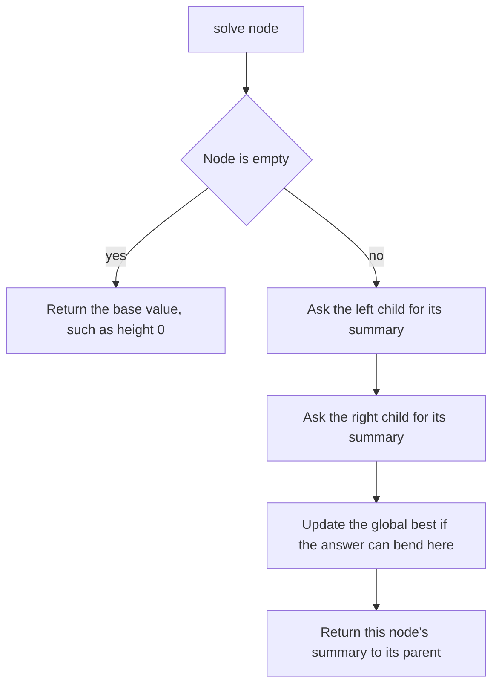

## The hook

Most binary tree interview questions, maximum depth, balanced or not, diameter, path sums, good nodes, look different and are solved by the same ten-line shape. People who struggle with trees usually try to picture the whole tree at once. People who find trees easy ask a much smaller question: what does one node need from its children, and what must it tell its parent?

Get that question right and the recursion writes itself. Get it wrong, usually by returning the final answer when the parent needs something else, and the code passes the examples and fails on the first lopsided tree.

## The intuition

:::analogy
Picture a company organised as a tree. Each manager asks the managers directly below them for a short summary of their whole team: "how many people", "how deep is your chain of command". The manager combines those summaries with their own information and sends one summary up. Nobody needs to see the whole company; each manager only reads two reports and writes one. Sometimes the head office also keeps a separate notice board for a record that any manager may beat, like "the longest chain of command between any two employees".
:::

That is [[bottom-up recursion]]: each node is the root of its own [[subtree]], gets its children's summaries, and returns its own. And when the overall answer is not what a parent needs to continue, it goes on the notice board, a [[global best]].

There is also a second direction. Sometimes a node needs information from above, such as "the highest salary on the chain from the CEO down to me". That is [[top-down recursion]]: the manager receives it from their own manager and passes an updated version down.

| Information needed | Direction | Example |
|---|---|---|
| about the subtree below | returned upwards | height, size, sum, balanced or not |
| about the path from the root | passed downwards as a parameter | depth so far, maximum on the path, running sum |
| about any path anywhere | returned value plus a global best | diameter, maximum path sum |

## How it works

### Step 1: decide what to return

Ask: "If I knew this one fact about each child's subtree, could I compute it for my own subtree?" For [[height]], yes: my height is 1 + max(left height, right height), and an empty subtree has height 0.

### Step 2: decide what to pass down

If a node's answer depends on its ancestors, pass it as a parameter. For *Count Good Nodes*, a node is good if no ancestor has a larger value; pass the maximum seen on the path so far.

### Step 3: separate the returned value from the answer

For the [[diameter]], the longest path through a node goes down the left side and down the right side: left height + right height edges. But the parent cannot use that path, because a path cannot branch. So:

- return the height, which is what the parent can extend;
- update a global best with left height + right height, which is the answer candidate at this node.

### Step 4: early exit with a sentinel

*Balanced Binary Tree* asks whether every node's two subtree heights differ by at most 1. Computing height separately at each node is O(n²) on a long chain. Instead, return the height, or −1 to mean "not balanced somewhere below". A parent that receives −1 returns −1 at once. One pass, O(n).



:::insight
For every tree problem, decide two things before coding: what a node returns to its parent, and what the overall answer is. When they differ, as with the diameter, return what the parent can extend and record the answer in a separate global best.
:::

## Walk through an example

The tree:

```text
        1
       / \
      2   3
     / \
    4   5
   /
  6
```

Heights are computed bottom-up, in post-order:

| Node | Left height | Right height | Returns height | Path through it (left + right) | Global diameter |
|---|---|---|---|---|---|
| 6 | 0 | 0 | 1 | 0 | 0 |
| 4 | 1 | 0 | 2 | 1 | 1 |
| 5 | 0 | 0 | 1 | 0 | 1 |
| 2 | 2 | 1 | 3 | 3 | 3 |
| 3 | 0 | 0 | 1 | 0 | 3 |
| 1 | 3 | 1 | 4 | 4 | 4 |

- **Maximum depth** is the root's height, 4.
- **Diameter** is 4 edges, the path 6 – 4 – 2 – 1 – 3. Here it happens to pass through the root, but the global best is what guarantees we would find it elsewhere too.
- **Balanced?** At node 2 the heights are 2 and 1, fine. At the root they are 3 and 1, a difference of 2, so the tree is not balanced; the root returns −1.

In company terms, manager 2 reported "my chain is 3 deep" upwards, and separately wrote "longest chain between two of my people: 3" on the notice board. The head office then beat that record with 4.

### Top-down: good nodes

Another tree: root 5, with left child 3 (children 6 and 2) and right child 7 (children 4 and 8). Pass down the largest value seen so far.

| Node | Largest on the path above | Good? | Passes down |
|---|---|---|---|
| 5 | none | yes | 5 |
| 3 | 5 | no | 5 |
| 6 | 5 | yes | 6 |
| 2 | 5 | no | 5 |
| 7 | 5 | yes | 7 |
| 4 | 7 | no | 7 |
| 8 | 7 | yes | 8 |

Four good nodes: 5, 6, 7 and 8.

:::try-this
For the first tree, what is the minimum depth, the number of nodes on the shortest path from the root to a leaf? (The leaf 3 is at depth 2, via 1 – 3, so the minimum depth is 2. Careful: a node with one child is not a leaf, so for node 4 you must follow its only child, 6.)
:::

:::warning
Common misconception: "Return the answer from every call." For the diameter, returning the diameter of the subtree gives the parent nothing it can extend, and for minimum depth, returning min(left, right) + 1 at a node with one missing child counts the empty side as depth 0 and gives a wrong answer. Decide what the parent needs, return that, and keep the true answer separately when they differ.
:::

## The code

```pseudo
height(node):                       # bottom-up, with the diameter as a global best
    if node is empty: return 0
    l = height(node.left); r = height(node.right)
    best = max(best, l + r)
    return 1 + max(l, r)

balanced_height(node):              # height, or -1 if unbalanced below
    if node is empty: return 0
    l = balanced_height(node.left); if l == -1: return -1
    r = balanced_height(node.right); if r == -1: return -1
    if |l - r| > 1: return -1
    return 1 + max(l, r)

good(node, maxAbove):               # top-down
    if node is empty: return 0
    count = 1 if node.val >= maxAbove else 0
    m = max(maxAbove, node.val)
    return count + good(node.left, m) + good(node.right, m)
```

```cpp
#include <bits/stdc++.h>
using namespace std;

struct Node {
    int val;
    Node *left = nullptr, *right = nullptr;
    Node(int v) : val(v) {}
};
const int NIL = INT_MIN;                             // marks a missing child in level order

Node* build(const vector<int>& a) {                  // level-order list, NIL for missing
    if (a.empty() || a[0] == NIL) return nullptr;
    Node* root = new Node(a[0]);
    queue<Node*> q;
    q.push(root);
    for (size_t i = 1; i < a.size(); i += 2) {
        Node* cur = q.front(); q.pop();
        if (a[i] != NIL) q.push(cur->left = new Node(a[i]));
        if (i + 1 < a.size() && a[i + 1] != NIL) q.push(cur->right = new Node(a[i + 1]));
    }
    return root;
}

int best = 0;                                        // global best for the diameter

int height(Node* n) {
    if (!n) return 0;
    int l = height(n->left), r = height(n->right);
    best = max(best, l + r);                         // path bending at n, in edges
    return 1 + max(l, r);                            // what the parent can extend
}

int balancedHeight(Node* n) {
    if (!n) return 0;
    int l = balancedHeight(n->left);
    if (l == -1) return -1;                          // failure travels up at once
    int r = balancedHeight(n->right);
    if (r == -1 || abs(l - r) > 1) return -1;
    return 1 + max(l, r);
}

int minDepth(Node* n) {
    if (!n) return 0;
    if (!n->left) return 1 + minDepth(n->right);     // a missing side is not a leaf
    if (!n->right) return 1 + minDepth(n->left);
    return 1 + min(minDepth(n->left), minDepth(n->right));
}

int goodNodes(Node* n, int maxAbove) {               // top-down parameter
    if (!n) return 0;
    int m = max(maxAbove, n->val);
    return (n->val >= maxAbove) + goodNodes(n->left, m) + goodNodes(n->right, m);
}

int main() {
    Node* t = build({1, 2, 3, 4, 5, NIL, NIL, 6});
    int h = height(t);
    cout << h << ' ' << best << ' ' << (balancedHeight(t) != -1) << ' ' << minDepth(t) << '\n';   // 4 4 0 2
    Node* u = build({5, 3, 7, 6, 2, 4, 8});
    cout << goodNodes(u, INT_MIN) << ' ' << (balancedHeight(u) != -1) << '\n';                  // 4 1
}
```

`build` reads a level-order list like LeetCode's, with `NIL` for a missing child, which makes it easy to test the same trees as in the tables. The traversal orders themselves are covered in [Four Ways to Tour a Family Tree](article:dsa-tree-traversals).

## Complexity

- **Time: O(n)** for every function here, because each node is visited once and does O(1) work besides its recursive calls.
- **Space: O(h)** for the recursion, where h is the height: O(log n) for a balanced tree and O(n) for a chain. Very deep chains can overflow the call stack; an iterative traversal with an explicit stack avoids that.
- **Naive Balanced Binary Tree,** computing heights again at each node, is O(n²) on a chain; the −1 sentinel brings it back to O(n).

## Common mistakes

- **Returning the answer instead of the summary,** as with the diameter, where the parent needs the height.
- **Mixing up edges and nodes** in heights and diameters; decide which you count and stay consistent.
- **Treating a node with one child as a leaf** in minimum depth.
- **Recomputing heights at every node,** making balance checks quadratic.
- **Forgetting to reset the global best** between test cases when the same variable is reused.
- **Passing information the wrong way,** returning something that depends on ancestors or passing down something that depends on descendants.

## Practice problems

*Maximum Depth of Binary Tree* is the purest bottom-up return. *Minimum Depth of Binary Tree* tests the one-child trap. *Balanced Binary Tree* combines height with an early-exit sentinel.

*Diameter of Binary Tree* separates the returned height from the global answer. *Count Good Nodes in Binary Tree* is the top-down direction. The hardest member of this family, maximum path sum, gets its own walkthrough later in this track.

## Key takeaways

- Most binary tree problems are one recursion that asks each child for a summary of its subtree and returns a summary of its own.
- Information about a subtree, such as height or size, travels upwards as return values; information about the path from the root, such as the largest value so far, travels downwards as parameters.
- When the answer can bend through a node, as with the diameter, return what the parent can extend and record the bent path in a separate global best.
- A sentinel return value such as −1 can carry failure upwards, turning a quadratic balance check into one linear pass.
- Each node is visited once, so these solutions run in O(n) time with O(h) recursion space.
