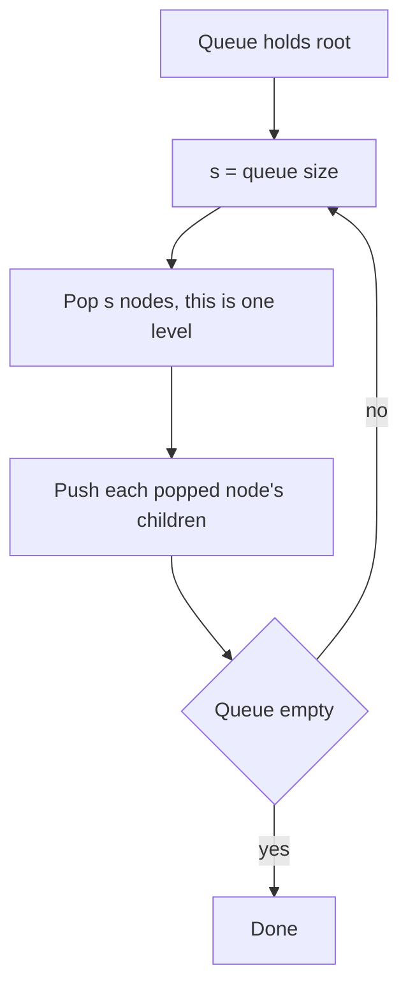

## The hook

Almost every tree problem in an interview, from "maximum depth" to "serialize a tree" to "lowest common ancestor", is a traversal with a small twist. The twist is usually *when* you do the work at each node: before visiting the children, between them, after them, or level by level.

Get the four traversals into your fingers, recursively and iteratively, and a large share of tree problems turn into choosing the right order and adding two lines. Get them wrong, and simple problems become confusing.

## The intuition

:::analogy
Imagine touring a family tree to write down everyone's name. You can announce each grandparent before visiting their children, as a family introduces itself at a wedding: that is preorder. You can wait until all their descendants have spoken and then sum up, as a family reunion closes with the eldest: that is postorder. You can go generation by generation, all grandparents, then all parents, then all children, like a group photo arranged in rows: that is level order. And for a family tree sorted by birth date, visiting the left branch, then the person, then the right branch reads everyone out in order: inorder.
:::

The family tree is a [[binary tree]]. The first three tours are [[depth-first search (DFS)]]; the row-by-row tour is [[breadth-first search (BFS)]].

## How it works

### The three depth-first orders

All three walk the same path: down the left subtree, back up, down the right subtree. They differ only in when the node itself is "visited".

| Order | Visit sequence | Typical use |
|---|---|---|
| Preorder | node, left, right | copying or serialising a tree, passing information down from parent to child |
| Inorder | left, node, right | sorted output of a [[binary search tree (BST)]], validating a BST |
| Postorder | left, right, node | computing results that need children first: heights, subtree sums, deleting a tree |

The recursive versions are three lines each, and the only difference is where the "visit" line goes. As [Trusting the Function You Are Still Writing](article:dsa-recursion-basics) explains, you trust the call to handle each subtree correctly and only think about the current node.

### Iterative versions with a stack

Recursion uses the call stack; you can manage your own, which avoids stack overflow on very deep trees and is sometimes asked in interviews.

- **Preorder:** push the root. Pop a node, visit it, push its right child then its left child (so left is processed first).
- **Inorder:** walk left from the current node pushing every node. When you cannot go left, pop a node, visit it, then move to its right child and repeat.
- **Postorder:** the simplest trick runs a modified preorder (node, right, left) and reverses the output, giving left, right, node.

### Level order with a queue

Push the root into a queue. While the queue is not empty, record its size s, pop exactly s nodes (one level), visit each, and push their children. Recording the size is what lets you separate levels, which many problems need: the rightmost node of each level, averages per level, or zigzag order.



:::insight
Every traversal visits each node once; what changes is the moment of the visit. Preorder acts before the children, so information flows down. Postorder acts after them, so information flows up. Level order trades the stack for a queue to go by distance from the root.
:::

### Choosing the right one

- Need values from children to compute the parent (height, diameter, balanced check)? **Postorder.**
- Need to pass something from parent to child (path sums, depth of each node)? **Preorder.**
- BST and sorted order matters (kth smallest, validate BST)? **Inorder.**
- Anything about levels, or shortest distance from the root? **Level order.**

## Walk through an example

Tree:

```pseudo
        8
      /   \
     3     10
    / \      \
   1   6      14
      / \    /
     4   7  13
```

| Traversal | Output |
|---|---|
| Preorder | 8, 3, 1, 6, 4, 7, 10, 14, 13 |
| Inorder | 1, 3, 4, 6, 7, 8, 10, 13, 14 |
| Postorder | 1, 4, 7, 6, 3, 13, 14, 10, 8 |
| Level order | [8], [3, 10], [1, 6, 14], [4, 7, 13] |

This is a BST, so the inorder output is sorted. The right side view, the last node of each level, is 8, 10, 14, 13.

Iterative inorder trace: push 8, 3, 1 going left. Pop 1, visit; it has no right child. Pop 3, visit; move to 6 and push 6, 4. Pop 4, visit. Pop 6, visit; move to 7, push, pop, visit. Pop 8, visit; move to 10, and so on.

:::try-this
For the same tree, what is the zigzag level order, where levels alternate left-to-right and right-to-left? ([8], [10, 3], [1, 6, 14], [13, 7, 4]. Run normal level order and reverse every second level.)
:::

## The code

```pseudo
preorder(node):  if node: visit(node); preorder(node.left); preorder(node.right)
inorder(node):   if node: inorder(node.left); visit(node); inorder(node.right)
postorder(node): if node: postorder(node.left); postorder(node.right); visit(node)

inorder_iterative(root):
    stack = []; cur = root
    while cur or stack:
        while cur: stack.push(cur); cur = cur.left
        cur = stack.pop(); visit(cur)
        cur = cur.right

level_order(root):
    if not root: return []
    queue = [root]; levels = []
    while queue:
        level = []
        repeat size(queue) times:
            node = queue.pop_front(); level.append(node.val)
            push node.left, node.right if they exist
        levels.append(level)
    return levels
```

```cpp
#include <bits/stdc++.h>
using namespace std;

struct Node { int val; Node *left = nullptr, *right = nullptr; Node(int v) : val(v) {} };

vector<int> inorderIter(Node* root) {
    vector<int> out; stack<Node*> st; Node* cur = root;
    while (cur || !st.empty()) {
        while (cur) { st.push(cur); cur = cur->left; }
        cur = st.top(); st.pop();
        out.push_back(cur->val);
        cur = cur->right;
    }
    return out;
}

vector<vector<int>> levelOrder(Node* root) {
    vector<vector<int>> levels;
    if (!root) return levels;
    queue<Node*> q; q.push(root);
    while (!q.empty()) {
        int s = q.size();
        levels.push_back({});
        while (s--) {
            Node* n = q.front(); q.pop();
            levels.back().push_back(n->val);
            if (n->left) q.push(n->left);
            if (n->right) q.push(n->right);
        }
    }
    return levels;
}

int main() {
    Node* r = new Node(8);
    r->left = new Node(3); r->right = new Node(10);
    r->left->left = new Node(1); r->left->right = new Node(6);
    r->left->right->left = new Node(4); r->left->right->right = new Node(7);
    r->right->right = new Node(14); r->right->right->left = new Node(13);
    for (int x : inorderIter(r)) cout << x << ' ';            // 1 3 4 6 7 8 10 13 14
    cout << '\n';
    for (auto& lv : levelOrder(r)) cout << lv.back() << ' ';  // right side view: 8 10 14 13
    cout << '\n';
}
```

## Complexity

- **Time:** O(n) for every traversal: each node is pushed and visited once.
- **Space:** depth-first traversals use O(h), where h is the [[height]]: O(log n) for a balanced tree, O(n) for a tree that is a long chain. Level order uses O(w), where w is the [[width]], which can be about n/2 at the last level of a complete tree.

## Common mistakes

:::warning
Common misconception: "iterative postorder is just iterative preorder with the visit moved." It is not, because a node must wait until *both* children are finished, and a single stack does not remember whether you came back from the left or the right. Use the reverse-of-(node, right, left) trick, or track the last visited node.
:::

- **Not handling null children**: check before pushing, or at the start of the recursive call.
- **Pushing left before right in iterative preorder**: the stack reverses order, so push right first.
- **Mixing levels in BFS**: without recording the queue size, nodes from the next level get processed with the current one.
- **Deep chains**: recursion on a 10⁵-node chain can overflow the stack; iterate instead.

## Practice problems

*Binary Tree Inorder Traversal* and *Binary Tree Postorder Traversal* practise the iterative stack versions. *Binary Tree Level Order Traversal* is the BFS template. *Binary Tree Right Side View* takes the last node of each level, and *Zigzag Level Order* reverses alternate levels. The iterative versions rely on the stack and queue behaviour from [The Last Plate In Is the First Plate Out](article:dsa-stack-patterns).

## Key takeaways

- Preorder visits a node before its children, inorder between them, and postorder after them; level order goes level by level.
- Use preorder to pass information down, postorder to gather results from children, inorder for sorted BST order, and level order for anything about levels.
- Iterative depth-first traversals replace the call stack with an explicit stack; postorder is easiest as a reversed node-right-left preorder.
- Level order uses a queue, and recording the queue size at the start of each level separates the levels.
- All traversals take O(n) time, with O(h) space for depth-first and O(w) space for level order.
