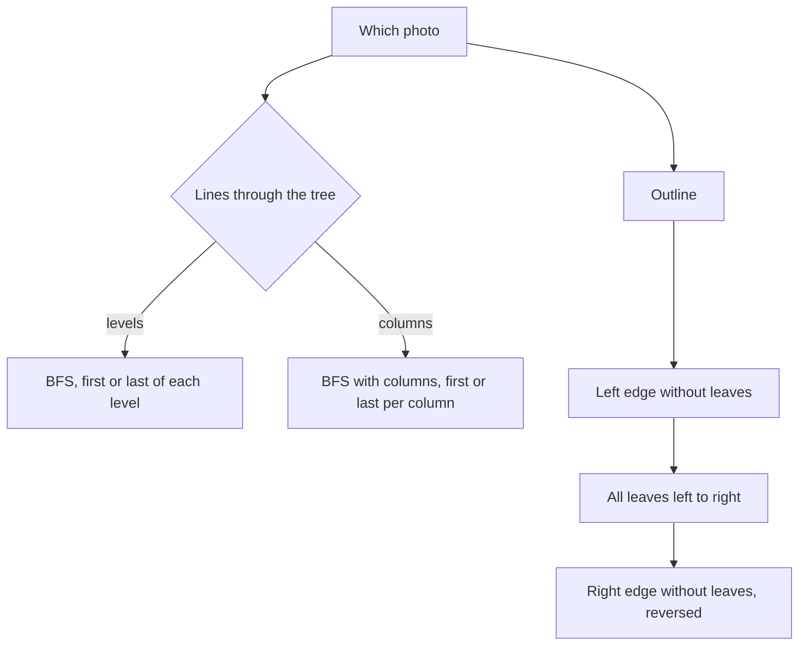

## The hook

A photographer walks around a tree in a park and takes four pictures: from the left, from the right, from directly above and from below. Each photo shows only some of the branches; the rest are hidden behind the ones in front. Then she traces the outline of the tree with her finger, down the left side, along the bottom and back up the right.

Those are the classic tree view questions, popular in interviews precisely because each one is a small twist on a traversal you already know. Left and right views come from levels, top and bottom views from columns, and the boundary is three traversals glued together carefully.

## The problem

For the tree

```text
           1
         /   \
        2     3
       / \     \
      4   5     6
         / \   /
        7   8 9
```

| View | Answer |
|---|---|
| left view | 1, 2, 4, 7 |
| right view | 1, 3, 6, 9 |
| top view | 4, 2, 1, 3, 6 |
| bottom view | 4, 7, 5, 9, 6 |
| boundary, anticlockwise | 1, 2, 4, 7, 8, 9, 6, 3 |

## The obvious approach

Compute each view by eye from a drawing, or by recursive searches that look for the "leftmost node at depth d" one depth at a time, rescanning the tree for every level. That is O(n · h) or worse, and it invites mistakes with nodes hidden behind others.

## The key insight

:::analogy
Picture the photographer standing to the right of the tree. Every level of branches is a horizontal line, and on each line she sees only the branch nearest to her: the rightmost node of that level. From above, every column is a vertical line, and she sees only the highest node in each column. The boundary is the outline: down the left edge, along every leaf at the bottom, and up the right edge, each point traced once.
:::

So each view is "pick one node per line" for the right kind of line:

- **[[Left view]] and [[right view]]:** lines are levels. Run a BFS and take the first or last node of each level. Equivalently, a DFS that visits the preferred side first records a node whenever its depth equals the number of nodes recorded so far.
- **[[Top view]] and [[bottom view]]:** lines are columns, with coordinates as in [Looking Down on a Tree Through a Grid](article:dsa-vertical-order). Run a BFS that carries columns; the first node seen in each column is the top view, and the last is the bottom view.
- **[[Boundary traversal]]:** three parts. The left edge, following left children (or the right child when there is no left), stopping before leaves. Then every leaf, left to right, by a DFS. Then the right edge, the mirror image, also without leaves, added in reverse so the outline goes up.



:::insight
Every view keeps one node per line: per level for left and right, per column for top and bottom. BFS visits nodes level by level, so "first per line" and "last per line" fall out of a single pass.
:::

## Walk through an example

### Levels and the side views

| Level | Nodes left to right | First | Last |
|---|---|---|---|
| 0 | 1 | 1 | 1 |
| 1 | 2, 3 | 2 | 3 |
| 2 | 4, 5, 6 | 4 | 6 |
| 3 | 7, 8, 9 | 7 | 9 |

The left view is 1, 2, 4, 7 and the right view is 1, 3, 6, 9. Notice that 7 is in the left view even though it is not a left child: it is simply the leftmost node of its level.

### Columns and the top and bottom views

| Column | Nodes in BFS order | Top (first) | Bottom (last) |
|---|---|---|---|
| −2 | 4 | 4 | 4 |
| −1 | 2, 7 | 2 | 7 |
| 0 | 1, 5 | 1 | 5 |
| 1 | 3, 8, 9 | 3 | 9 |
| 2 | 6 | 6 | 6 |

Column 1 holds 3 at row 1, and 8 and 9 both at row 3. The bottom view takes the later of the two deepest nodes in BFS order, 9, which is the usual convention; check the statement if it says otherwise.

### The boundary

| Part | Nodes | Note |
|---|---|---|
| root | 1 | |
| left edge without leaves | 2 | 4 is a leaf, so the edge stops before it |
| leaves left to right | 4, 7, 8, 9 | each leaf once |
| right edge without leaves, reversed | 6, 3 | the edge is 3 then 6; 9 is a leaf |

The outline is 1, 2, 4, 7, 8, 9, 6, 3. In photo terms, the finger traced down the left, along the bottom and back up the right, touching each point exactly once.

:::try-this
For the same tree, what is the left view if node 4 is removed? (Level 2 becomes 5, 6, so its first node is 5; level 3 is still 7, 8, 9. The left view is 1, 2, 5, 7.)
:::

:::warning
Common misconception: "The left view is the chain of left children from the root." It is the first node of each level, which may be a right child deep in the tree, such as 7 being reached by going left then right. Following only left children misses levels whose leftmost node hangs from a right branch.
:::

## The code

```pseudo
side_views(root):
    BFS level by level; record the first and the last node of each level

top_bottom(root):
    BFS carrying columns; for each column keep the first node seen (top) and the last (bottom)

boundary(root):
    out = [root] unless root is a leaf
    walk the left edge from root.left, adding non-leaves, going left when possible else right
    add every leaf with a DFS, left to right
    walk the right edge from root.right the same way, collect non-leaves, add them reversed
```

```cpp
#include <bits/stdc++.h>
using namespace std;

struct Node {
    int val;
    Node *left = nullptr, *right = nullptr;
    Node(int v, Node* l = nullptr, Node* r = nullptr) : val(v), left(l), right(r) {}
};
bool isLeaf(Node* n) { return n && !n->left && !n->right; }

pair<vector<int>, vector<int>> sideViews(Node* root) {
    vector<int> leftV, rightV;
    queue<Node*> q;
    if (root) q.push(root);
    while (!q.empty()) {
        int sz = q.size();
        for (int i = 0; i < sz; i++) {
            Node* n = q.front(); q.pop();
            if (i == 0) leftV.push_back(n->val);          // first of the level
            if (i == sz - 1) rightV.push_back(n->val);    // last of the level
            if (n->left) q.push(n->left);
            if (n->right) q.push(n->right);
        }
    }
    return {leftV, rightV};
}

pair<vector<int>, vector<int>> topBottom(Node* root) {
    map<int, int> top, bottom;                            // column -> value
    queue<pair<Node*, int>> q;
    if (root) q.push({root, 0});
    while (!q.empty()) {
        auto [n, c] = q.front(); q.pop();
        top.insert({c, n->val});                          // keeps the first, which is the highest
        bottom[c] = n->val;                               // overwrite: ends with the last
        if (n->left) q.push({n->left, c - 1});
        if (n->right) q.push({n->right, c + 1});
    }
    vector<int> t, b;
    for (auto& [c, v] : top) t.push_back(v);
    for (auto& [c, v] : bottom) b.push_back(v);
    return {t, b};
}

void leaves(Node* n, vector<int>& out) {
    if (!n) return;
    if (isLeaf(n)) { out.push_back(n->val); return; }
    leaves(n->left, out), leaves(n->right, out);
}

vector<int> boundary(Node* root) {
    vector<int> out;
    if (!root) return out;
    if (!isLeaf(root)) out.push_back(root->val);
    for (Node* n = root->left; n && !isLeaf(n); n = n->left ? n->left : n->right) out.push_back(n->val);
    leaves(root, out);
    vector<int> right;
    for (Node* n = root->right; n && !isLeaf(n); n = n->right ? n->right : n->left) right.push_back(n->val);
    out.insert(out.end(), right.rbegin(), right.rend());   // up the right side
    return out;
}

void print(const vector<int>& v) { for (int x : v) cout << x << ' '; cout << "| "; }

int main() {
    Node* root = new Node(1, new Node(2, new Node(4), new Node(5, new Node(7), new Node(8))),
                             new Node(3, nullptr, new Node(6, new Node(9))));
    auto [l, r] = sideViews(root);
    auto [t, b] = topBottom(root);
    print(l), print(r);
    cout << '\n';                                         // 1 2 4 7 | 1 3 6 9 |
    print(t), print(b);
    cout << '\n';                                         // 4 2 1 3 6 | 4 7 5 9 6 |
    print(boundary(root));
    cout << '\n';                                         // 1 2 4 7 8 9 6 3 |
    root->left->left = nullptr;                           // the try-this change: remove 4
    print(sideViews(root).first);
    cout << '\n';                                         // 1 2 5 7 |
}
```

The boundary starts with the root only if it is not itself a leaf, so a single-node tree prints that node once, from the leaf pass. The level-by-level BFS loop with `sz = q.size()` is the same one used in [Ripples on a Pond: Breadth-First Search](article:dsa-bfs).

## Complexity

- **Side views: O(n) time,** one BFS, and O(w) space for the widest level.
- **Top and bottom views: O(n log w)** with an ordered map over w columns, or O(n) with an array offset by the minimum column.
- **Boundary: O(n) time,** each node touched a constant number of times, O(h) recursion for the leaf pass.

## Common mistakes

- **Treating the left view as the chain of left children.**
- **Taking the top view from a DFS,** which can see a deep node in a column before the shallow one.
- **Listing a leaf twice** in the boundary, once in an edge and once in the leaf pass.
- **Adding the root twice** when it is also a leaf, in a single-node tree.
- **Forgetting to reverse the right edge,** which makes the outline jump instead of going up.
- **Missing a level's leftmost node** that hangs from a right child, when an edge walk is used instead of BFS for the views.

## Practice problems

*Binary Tree Right Side View* is the right view; solve it once with BFS and once with a right-first DFS that records a node when its depth equals the size of the answer so far. *Find Largest Value in Each Tree Row* uses the same level loop with a different choice per level. *Vertical Order Traversal of a Binary Tree* gives the column machinery behind the top and bottom views. The boundary traversal itself is a premium LeetCode problem, so practise it on the example above and on a tree whose left edge must step right, such as a root whose left child has only a right child.

## Key takeaways

- Left and right views are the first and last node of each level, found with one level-by-level BFS.
- Top and bottom views are the first and last node of each column in BFS order, using the same column coordinates as vertical order traversal.
- A left view can include right children, because it is defined by levels, not by following left links.
- A boundary traversal is the root, the left edge without leaves, all leaves from left to right, and the right edge without leaves in reverse.
- Excluding leaves from both edges and adding them once in the leaf pass is what prevents duplicates in the boundary.
