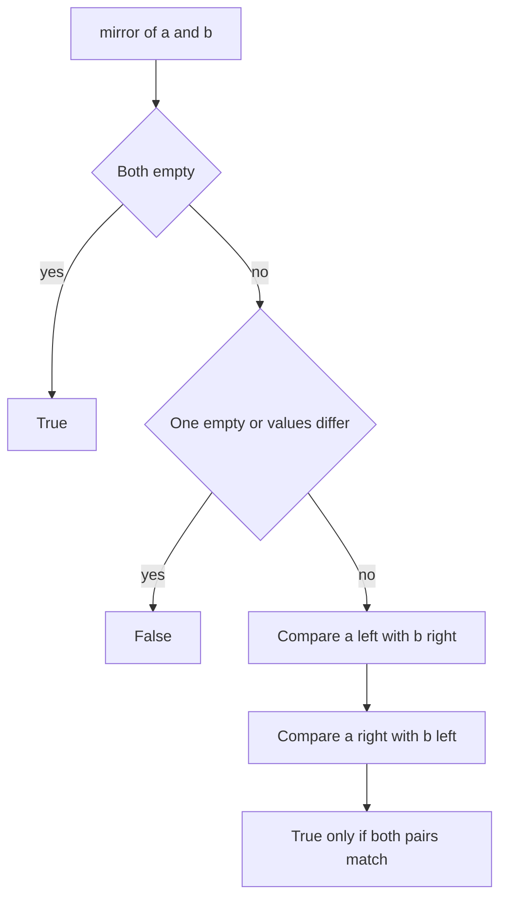

## The hook

Hold a drawing of a tree up to a mirror. If the reflection looks exactly like the original, the tree is symmetric. Checking that by eye is easy; checking it in code means comparing the right parts of the tree with each other, and most wrong answers compare the wrong pairs.

A small family of interview questions asks about shape rather than values: are two trees identical, is one a mirror of itself, does one appear inside the other, how wide does it get. They are mostly easy, but each has one thing to get right, and the width question hides an overflow that catches many solutions on deep trees.

## The problem

| Question | Example | Answer |
|---|---|---|
| Same Tree: are two trees identical in shape and values? | two copies of the same tree | yes |
| Symmetric Tree: is a tree its own mirror? | 5 with children 7 and 7, whose children are 1, 2 and 2, 1 | yes |
| Subtree of Another Tree: does t appear as a full subtree of s? | s contains a node whose subtree equals t | yes or no |
| Maximum Width: the widest level, counting gaps | see the walkthrough | 4 |

## The obvious approach

For symmetry, build a mirrored copy of the tree and compare it with the original. It works, but it costs O(n) extra memory and an extra pass. For width, count the nodes on each level, which is wrong: width counts the gaps between the leftmost and rightmost nodes too.

## The key insight

:::analogy
Picture holding the tree up to a mirror placed down the middle. The leftmost branch on one side must match the rightmost branch on the other, and the inner branches, the ones nearest the mirror, must match each other. You check those two pairs, then the same two pairs one level down inside each, and so on. You never need to draw the reflection; you compare positions that face each other across the glass.
:::

That is [[paired recursion]]: walk two subtrees at once and compare what you meet.

- **Same tree:** both empty, or both present with equal values, and same(a.left, b.left) and same(a.right, b.right).
- **Symmetric:** mirror(a, b) is true when both are empty, or both have equal values and mirror(a.left, b.right) and mirror(a.right, b.left). Start with mirror(root.left, root.right). That compares exactly the pairs that face each other across the mirror.
- **Subtree:** t is a subtree of s if same(s, t), or t is a subtree of s.left or of s.right. That is O(m · n) in the worst case. For large inputs, serialise both trees with null markers, as in [Packing a Tree Into a Box and Rebuilding It](article:dsa-serialize-tree), and search for one string inside the other in linear time.
- **Invert:** the [[mirror image]] is built by swapping every node's children, recursively.

### Width with heap numbers

Give each node a position as in a binary heap, [[heap indexing]]: root 1, children 2i and 2i + 1. Missing nodes simply never get visited, but their positions still count. The [[level width]] of a level is last index − first index + 1. A BFS that carries indices finds every level's first and last.

Indices double at every level, so a narrow tree 70 levels deep would need numbers beyond 2⁶⁴. Only differences within a level matter, so use [[index normalisation]]: when a level starts, subtract its first index from every index in it before computing children.



:::insight
Shape questions compare positions, not values in order. Walk two trees, or the two halves of one tree, in step, and choose the pairs carefully: matching sides for identical trees, opposite sides for a mirror.
:::

## Walk through an example

### Symmetric Tree

```text
        5
      /   \
     7     7
    / \   / \
   1   2 2   1
```

| Pair compared | Values | Next pairs |
|---|---|---|
| (left 7, right 7) | equal | (outer 1, outer 1) and (inner 2, inner 2) |
| (1, 1) | equal, both leaves | done |
| (2, 2) | equal, both leaves | done |

Symmetric. Now change the tree so both 7s have only a right child 2. The first pair (7, 7) matches, but the outer pair is (left 7's left = empty, right 7's right = 2): one empty, one not, so the tree is not symmetric, even though both sides "look the same" when read left to right. A mirror needs the second 7's child on its left.

### Maximum Width

```text
          1
        /   \
       2     3
      /       \
     4         7
              /
             8
```

| Level | Nodes with heap index | First | Last | Width |
|---|---|---|---|---|
| 0 | 1:1 | 1 | 1 | 1 |
| 1 | 2:2, 3:3 | 2 | 3 | 2 |
| 2 | 4:4, 7:7 | 4 | 7 | 4 |
| 3 | 8:14 | 14 | 14 | 1 |

The answer is 4: level 2 has nodes at positions 4 and 7, with two empty positions, 5 and 6, between them. With normalisation, level 2's indices are stored as 0 and 3 instead, which gives the same width.

:::try-this
Is the tree 1, with left child 2 and right child 2, where the left 2 has a left child 3 and the right 2 has a right child 3, symmetric? (Yes. The outer pair is the left 2's left child 3 and the right 2's right child 3, which match; the inner pair is two empty children. A mirror puts the 3s on opposite outer sides.)
:::

:::warning
Common misconception: "A tree is symmetric if its inorder traversal is a palindrome." Different shapes can share that inorder sequence. For example, a root 1 with only a left child 1 has inorder [1, 1], a palindrome, but it is not symmetric. Compare the facing pairs of nodes directly.
:::

## The code

```pseudo
same(a, b):
    if both empty: return true
    if one empty or a.val != b.val: return false
    return same(a.left, b.left) and same(a.right, b.right)

mirror(a, b):
    if both empty: return true
    if one empty or a.val != b.val: return false
    return mirror(a.left, b.right) and mirror(a.right, b.left)

max_width(root):
    queue = [(root, 0)]; best = 0
    while queue not empty:
        first = index of the first node in this level
        for each node in this level: idx = its index - first; push children with 2 idx + 1 and 2 idx + 2
        best = max(best, last idx + 1)
```

```cpp
#include <bits/stdc++.h>
using namespace std;

struct Node {
    int val;
    Node *left = nullptr, *right = nullptr;
    Node(int v, Node* l = nullptr, Node* r = nullptr) : val(v), left(l), right(r) {}
};

bool same(Node* a, Node* b) {
    if (!a || !b) return a == b;                         // both empty, or a mismatch
    return a->val == b->val && same(a->left, b->left) && same(a->right, b->right);
}

bool mirror(Node* a, Node* b) {
    if (!a || !b) return a == b;
    return a->val == b->val && mirror(a->left, b->right) && mirror(a->right, b->left);   // facing pairs
}
bool symmetric(Node* root) { return !root || mirror(root->left, root->right); }

bool isSubtree(Node* s, Node* t) {                       // O(m * n) worst case
    if (!s) return !t;
    return same(s, t) || isSubtree(s->left, t) || isSubtree(s->right, t);
}

Node* invert(Node* n) {
    if (!n) return nullptr;
    swap(n->left, n->right);
    invert(n->left), invert(n->right);
    return n;
}

long long maxWidth(Node* root) {
    if (!root) return 0;
    long long best = 0;
    queue<pair<Node*, unsigned long long>> q;
    q.push({root, 0});
    while (!q.empty()) {
        int sz = q.size();
        unsigned long long first = q.front().second, idx = 0;
        for (int i = 0; i < sz; i++) {
            auto [n, raw] = q.front(); q.pop();
            idx = raw - first;                           // normalise within the level
            if (n->left) q.push({n->left, 2 * idx + 1});
            if (n->right) q.push({n->right, 2 * idx + 2});
        }
        best = max(best, (long long)idx + 1);            // last index of the level, plus one
    }
    return best;
}

int main() {
    Node* sym = new Node(5, new Node(7, new Node(1), new Node(2)), new Node(7, new Node(2), new Node(1)));
    Node* lop = new Node(5, new Node(7, nullptr, new Node(2)), new Node(7, nullptr, new Node(2)));
    Node* try3 = new Node(1, new Node(2, new Node(3)), new Node(2, nullptr, new Node(3)));
    cout << symmetric(sym) << symmetric(lop) << symmetric(try3) << '\n';   // 101

    Node* w = new Node(1, new Node(2, new Node(4)), new Node(3, nullptr, new Node(7, new Node(8))));
    cout << maxWidth(w) << '\n';                                          // 4

    Node* deep = new Node(0);                                             // a zigzag 100 levels deep
    Node* cur = deep;
    for (int i = 1; i < 100; i++) cur = (i % 2 ? cur->left : cur->right) = new Node(i);
    cout << maxWidth(deep) << '\n';                                       // 1

    Node* t = new Node(7, new Node(1), new Node(2));
    cout << isSubtree(sym, t) << isSubtree(sym, new Node(7, new Node(2))) << ' ';
    invert(sym);
    cout << sym->left->left->val << sym->left->right->val << '\n';        // 10 12
}
```

The code numbers positions from 0 (children 2i + 1 and 2i + 2) rather than from 1 as in the table; differences within a level, and so the widths, are the same. The 100-level zigzag tree shows why normalisation matters: without it, the index at the bottom would be far beyond 64 bits. The symmetric tree is its own mirror, so inverting it leaves its left subtree reading 1 then 2, as before.

## Complexity

- **Same Tree, Symmetric Tree, Invert: O(n) time,** each node compared or visited once, and O(h) recursion.
- **Subtree of Another Tree: O(m · n)** with repeated comparisons, where m and n are the two sizes; O(m + n) with serialisation and a linear-time string search.
- **Maximum Width: O(n) time,** O(w) queue space for the widest level.

## Common mistakes

- **Comparing the wrong pairs for symmetry,** such as left with left.
- **Testing symmetry with a traversal palindrome,** which accepts non-symmetric shapes.
- **Counting nodes instead of positions** for width.
- **Overflowing heap indices** on deep trees; normalise per level.
- **Accepting a match in the middle of s for Subtree of Another Tree;** the match must include all of t's descendants and end where s's subtree ends, which is exactly what `same` checks.
- **Serialising without null markers** for the string-search version, which makes different shapes look equal.

## Practice problems

*Same Tree* and *Symmetric Tree* are paired recursion with matching and opposite pairs. *Invert Binary Tree* builds the mirror image. *Subtree of Another Tree* combines a traversal of s with *Same Tree* at every node. *Maximum Width of Binary Tree* is the heap-indexed BFS with normalisation. The level loop is the same as in [Ripples on a Pond: Breadth-First Search](article:dsa-bfs).

## Key takeaways

- Questions about a tree's shape are answered by walking two trees, or two halves of one tree, in step and comparing the nodes met.
- Two trees are identical when their roots match and their left and right subtrees are identical in pairs.
- A tree is symmetric when its left and right subtrees are mirrors, comparing outer children with outer children and inner with inner.
- Maximum width numbers nodes like a heap, root 1 and children 2i and 2i + 1, and measures last minus first plus one on each level.
- Subtracting each level's first index keeps the numbers small, which prevents overflow on deep, narrow trees.
