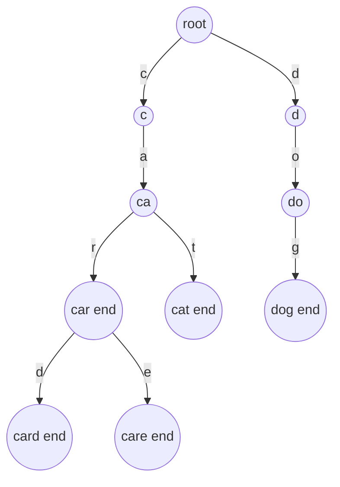

## The hook

You type "ca" into a search box and suggestions appear instantly: car, card, care, cat. The dictionary behind it might hold a million words. Checking each one for the prefix "ca" on every keystroke would be far too slow, and a hash set cannot help, because it only answers "is this exact string present?", not "what starts with this?".

The data structure built for exactly this question is the trie. It turns prefix questions into a short walk down a tree, one step per letter you typed, no matter how big the dictionary is. In interviews it shows up in autocomplete design, word games on grids, spell checkers, and, surprisingly, in bitwise XOR problems.

## The intuition

:::analogy
Think of an old phone book indexed letter by letter. The first tab says "C". Inside it, smaller tabs say "Ca", "Ce", "Ch". Inside "Ca", tabs for "Car", "Cat". To find everyone whose name starts with "Car", you never look at the D section or even at "Cat"; you just follow three tabs and everything behind the last tab is your answer. Names that start the same way share the same tabs.
:::

A [[trie]] is that tabbed phone book as a tree. The root is the cover. Each edge is one letter, so the path from the root to any node spells a [[prefix]]. Words with a common beginning share the same path until they differ.

## How it works

### The node

Each node holds:

- **children**: one slot per possible next character. With an [[alphabet size]] of 26, an array of 26 pointers; for large or unknown alphabets, a hash map.
- **end flag**: the [[end-of-word marker]], true if a word ends exactly here.
- optionally a **[[prefix count]]**: how many inserted words pass through this node.

### Insert

Start at the root. For each character, follow the child for that character, creating it if it does not exist, and increment its prefix count. At the last character, set the end flag.

### Search and startsWith

Walk from the root following the characters. If a child is missing, the answer is false. Otherwise:

- `search(word)` returns the end flag of the final node, because the path existing only proves it is a prefix.
- `startsWith(prefix)` returns true as soon as the whole path exists.
- `countPrefix(prefix)` returns the final node's prefix count.



### Pruned search on grids

In *Word Search II* you walk a letter grid looking for many words at once. Walk the grid and the trie together: from a cell, move to a neighbour only if the trie node has a child for that neighbour's letter. The moment the trie has no such child, no word can continue this way, so you backtrack immediately. One walk checks every word together instead of searching for each word separately.

### Tries over bits

Numbers can be inserted as binary strings, most significant bit first, giving a trie with alphabet size 2. To find the number that gives the maximum XOR with x, walk down choosing the opposite bit whenever that child exists. This greedy works because a higher bit outweighs all lower bits together.

:::insight
A trie stores the shared beginnings of words once, so any question about a prefix costs time proportional to the prefix length, independent of how many words are stored. Every query becomes "walk down L steps, then read what is there".
:::

## Walk through an example

Insert car, card, care, cat, dog, keeping a prefix count on each node.

| After inserting | New nodes created | Notes |
|---|---|---|
| car | c, a, r | r gets the end flag |
| card | d (under r) | c, a, r already exist, so they are reused |
| care | e (under r) | |
| cat | t (under a) | |
| dog | d, o, g (under root) | |

The trie has 10 nodes counting the root, even though the five words have 17 letters in total: shared prefixes are stored once.

Queries:

| Query | Walk | Result |
|---|---|---|
| search("car") | c → a → r, end flag set | true |
| search("ca") | c → a, no end flag | false |
| startsWith("ca") | c → a exists | true |
| countPrefix("ca") | prefix count on a | 4 |
| countPrefix("car") | prefix count on r | 3 (car, card, care) |
| startsWith("cab") | a has no child b | false |

:::try-this
Using the same trie, how would *Replace Words* turn "the cards are careful" into roots, if the dictionary of roots is {car, ca}? (For each word, walk the trie and stop at the first node with an end flag. With roots car and ca, "cards" first hits the end flag at "ca", so it becomes "ca"; "careful" also becomes "ca". The shortest root wins because you stop at the first end flag.)
:::

## The code

```pseudo
node: children[26] = null, is_end = false, count = 0

insert(word):
    cur = root
    for ch in word:
        if cur.children[ch] is null: cur.children[ch] = new node
        cur = cur.children[ch]
        cur.count += 1
    cur.is_end = true

walk(s):                       // returns the node for s, or null
    cur = root
    for ch in s:
        if cur.children[ch] is null: return null
        cur = cur.children[ch]
    return cur

search(word):      n = walk(word);   return n != null and n.is_end
starts_with(p):    return walk(p) != null
count_prefix(p):   n = walk(p);      return 0 if n is null else n.count
```

```cpp
#include <bits/stdc++.h>
using namespace std;

struct Trie {
    struct Node { int next[26]; bool end = false; int cnt = 0; Node() { fill(next, next + 26, -1); } };
    vector<Node> t{Node()};                        // node 0 is the root

    void insert(const string& w) {
        int cur = 0;
        for (char ch : w) {
            int c = ch - 'a';
            if (t[cur].next[c] == -1) { t[cur].next[c] = t.size(); t.emplace_back(); }
            cur = t[cur].next[c];
            t[cur].cnt++;
        }
        t[cur].end = true;
    }
    int walk(const string& s) const {
        int cur = 0;
        for (char ch : s) {
            cur = t[cur].next[ch - 'a'];
            if (cur == -1) return -1;
        }
        return cur;
    }
    bool search(const string& w) const { int n = walk(w); return n != -1 && t[n].end; }
    int countPrefix(const string& p) const { int n = walk(p); return n == -1 ? 0 : t[n].cnt; }
};

int main() {
    Trie tr;
    for (string w : {"car", "card", "care", "cat", "dog"}) tr.insert(w);
    cout << tr.t.size() << '\n';                                   // 10 nodes
    cout << tr.search("car") << tr.search("ca") << '\n';           // 10
    cout << tr.countPrefix("ca") << ' ' << tr.countPrefix("car") << ' '
         << tr.countPrefix("cab") << '\n';                         // 4 3 0
}
```

Storing nodes in a vector and using indices instead of `new` keeps memory contiguous and avoids leaks, a common competitive programming style.

## Complexity

- **Insert, search, startsWith:** O(L) for a string of length L, independent of how many words are stored.
- **Space:** at most one node per inserted character, so O(total characters) nodes. With a 26-slot array per node, that is O(26 × total characters) memory, which is the main cost.
- **Word Search II:** the trie walk prunes dead paths, so in practice it is far faster than searching each word separately, though the worst case remains exponential in word length.

## Common mistakes

:::warning
Common misconception: "if the path for a word exists in the trie, the word was inserted." The path only proves some inserted word *starts* with it. Inserting "card" creates the path c-a-r, but "car" was never inserted until a node carries the end-of-word marker. Always check the flag in `search`.
:::

- **Memory blow-up**: 26 pointers per node on 10⁶ characters is hundreds of megabytes with 8-byte pointers. Use int indices into a vector, or a hash map of children for sparse alphabets.
- **Forgetting to decrement counts on delete**, which leaves prefix counts wrong.
- **Wildcards** in *Design Add and Search Words*: a '.' must try every child, which is a DFS, not a single walk.
- **Word Search II duplicates**: clear a node's end flag after you report its word, so it is not found twice.
- **Uppercase or other characters**: `ch - 'a'` only works for lowercase letters; validate the alphabet first.

### Interview follow-ups

**"Trie or hash set for word lookup?"** A hash set is simpler and fast for exact lookups. A trie wins when you need prefixes: autocomplete, startsWith, pruning a grid search the moment no word starts with the current path, or longest common prefix.

**"How would you return the top 3 suggestions for a prefix?"** Walk to the prefix node, then DFS in lexicographic order, stopping after 3 words. For speed in production, cache the top suggestions at each node.

**"How do you cut memory?"** Use a hash map of children instead of a fixed array of 26 when the alphabet is large or sparse, or compress chains of single-child nodes (a radix tree).

## Practice problems

*Implement Trie (Prefix Tree)* is the template. *Design Add and Search Words Data Structure* adds a wildcard search done with DFS over children. *Replace Words* stops at the first end flag along each word. *Word Search II* combines a trie with grid backtracking, using the traversal ideas from [Four Ways to Tour a Family Tree](article:dsa-tree-traversals). *Maximum XOR of Two Numbers in an Array* uses a binary trie and the greedy opposite-bit walk. When you only need exact-match lookups, the hash sets from [The Notebook That Turns O(n²) Into O(n)](article:dsa-hashing-patterns) are simpler.

## Key takeaways

- A trie stores strings as paths of characters from a root, so words with a common prefix share nodes.
- Insert, search and prefix queries each take time proportional to the string's length, regardless of how many words are stored.
- A node needs an end-of-word marker, because a path existing only proves that some word starts with it.
- Storing a count on each node answers "how many words start with this prefix?" in one walk.
- Tries prune grid word searches and, built over bits, solve maximum XOR problems with a greedy walk.
