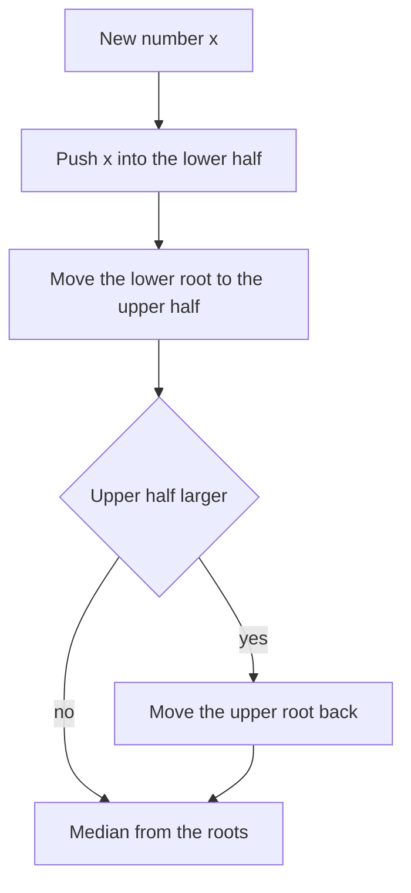

## The hook

Numbers arrive one at a time: response times, prices, sensor readings. After each one, you must report the median so far. Sorting after every arrival is O(n log n) each time. Inserting into a sorted array is O(n). For a million readings, both are far too slow.

Two heaps, set back to back, answer each median in O(1) and each arrival in O(log n). It is a short, elegant structure, and the same "two heaps facing each other" idea solves other problems where one set of items becomes available over time and you always want the best of what is available.

## The intuition

:::analogy
Picture a seesaw with two teams. The left team holds the smaller numbers and keeps its biggest member nearest the middle; the right team holds the larger numbers and keeps its smallest member nearest the middle. The two people closest to the pivot are the middle values. When a new person arrives, they join a team, and if one side gets more than one person heavier, its member nearest the middle steps across to the other side.
:::

The left team is a max-heap, the [[lower half heap]]: its root is the largest of the small numbers. The right team is a min-heap, the [[upper half heap]]: its root is the smallest of the large numbers. Two rules keep the seesaw level:

- **Order:** every number on the left is at most every number on the right.
- **[[Size invariant]]:** the left holds the same number as the right, or exactly one more.

With both rules, the median is the left root when the total is odd, and the average of the two roots when it is even.

## How it works

### Adding a number

A simple, always-correct sequence:

- push the number into the lower half;
- move the lower half's root to the upper half, which fixes the order rule;
- if the upper half is now larger, move its root back to the lower half, which fixes the size rule.

Each step is one heap operation: O(log n) per number, and the median is read from the roots in O(1).

### Windows need deletion: lazy deletion

*Sliding Window Median* removes the element leaving the window at every step. A heap can only remove its root, so use [[lazy deletion]]: record the departing value in a hash map of "pending removals", and adjust the size counts of the half it belongs to immediately. Whenever a pending value surfaces at a root, pop it and decrement its pending count. The heaps may hold some dead elements, but the roots are always alive, and the total work stays O(n log n). An ordered multiset avoids the bookkeeping, as in [A Sliding Window That Stays Sorted](article:dsa-ordered-set-windows).

### The same shape for greedy: IPO

*IPO* gives projects with a capital requirement and a profit, a starting capital w, and at most k projects to complete. Each completed project adds its profit to w. The [[two-heap greedy]]:

- a min-heap of projects ordered by capital, the ones not yet affordable;
- a max-heap of profits for projects you can afford now.

Each round, move every project whose capital is at most w from the first heap to the second, then take the most profitable affordable project. Taking the most profit now is safe because profits only increase w, which can only unlock more projects.



:::insight
Split the numbers into a smaller half and a larger half, keep each in a heap whose root faces the middle, and keep the halves within one element of each other. The median is then always at the roots, available in O(1).
:::

## Walk through an example

Stream: 5, 15, 1, 3, 8, 7.

| Arrival | Lower half (max-heap) | Upper half (min-heap) | Median |
|---|---|---|---|
| 5 | 5 | | 5 |
| 15 | 5 | 15 | (5 + 15) / 2 = 10 |
| 1 | 1, 5 | 15 | 5 |
| 3 | 1, 3 | 5, 15 | (3 + 5) / 2 = 4 |
| 8 | 1, 3, 5 | 8, 15 | 5 |
| 7 | 1, 3, 5 | 7, 8, 15 | (5 + 7) / 2 = 6 |

Look at the arrival of 3. It went into the lower half first, the lower root 5 moved across to the upper half, and the sizes ended at 2 and 2. The two people next to the pivot are now 3 and 5, so the median is 4. Checking against the sorted list 1, 3, 5, 15: the middle values are 3 and 5.

### IPO with starting capital 1 and k = 3

Projects as (capital, profit): (1, 3), (4, 5), (0, 2), (6, 6).

| Round | Capital w | Newly affordable | Take the best profit | w after |
|---|---|---|---|---|
| 1 | 1 | (0, 2), (1, 3) | 3 | 4 |
| 2 | 4 | (4, 5) | 5 | 9 |
| 3 | 9 | (6, 6) | 6 | 15 |

Final capital 15. The project with profit 2 was available from the start but never chosen, because something better was always affordable.

:::try-this
Continue the stream above with 2. Where does it end up, and what is the new median? (Push 2 into the lower half, move its root 5 across: lower 1, 2, 3 and upper 5, 7, 8, 15. The upper half is larger, so move 5 back: lower 1, 2, 3, 5 and upper 7, 8, 15. The total is 7, odd, so the median is the lower root, 5.)
:::

:::warning
Common misconception: "Push each number into whichever heap looks right, then fix the sizes." Deciding by comparing with one root can put a number on the wrong side when the heaps are empty or the number lies between the roots, and the order rule silently breaks. Always pass the number through the lower half and across, then rebalance; it costs one extra heap operation and is always correct.
:::

## The code

```pseudo
add(x):
    lower.push(x)
    upper.push(lower.pop())                 # keeps every lower <= every upper
    if size(upper) > size(lower): lower.push(upper.pop())

median():
    if size(lower) > size(upper): return lower.top
    return (lower.top + upper.top) / 2

ipo(k, w, projects):
    by_capital = min-heap of (capital, profit); affordable = max-heap of profits
    repeat k times:
        move every project with capital <= w from by_capital to affordable
        if affordable is empty: stop
        w += affordable.pop()
    return w
```

```cpp
#include <bits/stdc++.h>
using namespace std;

class MedianFinder {
    priority_queue<int> lower;                                   // max-heap: smaller half
    priority_queue<int, vector<int>, greater<int>> upper;        // min-heap: larger half
public:
    void add(int x) {
        lower.push(x);
        upper.push(lower.top()), lower.pop();                    // order between the halves
        if (upper.size() > lower.size()) lower.push(upper.top()), upper.pop();   // sizes
    }
    double median() const {
        if (lower.size() > upper.size()) return lower.top();
        return ((double)lower.top() + upper.top()) / 2.0;
    }
};

long long ipo(int k, long long w, const vector<int>& profits, const vector<int>& capital) {
    vector<pair<int, int>> proj;                                 // (capital, profit)
    for (size_t i = 0; i < profits.size(); i++) proj.push_back({capital[i], profits[i]});
    sort(proj.begin(), proj.end());
    priority_queue<int> affordable;
    size_t i = 0;
    while (k--) {
        while (i < proj.size() && proj[i].first <= w) affordable.push(proj[i++].second);   // newly unlocked
        if (affordable.empty()) break;
        w += affordable.top(), affordable.pop();                 // best project we can afford now
    }
    return w;
}

int main() {
    MedianFinder mf;
    for (int x : {5, 15, 1, 3, 8, 7}) mf.add(x), cout << mf.median() << ' ';
    cout << '\n';                                                // 5 10 5 4 5 6
    mf.add(2);
    cout << mf.median() << '\n';                                 // 5
    cout << ipo(3, 1, {3, 5, 2, 6}, {1, 4, 0, 6}) << '\n';       // 15
}
```

IPO's first heap is replaced by a sorted array with a pointer, which works because projects only ever move from "not affordable" to "affordable", in capital order. The heap operations themselves are explained in [The Triage Nurse Who Always Knows Who Is Next](article:dsa-heap-basics).

## Complexity

- **Running median: O(log n) per insertion, O(1) per median,** O(n) space.
- **Sliding window median with lazy deletion: O(n log n) time,** O(n) space in the worst case for dead elements; with an ordered multiset, O(n log k) for window size k.
- **IPO: O(n log n)** for sorting and the heap operations, O(n) space.

## Common mistakes

- **Breaking the order rule** by pushing into the upper half based on a single comparison.
- **Letting the sizes drift** by more than one, which moves the median away from the roots.
- **Integer overflow in the average** of two large roots; convert to double or 64-bit before adding.
- **Deleting from a heap by searching it,** which is O(n); use lazy deletion or an ordered multiset.
- **Forgetting the size adjustment** when lazily deleting, which makes the halves look balanced when they are not.
- **In IPO, stopping when no project is affordable** only at the end; if the affordable heap is empty in a round, no later round can change that, so break immediately.

## Practice problems

*Find Median from Data Stream* is the two-heap structure itself. *Sliding Window Median* adds deletions, with lazy deletion or a multiset. *IPO* uses two heaps in a different role: one releases projects as capital grows and the other picks the most profitable. The bounded single heap, the simpler relative of this pattern, is in [A Talent Show That Keeps Only the Best K](article:dsa-top-k-pattern).

## Key takeaways

- A running median keeps the smaller half in a max-heap and the larger half in a min-heap, with the lower half holding the same number of elements or one more.
- The median is the lower half's root when the count is odd and the average of both roots when it is even.
- Adding a number through the lower half, moving its root across and rebalancing keeps both the order and size rules with O(log n) work.
- Heaps cannot delete arbitrary elements, so sliding windows use lazy deletion or an ordered multiset.
- Two heaps also power greedy choices such as IPO, where one releases items as they become available and the other picks the best available item.
