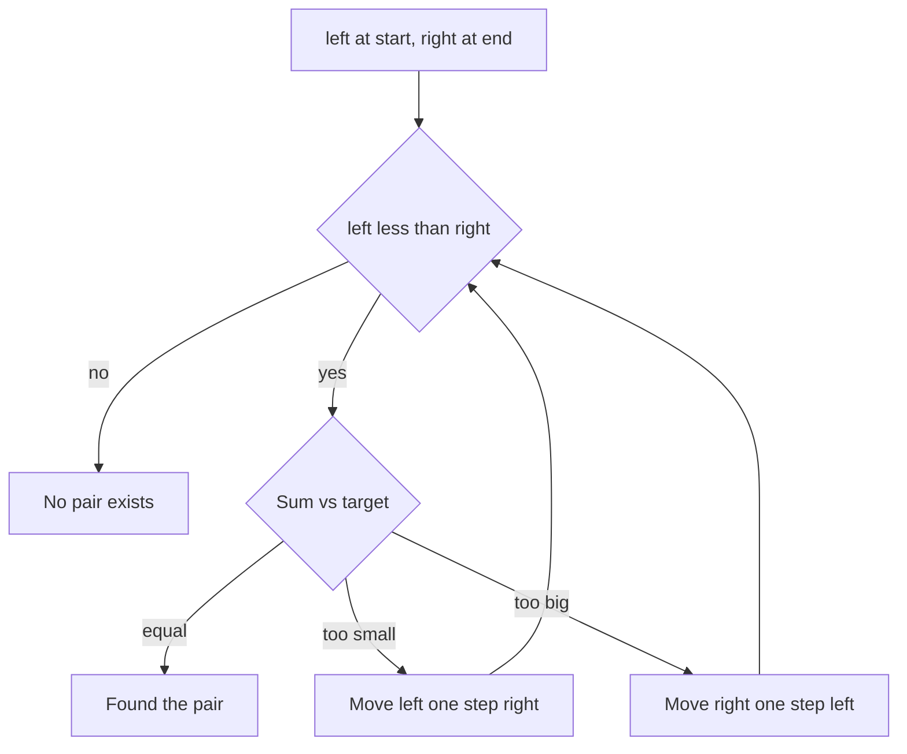

## The hook

Two friends are looking for a pair of books on a long, sorted shelf whose prices add up to exactly 500 rupees. One starts at the cheap end, the other at the expensive end. Each time they compare, one of them takes a step inward. Within one walk along the shelf, they either find the pair or prove it does not exist.

No hash map, no extra memory, no checking every pair. Just two fingers and one rule about which finger moves.

## The intuition

:::analogy
Think of the two friends on the shelf. If their two books cost too much together, the friend at the expensive end steps toward cheaper books, because even the cheapest book cannot rescue that expensive one. If the total is too little, the friend at the cheap end steps toward pricier books. Every step throws away a book that can never be part of the answer.
:::

This is the two pointers pattern. A [[pointer]] here is just an index. The magic is not in the pointers; it is in the sorted order, which tells you, after every comparison, exactly which candidates are now hopeless.

Cues in a problem statement that should make you reach for it:

- the input is sorted, or sorting it does not lose anything the problem needs;
- you want a pair, triplet or quadruplet with a target sum, or the closest one;
- a palindrome or other symmetric check;
- "in place" filtering or compaction, such as removing duplicates or zeros;
- merging or intersecting two sorted lists.

## How it works

There are two flavours.

**[[Opposite-direction pointers]]** start at both ends and move inward. Use them on sorted arrays for pair problems ("two values that sum to a target", "widest container"), and for symmetric checks like palindromes.

**[[Same-direction pointers]]** both move left to right. A slow pointer marks where the next kept element goes; a fast pointer scans ahead. Use them to compact an array in place, like removing duplicates or zeros.

For the pair-sum version:



### Why it never skips the answer

The [[invariant]] is: *if a valid pair exists, it lies between left and right.*

Suppose `a[left] + a[right]` is too big. Every element between them is at least `a[left]`, so `a[right]` plus any of them is also too big. Nothing useful pairs with `a[right]`, and dropping it keeps the invariant. The "too small" case is the mirror image. Since a valid pair is never discarded, the loop finds it if it exists.

:::insight
Two pointers works when each comparison lets you safely discard one end. Sorted order is what makes that safe. When you see "sorted" plus "pair" or "triplet", try two pointers before reaching for a hash map.
:::

## Walk through an example

Sorted prices `[1, 3, 4, 6, 8, 11]`, target 10.

| Step | left (value) | right (value) | Sum | Action |
|---|---|---|---|---|
| 1 | 0 (1) | 5 (11) | 12 | too big, right moves left |
| 2 | 0 (1) | 4 (8) | 9 | too small, left moves right |
| 3 | 1 (3) | 4 (8) | 11 | too big, right moves left |
| 4 | 1 (3) | 3 (6) | 9 | too small, left moves right |
| 5 | 2 (4) | 3 (6) | 10 | **found: 4 + 6** |

Five comparisons instead of the fifteen pairs a brute force would check.

### Extending to 3Sum

To find all triplets summing to zero: sort the array, fix the first number `a[i]`, then run two pointers on the rest looking for a pair that sums to `-a[i]`. That is O(n) work per `i`, so O(n²) overall instead of O(n³). Sorting also puts equal values side by side, so you can skip duplicates by moving past repeated values.

Trace it on `[-1, 0, 1, 2, -1, -4]`, which sorts to `[-4, -1, -1, 0, 1, 2]`:

| Fixed a[i] | Need a pair summing to | Pointer walk | Triplets found |
|---|---|---|---|
| −4 (i = 0) | 4 | every sum is too small, left walks to the end | none |
| −1 (i = 1) | 1 | −1 + 2 = 1 match; skip equal values; 0 + 1 = 1 match | [−1, −1, 2], [−1, 0, 1] |
| −1 (i = 2) | | equal to the previous fixed value, skipped | none |
| 0 (i = 3) | 0 | 1 + 2 = 3 too big, right moves, pointers meet | none |

Skipping the second −1 as a fixed value is what prevents [−1, 0, 1] from being reported twice. On the shelf, once one friend has tried "a −1 book as the first pick", picking the other −1 book first can only repeat the same searches.

### Counting pairs instead of finding one

"How many pairs have a sum below the target?" uses the same squeeze, with a twist: when `a[left] + a[right]` is small enough, then `a[left]` pairs well with **every** element from `left + 1` to `right`, because they are all no bigger than `a[right]`. Add `right - left` in one step and move `left`.

For `[1, 2, 3, 4, 6]` and target 7: 1 + 6 is not below 7, so right moves; 1 + 4 = 5 is, so add 3 pairs and move left; 2 + 4 = 6 is, so add 2; 3 + 4 = 7 is not, so right moves and the pointers meet. The total is 5, without listing a single pair.

### Container With Most Water: discarding a wall

Given wall heights, pick two walls that hold the most water: the width between them times the shorter height. Start with the widest pair. The shorter wall limits the water, and any narrower container that keeps that shorter wall can only be worse: narrower, and still capped by the same short wall. So the shorter wall can never be part of a better answer. Discard it.

| left (height) | right (height) | Water | Best | Move |
|---|---|---|---|---|
| 0 (1) | 8 (7) | 1 × 8 = 8 | 8 | left, it is shorter |
| 1 (8) | 8 (7) | 7 × 7 = 49 | 49 | right |
| 1 (8) | 7 (3) | 3 × 6 = 18 | 49 | right |
| 1 (8) | 6 (8) | 8 × 5 = 40 | 49 | right, a tie can move either |
| 1 (8) | 5 (4) | 4 × 4 = 16 | 49 | right |

The remaining steps only shrink, and the answer for heights `[1, 8, 6, 2, 5, 4, 8, 3, 7]` is 49. It is the same invariant in a new costume: each comparison proves one end useless.

### Two arrays, one pointer each

The opposite flavour works across two sorted arrays. To merge them, compare the fronts and take the smaller. *Merge Sorted Array* asks you to merge into the first array, which has spare room at its end. Fill from the back, comparing the largest remaining values, so you never overwrite an element you still need.

:::try-this
Trace the same-direction version on `[0, 0, 1, 1, 1, 2, 3, 3]` to remove duplicates in place. Keep `slow` at the last kept position and move `fast` forward; copy `a[fast]` to `a[slow + 1]` whenever it differs from `a[slow]`. You should end with the first four slots holding `0, 1, 2, 3`.
:::

## The code

```pseudo
pair_with_sum(a, target):        // a is sorted
    left = 0, right = n - 1
    while left < right:
        s = a[left] + a[right]
        if s == target: return (left, right)
        if s < target: left += 1
        else: right -= 1
    return none

remove_duplicates(a):            // a is sorted, returns new length
    if n == 0: return 0
    slow = 0
    for fast in 1 .. n-1:
        if a[fast] != a[slow]:
            slow += 1
            a[slow] = a[fast]
    return slow + 1
```

```cpp
#include <bits/stdc++.h>
using namespace std;

pair<int, int> pairWithSum(const vector<int>& a, int target) {
    int l = 0, r = (int)a.size() - 1;
    while (l < r) {
        long long s = (long long)a[l] + a[r];
        if (s == target) return {l, r};
        if (s < target) l++;
        else r--;
    }
    return {-1, -1};
}

int removeDuplicates(vector<int>& a) {
    if (a.empty()) return 0;
    int slow = 0;
    for (int fast = 1; fast < (int)a.size(); fast++)
        if (a[fast] != a[slow]) a[++slow] = a[fast];
    return slow + 1;
}

vector<vector<int>> threeSum(vector<int> a) {
    sort(a.begin(), a.end());
    vector<vector<int>> res;
    int n = a.size();
    for (int i = 0; i < n - 2; i++) {
        if (i > 0 && a[i] == a[i - 1]) continue;              // same first pick as before
        int l = i + 1, r = n - 1;
        while (l < r) {
            int s = a[i] + a[l] + a[r];
            if (s < 0) l++;
            else if (s > 0) r--;
            else {
                res.push_back({a[i], a[l], a[r]});
                while (l < r && a[l] == a[l + 1]) l++;        // skip equal values
                while (l < r && a[r] == a[r - 1]) r--;
                l++, r--;
            }
        }
    }
    return res;
}

long long countPairsBelow(const vector<int>& a, int target) {   // a sorted
    long long cnt = 0;
    for (int l = 0, r = (int)a.size() - 1; l < r;) {
        if (a[l] + a[r] < target) cnt += r - l, l++;          // a[l] works with all of l+1..r
        else r--;
    }
    return cnt;
}

int maxArea(const vector<int>& h) {
    int best = 0;
    for (int l = 0, r = (int)h.size() - 1; l < r;) {
        best = max(best, min(h[l], h[r]) * (r - l));
        if (h[l] < h[r]) l++;                                // the shorter wall can never do better
        else r--;
    }
    return best;
}

void mergeInto(vector<int>& a, int m, const vector<int>& b) {   // a has room for b at its end
    int i = m - 1, j = (int)b.size() - 1, w = m + (int)b.size() - 1;
    while (j >= 0) a[w--] = (i >= 0 && a[i] > b[j]) ? a[i--] : b[j--];
}

int main() {
    auto [i, j] = pairWithSum({1, 3, 4, 6, 8, 11}, 10);
    cout << i << ' ' << j << '\n';                                  // 2 3
    vector<int> v = {0, 0, 1, 1, 1, 2, 3, 3};
    cout << removeDuplicates(v) << '\n';                            // 4
    for (auto& tr : threeSum({-1, 0, 1, 2, -1, -4})) cout << tr[0] << ',' << tr[1] << ',' << tr[2] << ' ';
    cout << '\n';                                                   // -1,-1,2 -1,0,1
    cout << countPairsBelow({1, 2, 3, 4, 6}, 7) << '\n';            // 5
    cout << maxArea({1, 8, 6, 2, 5, 4, 8, 3, 7}) << '\n';           // 49
    vector<int> a = {1, 4, 7, 0, 0, 0};
    mergeInto(a, 3, {2, 5, 6});
    for (int x : a) cout << x << ' ';
    cout << '\n';                                                   // 1 2 4 5 6 7
}
```

## Complexity

- **Pair sum on a sorted array:** O(n) time, because each step moves one pointer inward and the pointers are [[monotonic]]; they never move back. O(1) extra space.
- **If the input is not sorted:** add O(n log n) for sorting. A hash map gives O(n) time instead, but needs O(n) memory.
- **3Sum:** O(n log n) to sort plus O(n²) for the pair scans, so O(n²) overall.
- **Remove duplicates:** O(n) time, O(1) space.
- **Counting pairs, Container With Most Water and merging:** O(n) time, O(1) extra space, for the same reason: every step moves one pointer, and no pointer moves back.

## Common mistakes

:::warning
Common misconception: "two pointers works on any array." The inward squeeze relies on sorted order. On unsorted data, moving a pointer can throw away the answer. Sort first, or use a hash map when you must keep original indices.
:::

- **Using `<=` instead of `<`** in the loop condition, which can pair an element with itself.
- **Overflow** when adding two large values. Use `long long` for the sum.
- **Duplicate triplets in 3Sum.** After fixing `a[i]`, skip equal values of `i`; after a match, move both pointers past equal values.
- **Losing original indices.** Sorting reorders elements. If the problem wants original positions, sort pairs of (value, index).
- **Moving the taller wall** in Container With Most Water. Only discarding the shorter wall is safe.
- **Merging from the front** into an array with spare room at the end, which overwrites values not yet merged. Fill from the back.
- **Counting one pair at a time** in counting problems, which turns O(n) back into O(n²). Add `right - left` in one step.

## Practice problems

Begin with *Two Sum II* and *Valid Palindrome*, the purest forms. *Sum of Two Values* on CSES is the same idea with unsorted input and original indices, a good test of the last mistake above.

*Container With Most Water* uses the same discard argument with a different rule: always move the shorter wall. *3Sum* puts it all together with duplicate handling. *Merge Sorted Array* is the two-array flavour, filled from the back. When the window between the pointers itself matters, the next pattern, [The Caterpillar That Reads Arrays in One Pass](article:dsa-sliding-window), takes over.

## Key takeaways

- Two pointers replaces a check of every pair with a single inward walk, cutting O(n²) to O(n) on sorted data.
- Each comparison safely discards one end, because sorted order proves that element cannot be part of any answer.
- The invariant "any valid pair lies between the pointers" is what guarantees the answer is never skipped.
- Same-direction pointers compact or filter an array in place with O(1) extra memory.
- The same discard argument powers 3Sum after sorting, counting pairs in one step, Container With Most Water and merging two sorted arrays.
- Sorted input plus a pair or triplet condition is the cue to try two pointers, and 3Sum extends it by fixing one element first.
