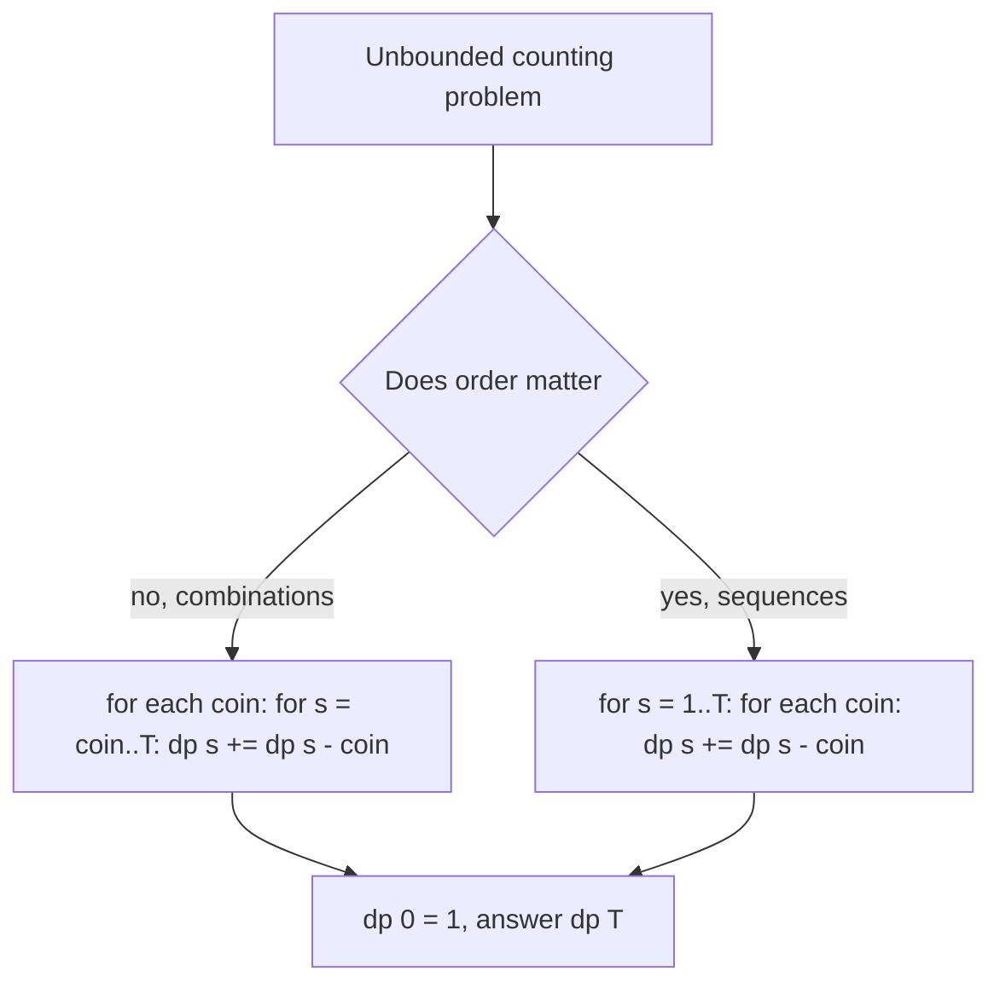

## The hook

In [Packing a Backpack With a Weight Limit](article:dsa-knapsack-01), every item was unique: one laptop, one tent, one camera. Many interview problems remove that limit. Coins come in unlimited supply. A rod can be cut into as many 2-metre pieces as you like. A number can be written as a sum of the same square several times.

This small change, "each item can be used any number of times", changes one loop direction in the code and opens a family of problems: minimum coins, number of ways to make change, rod cutting, perfect squares and integer break. It also hides the most common DP bug in interviews: counting 1 + 3 and 3 + 1 as different ways when the problem says they are the same, or the other way round.

## The intuition

:::analogy
Picture a vending machine with endless stock of each snack, and a fixed amount of money in your pocket. Each snack has a price and a happiness value. You can buy the same snack again and again. To get the most happiness for exactly ₹c, think about the last snack you bought: if it cost w, the rest of your money, c − w, should have been spent in the best possible way too. And that "rest" may itself include the same snack again, because the machine never runs out.
:::

The money in your pocket is the [[capacity]], snacks are item types, and "the machine never runs out" is what makes this an [[unbounded knapsack]].

## How it works

### State, transition and base case

| Part | Definition |
|---|---|
| State | dp[c] = best total value using total weight at most c |
| Transition | dp[c] = max(0, max over items with wᵢ ≤ c of dp[c − wᵢ] + vᵢ) |
| Base case | dp[0] = 0, and every dp[c] starts at 0, because taking nothing and leaving space unused is allowed |
| Answer | dp[W] |

Because an item can be reused, the subproblem after taking item i is the same kind of problem with a smaller capacity, and item i is still available. There is no "items considered so far" dimension, which is why one array is enough.

### Why the loop goes forwards

In the 0/1 version, the 1D table is updated with capacity going **downwards**, so dp[c − w] still holds the value from before the current item was considered, and each item is used at most once. In the unbounded version you want the opposite. Looping capacity **upwards** means dp[c − w] was already updated for this item, so it may contain the item, and adding it again is exactly "reuse".

| Version | Item loop | Capacity loop | Effect |
|---|---|---|---|
| 0/1 knapsack | outer | W down to w | each item at most once |
| Unbounded knapsack | outer (or inner) | w up to W | each item any number of times |

### Counting: combinations or ordered sequences

When the question is "how many ways" instead of "best value", the transition becomes a sum, and the loop order decides what you count:

- **Items outside, capacity inside** → each [[combination]] counted once. Coins are added in a fixed order (all 1s first, then 2s, then 3s), so a multiset like {1, 3} can only be built one way.
- **Capacity outside, items inside** → each [[permutation (ordered sequence)]] counted. At every sum, any coin may be the last one added, so 1 + 3 and 3 + 1 are different paths.



:::insight
The direction of the capacity loop decides whether items can repeat, and the nesting of the loops decides whether order matters. Two loop choices, four different problems, the same one-line transition.
:::

### Rebuilding the selection

Keep a [[choice array]]: when dp[c] improves using item i, record choice[c] = i. Afterwards, start at c = W and repeatedly take choice[c], subtracting its weight, until you reach a capacity where nothing was chosen. This gives one optimal multiset of items in O(W) extra time.

### Variants you will meet

- **Rod cutting**: piece lengths are weights, piece prices are values, rod length is capacity.
- **Minimum coins**: replace max with min and value with 1 per coin, covered in [Making Change at the Counter](article:dsa-coin-change).
- **Perfect squares**: items are 1, 4, 9, ..., and the answer is the minimum count.
- **Integer break**: maximise a product instead of a sum; the same structure with multiplication.

## Walk through an example

**Best value.** Items (weight, value): (1, 15), (3, 50), (4, 60). Capacity W = 8.

| c | 0 | 1 | 2 | 3 | 4 | 5 | 6 | 7 | 8 |
|---|---|---|---|---|---|---|---|---|---|
| dp[c] | 0 | 15 | 30 | 50 | 65 | 80 | 100 | 115 | 130 |
| choice | – | w1 | w1 | w3 | w1 | w1 | w3 | w1 | w1 |

Rebuild from c = 8: choice w1 → c = 7; w1 → c = 6; w3 → c = 3; w3 → c = 0. Items: 1 + 1 + 3 + 3, value 15 + 15 + 50 + 50 = **130**. For comparison, the 0/1 version, where each item is used at most once, reaches only 125 (all three items, weight 8).

**Counting.** Coins {1, 2, 3}, target 4, coins on the outside:

| After coin | dp[0] | dp[1] | dp[2] | dp[3] | dp[4] |
|---|---|---|---|---|---|
| start | 1 | 0 | 0 | 0 | 0 |
| 1 | 1 | 1 | 1 | 1 | 1 |
| 2 | 1 | 1 | 2 | 2 | 3 |
| 3 | 1 | 1 | 2 | 3 | 4 |

**4 combinations**: 1+1+1+1, 1+1+2, 2+2, 1+3. Swapping the loops gives dp = [1, 1, 2, 4, 7]: **7 ordered sequences**, because 1+1+2 appears in 3 orders and 1+3 in 2.

:::try-this
A 5-metre rod sells for these prices by piece length: 1 m → 2, 2 m → 5, 3 m → 7, 4 m → 8, 5 m → 10. What is the best total price? (dp = [0, 2, 5, 7, 10, 12]. Cut it into 2 + 3 for 5 + 7 = 12, or 1 + 2 + 2 for 2 + 5 + 5 = 12.)
:::

## The code

```pseudo
best_value(items, W):
    dp = [0] * (W + 1); choice = [-1] * (W + 1)
    for c in 1 .. W:                              // capacity forwards
        for i, (w, v) in items:
            if w <= c and dp[c - w] + v > dp[c]:
                dp[c] = dp[c - w] + v; choice[c] = i
    return dp[W]

count_combinations(coins, T):
    dp = [1] + [0] * T
    for coin in coins:                            // coins outside
        for s in coin .. T: dp[s] += dp[s - coin]
    return dp[T]

count_sequences(coins, T):
    dp = [1] + [0] * T
    for s in 1 .. T:                              // sums outside
        for coin in coins: if coin <= s: dp[s] += dp[s - coin]
    return dp[T]
```

```cpp
#include <bits/stdc++.h>
using namespace std;

int main() {
    vector<pair<int, int>> items = {{1, 15}, {3, 50}, {4, 60}};
    int W = 8;
    vector<int> dp(W + 1, 0), choice(W + 1, -1);
    for (int c = 1; c <= W; c++)
        for (int i = 0; i < (int)items.size(); i++) {
            auto [w, v] = items[i];
            if (w <= c && dp[c - w] + v > dp[c]) { dp[c] = dp[c - w] + v; choice[c] = i; }
        }
    cout << dp[W] << ":";                                     // 130:
    for (int c = W; c > 0 && choice[c] != -1; c -= items[choice[c]].first)
        cout << ' ' << items[choice[c]].first;                // 1 1 3 3
    cout << '\n';

    vector<int> coins = {1, 2, 3};
    int T = 4;
    vector<long long> comb(T + 1, 0), seq(T + 1, 0);
    comb[0] = seq[0] = 1;
    for (int coin : coins)
        for (int s = coin; s <= T; s++) comb[s] += comb[s - coin];
    for (int s = 1; s <= T; s++)
        for (int coin : coins) if (coin <= s) seq[s] += seq[s - coin];
    cout << comb[T] << ' ' << seq[T] << '\n';                 // 4 7
}
```

## Complexity

- **Time:** O(n × W) for n item types and capacity W: every capacity tries every item.
- **Space:** O(W) for the 1D table, plus O(W) for the choice array if you rebuild the answer.
- Like 0/1 knapsack, this is pseudo-polynomial: fast when W is up to about 10⁶ or 10⁷, not when W is 10¹⁸.

## Common mistakes

:::warning
Common misconception: "the order of the two loops does not matter, it is the same DP." For best value or minimum count, it really does not matter. For counting ways, it decides the answer: coins outside counts combinations (4 in the example), sums outside counts ordered sequences (7). Read the problem statement for "different orders count as different" before choosing.
:::

- **Looping capacity backwards** by habit from 0/1 knapsack, which silently forbids reuse.
- **Forgetting dp[0] = 1** in counting problems: there is exactly one way to make 0, by choosing nothing.
- **Overflow** in counting problems: the number of ways grows quickly, so take the required modulus at every addition.
- **Initialising min-problems with 0** instead of infinity, which makes unreachable capacities look free.

## Practice problems

*Coin Change II* and *Coin Combinations II* (CSES) count combinations: coins outside. *Combination Sum IV* and *Coin Combinations I* (CSES) count ordered sequences: sums outside, despite the first one's name. *Perfect Squares* is a minimum-count unbounded knapsack over the squares. The recurrence style comes from [Stairs, Robbers and Secret Codes](article:dsa-dp-1d).

## Key takeaways

- Unbounded knapsack lets every item type be used any number of times, so one 1D table over capacity is enough.
- Looping capacity forwards lets dp[c − w] already include the current item, which is exactly what allows reuse.
- For counting ways, putting items in the outer loop counts combinations, and putting capacity in the outer loop counts ordered sequences.
- A choice array that records the winning item at each capacity lets you rebuild an optimal selection by walking back from W.
- Rod cutting, minimum coins, perfect squares and coin-combination counting are all the same pattern with different items and operators.
