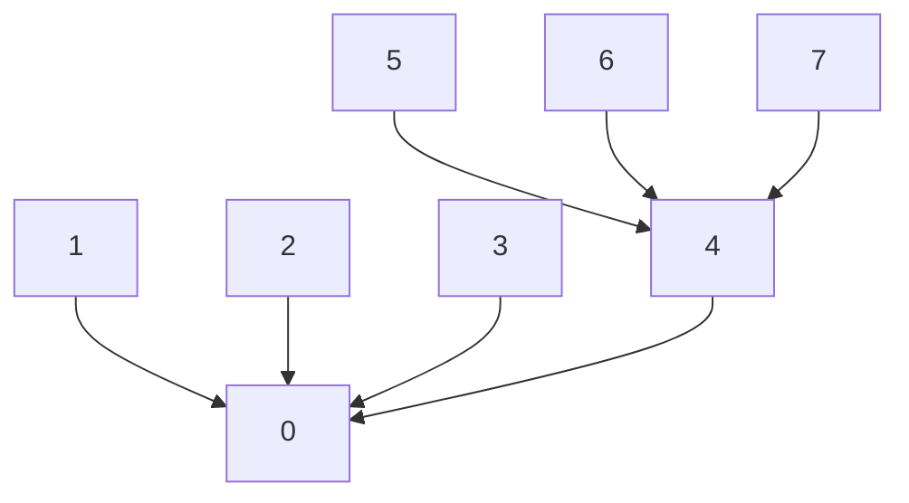

## The hook

A social app processes a stream of "A is now friends with B" events, and after each one it must answer "are X and Y in the same circle?" You could rebuild the graph and run a search for every question, but with a hundred thousand events and questions, that is billions of steps.

What you need is a structure that merges groups in an instant and answers "same group?" in an instant, without ever walking the whole graph. Union-find does exactly that, and it is the engine behind Kruskal's minimum spanning tree, redundant-edge detection and many "merge these accounts" problems. How can merging and checking both be almost free?

## The intuition

:::analogy
Picture a party where guests arrive alone. Every friend group has one host, and each guest remembers only who introduced them, a person who knows the host or the host directly. To check whether two guests are in the same group, each follows "who introduced me?" up the chain until reaching a host, and you compare hosts. When two groups decide to merge, only the hosts talk: the host of the smaller group agrees to report to the host of the larger one. And whenever a guest walks up a long chain to find their host, everyone on that chain learns to go straight to the host next time.
:::

That party is [[union-find]]:

- each group is a tree, and the host is its root, the [[representative]];
- "who introduced me?" is the parent pointer, and merging through hosts is union;
- the smaller group joining the larger is [[union by size]];
- learning to skip the chain is [[path compression]].

## How it works

Keep two arrays: parent[x] and size[x] (meaningful only at roots). Initially every element is its own group: parent[x] = x, size[x] = 1.

**find(x):** follow parent pointers until reaching an element that is its own parent. That is the root. On the way back, point every element you passed directly at the root.

**union(a, b):**

1. ra = find(a), rb = find(b).
2. If ra == rb, they are already together. Return false.
3. Otherwise hang the smaller root under the larger: parent[small] = large, size[large] += size[small]. Return true.

**Counting components:** start with count = n and subtract 1 for every union that returns true. After processing all edges of a graph, count is the number of connected components, with no DFS at all.

### Why it is near-constant

Each optimisation alone already helps:

- **No optimisation:** unions can build a chain like 0 ← 1 ← 2 ← … ← n − 1, and find costs O(n).
- **Union by size alone:** an element gets one step deeper only when its group is hung under a group at least as large, so its group size at least doubles. Size can double at most log₂ n times, so every tree has height at most log₂ n, and find is O(log n).
- **Path compression alone:** the amortised cost is also logarithmic.
- **Both together:** the [[amortised cost]] per operation is O(α(n)), where α is the [[inverse Ackermann function]]. Robert Tarjan proved this bound in the 1970s. α(n) grows so slowly that it is at most 4 for any n you could ever store, so in practice each operation costs a small constant.

[[Union by rank]] is the classic alternative to size. A rank starts at 0 and increases by one only when two equal-rank roots merge. It gives the same guarantees. Size is easier to reason about and gives you each group's size for free, which many problems ask for.

:::insight
Union-find never stores the edges, only "who is my representative". Union by size keeps every tree logarithmically shallow, and path compression flattens whatever paths you actually use, so together they make each operation cost almost nothing on average.
:::

## Walk through an example

Eight guests, 0 to 7. Ties in size hang the second root under the first.

| Operation | find results | Action | parent after (0..7) | Components |
|---|---|---|---|---|
| start | | | 0 1 2 3 4 5 6 7 | 8 |
| union(0, 1) | 0, 1 | 1 under 0 | 0 0 2 3 4 5 6 7 | 7 |
| union(2, 3) | 2, 3 | 3 under 2 | 0 0 2 2 4 5 6 7 | 6 |
| union(4, 5) | 4, 5 | 5 under 4 | 0 0 2 2 4 4 6 7 | 5 |
| union(6, 7) | 6, 7 | 7 under 6 | 0 0 2 2 4 4 6 6 | 4 |
| union(1, 3) | 0, 2 | 2 under 0, size 4 | 0 0 0 2 4 4 6 6 | 3 |
| union(0, 2) | 0, 0 | **already together** | 0 0 0 2 4 4 6 6 | 3 |
| union(5, 7) | 4, 6 | 6 under 4, size 4 | 0 0 0 2 4 4 4 6 | 2 |
| union(3, 7) | 0, 4 | 4 under 0, size 8 | 0 0 0 0 0 4 4 4 | 1 |

Three moments are worth reading closely:

- **union(0, 2)** finds the same root on both sides. In a graph, that edge would close a loop, which is exactly how *Redundant Connection* is solved.
- **union(3, 7)** compresses two paths. find(3) walks 3 → 2 → 0 and then points 3 straight at 0. find(7) walks 7 → 6 → 4 and points 7 straight at 4. Look at positions 3 and 7 in the parent row.
- After that union, the tallest path is two links (for example 6 → 4 → 0), within the log₂ 8 = 3 bound from union by size.



One more find(7) now walks 7 → 4 → 0 and sets parent[7] = 0. Every repeated question gets cheaper, which is the party guest learning to go straight to the host.

:::try-this
Starting from the final table, what does parent look like after find(5) and find(6)? (Both walk to 0 through 4 and get compressed: parent becomes 0 0 0 0 0 0 0 4 if find(7) has not run yet, so only 7 still points to 4.)
:::

## The code

```pseudo
make(n): parent[x] = x, size[x] = 1 for all x; count = n

find(x):
    if parent[x] != x:
        parent[x] = find(parent[x])          // path compression
    return parent[x]

union(a, b):
    a = find(a); b = find(b)                 // always work with roots
    if a == b: return false                  // already connected
    if size[a] < size[b]: swap(a, b)
    parent[b] = a; size[a] += size[b]        // smaller under larger
    count -= 1
    return true
```

```cpp
#include <bits/stdc++.h>
using namespace std;

struct DSU {
    vector<int> parent, sz;
    int count;
    DSU(int n) : parent(n), sz(n, 1), count(n) { iota(parent.begin(), parent.end(), 0); }
    int find(int x) { return parent[x] == x ? x : parent[x] = find(parent[x]); }
    bool unite(int a, int b) {
        a = find(a); b = find(b);
        if (a == b) return false;
        if (sz[a] < sz[b]) swap(a, b);
        parent[b] = a; sz[a] += sz[b]; count--;
        return true;
    }
};

int main() {
    DSU d(8);
    vector<pair<int,int>> ops = {{0,1}, {2,3}, {4,5}, {6,7}, {1,3}, {0,2}, {5,7}, {3,7}};
    for (auto [a, b] : ops) cout << d.unite(a, b);
    cout << '\n';                                          // 11111011
    for (int p : d.parent) cout << p << ' ';
    cout << "| components " << d.count << '\n';            // 0 0 0 0 0 4 4 4 | components 1
    d.find(7);
    cout << d.parent[7] << ' ' << d.sz[d.find(5)] << '\n';  // 0 8
}
```

The recursive find is safe here because union by size keeps trees at most log₂ n deep. If you drop union by size, prefer a loop, such as path halving (`parent[x] = parent[parent[x]]` while stepping up), which also keeps the near-constant bound when combined with union by size or rank.

## Complexity

- **Time:** O(α(n)) amortised per find or union with both optimisations, so m operations cost O(m α(n)), effectively linear. With union by size alone, O(log n) per operation in the worst case.
- **Space:** O(n) for the parent and size arrays.

## Common mistakes

:::warning
Common misconception: "to merge a and b, set parent[a] = b." That links a itself, not its group. If a is not a root, a leaves its old group and its old friends lose their connection to it. After union(0, 1) gives parent[1] = 0, the shortcut parent[1] = 2 for union(1, 2) leaves 0 and 2 in different groups even though both should be connected through 1. Always find both roots first and link root to root.
:::

- **Comparing parents instead of roots.** parent[a] == parent[b] is not "same group". Compare find(a) == find(b).
- **Counting components on every call.** Decrement the count only when unite actually merges two different roots.
- **Updating size at the wrong place.** Size is valid only at a root; read it as size[find(x)].
- **1-indexed input.** CSES numbers cities from 1, so allocate n + 1 elements or subtract 1.
- **Expecting deletion.** Union-find cannot split a group. If edges are removed over time, process the operations in reverse so removals become unions.

## Practice problems

*Number of Provinces* gives an adjacency matrix: unite every connected pair and return the count. *Building Roads* (CSES) asks for the fewest new roads to connect everything: with k components you need k − 1 roads, linking one representative of each component. *Redundant Connection* returns the first edge whose endpoints already share a root. *Road Construction* (CSES) reports the component count and the largest component after each new road, where union by size gives the largest size for free. *Accounts Merge* unites emails that appear in the same account and then groups emails by representative, a good test of mapping strings to integer ids.

## Key takeaways

- Union-find stores each group as a tree with a representative root, and two elements are connected exactly when their finds return the same root.
- Union must always link the two roots, never the original elements, and should hang the smaller tree under the larger.
- Path compression points every element on a find path straight at the root, so repeated queries become almost free.
- With both optimisations, each operation costs O(α(n)) amortised, where the inverse Ackermann function α is at most 4 in practice.
- Counting successful unions gives the number of components, and a failed union reveals an edge that would close a cycle.
