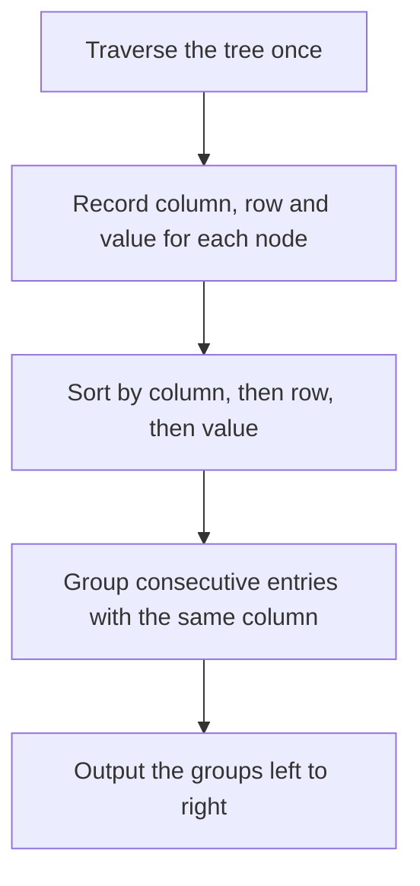

## The hook

Lay a sheet of graph paper over a drawing of a binary tree and look straight down. Each node sits in some column of the grid, and some columns hold several nodes stacked at different depths. Reading the tree column by column, left to right, is a different view from any of the usual traversals.

*Vertical Order Traversal* is a hard-labelled problem mostly because of its bookkeeping: giving every node coordinates, grouping them, and applying exactly the right tie-break when two nodes land in the same spot. The ideas are simple; the rules are where people lose marks.

## The problem

Give the root position (row 0, column 0). A left child is one row down and one column left; a right child is one row down and one column right. Return the nodes grouped by [[column]], from the leftmost column to the rightmost. Within a column, order by [[row]], top to bottom. If two nodes share both row and column, order them by value.

```text
          1
        /   \
       2     3
      / \   / \
     4   6 5   7
```

| Node | Row | Column |
|---|---|---|
| 1 | 0 | 0 |
| 2 | 1 | −1 |
| 3 | 1 | 1 |
| 4 | 2 | −2 |
| 6 | 2 | 0 |
| 5 | 2 | 0 |
| 7 | 2 | 2 |

The answer is [[4], [2], [1, 5, 6], [3], [7]]. Nodes 6 and 5 share row 2 and column 0, so they are ordered by value: 5 before 6.

## The obvious approach

Find the leftmost and rightmost columns first, then for each column scan the whole tree for nodes in it. That is O(n) per column and up to n columns, O(n²). It also leaves the tie-breaks to chance, depending on the scan order.

## The key insight

:::analogy
Picture the graph paper over the tree. You walk the tree once and, for every node, write a small card: its column, its row and its value. Then you sort the cards by column, then by row, then by value, and deal them into piles, one pile per column. Each pile, read top to bottom, is one group of the answer.
:::

That is the whole method: one traversal to compute coordinates, one sort with the right key, one pass to group. The [[sort key]] encodes the [[tie-break rule]] directly, so there is nothing to get wrong later:

- primary key: column, so groups come out left to right;
- second key: row, so each group reads top to bottom;
- third key: value, for nodes at exactly the same position.

### The BFS variant

Some versions of the problem, often seen in interviews, use a different rule for nodes at the same position: keep them in left-to-right order as BFS meets them, rather than sorting by value. Then you do not need to sort at all. Run a BFS that carries each node's column, and append each node to its column's list in a [[column map]]. BFS visits rows in order and each row left to right, so every list is already in the required order. In the example, that rule gives [1, 6, 5] for column 0, because 6 is to the left of 5.

| Rule for nodes at the same row and column | Method | Column 0 in the example |
|---|---|---|
| by value | collect (column, row, value), sort | 1, 5, 6 |
| left to right as BFS meets them | BFS with a column map | 1, 6, 5 |



:::insight
Turn the tree into coordinates and let a sort key carry the rules: column first, then row, then value. Once the tie-break is written into the key, grouping is a single pass.
:::

## Walk through an example

The cards, after sorting by (column, row, value):

| Column | Row | Value | Pile |
|---|---|---|---|
| −2 | 2 | 4 | 1st |
| −1 | 1 | 2 | 2nd |
| 0 | 0 | 1 | 3rd |
| 0 | 2 | 5 | 3rd |
| 0 | 2 | 6 | 3rd |
| 1 | 1 | 3 | 4th |
| 2 | 2 | 7 | 5th |

Dealing them into piles by column gives [4], [2], [1, 5, 6], [3] and [7]. On the graph paper, column 0 holds the root at the top and two nodes side by side underneath; the rule "same row, sort by value" puts 5 before 6.

### Related views

The same coordinates answer other questions. *Binary Tree Right Side View* asks for the last node of each row in BFS order. The top view of a tree takes the first node of each column in BFS order, and the bottom view the last. Those views are the subject of the next walkthrough in this track.

:::try-this
Add a node 8 as the left child of 6 in the example. What are its row and column, and how does the answer change? (It is at row 3, column −1, the same column as 2. Column −1 becomes [2, 8], because 2 is in row 1 and 8 in row 3. The other columns are unchanged.)
:::

:::warning
Common misconception: "Group nodes by column with a DFS and you are done." A DFS visits the left subtree completely before the right one, so a deep node on the left can be listed before a shallower node on the right in the same column. Always order by row as well, either by sorting with row in the key or by using BFS, which visits rows in order.
:::

## The code

```pseudo
vertical_order(root):
    cards = []
    dfs(node, row, col): if node: cards.add((col, row, node.value)); dfs(left, row + 1, col - 1); dfs(right, row + 1, col + 1)
    dfs(root, 0, 0)
    sort cards by (col, row, value)
    group consecutive cards with the same col

vertical_order_bfs(root):            # same-position ties in BFS order
    queue = [(root, 0)]; columns = ordered map
    while queue: (node, col) = pop; columns[col].add(node.value); push children with col - 1 and col + 1
    return the lists in columns, left to right
```

```cpp
#include <bits/stdc++.h>
using namespace std;

struct Node {
    int val;
    Node *left = nullptr, *right = nullptr;
    Node(int v, Node* l = nullptr, Node* r = nullptr) : val(v), left(l), right(r) {}
};

vector<vector<int>> verticalSorted(Node* root) {             // ties at the same spot: by value
    vector<tuple<int, int, int>> cards;                       // (column, row, value)
    function<void(Node*, int, int)> dfs = [&](Node* n, int row, int col) {
        if (!n) return;
        cards.push_back({col, row, n->val});
        dfs(n->left, row + 1, col - 1);
        dfs(n->right, row + 1, col + 1);
    };
    dfs(root, 0, 0);
    sort(cards.begin(), cards.end());                         // column, then row, then value
    vector<vector<int>> out;
    for (size_t i = 0; i < cards.size(); i++) {
        if (i == 0 || get<0>(cards[i]) != get<0>(cards[i - 1])) out.push_back({});
        out.back().push_back(get<2>(cards[i]));
    }
    return out;
}

vector<vector<int>> verticalBfs(Node* root) {                // ties at the same spot: BFS order
    map<int, vector<int>> cols;                               // ordered by column
    queue<pair<Node*, int>> q;
    if (root) q.push({root, 0});
    while (!q.empty()) {
        auto [n, c] = q.front(); q.pop();
        cols[c].push_back(n->val);
        if (n->left) q.push({n->left, c - 1});
        if (n->right) q.push({n->right, c + 1});
    }
    vector<vector<int>> out;
    for (auto& [c, v] : cols) out.push_back(v);
    return out;
}

void print(const vector<vector<int>>& g) {
    for (auto& col : g) {
        cout << '[';
        for (size_t i = 0; i < col.size(); i++) cout << col[i] << (i + 1 < col.size() ? "," : "");
        cout << "] ";
    }
    cout << '\n';
}

int main() {
    Node* root = new Node(1, new Node(2, new Node(4), new Node(6)), new Node(3, new Node(5), new Node(7)));
    print(verticalSorted(root));                              // [4] [2] [1,5,6] [3] [7]
    print(verticalBfs(root));                                 // [4] [2] [1,6,5] [3] [7]
    root->left->right->left = new Node(8);                    // the try-this change
    print(verticalSorted(root));                              // [4] [2,8] [1,5,6] [3] [7]
}
```

Sorting tuples compares column, then row, then value, which is exactly the rule of *Vertical Order Traversal of a Binary Tree*; the BFS version uses an ordered `map` so columns come out left to right. The level-by-level BFS itself is covered in [Ripples on a Pond: Breadth-First Search](article:dsa-bfs).

## Complexity

- **DFS plus sort: O(n log n) time,** dominated by sorting n cards, and O(n) space.
- **BFS with an ordered map: O(n log w),** where w is the number of columns, because each insertion into the map costs O(log w); with a hash map plus the known column range, it is O(n).
- **Space: O(n)** for the cards or the column lists.

## Common mistakes

- **Missing the row in the order,** so DFS order puts deep left nodes before shallow right ones.
- **Using the wrong tie-break** for nodes at the same row and column; check whether the problem wants value order or BFS order.
- **Using an unordered map** for columns and then outputting them in arbitrary order.
- **Off-by-one in coordinates,** such as giving both children the same column.
- **Sorting each column only by value,** which loses the row order entirely.

## Practice problems

*Binary Tree Level Order Traversal* is the BFS the column method is built on. *Binary Tree Right Side View* uses rows the same way as columns are used here. *Vertical Order Traversal of a Binary Tree* is the walkthrough, with value as the final tie-break. Practise both methods on the example tree and compare the two outputs for column 0.

## Key takeaways

- Give every node coordinates: the root is row 0, column 0, and each child is one row down and one column left or right.
- Vertical order groups nodes by column from left to right, and within a column orders them by row from top to bottom.
- Collecting (column, row, value) and sorting puts every tie-break rule into the sort key, then one pass groups the columns.
- When nodes at the same position should keep BFS order instead of value order, a BFS that appends to an ordered column map needs no sort at all.
- A DFS alone does not visit rows in order, so the row must appear in the ordering somewhere.
