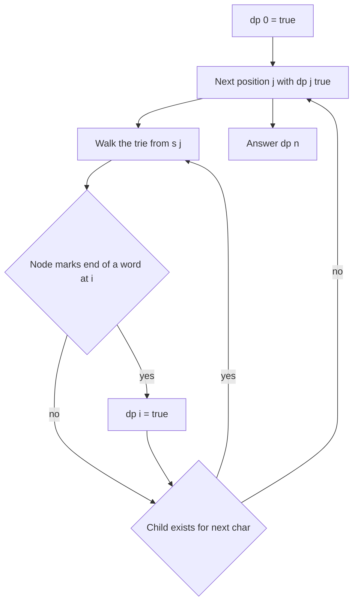

## The hook

Search engines see queries like "icecreamcone" typed without spaces and still find shops selling ice cream cones. Hashtags like #throwbackthursday get split into words for analysis. Under both sits a simple question: can this string be cut into pieces that are all real words, and if so, how?

Word Break is a favourite interview question because it looks like a string problem, behaves like a DP, hides a performance trap in substring creation, and has a follow-up, "return every possible sentence", that tests whether you understand when DP can and cannot make a problem fast.

## The problem

You are given a string s and a [[dictionary]] of words.

1. **Word Break:** return true if s can be split into a sequence of one or more dictionary words, using words as many times as needed.
2. **Word Break II (follow-up):** return every such [[segmentation]] as a sentence with spaces.

For example, with dictionary {ice, cream, icecream, cone, con, e}, the string "icecreamcone" can be split, while "icecreamcones" cannot.

## The obvious approach

Try every first word that matches the start of the string, then recurse on the rest. This is correct but explodes: when many prefixes are words, the same suffix is solved again and again through different routes. For "icecreamcone", the suffix "cone" is reached both after "ice" + "cream" and after "icecream". With long strings of repeated letters the number of routes grows exponentially.

## The key insight

:::analogy
Picture a long ribbon with letters printed on it, and a box of label stamps, one per dictionary word. You want to cut the ribbon so every piece exactly matches a stamp. Walk along the ribbon and put a pin at every position where "everything to the left of here can be cut cleanly". The start of the ribbon gets a pin for free. A new position deserves a pin if some earlier pin is followed by a piece that matches a stamp and ends exactly here. If the far end of the ribbon gets a pin, the whole ribbon can be cut.
:::

Each pin is a [[cut point]]. Whether a position deserves a pin depends only on earlier pins, not on how they were reached, which is exactly the overlapping-subproblem structure from [Stairs, Robbers and Secret Codes](article:dsa-dp-1d).

| Part | Definition |
|---|---|
| State | dp[i] = true if the prefix s[0..i) can be fully segmented |
| Transition | dp[i] = true if there is a j < i with dp[j] true and s[j..i) in the dictionary |
| Base case | dp[0] = true: the empty prefix needs no words |
| Answer | dp[n] |

### The hidden cost and the trie speed-up

The transition checks up to i substrings for each i, and each substring costs O(length) to build and hash, so the plain version is O(n³) in the worst case. Two fixes:

- **Limit the length:** only try j ≥ i − L, where L is the longest dictionary word.
- **Walk a [[trie]] forwards:** for each pinned position j, walk the trie from s[j] one character at a time. Every time the walk reaches the end of a word at position i, set dp[i] = true. Stop when the trie has no matching child. This checks all words starting at j in O(L) total, with no substrings created, using the structure from [Autocomplete in Your Pocket](article:dsa-tries).



:::insight
The DP only remembers *whether* each prefix can be cut, not *how*. Forgetting the "how" is what collapses exponentially many routes into n true or false values. Word Break II needs the "how", which is why it cannot always be fast.
:::

### Word Break II: listing every sentence

Use [[memoised backtracking]]: solve(i) returns all sentences for the suffix starting at i, by trying every word s[i..j) and attaching it to each sentence from solve(j). Cache results per position so each suffix is expanded once. Before recursing, you can run the true/false DP from the right to skip positions from which the end is unreachable. The output itself can be exponential, so no method beats the size of the answer.

## Walk through an example

s = "icecreamcone" (indices 0 to 11, n = 12), dictionary {ice, cream, icecream, cone, con, e}.

| i | prefix s[0..i) | dp[i] | reason |
|---|---|---|---|
| 0 | (empty) | true | base case |
| 3 | ice | true | dp[0] and "ice" |
| 8 | icecream | true | dp[3] and "cream", or dp[0] and "icecream" |
| 11 | icecreamcon | true | dp[8] and "con" |
| 12 | icecreamcone | **true** | dp[8] and "cone", or dp[11] and "e" |

Every other position stays false; for example, dp[5] would need "icecr" or a word ending there, and none exists.

For Word Break II, the four sentences are:

- ice cream con e
- ice cream cone
- icecream con e
- icecream cone

For "icecreamcones", no word ends at the final "s", so dp[13] is false.

:::try-this
With dictionary {a, aa}, how many ways can "aaaa" be segmented? (Count sequences of 1s and 2s summing to 4: 1111, 112, 121, 211, 22, so 5 ways. This Fibonacci growth is why Word Break II can explode.)
:::

## The code

```pseudo
word_break(s, dict):                     // with a length limit
    L = max word length
    dp = [false] * (n + 1); dp[0] = true
    for i in 1 .. n:
        for j in max(0, i - L) .. i - 1:
            if dp[j] and s[j..i) in dict: dp[i] = true; break
    return dp[n]

word_break_trie(s, trie):
    dp[0] = true
    for j in 0 .. n - 1:
        if not dp[j]: continue
        node = trie.root
        for i in j .. n - 1:
            node = node.child[s[i]]
            if node is none: break
            if node.is_word: dp[i + 1] = true
    return dp[n]
```

```cpp
#include <bits/stdc++.h>
using namespace std;

struct Trie {
    vector<array<int, 26>> next{{}};
    vector<bool> isWord{false};
    void insert(const string& w) {
        int v = 0;
        for (char ch : w) {
            int c = ch - 'a';
            if (!next[v][c]) { next[v][c] = next.size(); next.push_back({}); isWord.push_back(false); }
            v = next[v][c];
        }
        isWord[v] = true;
    }
};

bool wordBreak(const string& s, const vector<string>& words) {
    Trie t;
    for (auto& w : words) t.insert(w);
    int n = s.size();
    vector<bool> dp(n + 1, false);
    dp[0] = true;
    for (int j = 0; j < n; j++) {
        if (!dp[j]) continue;
        for (int i = j, v = 0; i < n; i++) {
            v = t.next[v][s[i] - 'a'];
            if (!v) break;                       // no word continues this way
            if (t.isWord[v]) dp[i + 1] = true;
        }
    }
    return dp[n];
}

int main() {
    vector<string> dict = {"ice", "cream", "icecream", "cone", "con", "e"};
    cout << wordBreak("icecreamcone", dict) << ' '
         << wordBreak("icecreamcones", dict) << '\n';   // 1 0
}
```

## Complexity

- **Plain DP:** O(n²) substring checks, each O(n) to build and hash, so O(n³) worst case.
- **With a length limit L:** O(n × L) checks, each O(L): O(n × L²).
- **With a trie:** O(n × L) character steps and no substrings, plus O(total dictionary length) to build the trie.
- **Space:** O(n) for dp, plus the trie or hash set.
- **Word Break II:** proportional to the number and length of sentences produced, which can be exponential.

## Common mistakes

:::warning
Common misconception: "Word Break II is just Word Break with memoisation, so it runs in O(n²)." Memoisation stops repeated work, but the answer can contain exponentially many sentences, as the "aaaa" example shows, and they all have to be written out. Say this in an interview and prune positions that cannot reach the end.
:::

- **Forgetting dp[0] = true**, which makes every answer false.
- **Greedy longest-match**: taking "icecream" or always the longest word can paint you into a corner; the DP tries all.
- **Off-by-one between dp indices and string indices**: dp[i] covers s[0..i), so the word ending at index i − 1 is s[j..i).
- **Rebuilding substrings in every check** without a length limit, which turns an O(n²) idea into O(n³).

## Practice problems

*Word Break* is the true/false DP. *Word Break II* lists every sentence with memoised backtracking. *Word Combinations* (CSES) counts segmentations modulo a prime and needs the trie walk to be fast enough. *Concatenated Words* runs Word Break for every word against the rest of the dictionary.

## Key takeaways

- dp[i] is true when the first i characters can be cut into dictionary words, with dp[0] = true as the base case.
- A position becomes true if some earlier true position is followed by a dictionary word ending exactly there.
- Building substrings has a hidden cost, so limit the word length or walk a trie forwards from each true position.
- The DP stores only whether each prefix can be cut, which is what makes it polynomial.
- Word Break II must list every sentence, which can be exponentially many, so use memoised backtracking with pruning.
