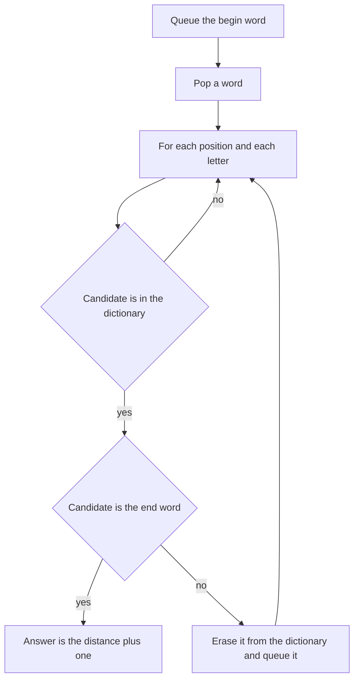

## The hook

Turn COLD into WARM by changing one letter at a time, and every word along the way must be a real word. COLD, WOLD, WORD, WARD, WARM: five words, four changes. The puzzle is older than computers, and it is a favourite interview problem because nobody hands you a graph.

The words are the vertices, "one letter apart" is the edge, and the shortest chain is a BFS. The whole difficulty is doing that without ever writing the graph down.

## The problem

You are given a begin word, an end word and a word list, all words of the same length in lowercase. A transformation changes exactly one letter, and every word after the begin word must be in the list. Return the number of words in the shortest chain from begin to end, counting both ends, or 0 if there is none.

For begin "cold", end "warm" and the list cord, card, ward, warm, worm, word, wold, bold, corm, ware, the answer is 5.

## The obvious approach

Build the graph explicitly: compare every pair of words, and add an edge when they differ in exactly one position. Then run BFS.

```pseudo
for each pair (a, b) of words:              # N² / 2 pairs
    if differ_in_one_place(a, b): add edge  # L letters each
bfs(begin)
```

With N = 5,000 words of length L = 10, that is about 12.5 million pairs, each compared letter by letter, before BFS even starts. Most of those edges are never used, because BFS usually finds the end word after exploring a small part of the dictionary.

## The key insight

:::analogy
Instead of drawing a map of every word, stand on one word and ask: which words can I reach by changing one letter? Try every position and every letter, and look each result up in the dictionary. Only real words survive. You discover the roads out of a word at the moment you stand on it, and never before.
:::

That is an [[implicit graph]], explored by [[neighbour generation]]. For a word of length L there are L × 25 candidate changes, each checked in a hash set. BFS over the words finds the shortest chain, exactly as in [Ripples on a Pond: Breadth-First Search](article:dsa-bfs).

Three details make it fast and correct:

- **Mark a word as soon as it is queued**, by erasing it from the set. Otherwise every word in a layer can queue the same neighbour again.
- **Stop as soon as the end word is generated.** Its distance is final the moment it is discovered.
- **Check that the end word is in the list** before searching; if not, the answer is 0.

### An alternative: wildcard buckets

Replace each position of each word with a star: "cold" belongs to the [[wildcard bucket]]s *old, c*ld, co*d and col*. Two words are one letter apart exactly when they share a bucket. Group the dictionary into buckets once, in O(N × L) bucket keys. A word's neighbours are then all words in its L buckets. To keep it linear, clear a bucket after using it once: every word in it has been discovered at this distance or earlier.

### Bidirectional BFS

Word graphs branch heavily: one word can have dozens of neighbours, and BFS layers grow fast. [[Bidirectional BFS]] runs two searches, one from each end, and always expands the smaller [[frontier]]. When a generated word is already in the other frontier, the two searches have met. Two half-depth searches explore far fewer words than one full-depth search.

| Approach | Neighbours found by | Cost per popped word | Notes |
|---|---|---|---|
| Explicit graph | Comparing all pairs | already built | O(N² × L) setup |
| Letter generation | L × 25 hash lookups | O(26 × L²) with hashing | Simple, standard answer |
| Wildcard buckets | L bucket lookups | O(L²) plus bucket sizes | Faster when the alphabet is large |
| Bidirectional | Either of the above | Same, far fewer words | Best on long ladders |

### The same problem in disguise

*Open the Lock* is a ladder on four-digit strings: each move turns one wheel up or down, with wrap-around from 9 to 0, and some combinations are dead ends you must avoid. Every state has exactly 8 neighbours. *Minimum Genetic Mutation* is a ladder over the letters A, C, G and T with a bank of allowed strings.



:::insight
When a graph is defined by a rule, generate each vertex's neighbours from the rule at the moment it is popped. You pay only for the part of the graph BFS actually visits, and a hash set turns "is this a valid vertex?" into one lookup.
:::

## Walk through an example

Begin "cold", end "warm", list: cord, card, ward, warm, worm, word, wold, bold, corm, ware.

| Distance (words in chain) | Layer | Discovered from |
|---|---|---|
| 1 | cold | start |
| 2 | bold, wold, cord | cold: b, w in position 0; r in position 2 |
| 3 | word, card, corm | wold → word; cord → card, corm |
| 4 | ward, worm | word → ward, worm |
| 5 | warm, ware | ward → warm, ware |

The end word appears at distance 5, through cold → wold → word → ward → warm. Another chain, cold → cord → card → ward → warm, has the same length. "bold" was discovered but leads nowhere: no word in the list is one letter from it except cold and wold, which were already taken.

### The buckets for a few words

| Bucket | Words |
|---|---|
| *old | cold, wold, bold |
| co*d | cold, cord |
| w*rd | ward, word |
| war* | ward, warm, ware |

From cold, the buckets *old and co*d give bold, wold and cord, the same layer as above.

### Open the Lock

Dead ends 1000, 0010, 9000, 0090; target 1010; start 0000. The two obvious first moves toward the target, 1000 and 0010, are both dead. BFS finds a 4-move route instead, for example 0000 → 0100 → 1100 → 1110 → 1010, turning the second wheel forward and back again. If every one of the eight neighbours of 0000 were dead, the answer would be -1.

:::try-this
With the same list, what is the shortest chain from "bold" to "ware"? (bold → cold or wold at distance 2, then wold → word at 3, word → ward at 4, ward → ware at 5. The chain has 5 words: bold, wold, word, ward, ware.)
:::

:::warning
Common misconception: "The answer is the number of letter changes." LeetCode's Word Ladder counts words in the chain, including the begin word, so cold → wold → word → ward → warm is 5, not 4. Open the Lock and Minimum Genetic Mutation count moves instead. Read which one the problem wants before returning a distance.
:::

## The code

```pseudo
ladder_length(begin, end, words):
    dict = set(words)
    if end not in dict: return 0
    queue = [begin]; dist = 1
    while queue:
        repeat size(queue) times:
            w = queue.pop_front()
            for i in 0 .. L-1:
                for ch in 'a' .. 'z':
                    cand = w with position i set to ch
                    if cand == end: return dist + 1
                    if cand in dict: dict.erase(cand); queue.push(cand)
        dist += 1
    return 0
```

```cpp
#include <bits/stdc++.h>
using namespace std;

int ladderLength(const string& begin, const string& end, const vector<string>& words) {
    unordered_set<string> dict(words.begin(), words.end());
    if (!dict.count(end)) return 0;
    queue<string> q;
    q.push(begin);
    dict.erase(begin);
    for (int dist = 1; !q.empty(); dist++) {
        for (int s = q.size(); s > 0; s--) {                  // one BFS layer
            string w = q.front(); q.pop();
            for (size_t i = 0; i < w.size(); i++) {
                char orig = w[i];
                for (char ch = 'a'; ch <= 'z'; ch++) {
                    if (ch == orig) continue;
                    w[i] = ch;
                    if (w == end) return dist + 1;
                    if (dict.erase(w)) q.push(w);             // erase = mark visited on push
                }
                w[i] = orig;
            }
        }
    }
    return 0;
}

int ladderBidirectional(const string& begin, const string& end, const vector<string>& words) {
    unordered_set<string> dict(words.begin(), words.end());
    if (!dict.count(end)) return 0;
    unordered_set<string> front = {begin}, back = {end};
    dict.erase(begin), dict.erase(end);
    for (int dist = 2; !front.empty() && !back.empty(); dist++) {
        if (front.size() > back.size()) swap(front, back);    // expand the smaller side
        unordered_set<string> next;
        for (string w : front)
            for (size_t i = 0; i < w.size(); i++) {
                char orig = w[i];
                for (char ch = 'a'; ch <= 'z'; ch++) {
                    w[i] = ch;
                    if (back.count(w)) return dist;           // the two searches meet
                    if (dict.erase(w)) next.insert(w);
                }
                w[i] = orig;
            }
        front = move(next);
    }
    return 0;
}

int openLock(const vector<string>& deadends, const string& target) {
    unordered_set<string> dead(deadends.begin(), deadends.end());
    if (dead.count("0000")) return -1;
    queue<string> q;
    q.push("0000");
    dead.insert("0000");                                      // reuse as the visited set
    for (int moves = 0; !q.empty(); moves++)
        for (int s = q.size(); s > 0; s--) {
            string u = q.front(); q.pop();
            if (u == target) return moves;
            for (int i = 0; i < 4; i++)
                for (int d : {1, 9}) {                        // +1 or -1 with wrap-around
                    string v = u;
                    v[i] = char('0' + (u[i] - '0' + d) % 10);
                    if (dead.insert(v).second) q.push(v);
                }
        }
    return -1;
}

int main() {
    vector<string> words = {"cord", "card", "ward", "warm", "worm", "word", "wold", "bold", "corm", "ware"};
    cout << ladderLength("cold", "warm", words) << ' ' << ladderBidirectional("cold", "warm", words) << ' '
         << ladderLength("bold", "ware", words) << ' ' << ladderLength("cold", "warp", words) << '\n';   // 5 5 5 0
    cout << openLock({"1000", "0010", "9000", "0090"}, "1010") << ' '
         << openLock({"1000", "0010", "9000", "0090", "0100", "0900", "0001", "0009"}, "1010") << '\n';  // 4 -1
}
```

`openLock` reuses the dead-end set as its visited set: a combination already in the set is either forbidden or already queued, and in both cases BFS must not push it again.

## Complexity

- **Letter generation BFS: O(N × L × 26)** candidate strings in the worst case, each costing O(L) to build and hash, so O(N × 26 × L²) time; O(N × L) space for the set and queue.
- **Wildcard buckets: O(N × L)** bucket keys of length L to build, so O(N × L²), plus the bucket contents scanned once each.
- **Bidirectional BFS:** the same worst case, but usually far fewer words, since both searches stop at half depth.
- **Open the Lock: O(10⁴ × 8)** at most, since there are only 10,000 combinations.

## Common mistakes

- **Building the full graph** by comparing all pairs.
- **Marking words visited when popped,** which lets duplicates flood the queue.
- **Returning the number of changes** when the problem counts words, or the other way round.
- **Forgetting that the end word must be in the list;** if it is not, return 0 immediately.
- **Searching from both ends without expanding the smaller frontier,** which loses most of the benefit of bidirectional BFS.
- **In Open the Lock, forgetting to check whether "0000" itself is a dead end.**

## Practice problems

*Word Ladder* is the full problem; solve it with letter generation first, then rewrite it bidirectionally. *Open the Lock* is the same BFS with digits, wrap-around and forbidden states. *Minimum Genetic Mutation* is a small, gentle version over four letters. When the state includes more than a position, such as keys or remaining breaks, the ideas in [A Robot Vacuum Mapping the Room](article:dsa-grid-graph-tricks) take over.

## Key takeaways

- Word Ladder is BFS on an implicit graph whose vertices are words and whose edges join words one letter apart.
- Generating neighbours by changing each position to each letter and checking a hash set avoids building the O(N²) graph.
- Erasing a word from the dictionary when it is queued marks it visited and keeps each word in the queue at most once.
- Bidirectional BFS expands the smaller of two frontiers from both ends and stops when they meet, which explores far fewer words on long ladders.
- Open the Lock and Minimum Genetic Mutation are the same ladder with different alphabets, wrap-around and forbidden states.
