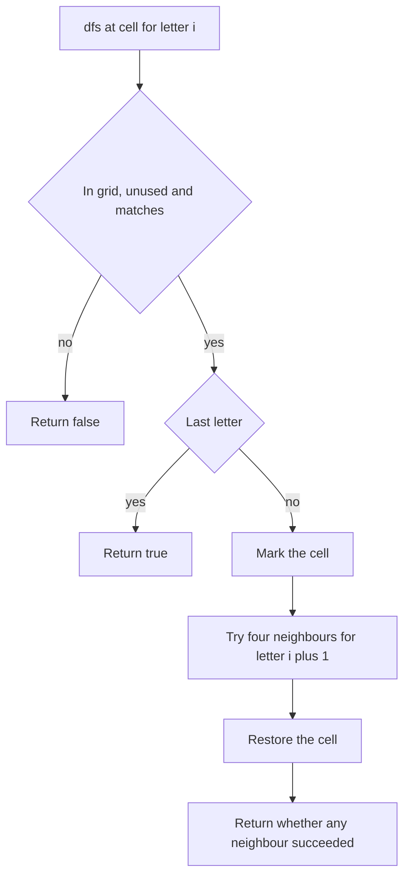

## The hook

A puzzle page shows a grid of letters and a list of words hidden in it. You put your finger on a letter that matches the start of a word, slide it to a neighbouring letter that matches the next one, and keep going. If you hit a dead end, you lift your finger back one square and try another direction. You never let your finger cross a square it is already on.

That is *Word Search*, one of the most common backtracking questions. It is a good test of two details people often miss: marking a cell as used and then unmarking it, and stopping as early as possible. Its big brother, *Word Search II*, adds a trie and becomes a favourite hard problem.

## The problem

Given a grid of letters and a word, decide whether the word can be traced by moving between horizontally or vertically adjacent cells, using each cell at most once in that word, a [[simple path]].

Our board:

```text
C A T S
O R E D
D O G S
```

| Word | Found? | Path |
|---|---|---|
| CORE | yes | (0,0) C, (1,0) O, (1,1) R, (1,2) E |
| DOGE | yes | (2,0) D, (2,1) O, (2,2) G, (1,2) E |
| TEDS | yes | (0,2) T, (1,2) E, (1,3) D, (0,3) S |
| CART | no | after C, A, R, no neighbour of R is T |
| SEES | no | there is no path through two E cells |

## The obvious approach

Generate every path of length L in the grid and compare it with the word: hopeless, since paths multiply by up to four at every step. A first improvement is the plain search: from each cell matching the first letter, explore neighbours that match the next letter, keeping a separate visited array. That is the right idea; the improvements are in the details.

## The key insight

:::analogy
Picture your finger on the grid. Each step moves it to a neighbouring square that shows the next letter. While your finger rests on a path, those squares are covered and cannot be used again. When you lift your finger back one square, the square you leave is uncovered and available for other attempts. And if the next letter is not on any neighbouring square, you lift back at once, without exploring further.
:::

That is [[grid backtracking]]:

- **Match or stop:** if the current cell is off the grid, already on the path, or not the letter you need, return false immediately.
- **Cover the square:** overwrite the cell with a marker such as '#'. This [[in-place marking]] replaces a separate visited array.
- **Explore:** try the four neighbours for the next letter.
- **Uncover:** put the original letter back before returning, whether or not the word was found.

Two cheap prunings help a lot:

- **Letter counts.** If the board has fewer copies of some letter than the word needs, answer false before searching at all.
- **Rarer end first.** If the word's last letter is rarer on the board than its first letter, search for the reversed word instead. Fewer starting cells means fewer searches.

### Many words at once

*Word Search II* gives a list of words. Running the single-word search for each word repeats the same walks for words with shared prefixes.

Instead, put all words in a [[trie]]. Run one search from every cell, walking the trie alongside the grid: stop as soon as the letters so far are not a prefix of any word. When you reach a trie node that ends a word, record it and clear the mark so it is reported once. That is [[prefix pruning]], and it lets the search handle thousands of words at once.



:::insight
On a grid, the board itself can be the visited set: overwrite a cell while it is on the path and restore it on the way back. Then the search only ever explores simple paths, and the board is unchanged when the function returns.
:::

## Walk through an example

### Tracing DOGE

| Step | Cell | Letter needed | Action |
|---|---|---|---|
| 1 | (2,0) | D | matches; mark, try neighbours for O |
| 2 | (1,0) | O | matches; mark, try neighbours for G: C, R and D are wrong or covered, so restore and back off |
| 3 | (2,1) | O | matches; mark, try neighbours for G |
| 4 | (2,2) | G | matches; mark, try neighbours for E |
| 5 | (1,2) | E | matches the last letter: found |

Step 2 is the important one. The O at (1,0) looked promising, but no G is next to it, so the finger lifted back and that square was restored, ready for other attempts. All marks are restored as the recursion unwinds, so the board is unchanged afterwards.

### Word Search II with a trie

For the words CAT, CART, DOGE, RED and ROAD, one search over the board finds CAT, DOGE and RED. Starting at the R in (1,1), the trie allows R → E or R → O; R → E → D completes RED, while R → O dies at once because no neighbour of the O at (2,1) or (1,0) is an A. Every path is cut as soon as its letters leave the trie.

### Path with Maximum Gold

The same backtracking collects values instead of letters. Each cell holds some gold or 0; you may start anywhere, move to adjacent non-zero cells, never revisit a cell, and want the most gold. For

```text
4 0 2
3 6 1
0 5 0
```

the best path is 4 → 3 → 6 → 5 for 18. The marking is the same: set a cell to 0 while it is on the path and restore its gold on return.

:::try-this
On the board above, can you trace CORED, and is GODS possible? (CORED: C (0,0), O (1,0), R (1,1), E (1,2), D (1,3), yes. GODS: after G (2,2) and O (2,1) comes D (2,0), but D's neighbours are O (1,0) and O (2,1), neither an S, so no.)
:::

:::warning
Common misconception: "Mark visited cells once and never unmark them." A cell is only off limits for the path currently being built. If you leave it marked after backing off, a different path, perhaps starting elsewhere, cannot use it, and the search wrongly reports that the word is missing. Always restore the cell before returning.
:::

## The code

```pseudo
exist(board, word):
    for each cell (r, c): if dfs(r, c, 0): return true
    return false

dfs(r, c, i):
    if (r, c) is outside, or board[r][c] != word[i]: return false
    if i == len(word) - 1: return true
    saved = board[r][c]; board[r][c] = '#'            # cover the square
    found = dfs on the four neighbours with i + 1
    board[r][c] = saved                               # uncover it
    return found
```

```cpp
#include <bits/stdc++.h>
using namespace std;

const int DR[] = {1, -1, 0, 0}, DC[] = {0, 0, 1, -1};

bool dfs(vector<string>& b, const string& w, int r, int c, int i) {
    if (r < 0 || c < 0 || r >= (int)b.size() || c >= (int)b[0].size() || b[r][c] != w[i]) return false;
    if (i + 1 == (int)w.size()) return true;
    char saved = b[r][c];
    b[r][c] = '#';                                          // on the path
    bool found = false;
    for (int d = 0; d < 4 && !found; d++) found = dfs(b, w, r + DR[d], c + DC[d], i + 1);
    b[r][c] = saved;                                        // restore on the way back
    return found;
}

bool exist(vector<string> b, string w) {
    map<char, int> have, need;                              // prune: enough letters?
    for (auto& row : b) for (char ch : row) have[ch]++;
    for (char ch : w) if (++need[ch] > have[ch]) return false;
    if (have[w.back()] < have[w.front()]) reverse(w.begin(), w.end());   // start from the rarer end
    for (int r = 0; r < (int)b.size(); r++)
        for (int c = 0; c < (int)b[0].size(); c++)
            if (dfs(b, w, r, c, 0)) return true;
    return false;
}

struct Trie { Trie* next[26] = {}; string word; };          // word is set where a word ends

void dfsTrie(vector<string>& b, int r, int c, Trie* node, vector<string>& found) {
    if (r < 0 || c < 0 || r >= (int)b.size() || c >= (int)b[0].size() || b[r][c] == '#') return;
    Trie* nx = node->next[b[r][c] - 'A'];
    if (!nx) return;                                        // not a prefix of any word: prune
    if (!nx->word.empty()) found.push_back(nx->word), nx->word.clear();   // report once
    char saved = b[r][c];
    b[r][c] = '#';
    for (int d = 0; d < 4; d++) dfsTrie(b, r + DR[d], c + DC[d], nx, found);
    b[r][c] = saved;
}

vector<string> findWords(vector<string> b, const vector<string>& words) {
    Trie root;
    for (auto& w : words) {
        Trie* t = &root;
        for (char ch : w) t = t->next[ch - 'A'] ? t->next[ch - 'A'] : (t->next[ch - 'A'] = new Trie());
        t->word = w;
    }
    vector<string> found;
    for (int r = 0; r < (int)b.size(); r++)
        for (int c = 0; c < (int)b[0].size(); c++) dfsTrie(b, r, c, &root, found);
    sort(found.begin(), found.end());
    return found;
}

int maxGold(vector<vector<int>>& g, int r, int c) {
    if (r < 0 || c < 0 || r >= (int)g.size() || c >= (int)g[0].size() || g[r][c] == 0) return 0;
    int v = g[r][c], best = 0;
    g[r][c] = 0;                                            // mark by emptying the cell
    for (int d = 0; d < 4; d++) best = max(best, maxGold(g, r + DR[d], c + DC[d]));
    g[r][c] = v;                                            // restore the gold
    return v + best;
}

int main() {
    vector<string> board = {"CATS", "ORED", "DOGS"};
    for (string w : {"CORE", "DOGE", "TEDS", "CART", "SEES", "CORED", "GODS"}) cout << exist(board, w);
    cout << '\n';                                           // 1110010
    for (auto& w : findWords(board, {"CAT", "CART", "DOGE", "RED", "ROAD"})) cout << w << ' ';
    cout << '\n';                                           // CAT DOGE RED
    vector<vector<int>> gold = {{4, 0, 2}, {3, 6, 1}, {0, 5, 0}};
    int best = 0;
    for (int r = 0; r < 3; r++)
        for (int c = 0; c < 3; c++) best = max(best, maxGold(gold, r, c));
    cout << best << '\n';                                   // 18
}
```

`exist` takes the board by value so the caller's board is never touched, though the restore step would leave it unchanged anyway. The trie pattern is the same structure as in [Autocomplete in Your Pocket](article:dsa-tries).

## Complexity

- **Word Search: O(R × C × 3^L) time** in the worst case: up to R × C starting cells, and each step after the first has at most three new neighbours. The letter-count check is O(R × C + L). Space is O(L) for the recursion.
- **Word Search II: O(R × C × 3^M)** in the worst case, with M the longest word length, plus O(total letters) to build the trie. In practice, prefix pruning makes it far faster than searching each word separately.
- **Path with Maximum Gold: exponential in the number of gold cells,** which the problem keeps small.

## Common mistakes

- **Not restoring the cell,** which blocks it for every later path.
- **Checking the letter after marking,** or marking before checking bounds, which reads outside the grid.
- **Using a visited array shared across starting cells** without clearing it.
- **Moving diagonally** when only horizontal and vertical moves are allowed.
- **Reporting the same word twice** in Word Search II; clear the word at its trie node once it is found.
- **Building the trie per starting cell** instead of once.

## Practice problems

*Word Search* is the walkthrough; add the letter-count and rarer-end prunings once the basic version works. *Path with Maximum Gold* is the same grid backtracking with a sum instead of a word. *Word Search II* combines it with a trie and prefix pruning; it is hard mostly because of the bookkeeping, not new ideas. The underlying search is the depth-first walk from [Going Deep With a Ball of String](article:dsa-dfs), with the extra rule of undoing each step.

## Key takeaways

- Word Search is a depth-first search from each starting cell that matches one letter per step and never reuses a cell on the current path.
- Overwrite a cell while it is on the path and restore it on return, so the board itself acts as the visited set.
- Prune before searching: check that the board has enough of each letter, and start from the word's rarer end.
- The search is O(R × C × 3^L) because each step after the first has at most three unvisited neighbours.
- For many words, walk a trie alongside the grid and stop any path whose letters are not a prefix of a remaining word.
