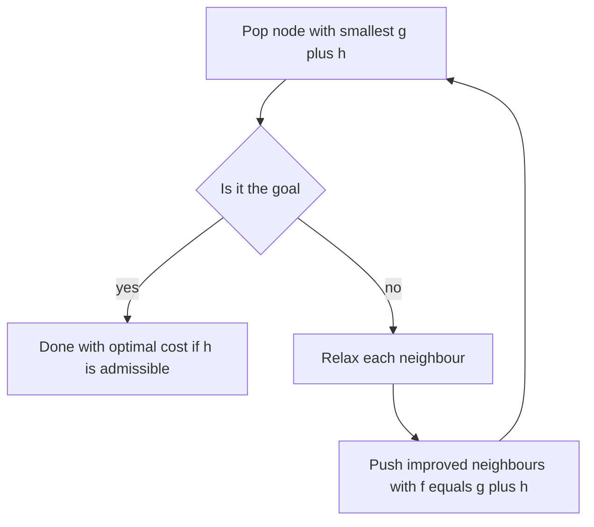

## The hook

A game character must walk from one corner of a map to the opposite corner, around a wall. You already know Dijkstra's algorithm, so you run it. It finds the shortest path, but before it gets there it carefully explores cells in every direction, including the far side of the map, away from the goal.

On an 8 × 8 grid with one wall, Dijkstra expanded **60** cells to find a path of length 14. A* found the same path, also of length 14, after expanding **15**.

Same guarantee, a quarter of the work. Guess what extra information A* used. (It is something any child knows when walking to a visible tree: roughly how far away it still is.)

## Where you meet it every day

- **Video games**: characters and units finding their way around obstacles, usually with A* or a close variant on a grid or navigation mesh.
- **Route planning**: map services rely on many speed-up techniques, and goal-directed search in the spirit of A* is one of the classic ideas behind them.
- **Robotics**: planning paths for robots and autonomous vehicles on maps of free space.
- **Puzzle solving**: sliding puzzles and similar state-space searches use A* with problem-specific heuristics.

## The intuition

:::analogy
A **hiker uses a compass toward the summit while counting steps**. The step count is how far she has walked (honest and exact). The compass and the visible peak give a rough guess of how far is left. At each fork she prefers the trail where steps walked plus distance still to go looks smallest. She still backtracks if a trail turns out to be blocked, but she never wanders off in the opposite direction just because it is short so far.
:::

Dijkstra counts steps only: it always expands the node with the smallest cost so far, g(n). That is why it spreads out like ripples in every direction.

A* adds the compass: a **[[heuristic]]** h(n), an estimate of the cost still to go. It expands the node with the smallest

**f(n) = g(n) + h(n)**: cost so far plus estimated cost remaining.

Nodes that are cheap so far but lead away from the goal get a large h and wait. Nodes on the way to the goal are expanded first.

## How it works

A* is Dijkstra with a different priority:

1. Put the start in the **[[open set]]** (a priority queue) with g = 0 and f = h(start).
2. Pop the node with the smallest f. If it is the goal, stop: its g is the answer.
3. For each neighbour, compute a tentative g = g(current) + edge cost. If it improves the neighbour's best g, record it and push the neighbour with f = g + h.
4. Repeat.

Peter Hart, Nils Nilsson and Bertram Raphael published A* in 1968.

### The one rule: never overestimate

An **[[admissible heuristic]]** never overestimates the true remaining cost. With it, A* returns a shortest path.

Wait, why does overestimating break it? Because A* stops the first time it pops the goal. If h made a good route look worse than it is, that route sits in the queue while a worse route reaches the goal first and is accepted.

Common admissible heuristics:

| Movement | Heuristic | Why it is admissible |
|---|---|---|
| 4 directions, unit steps | Manhattan distance abs(dx) + abs(dy) | You need at least that many steps |
| 8 directions, unit diagonal cost | max(abs(dx), abs(dy)) | A diagonal covers one step in each axis |
| Any direction, distances in space | Straight-line distance | No path is shorter than a straight line |
| Roads, travel time | Straight-line distance ÷ maximum speed | No route can be faster than that |

Most practical heuristics are also **[[consistent heuristic]]s**: h(u) ≤ cost(u, v) + h(v) for every edge. Then a node never needs reopening once it is popped, just as in Dijkstra.



## Walk through an example

### Why the rule matters

Graph: S→A costs 1, A→G costs 10, S→B costs 4, B→G costs 4. The shortest path is S→B→G with cost 8.

**Admissible heuristic** h(S) = 0, h(A) = 5, h(B) = 4, h(G) = 0 (none exceeds the true remaining cost: A really needs 10, B needs 4).

| Pop | g | f = g + h | Pushes |
|---|---|---|---|
| S | 0 | 0 | A (g 1, f 6), B (g 4, f 8) |
| A | 1 | 6 | G via A (g 11, f 11) |
| B | 4 | 8 | G via B (g 8, f 8) |
| G | 8 | 8 | done: **cost 8** |

**Inadmissible heuristic**: change only h(B) to 20 (it really needs 4).

| Pop | g | f | Pushes |
|---|---|---|---|
| S | 0 | 0 | A (f 6), B (f 4 + 20 = 24) |
| A | 1 | 6 | G via A (g 11, f 11) |
| G | 11 | 11 | done: **cost 11**, wrong |

B, with f = 24, was never popped. One overestimate, and the answer is wrong.

### Why the grid search was so much cheaper

On the 8 × 8 grid, Manhattan distance gives every cell an honest lower bound on the remaining steps. Cells behind the start or far from the goal get large f values and are never expanded before the goal is reached. Breaking ties in favour of smaller h (cells closer to the goal) helps further on open grids, where many cells share the same f.

:::try-this
On a 4-direction grid, the start is (0, 0) and the goal is (3, 4). What is h at the start, and could the shortest path ever be shorter than that? (Manhattan h = 3 + 4 = 7. No: with only horizontal and vertical unit moves, you need at least 3 vertical and 4 horizontal steps, so 7 is a lower bound. Walls can only make it longer.)
:::

## The code

```pseudo
a_star(start, goal, h):
    g[start] = 0
    open = priority queue ordered by g + h, containing start
    while open is not empty:
        u = pop node with smallest g[u] + h(u)
        if u == goal: return g[u]
        if u already closed: continue
        mark u closed
        for each edge u -> v with cost w:
            if g[u] + w < g[v]:
                g[v] = g[u] + w
                push v with priority g[v] + h(v)
    return no path
```

The C++ reproduces both experiments: Dijkstra versus A* on the grid, and the admissible versus overestimating heuristic on the small graph.

```cpp
#include <bits/stdc++.h>
using namespace std;

// A* on a grid with unit steps. Returns {path length, cells expanded}; h = 0 gives Dijkstra.
pair<int, int> gridSearch(const vector<string>& g, bool useHeuristic) {
    int R = g.size(), C = g[0].size();
    pair<int, int> s{0, 0}, t{R - 1, C - 1};
    auto h = [&](int r, int c) { return useHeuristic ? abs(r - t.first) + abs(c - t.second) : 0; };
    vector<vector<int>> dist(R, vector<int>(C, INT_MAX));
    vector<vector<bool>> closed(R, vector<bool>(C, false));
    // (f, h, g, r, c): smallest f first, ties broken by smaller h (closer to the goal)
    priority_queue<array<int, 5>, vector<array<int, 5>>, greater<>> pq;
    dist[0][0] = 0;
    pq.push({h(0, 0), h(0, 0), 0, 0, 0});
    int expanded = 0, dr[] = {1, -1, 0, 0}, dc[] = {0, 0, 1, -1};
    while (!pq.empty()) {
        auto [f, hh, d, r, c] = pq.top(); pq.pop();
        if (closed[r][c]) continue;
        closed[r][c] = true;
        expanded++;
        if (make_pair(r, c) == t) return {d, expanded};
        for (int k = 0; k < 4; k++) {
            int nr = r + dr[k], nc = c + dc[k];
            if (nr < 0 || nr >= R || nc < 0 || nc >= C || g[nr][nc] == '#') continue;
            if (d + 1 < dist[nr][nc]) {
                dist[nr][nc] = d + 1;
                pq.push({d + 1 + h(nr, nc), h(nr, nc), d + 1, nr, nc});
            }
        }
    }
    return {-1, expanded};
}

// A* on a small weighted graph with a given heuristic table: shows why h must not overestimate.
int graphSearch(const map<char, vector<pair<char, int>>>& adj, map<char, int> h) {
    priority_queue<tuple<int, int, char>, vector<tuple<int, int, char>>, greater<>> pq;   // (f, g, node)
    set<char> closed;
    pq.push({h['S'], 0, 'S'});
    while (!pq.empty()) {
        auto [f, d, u] = pq.top(); pq.pop();
        if (closed.count(u)) continue;
        closed.insert(u);
        if (u == 'G') return d;              // A* stops at the first time the goal is popped
        for (auto [v, w] : adj.at(u)) pq.push({d + w + h[v], d + w, v});
    }
    return -1;
}

int main() {
    vector<string> grid = {"........", "........", "....#...", "....#...",
                           "....#...", "....#...", "........", "........"};
    auto [d0, e0] = gridSearch(grid, false);
    auto [d1, e1] = gridSearch(grid, true);
    cout << "Dijkstra: length " << d0 << ", expanded " << e0 << "\n";   // 14, 60
    cout << "A*:       length " << d1 << ", expanded " << e1 << "\n";   // 14, 15
    map<char, vector<pair<char, int>>> adj = {{'S', {{'A', 1}, {'B', 4}}}, {'A', {{'G', 10}}}, {'B', {{'G', 4}}}, {'G', {}}};
    cout << graphSearch(adj, {{'S', 0}, {'A', 5}, {'B', 4}, {'G', 0}}) << "\n";    // 8: admissible
    cout << graphSearch(adj, {{'S', 0}, {'A', 5}, {'B', 20}, {'G', 0}}) << "\n";   // 11: overestimate at B
}
```

## Why it is clever

:::insight
A* keeps Dijkstra's guarantee while spending its effort where the goal is. Adding an honest lower bound on the remaining cost to the priority steers the search toward the goal, and because the bound never overestimates, no shorter path can be skipped.
:::

The heuristic is a dial. h = 0 is Dijkstra: safe but unfocused. A perfect h (the exact remaining cost) expands only nodes on a shortest path. Everything between trades a bit of guaranteed effort for focus, and the better the admissible estimate, the less work A* does.

## Where it falls short

:::warning
Common misconception: "a bigger heuristic is always better because it focuses the search more." Up to the true remaining cost, yes. Beyond it, the heuristic is inadmissible and A* can return a longer path, as in the h(B) = 20 example. Weighted variants that multiply h on purpose trade optimality for speed, and that should be a deliberate choice.
:::

- **Memory**: A* keeps every discovered node in its open and closed sets, which can be huge in large state spaces. Variants such as iterative-deepening A* trade time for memory.
- **Heuristics must be designed**: a weak heuristic gives little speed-up; a strong one needs domain knowledge.
- **Single source, single goal**: for many queries on a fixed road network, preprocessing-based methods can beat plain A* by far.
- **Changing maps**: when obstacles move, replanning from scratch each time is wasteful; incremental variants exist for that.

### Interview follow-ups

**"How is A* different from greedy best-first search?"** Greedy best-first orders by h alone, ignoring the cost so far. It is often fast but can return long paths. A* uses g + h and is optimal with an admissible h.

**"Your grid allows diagonal moves costing √2. Which heuristic?"** The octile distance: with dx and dy, it is max(dx, dy) + (√2 − 1)·min(dx, dy), the exact cost on an empty grid, so it never overestimates.

**"Can A* replace Dijkstra in a network delay problem?"** Only for a single target with a known lower bound to it. For "shortest distance to every node", there is no single goal to aim at, so plain Dijkstra, as in [Water Racing Through a Network of Pipes](article:dsa-dijkstra), is the tool.

## Key takeaways

- A* is Dijkstra with the priority f = g + h, where g is the exact cost so far and h is an estimate of the remaining cost.
- If the heuristic never overestimates (admissible), A* returns a shortest path; one overestimate can make it return a longer one.
- Good heuristics such as Manhattan, octile or straight-line distance focus the search toward the goal, expanding far fewer nodes than Dijkstra.
- With h = 0, A* is exactly Dijkstra; with a perfect h, it expands only nodes on a shortest path.
- A* is used for pathfinding in games, robots and puzzles, and its main costs are memory and the need for a good, admissible heuristic.
