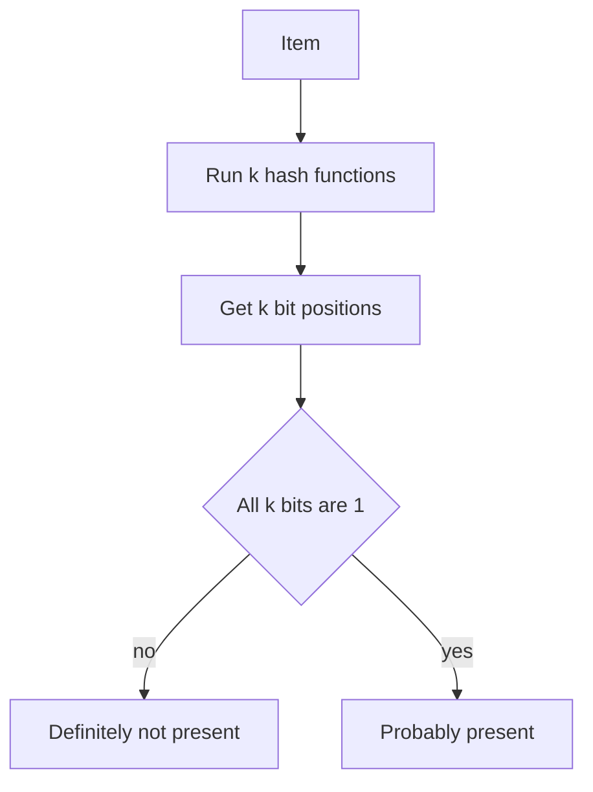

## The hook

Your database holds a billion keys spread across hundreds of files on disk. A request arrives for a key that does not exist. Without help, the database might open file after file, paying for a slow disk read each time, only to answer "not found".

Now imagine a little helper sitting in memory that can say, instantly, "that key is definitely not in this file". It is occasionally wrong in one direction, but never in the other. That helper is a Bloom filter, and it saves real disk reads every second in databases you have used.

## Where you meet it every day

- **Databases built on LSM trees**, such as RocksDB, LevelDB and Cassandra, keep a Bloom filter for each on-disk file so lookups skip files that cannot contain the key.
- **Web browsers:** early versions of Google Chrome's Safe Browsing kept a compact filter of known malicious URLs locally, and only asked Google's servers when the filter said "maybe".
- **Content delivery networks** have reportedly used Bloom filters to avoid caching "one-hit wonders", objects requested only once, so the cache keeps space for popular content.

In each case, a quick "definitely not" in memory avoids an expensive check somewhere slower.

## The intuition

:::analogy
Picture a nightclub bouncer with a guest list that only records initials. When you arrive, the bouncer checks your initials. If even one of them is missing, you are definitely not on the list. If all are there, you are probably on it, though someone else with the same initials might have made the list instead. The bouncer never turns away a real guest, but now and then lets in a lucky stranger.
:::

A [[Bloom filter]] stores fingerprints, not items. Each item leaves a few marks in a shared [[bit array]], and to check an item you look for its marks. Missing marks prove absence. Present marks suggest presence, because other items may have left the same marks.

## How it works

Start with a bit array of `m` bits, all 0, and `k` different [[hash function]]s, each mapping an item to a position from 0 to m − 1.

- **Add** an item: compute its k positions and set all of those bits to 1.
- **Query** an item: compute its k positions. If any bit is 0, answer "definitely not". If all are 1, answer "probably yes".



So the filter can produce a [[false positive]], when other items happened to set all of this item's bits, but never a [[false negative]].

### How wrong is "probably"?

With n items added to m bits using k hash functions, the false positive rate is approximately

$$p \approx \left(1 - e^{-kn/m}\right)^k$$

- $kn$ is the total number of bit-setting operations.
- $1 - e^{-kn/m}$ is roughly the fraction of bits that end up set to 1.
- Raising it to the power $k$ is the chance that all k bits for a new item are already 1 by accident.

The best number of hash functions turns out to be about $k = (m/n) \ln 2$. In practice, a commonly quoted rule of thumb is that about 10 bits per item gives roughly a 1% false positive rate, whatever the size of the items themselves.

## Walk through an example

Take a tiny filter with m = 10 bits and k = 2 hash functions. Suppose the hashes give these positions (made up for the example):

| Item | h1 | h2 |
|---|---|---|
| "cat" | 1 | 6 |
| "dog" | 3 | 6 |
| "owl" | 1 | 3 |
| "fox" | 2 | 8 |

**Add "cat"**: set bits 1 and 6. **Add "dog"**: set bits 3 and 6 (6 is already 1).

Bits now: positions 1, 3 and 6 are 1, the rest are 0.

- **Query "fox"**: bit 2 is 0, so "fox" is **definitely not** present. Correct.
- **Query "owl"**: bits 1 and 3 are both 1, so the filter says **probably yes**. But "owl" was never added. That is a false positive: "cat" and "dog" together happened to cover owl's bits.

:::try-this
Add "fox" to the filter above, then query "owl" again. Does the answer change? Now imagine you remove "cat" by clearing bits 1 and 6. Query "dog". What goes wrong? (Bit 6 is now 0, so the filter says "dog" is definitely not present, even though it is. That is why plain Bloom filters do not support deletion.)
:::

## The code

```pseudo
create(m, k):
    bits = array of m zeros

add(item):
    for i in 1 .. k:
        bits[hash_i(item) mod m] = 1

might_contain(item):
    for i in 1 .. k:
        if bits[hash_i(item) mod m] == 0:
            return false        // definitely not
    return true                 // probably yes
```

Real implementations do not need k truly independent hash functions. A common trick computes two hashes, h1 and h2, and derives the rest as `h1 + i * h2`, which behaves almost as well and is much cheaper.

## Why it is clever

:::insight
A Bloom filter trades a small, controllable chance of "maybe" for an enormous saving in memory. It never stores the items themselves, only shared bits, so a filter for a billion keys can fit in about a gigabyte instead of the tens of gigabytes the keys would need.
:::

The one-sided error is what makes it useful. A "definitely not" can be trusted completely, so you safely skip the expensive work. A "probably yes" just means you do the expensive check you would have done anyway. The filter can only save time, never cause a wrong final answer.

## Where it falls short

:::warning
Common misconception: "you can delete from a Bloom filter by clearing bits." Bits are shared between items, so clearing them can create false negatives. If you need deletion, use a counting Bloom filter (counters instead of bits) or a cuckoo filter.
:::

- **It cannot list its contents** or tell you how many items it holds exactly.
- **It fills up.** As more items are added than it was sized for, the false positive rate climbs. You must estimate n up front or rebuild a bigger filter.
- **"Probably yes" still needs a real check**, so it only helps when "no" is the common answer.

## Key takeaways

- A Bloom filter answers set membership with "definitely not" or "probably yes", using only a bit array and a few hash functions.
- It never gives false negatives, so a "no" can be trusted and the expensive lookup can be skipped.
- The false positive rate depends on bits per item and the number of hash functions, and about 10 bits per item gives roughly 1%.
- Databases, browsers and CDNs use Bloom filters to avoid slow disk reads, network calls or wasted cache space.
- Plain Bloom filters cannot delete items or list contents; counting and cuckoo filters exist for those needs.
