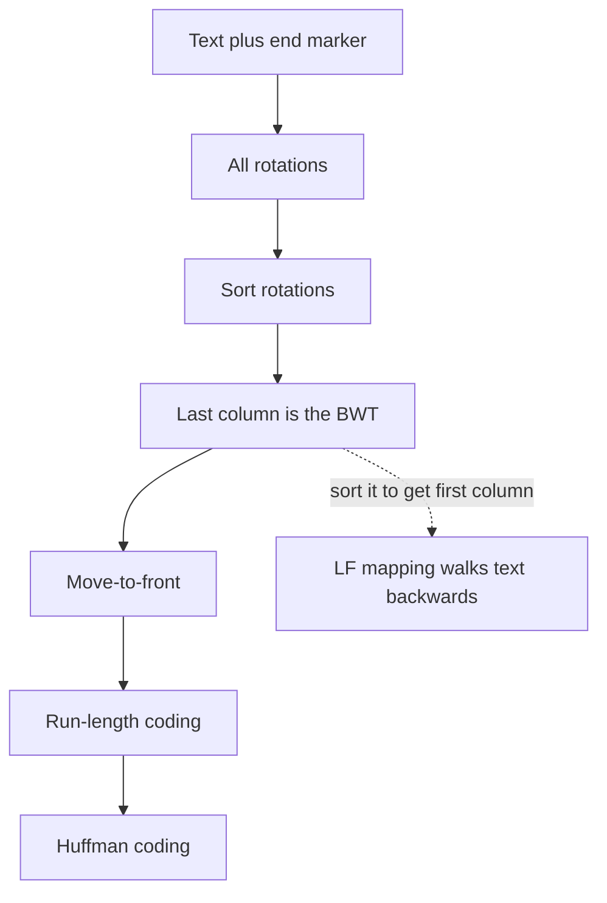

## The hook

Some ideas look like magic tricks. Take a text, write down every way of rotating it, sort those rotations alphabetically, and keep only the last letter of each. You get a scrambled string with the same letters as before, except that equal letters now tend to sit together. Stranger still, from that scrambled string alone you can rebuild the original text exactly.

Michael Burrows and David Wheeler published this transform in 1994. It became the core of the bzip2 compressor, and later the heart of tools that align billions of DNA reads against the human genome.

## Where you meet it every day

- **bzip2**, a common compressor on Linux systems, applies the BWT, then move-to-front and run-length coding, then Huffman coding.
- **Genome sequencing**: read aligners such as BWA and Bowtie search an index built on the BWT of a reference genome, called an FM-index.
- **Compressed full-text indexes** use the BWT to search text while storing it in compressed form.

## The intuition

:::analogy
Imagine a rhyming dictionary that sorts words by their endings. Words ending "-ing" all line up together, so the letter just before "-ing" is often a similar one. The BWT does something similar for every position of a text at once: it sorts each position by what *follows* it, and outputs the letter that *precedes* it. In English, whatever is followed by "he " is very often "t", so all those t's land in the same neighbourhood of the output.
:::

Sorting by the following context makes the preceding letters cluster. That clustering is what a later compression stage exploits.

## How it works

### The forward transform

1. Append an [[end marker]] $, smaller than every letter, so each [[rotation]] is distinct and the original can be found again.
2. Write all n rotations of the text.
3. Sort them.
4. Output the last column. That string is the [[Burrows-Wheeler transform (BWT)]].

Each row of the sorted list starts with some suffix of the text, and its last character is the character just before that suffix. Rows whose suffixes begin alike sit together, and their preceding characters are often alike too.

### Inverting it

The first column is simply the sorted letters of the last column, so you have both. The key fact is the [[LF mapping]]: the k-th "a" in the last column is the same character of the text as the k-th "a" in the first column. That works because rows with the same first letter are sorted by what follows it, and that is the same order those letters have in the last column.

So start at the row that begins with $ (the original text, rotated). Its last character is the text's final letter. Use LF to jump to the row that starts with that letter; its last character is the letter before it. Repeat, collecting letters backwards, until you reach $.



### Why it helps compression

The BWT itself saves nothing: the output has exactly the same letters. The payoff comes from the next stage. [[Move-to-front coding]] keeps a list of symbols and outputs each symbol's current position, then moves it to the front. A run of the same letter becomes one number followed by zeros, and a stream full of zeros and small numbers is ideal for run-length and Huffman coding, as in [Shorthand, Then Shorter Shorthand](article:famous-algos-deflate).

:::insight
The BWT sorts characters by the context that follows them, so characters with similar contexts end up adjacent. Text has strong context, so the last column develops long runs, and runs are easy to compress. The end marker plus the LF mapping make the shuffle lossless.
:::

### Why it helps searching

Because sorted rotations are effectively sorted suffixes, every occurrence of a pattern sits in one contiguous range of rows. Backward search uses the LF mapping to narrow that range one pattern letter at a time, from the last letter to the first, without decompressing the text. That is the idea behind FM-index aligners for DNA.

## Walk through an example

Text: **banana$**.

| Row | Sorted rotation | First (F) | Last (L) |
|---|---|---|---|
| 0 | $banana | $ | a |
| 1 | a$banan | a | n |
| 2 | ana$ban | a | n |
| 3 | anana$b | a | b |
| 4 | banana$ | b | $ |
| 5 | na$bana | n | a |
| 6 | nana$ba | n | a |

BWT = **annb$aa**. Notice "nn" and "aa" already sitting together.

**Inverting.** Number each letter's occurrences. Last column: a₁ n₁ n₂ b₁ $ a₂ a₃. First column: $ a₁ a₂ a₃ b₁ n₁ n₂. LF sends each last-column letter to the row where the same occurrence appears in the first column: row 0 (a₁) → 1, row 1 (n₁) → 5, row 2 (n₂) → 6, row 3 (b₁) → 4, row 4 ($) → 0, row 5 (a₂) → 2, row 6 (a₃) → 3.

Start at row 0 (begins with $):

| Step | Row | Last letter collected |
|---|---|---|
| 1 | 0 | a |
| 2 | 1 | n |
| 3 | 5 | a |
| 4 | 2 | n |
| 5 | 6 | a |
| 6 | 3 | b |
| 7 | 4 | $ stop |

Collected backwards: a, n, a, n, a, b, so reading it in reverse gives **banana**. ✓

**Move-to-front** on annb$aa with the list [$, a, b, n] gives 1, 3, 0, 3, 3, 3, 0. On a word this short there are few repeats, but on a long text the clustered last column turns into long runs of zeros.

:::try-this
Compute the BWT of "abab$" with $ smallest. (Rotations sorted: $abab, ab$ab, abab$, b$aba, bab$a. Last column: b, b, $, a, a, so the BWT is "bb$aa", with both b's and both a's grouped.)
:::

## The code

```pseudo
bwt(text):                       // text ends with unique smallest '$'
    rows = all rotations of text
    sort(rows)
    return last character of each row

inverse_bwt(L):
    F = sorted(L)
    for each position i: LF[i] = index in F of the same occurrence of L[i]
    row = index of '$' in F      // row 0
    out = []
    repeat len(L) - 1 times:
        out.append(L[row]); row = LF[row]
    return reverse(out) + '$'
```

```cpp
#include <bits/stdc++.h>
using namespace std;

string bwt(const string& t) {
    int n = t.size();
    vector<string> rows;
    for (int i = 0; i < n; i++) rows.push_back(t.substr(i) + t.substr(0, i));
    sort(rows.begin(), rows.end());                 // '$' (36) sorts before letters
    string L;
    for (auto& r : rows) L += r.back();
    return L;
}

string inverseBwt(const string& L) {
    int n = L.size();
    vector<int> idx(n);
    iota(idx.begin(), idx.end(), 0);
    stable_sort(idx.begin(), idx.end(), [&](int a, int b) { return L[a] < L[b]; });
    vector<int> LF(n);
    for (int i = 0; i < n; i++) LF[idx[i]] = i;     // k-th c in L -> k-th c in F
    string out;
    int row = 0;                                    // row starting with '$'
    for (int k = 0; k < n - 1; k++) { out += L[row]; row = LF[row]; }
    reverse(out.begin(), out.end());
    return out + "$";
}

int main() {
    string L = bwt("banana$");
    cout << L << ' ' << inverseBwt(L) << '\n';      // annb$aa banana$
}
```

Sorting full rotations is O(n² log n), fine for learning. Real implementations build a suffix array in O(n log n) or O(n) and read the BWT from it.

## Why it is clever

It finds structure in text without looking for repeats explicitly: sorting does the work, and the text's own statistics produce the runs. It is reversible from the output alone, apart from a marker or a row index. And the same sorted structure doubles as a search index, so one transform serves both compression and fast pattern matching over huge texts like genomes.

## Where it falls short

:::warning
Common misconception: "the BWT compresses data." It is a permutation: the output has exactly as many symbols as the input. Compression comes only from the stages after it, such as move-to-front, run-length and Huffman coding, which benefit from the clustering.
:::

- **Block-based and memory-hungry**: the transform needs a whole block in memory and sorts it, so it is slower than LZ77-based compressors, especially for decompression-heavy workloads.
- **Needs a terminator or index**: without the end marker or the original row number, inversion is ambiguous.
- **Gains depend on context**: text and DNA cluster well; random or already compressed data gains nothing.

## Key takeaways

- The Burrows-Wheeler transform sorts all rotations of the text and outputs the last column, which groups letters that precede similar contexts.
- It does not shrink data by itself; move-to-front, run-length and Huffman coding turn its clustered output into fewer bits.
- The LF mapping links the k-th occurrence of a letter in the last column to its k-th occurrence in the first column, which lets you rebuild the text backwards.
- Because sorted rotations behave like sorted suffixes, the BWT also supports fast pattern search, which DNA aligners use.
- bzip2 is the classic compressor built on it, trading speed for good compression of text.
