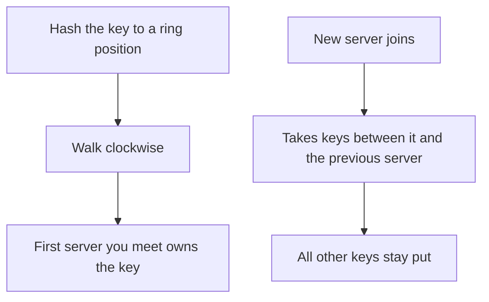

## The hook

It is the biggest sale of the year, and your cache cluster is struggling. You add a fifth server to the four you have. Within seconds, almost every cache lookup starts missing, the database behind the cache is flooded with requests, and the site slows to a crawl.

Adding capacity made things worse. The culprit was one innocent line of code, `server = hash(key) % n`. The fix is a beautifully simple idea from 1997 called consistent hashing.

## Where you meet it every day

- **Distributed databases** in the Dynamo family, such as Amazon's Dynamo design and Apache Cassandra, use a hash ring to decide which nodes store each key.
- **Distributed caches:** client libraries for Memcached clusters commonly use consistent hashing so adding a cache server does not invalidate most of the cache.
- **Load balancers and CDNs** use it to send the same user or the same URL to the same backend, which keeps caches warm.

Whenever data must be split across a changing set of machines, consistent hashing is the usual answer.

## The intuition

:::analogy
Picture guests seated around a large round table, with place cards spread around its edge. Each guest sits in front of the first place card clockwise from where they arrived. When a new card is put down, only the guests between it and the previous card move over to it. Everyone else stays exactly where they are.
:::

That is the whole trick. With `mod n`, changing n changes almost every answer, so almost every key moves. With [[consistent hashing]], adding a server only takes over one stretch of the circle, so only the keys in that stretch move.

## How it works

Hash values cover a range, say 0 to 2³² − 1. Bend that range into a circle, the [[hash ring]].

1. Hash each server's name to a position on the ring.
2. Hash each key to a position on the ring.
3. A key belongs to the **first server clockwise** from it.



When a server joins, it takes over only the keys between its position and the previous server's. When a server leaves, its keys pass to the next server clockwise. On average, only about 1/n of the keys move, compared with most of them under `mod n`.

### Virtual nodes

With only one point per server, the arcs between servers can be wildly uneven, so one server might own far more keys than another. Real systems give each physical server many positions on the ring, called [[virtual node]]s, for example by hashing "server-A#1", "server-A#2" and so on. Many small arcs average out, so load is even. And when a server leaves, its many small arcs pass to many different neighbours, instead of dumping everything on one.

## Walk through an example

Use a tiny ring from 0 to 99. Servers hash to: A at 10, B at 45, C at 80.

| Key | Ring position | Owner (first server clockwise) |
|---|---|---|
| k1 | 5 | A (10) |
| k2 | 30 | B (45) |
| k3 | 60 | C (80) |
| k4 | 90 | A (wraps around to 10) |

Now add server D at position 55. Which keys move?

- k1 at 5: still A. k2 at 30: still B. k4 at 90: still A.
- k3 at 60: the first server clockwise is still C at 80. It stays.
- Only keys between 45 and 55 would move to D. None of our four do.

Compare with `mod n`. If the key positions were also the hashes, going from 3 to 4 servers changes `5 % 3 = 2` to `5 % 4 = 1`, `30 % 3 = 0` to `30 % 4 = 2`, and so on: most keys change servers.

:::try-this
Remove server B from the original ring (A at 10, B at 45, C at 80). Which of k1 to k4 move, and where to? (Only k2 at 30 moves, to C at 80, the next server clockwise. Everything else stays.)
:::

## The code

The ring is just a sorted map from position to server. Lookup is "the first entry at or after this position, wrapping around".

```pseudo
ring = sorted map from position to server

add_server(s, replicas):
    for i in 1 .. replicas:
        ring[hash(s + "#" + i)] = s

remove_server(s, replicas):
    for i in 1 .. replicas:
        delete ring[hash(s + "#" + i)]

server_for(key):
    p = hash(key)
    entry = first entry in ring with position >= p
    if none: entry = first entry in ring      // wrap around
    return entry.server
```

In C++, `std::map` with `lower_bound` gives exactly this O(log v) lookup, where v is the number of virtual nodes.

## Why it is clever

:::insight
Consistent hashing makes each key's home depend only on its neighbours on the ring, not on the total number of servers. Change the server count and only one neighbourhood is affected, so [[rebalancing]] touches about 1/n of the data instead of nearly all of it.
:::

This is what makes elastic [[sharding]] practical: clusters can grow, shrink and lose machines without a stop-the-world data migration.

## Where it falls short

:::warning
Common misconception: "consistent hashing balances load perfectly." It balances keys, not traffic. One extremely popular key, such as a celebrity's profile, still lands on one server. Hot keys need separate fixes, like replicating that key or adding a small cache in front.
:::

- **Without virtual nodes, balance is poor.** Few points per server means uneven arcs.
- **Lookups are O(log v)**, not O(1), because the ring is a sorted structure.
- **Membership must be agreed.** Every client must see the same ring, which needs a coordination or gossip mechanism.
- **Alternatives exist** for specific needs: rendezvous hashing avoids the ring entirely, and jump consistent hash needs no memory when servers are simply numbered.

### Interview follow-ups

**"With N servers and K keys, how many keys move when you add one server?"** About K/(N+1): only the keys on the arc the new server takes over. Plain `hash(key) mod N` would move almost all of them, because nearly every key's remainder changes.

**"Why virtual nodes, and how many?"** Each physical server gets many points on the ring, so its share is the sum of many small arcs and evens out. More points mean better balance but a bigger ring to store and search; systems typically use tens to a few hundred per server. Virtual nodes also let a bigger machine take proportionally more points.

**"How do you replicate data on a ring?"** Store each key on the next R distinct physical servers clockwise. Skip virtual nodes that belong to a server already chosen, or two replicas could land on the same machine.

**"One key gets 100x the traffic. What now?"** Consistent hashing cannot help, because it places keys, not load. Cache the hot key in front, replicate it to several servers and spread reads, or split it into sub-keys such as key#1..key#8.

**"Ring versus rendezvous hashing?"** Rendezvous (highest random weight) scores every server for each key and picks the best: no ring, perfect minimal movement, but O(N) work per lookup. Fine for tens of servers; the ring with binary search scales to many more.

## Key takeaways

- Plain `hash(key) mod n` moves most keys whenever n changes, which can wipe out a cache or force a huge data migration.
- Consistent hashing places servers and keys on a ring and gives each key to the first server clockwise.
- Adding or removing a server moves only about 1/n of the keys, the ones in that server's stretch of the ring.
- Virtual nodes give each server many ring positions, which evens out load and spreads a failed server's keys across many neighbours.
- It balances keys, not hot traffic, so very popular keys still need their own solution.
