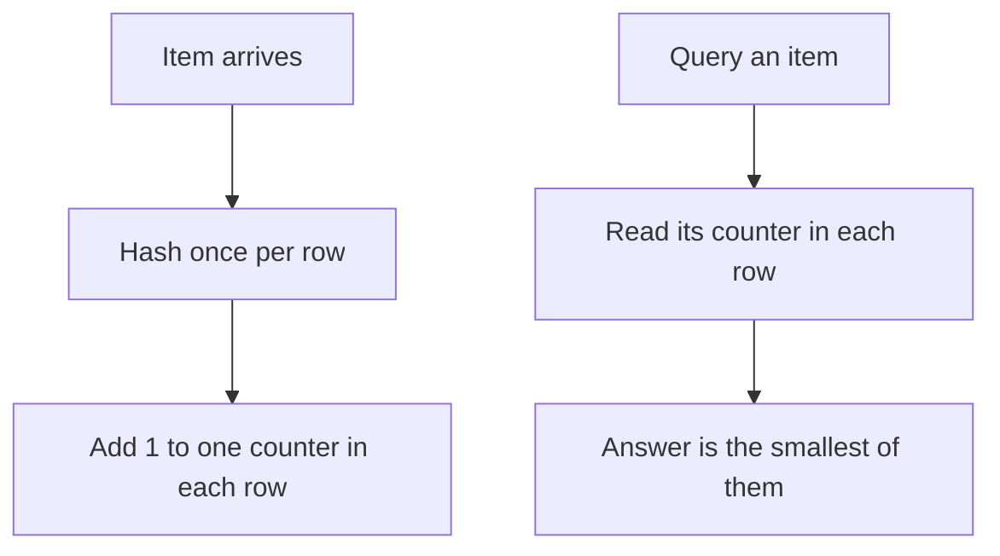

## The hook

Every second, a busy network router sees hundreds of thousands of packets from countless IP addresses. Somewhere in that flood, one address is sending far more than its share: maybe a misconfigured server, maybe an attack. The router has a few megabytes of fast memory and no time to keep a full table of every address it has ever seen.

How do you count things you cannot afford to store? You accept a little error, in a controlled direction, and use a Count-Min Sketch.

## Where you meet it every day

- **Network monitoring:** finding the IP addresses or flows that send the most traffic, the [[heavy hitter]]s, is a classic use studied in the original research.
- **Trending and popularity:** approximate counts of searches, hashtags or product views, where "about 52,000" is as useful as "exactly 51,873".
- **Data systems:** stream processors and databases offer Count-Min style sketches for approximate frequency queries, and Redis supports Count-Min Sketch through its probabilistic data structures module.

Whenever a [[stream]] is too big to count exactly, a [[sketch]] trades exactness for tiny, fixed memory.

## The intuition

:::analogy
Imagine counting votes with several tally sheets, each with only a few columns. Every name is assigned one column on each sheet by a different rule, so two names often share a column on one sheet but rarely on all of them. Any one sheet exaggerates a name's count, because other names share the column. So to estimate a name's votes, you look at its column on every sheet and trust the smallest number: the sheet where it was least crowded.
:::

That is the whole data structure: a few rows of counters, a different hash function per row, and "take the minimum" when you ask a question.

## How it works

The sketch is a grid of counters with **d rows** and **w columns**, all starting at 0. Each row has its own hash function that maps an item to a column.

- **Add** an item (with count c, usually 1): for each row, hash the item to a column and add c to that counter.
- **Query** an item: for each row, look at the counter its hash points to. Return the **minimum** of those d numbers.



### Why the minimum, and how wrong can it be?

Each counter holds the item's true count **plus** the counts of any other items that [[collision|collided]] with it in that row. Collisions only add, so every counter is an [[overestimate]] or exact, never too low. The minimum is the least polluted one.

The guarantee from the original analysis is roughly this: with w columns and d rows, the estimate exceeds the true count by at most about $\frac{e}{w} N$ with probability at least $1 - e^{-d}$, where N is the total of all counts in the stream.

- Wider rows (bigger w) mean fewer collisions, so a smaller error.
- More rows (bigger d) mean more chances that at least one row is clean, so higher confidence.
- Memory is just w × d counters, no matter how many distinct items appear.

## Walk through an example

A tiny sketch: d = 2 rows, w = 4 columns. Hash outputs are made up for the example.

| Item | Row 1 column | Row 2 column |
|---|---|---|
| cat | 0 | 2 |
| dog | 0 | 1 |
| owl | 3 | 2 |

Stream: cat, cat, dog, owl, cat.

**Row 1** counters: column 0 gets cat ×3 and dog ×1 = 4; column 3 gets owl = 1. Row 1 = `[4, 0, 0, 1]`.
**Row 2** counters: column 2 gets cat ×3 and owl ×1 = 4; column 1 gets dog = 1. Row 2 = `[0, 1, 4, 0]`.

Queries:

- **cat:** row 1 says 4, row 2 says 4. Minimum 4. True count 3. An overestimate, because cat collided with dog in row 1 and with owl in row 2.
- **dog:** row 1 says 4, row 2 says 1. Minimum **1**. Exactly right; row 2 was clean.
- **owl:** row 1 says 1, row 2 says 4. Minimum **1**. Exactly right.

:::try-this
Add a third row where the hash puts cat in column 1, dog in column 2 and owl in column 3. Fill in its counters for the same stream, then query cat again. (Row 3 becomes `[0, 3, 1, 1]`, so cat's minimum drops to 3, the true count. More rows, more chances of a clean read.)
:::

## The code

```pseudo
create(w, d):
    table = d rows of w zeros
    pick d independent hash functions h_1 .. h_d

add(item, c = 1):
    for i in 1 .. d:
        table[i][h_i(item) mod w] += c

estimate(item):
    best = infinity
    for i in 1 .. d:
        best = min(best, table[i][h_i(item) mod w])
    return best
```

To find heavy hitters, keep a small min-heap of the top candidates next to the sketch. After each add, estimate the item; if it beats the smallest in the heap, swap it in. The sketch does the counting; the heap remembers the names.

## Why it is clever

:::insight
The error only goes one way. Because collisions can only inflate counters, the minimum across independent rows is a tight upper bound, and its memory is fixed by how accurate you want to be, not by how many distinct items exist.
:::

It is also mergeable: two sketches built with the same hash functions can be added cell by cell, which gives the sketch of the combined stream. That makes it natural for distributed systems, where each server sketches its own traffic and a central node sums them.

## Where it falls short

:::warning
Common misconception: "Count-Min Sketch is accurate for every item." The error is relative to the whole stream's total N, not to the item's own count. A rare item can look many times bigger than it is. The sketch is good at finding frequent items, and poor at counting rare ones precisely.
:::

- **It cannot list items.** It stores counters, not names, so pair it with a heap or a candidate list.
- **Only overestimates with additions.** If you also subtract counts, the one-sided guarantee weakens, and variants are needed.
- **Error grows with total volume.** Long-running sketches are often reset or decayed over time windows.

## Key takeaways

- A Count-Min Sketch counts items in a stream using a fixed grid of counters, one hash function per row.
- Adding an item increments one counter per row, and a query returns the minimum of those counters.
- Collisions only inflate counters, so estimates are never too low, and the minimum is the least polluted row.
- Wider rows reduce the error and more rows raise the confidence, with memory independent of the number of distinct items.
- It shines at finding heavy hitters in huge streams but cannot list items or count rare ones precisely.
