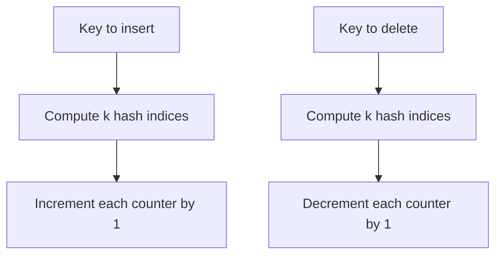
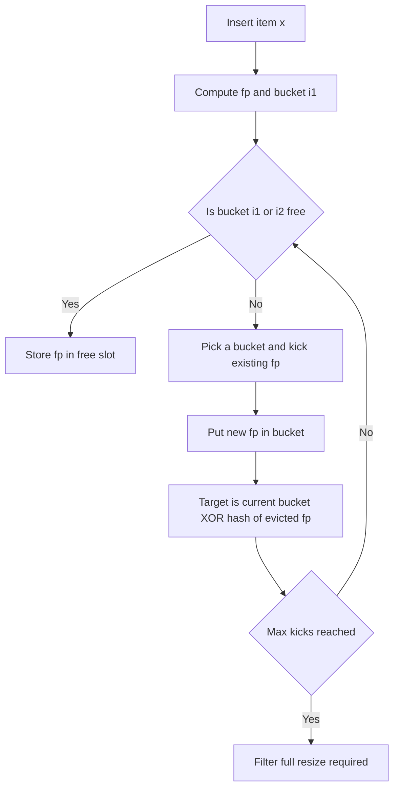

## The hook

A standard [Bloom filter](article:famous-algos-bloom-filter) is an astonishing bouncer. It memorises millions of items in a tiny sliver of memory and tells you instantly whether a guest has arrived, with zero false negatives.

Then a user closes their account, a cached web page expires, or a malicious IP address is unbanned. You need to revoke their membership.

You run to your Bloom filter, find the bits that correspond to that key, and reach out to flip them back to zero. Stop right there. If you flip those bits, you silently break the filter for five other completely innocent users who happen to share them. The bouncer turns around and tells your database that active customers do not exist.

Once a guest enters a standard Bloom filter, they can never leave. How do you build a filter that lets you take someone off the list without storing every raw key?

## Where you meet it every day

- **Distributed caches and CDNs:** edge routers store millions of active URLs in memory. When a publisher invalidates a cached page, the router must delete it from its set filter immediately so fresh content is fetched from origin.
- **Network intrusion detection and firewalls:** routers track active TCP connections and malicious IPs. Once a connection closes or a quarantine window expires, the state must be removed without restarting the router.
- **Key-value stores:** modern storage engines use deletable filters in memory to avoid checking disk for deleted rows before compaction cycles run.
- **Packet deduplication in network switches:** network fabrics track in-flight packet hashes to discard duplicates. As packets reach destinations, their hashes must be pruned continuously from high-speed SRAM.

Whenever you need the memory savings of a Bloom filter but your working set changes over time, you need a deletable filter.

## The intuition

:::analogy
Think of a coat check that can hand coats back.

A classic Bloom filter is like a wall of pegs where the attendant puts a single blue mark on a peg whenever a coat’s ticket hashes there. Multiple coats share pegs. If someone picks up their jacket, the attendant cannot simply wipe the blue mark away, because three other coats still rely on that mark being there.

To fix this, a **Counting Bloom filter** replaces the peg mark with a mechanical clicker counter. When you check in, the attendant clicks the tally up by one. When you hand your coat ticket back, they click it down by one. As long as the tally is above zero, a coat is still there.

A **Cuckoo filter** takes an even cleverer approach. Instead of keeping a tally, each hanger slot holds a tiny numbered token called a [[Fingerprint|fingerprint]]. Each coat has two allowed slots. If your preferred slot is taken, you gently kick the existing coat token to its alternate slot. If that slot is also taken, *that* coat kicks its neighbour, triggering a chain of polite relocations until everyone finds a spot. And when you leave, the attendant just removes your token from its slot.
:::

Both approaches let you revoke membership. But as you will see, they make radically different trade-offs in memory, speed, and safety.

## How it works

Let's examine both solutions to see why the industry spent fourteen years transitioning from one to the other.

### Approach 1: Counting Bloom filters

In 2000, Fan, Cao, Almeida, and Broder introduced the [[Counting Bloom filter]]. The idea is direct: replace the bit array with an array of small integer counters, typically 4 bits each.

1. **Insert:** Hash the key with $k$ hash functions. Increment the counter at each of the $k$ indices.
2. **Lookup:** Hash the key with the same $k$ functions. If *all* $k$ counters are greater than zero, return positive. If any counter is zero, return negative.
3. **Delete:** Hash the key with the $k$ functions. Decrement each counter by one.



This sounds painless, but notice the price: replacing a 1-bit flag with a 4-bit counter makes the filter **four times larger** to achieve the exact same false-positive rate. Worse, counters introduce a dangerous failure mode: [[Counter overflow|counter overflow]].

What happens when 16 different items happen to hash to the same 4-bit counter? The counter hits 15, wraps around to 0, and suddenly your filter reports false negatives! Real systems freeze the counter at 15 once it saturates. But once frozen, that counter can never be decremented again, slowly degrading the filter into an undeletable mess.

### Approach 2: Cuckoo filters

In 2014, Fan, Andersen, Kaminsky, and Mitzenmacher introduced the [[Cuckoo filter]]. It is based on cuckoo hashing, named after the cuckoo bird that kicks other birds' eggs out of nests.

Instead of hashing an item across multiple independent counter arrays, a Cuckoo filter stores a tiny [[Fingerprint|fingerprint]] (usually 1 to 2 bytes) in a bucket array. Each item has exactly **two candidate buckets**, calculated with a mathematical trick called [[Partial-key cuckoo hashing|partial-key cuckoo hashing]].



### The partial-key XOR trick

In classical cuckoo hashing, if bucket $i_1 = h_1(x)$ is occupied, you calculate bucket $i_2 = h_2(x)$.

Wait, why can't we do that here?

Think about what a set filter actually stores. It **does not store the original key $x$**! It only stores a short 8-bit fingerprint. If you need to kick an existing fingerprint out of bucket $i_1$, you cannot compute $h_2(x)$ because you no longer have $x$!

Fan et al. solved this with one of the neatest equations in system design:

$$i_1 = \text{hash}(x) \pmod m$$
$$i_2 = (i_1 \oplus \text{hash}(\text{fingerprint})) \pmod m$$

Where:
- $x$ is the raw item you want to store.
- $\text{fingerprint} = \text{hash}_{fp}(x)$, a short value (such as 8 bits).
- $i_1$ is the primary bucket index.
- $i_2$ is the alternate bucket index.
- $\oplus$ is the bitwise XOR operator.
- $m$ is the total number of buckets.

Because XOR is its own inverse ($(A \oplus B) \oplus B = A$), look what happens if you are sitting at bucket $i_2$ holding only the fingerprint:

$$i_1 = (i_2 \oplus \text{hash}(\text{fingerprint})) \pmod m$$

You can find the alternate bucket directly from the current bucket and the fingerprint itself! You never need to know the original key $x$.

:::insight
Partial-key cuckoo hashing lets an evicted item find its alternate home using only its current address and its short fingerprint. You can shuffle items indefinitely without ever remembering the original inputs.
:::

## Walk through an example

Let's trace a tiny Cuckoo filter by hand.

Our filter has **4 buckets** (indices 0, 1, 2, 3), and each bucket holds **1 entry**. We set our maximum kicks to 3.

Suppose our hash functions give:
- Item $x$: fingerprint = `0xA`. $h_1(x) = 1$. Let $\text{hash}(\text{0xA}) = 2$.
- Item $y$: fingerprint = `0xB`. $h_1(y) = 1$. Let $\text{hash}(\text{0xB}) = 2$.

Both items want to live in bucket 1 or bucket $(1 \oplus 2) = 3$.

### Step 1: Insert item x
We compute $i_1 = 1$. Bucket 1 is empty. We place `0xA` into bucket 1.

| Bucket 0 | Bucket 1 | Bucket 2 | Bucket 3 |
|---|---|---|---|
| _ | **0xA** | _ | _ |

### Step 2: Insert item y
We compute $i_1(y) = 1$. Bucket 1 is occupied by `0xA`!
We compute its alternate bucket $i_2(y) = 1 \oplus \text{hash}(\text{0xB}) = 1 \oplus 2 = 3$. Bucket 3 is currently empty, so we could place it there. But let's assume our algorithm tries bucket 1 first, kicks out the resident, and moves it to make room:

1. Kick `0xA` out of bucket 1.
2. Put `0xB` into bucket 1.
3. Where does `0xA` go? It was in bucket 1, so its alternate is $1 \oplus \text{hash}(\text{0xA}) = 1 \oplus 2 = 3$.
4. Check bucket 3: it is free! Place `0xA` in bucket 3.

| Bucket 0 | Bucket 1 | Bucket 2 | Bucket 3 |
|---|---|---|---|
| _ | **0xB** | _ | **0xA** |

Both items are safely stored!

### Step 3: Lookup item x
To check if $x$ is present:
1. Compute $\text{fingerprint}(x) = \text{0xA}$.
2. Check $i_1 = 1$: contains `0xB` (mismatch).
3. Check $i_2 = 1 \oplus \text{hash}(\text{0xA}) = 3$: contains `0xA` (match!).
4. Return **True**. Lookup takes at most 2 bucket reads!

### Step 4: Delete item x
To delete $x$:
1. Search buckets 1 and 3 for `0xA`.
2. Found in bucket 3. Remove it.

| Bucket 0 | Bucket 1 | Bucket 2 | Bucket 3 |
|---|---|---|---|
| _ | **0xB** | _ | _ |

Item $x$ is gone. Item $y$ remains completely intact in bucket 1, and no counters were harmed.

:::try-this
Suppose a Counting Bloom filter uses 4-bit counters (maximum value 15). What happens if an element is inserted 16 times, and then deleted 16 times?
(Answer: On the 16th insert, the counter saturates at 15 so it does not wrap to 0. When decremented 16 times, production systems freeze saturated counters permanently to avoid false negatives. This leaves a ghost tally that can never be cleared, permanently creating a small residual risk of false positives.)
:::

## The code

Here is the complete pseudocode for inserting, looking up, and deleting from a Cuckoo filter with multiple slots per bucket.

```pseudo
constants:
    SLOTS_PER_BUCKET = 4
    MAX_KICKS = 500

class CuckooFilter:
    buckets = array of size NUM_BUCKETS, each having SLOTS_PER_BUCKET slots

    function fingerprint(x):
        return short_nonzero_hash(x)

    function alternate_index(index, fp):
        return (index XOR hash(fp)) mod NUM_BUCKETS

    function lookup(x):
        fp = fingerprint(x)
        i1 = hash(x) mod NUM_BUCKETS
        i2 = alternate_index(i1, fp)
        return (fp in buckets[i1]) or (fp in buckets[i2])

    function insert(x):
        fp = fingerprint(x)
        i1 = hash(x) mod NUM_BUCKETS
        i2 = alternate_index(i1, fp)

        // If either bucket has an empty slot, take it
        if buckets[i1] has empty slot:
            add fp to buckets[i1]
            return true
        if buckets[i2] has empty slot:
            add fp to buckets[i2]
            return true

        // Must evict: pick one of the two candidate buckets at random
        curr_index = randomly choose between i1 and i2
        curr_fp = fp

        for n in 1 .. MAX_KICKS:
            // Swap curr_fp with a random entry in curr_index
            displaced_fp = swap curr_fp with random entry in buckets[curr_index]
            curr_fp = displaced_fp
            
            // Find alternate home for the displaced fingerprint
            curr_index = alternate_index(curr_index, curr_fp)
            if buckets[curr_index] has empty slot:
                add curr_fp to buckets[curr_index]
                return true

        // Loop detected: the coat check is completely packed
        return failure_filter_is_full

    function delete(x):
        fp = fingerprint(x)
        i1 = hash(x) mod NUM_BUCKETS
        i2 = alternate_index(i1, fp)

        if fp in buckets[i1]:
            remove one instance of fp from buckets[i1]
            return true
        if fp in buckets[i2]:
            remove one instance of fp from buckets[i2]
            return true
        return false
```

Notice the delete function: it touches at most **two buckets**. In a Bloom filter, a lookup must check $k$ locations scattered across memory (often 5 to 10 cache lines). In a Cuckoo filter with 4 slots per bucket, checking two buckets usually touches just **two cache lines**.

## Why it is clever

The genius of the Cuckoo filter lies in three specific properties:

### 1. Lookup is strictly $O(1)$ worst-case
In a standard Bloom or Counting Bloom filter, a lookup checks $k$ independent hash locations. In a Cuckoo filter, an item can **only ever live in two buckets**. It does not matter how many millions of items are stored; the algorithm checks bucket $i_1$, then bucket $i_2$, and stops. That yields exceptional cache locality.

### 2. High space efficiency at low error rates
A standard Bloom filter requires roughly 1.44 bits per item for every factor-of-two reduction in false positives ($\approx 10$ bits per item for a 1% error rate).

A Counting Bloom filter needs 3 to 4 times that memory because it replaces bits with 4-bit counters ($\approx 32\text{ to }40$ bits per item).

A Cuckoo filter with 4-entry buckets reaches over **95% table occupancy**. To achieve a 1% false positive rate, an 8-bit fingerprint suffices. With overhead, it consumes roughly **12 bits per item** while supporting full deletions—nearly three times smaller than a Counting Bloom filter!

### 3. Deletions do not degrade the structure
When you delete an item, you free a slot immediately. Other items can now move into that empty slot during future evictions.

:::analogy
Remember our coat check that can hand coats back? In a Counting Bloom filter, every time a tally peg reaches maximum capacity, the clerk tapes over it permanently. In a Cuckoo filter, taking your coat down frees a hanger on the spot, restoring flexibility to the entire checkroom.
:::

## Where it falls short

Despite its brilliance, the Cuckoo filter is not a drop-in replacement for every scenario. It brings its own sharp edges.

:::warning
Common misconception: "You can delete items from a standard Bloom filter by setting the bits back to zero." You cannot. Clearing a shared bit causes catastrophic false negatives for other items, violating the foundational guarantee of a Bloom filter.
:::

### 1. Insertion failure under high load
Predict what happens when you try to insert an item into a Cuckoo filter that is 98% full.

Can it just search linearly for an empty spot? No. Every item is rigidly confined to exactly two bucket choices. If those two buckets and their downstream relocation paths form a closed cycle, an eviction chain loops forever.

When the coat check gets completely full, you cannot find an open backup slot anywhere, and an eviction chain loops forever. After `MAX_KICKS` relocations, the filter throws its hands up and declares an **insertion failure**. You must resize the table and re-insert items.

### 2. Repeated insertions of the same key
Pause and predict: what happens if you insert the exact same item $x$ into a Cuckoo filter with 4 slots per bucket 9 times?

Each copy generates the identical fingerprint and maps to the identical two buckets. With 4 slots in bucket $i_1$ and 4 slots in bucket $i_2$, there are only $2 \times 4 = 8$ available slots total across both candidate homes.

On the 9th insertion, both buckets are stuffed completely with duplicate fingerprints of $x$. The algorithm tries to kick a copy out to its alternate home, but every kick lands squarely back in the other completely full bucket. The filter triggers an unresolvable infinite kick loop and **fails immediately**, even if the rest of the table is completely empty!

### 3. Deleting an item you never inserted
If you call `delete(x)` on an item that was never added to the filter, and a different item happens to share $x$'s fingerprint and bucket, you will delete that other item's fingerprint by accident! This introduces a **false negative** for the surviving item. You must only delete items you know are present.

### Interview follow-ups

**"How do Counting Bloom filters handle counter overflow, and why not use 8-bit counters?"**
Most implementations use 4-bit counters because memory is the primary constraint. At 4 bits, counters saturate at 15. The standard policy is to freeze saturated counters so they never decrement. Using 8-bit counters reduces saturation risk to near zero, but inflates the filter to 8 times the size of a standard Bloom filter, defeating the purpose of a compact sketch.

**"Why does partial-key cuckoo hashing use XOR instead of addition?"**
Addition is not an involution: $(i_1 + H) + H \neq i_1$. With addition, you would need to know whether you are currently at bucket 1 or bucket 2 to decide whether to add or subtract the hash offset. With XOR, $i \oplus H$ works identically in both directions. The formula is completely symmetric.

**"What is the difference in cache performance between Bloom filters and Cuckoo filters?"**
Bloom filter lookups compute $k$ independent hashes (typically 7 to 10), each fetching a random bit across a large array. This causes multiple CPU cache misses per query. A Cuckoo filter checks only two contiguous buckets (often fitting in one or two cache lines), making lookups significantly faster on modern hardware.

**"Can a Cuckoo filter's capacity be expanded dynamically without the original keys?"**
No. Because the filter only stores truncated fingerprints (e.g., 8 bits), it cannot re-evaluate hash functions across a larger bucket count. To resize, you must either maintain an external log of raw keys, use a hierarchy of multiple filter layers, or allocate a larger filter from scratch.

## Key takeaways

- A standard Bloom filter cannot support deletions because zeroing shared bits causes false negatives for unrelated items.
- Counting Bloom filters replace single bits with small integer counters, allowing deletions at the cost of $3\times$ to $4\times$ more memory and the risk of counter overflow.
- Cuckoo filters store small fingerprints in buckets, giving each item two candidate locations and using eviction chains when buckets are full.
- The partial-key XOR trick ($i_2 = i_1 \oplus \text{hash}(\text{fingerprint})$) allows displaced fingerprints to find alternate buckets without storing original raw keys.
- Cuckoo filters offer faster $O(1)$ lookups and tighter space efficiency than Counting Bloom filters, but fail on insertions when table load is high or duplicate items saturate candidate buckets.

If your data stream only needs counting frequencies rather than set membership testing, you can shrink your memory footprint even further. That brings us to our next sketch: [Counting a Billion Things on a Postcard](article:famous-algos-count-min-sketch).
