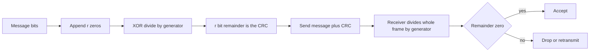

## The hook

Every Ethernet frame your computer sends ends with 4 extra bytes. They contain no data at all. They exist so that the receiving network card can tell, almost for free, whether any of the preceding bits were flipped by electrical noise on the way. If the check fails, the frame is silently dropped and higher layers retransmit it.

Those 4 bytes are a cyclic redundancy check. The same idea protects ZIP archives, PNG images, gzip files and storage devices. It is a beautiful example of turning a bit of algebra into a circuit that runs at line speed.

## Where you meet it every day

- **Ethernet and Wi-Fi** frames end with a CRC-32 frame check sequence.
- **ZIP and gzip** store a CRC-32 of the uncompressed data, so extraction can detect corruption.
- **PNG** images carry a CRC-32 on every chunk.
- **Storage and buses**: disks, SSDs, and protocols such as USB and SATA use CRCs on transferred blocks; many CPUs have an instruction for the CRC-32C variant.

## The intuition

:::analogy
Think of a bank cheque with the amount written in a box. A smudge could turn a 3 into an 8. Suppose the bank also asked you to write, in a separate box, the remainder when that amount is divided by some fixed number. A smudged amount almost never leaves the same remainder, so the clerk's quick division exposes the smudge. The cleverer the choice of divisor, the more kinds of smudges it is guaranteed to notice.
:::

A [[cyclic redundancy check (CRC)]] is exactly that remainder box, computed on bits instead of digits, with a divisor chosen so that the most common kinds of corruption always change the remainder.

## How it works

### Bits as polynomials

Treat a bit string as a polynomial whose coefficients are 0 or 1: 1101 is x³ + x² + 1. Arithmetic on the coefficients is done modulo 2, so adding and subtracting are both XOR, with no carries or borrows. Long division then becomes [[XOR division]]: line the divisor up under the leftmost 1, XOR, and repeat.

### Computing the CRC

Sender and receiver agree on a [[generator polynomial]] G of degree r (r + 1 bits).

1. Append r zero bits to the message.
2. Divide by G using XOR division.
3. The r-bit remainder is the CRC. Send the message followed by the CRC.

Appending the remainder makes the transmitted bit string an exact multiple of G, because XOR-ing in the remainder cancels it, in the same way that subtracting the remainder from a number makes it divisible.

### Checking

The receiver divides the whole received frame by G. A zero remainder means no error was detected. A non-zero remainder means corruption. Mathematically, the received frame is (sent frame) XOR (error pattern), and the sent frame divides evenly, so the remainder depends only on the error pattern. An error goes unnoticed only if the error pattern itself is a multiple of G.



### What it is guaranteed to catch

With a well-chosen generator of degree r that has a non-zero constant term:

- every single-bit error,
- every [[burst error]] of length r or less, meaning any corruption confined to r consecutive bits,
- every error with an odd number of flipped bits, if G has x + 1 as a factor,
- and almost all other errors: a random corruption slips through with probability about 1 in 2ʳ.

CRC-32, with r = 32, therefore catches every burst up to 32 bits long, and misses a random corruption only about once in four billion.

:::insight
A CRC is a remainder, and the remainder of a sum is the sum of the remainders. So whether an error is caught depends only on the error pattern, never on the data, and choosing G is choosing which error patterns can never divide evenly by it.
:::

### Making it fast

Bit-by-bit division is easy to build in hardware with a shift register and a few XOR gates, which is why network cards compute it as bits stream past. In software, a 256-entry table processes a whole byte per step. Real standards also add details, such as starting the register at all ones and inverting the result, so that leading zero bytes and all-zero frames are not invisible; the core is still polynomial division.

## Walk through an example

Message **101101**, generator **1101** (x³ + x² + 1, so r = 3). Append three zeros: **101101000**.

| Step | Working bits | Action |
|---|---|---|
| start | 101101000 | leading 1 at position 0 |
| 1 | 1011 XOR 1101 = 0110 → 011001000 | next leading 1 at position 1 |
| 2 | 1100 XOR 1101 = 0001 → 000011000 | next leading 1 at position 4 |
| 3 | 1100 XOR 1101 = 0001 → 000000010 | message bits used up |

Remainder (last 3 bits): **010**. Transmit **101101010**.

Receiver check: dividing 101101010 by 1101 leaves **000**, so the frame is accepted. Now flip the third bit in transit: the receiver gets 100101 followed by 010, divides, and gets remainder **110**, not zero, so the corruption is caught.

For a sense of scale, the standard CRC-32 used by gzip and PNG of the five bytes "hello" is 0x3610A686.

:::try-this
With the same generator 1101, compute the CRC of the message 1000. (Append zeros: 1000000. XOR 1101 at the front: 0101000. Leading 1 at position 1: 1010 XOR 1101 = 0111, giving 0011100. Leading 1 at position 2: 1110 XOR 1101 = 0011, giving 0000110. Remainder 110, so send 1000110.)
:::

## The code

```pseudo
crc_remainder(message_bits, G):        // G has r+1 bits
    bits = message_bits + [0] * r
    for i in 0 .. len(message_bits) - 1:
        if bits[i] == 1:
            for j in 0 .. r: bits[i + j] ^= G[j]
    return bits[last r positions]

crc32(bytes):                          // standard reflected CRC-32
    crc = 0xFFFFFFFF
    for b in bytes:
        crc ^= b
        repeat 8 times:
            crc = (crc >> 1) ^ (0xEDB88320 if crc & 1 else 0)
    return crc ^ 0xFFFFFFFF
```

```cpp
#include <bits/stdc++.h>
using namespace std;

string crcRemainder(string msg, const string& gen) {
    int r = gen.size() - 1;
    string bits = msg + string(r, '0');
    for (size_t i = 0; i < msg.size(); i++)
        if (bits[i] == '1')
            for (int j = 0; j <= r; j++) bits[i + j] = (bits[i + j] == gen[j]) ? '0' : '1';
    return bits.substr(bits.size() - r);
}

uint32_t crc32(const string& s) {
    uint32_t crc = 0xFFFFFFFFu;
    for (unsigned char b : s) {
        crc ^= b;
        for (int k = 0; k < 8; k++) crc = (crc >> 1) ^ ((crc & 1) ? 0xEDB88320u : 0u);
    }
    return crc ^ 0xFFFFFFFFu;
}

int main() {
    cout << crcRemainder("101101", "1101") << '\n';      // 010
    cout << crcRemainder("1000", "1101") << '\n';        // 110
    printf("%08x\n", crc32("hello"));                    // 3610a686
}
```

The constant 0xEDB88320 is the CRC-32 generator written bit-reversed, because this standard processes the least significant bit of each byte first.

## Why it is clever

It turns error detection into algebra, which lets designers *prove* what it catches, such as every burst up to r bits, instead of hoping. It costs a handful of gates in hardware and a table lookup per byte in software. And r check bits detect all short bursts plus all but about 2⁻ʳ of random errors, which is excellent value for 4 bytes on a 1,500-byte frame.

## Where it falls short

:::warning
Common misconception: "a CRC protects data from tampering." CRCs are linear and use no secret key, so anyone who modifies data can recompute the CRC, or even adjust a few bytes so the old CRC still matches. For security, use a cryptographic MAC or a signature, as in [A Fingerprint You Cannot Fake](article:famous-algos-cryptographic-hashing).
:::

- **Detection only**: a CRC says that something is wrong, not where; recovery needs retransmission or an error-correcting code, as in [The Grid That Points at the Wrong Bit](article:famous-algos-hamming-codes).
- **Limited by length**: very large files can contain undetected errors with probability about 2⁻³², which is why storage systems also use stronger hashes end to end.
- **Variants differ**: initial value, bit order and final XOR vary between standards, so two "CRC-32" implementations can disagree unless every parameter matches.

### Interview follow-ups

**"What errors is CRC-32 guaranteed to catch?"** All single-bit errors and every burst error of length 32 or less, among others. Random larger corruption slips through with probability about 2⁻³². That is why it suits accidental noise in network frames and files.

**"CRC or SHA-256 for checking a downloaded file?"** Against accidental corruption, CRC is enough and much faster. Against an attacker who can change the file, only a cryptographic hash from a trusted source (or a signature) works, because a CRC can be recomputed or forced to match.

**"Why is CRC so fast in hardware?"** It is polynomial division with XOR and no carries, which maps onto a shift register with a few XOR gates. Software uses lookup tables or CPU instructions built for it.

## Key takeaways

- A CRC treats data as a polynomial over bits and sends the remainder of dividing it by a fixed generator polynomial.
- XOR replaces subtraction, so the division is cheap in hardware and fast in software with lookup tables.
- The receiver divides the whole frame by the generator, and any non-zero remainder means corruption.
- A degree-r generator catches all single-bit errors and all bursts up to r bits, and misses random errors only about once in 2^r.
- CRCs detect accidental errors only, so use cryptographic MACs or signatures against deliberate tampering.
