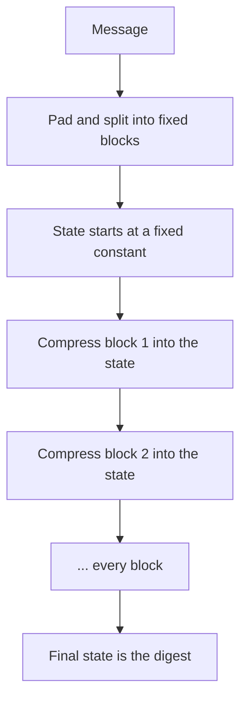

## The hook

Type "PaperStack" into a SHA-256 calculator and you get 64 hexadecimal characters. Change one letter to "paperStack" and the output looks completely unrelated. Not a little different: about half of its bits flip, with no visible pattern.

That strange property, plus the fact that nobody can work backwards from the output or deliberately make two inputs match, makes cryptographic hashes one of the quiet foundations of computing. They name every Git commit, verify every software download and protect stored passwords.

## Where you meet it every day

- **Git** identifies every file, directory and commit by a hash of its contents (historically SHA-1, with SHA-256 support added), so the history cannot be silently altered.
- **Software downloads** publish a SHA-256 checksum so you can confirm the file you received is the one the publisher released.
- **TLS certificates and digital signatures** sign a hash of the data rather than the data itself.
- **Blockchains** chain blocks together by including each previous block's hash.
- **Password storage** builds on hashing, using deliberately slow variants, covered in the next article.

## The intuition

:::analogy
Think of a fingerprint. It is tiny compared with a whole person, yet it identifies them. Change a single hair on the person and, in this magical version, their fingerprint changes completely. And no matter how long you study a fingerprint, you cannot rebuild the person, nor can you find a second person with the same print.
:::

A [[cryptographic hash function]] produces such a fingerprint for data: a fixed-size [[digest]], such as 256 bits for SHA-256, for an input of any size.

## How it works

### The properties that matter

- **Deterministic:** the same input always gives the same digest.
- **[[Preimage resistance]]:** given a digest, finding any input that produces it is infeasible.
- **Second preimage resistance:** given one input, finding a different input with the same digest is infeasible.
- **[[Collision resistance]]:** finding any two different inputs with the same digest is infeasible.
- **[[Avalanche effect]]:** a one-bit change in the input flips about half of the output bits.

"Infeasible" means that the best known attacks would take astronomically long with all the computers on Earth, not that it is mathematically impossible. Collisions must exist, because infinitely many inputs map to a finite number of outputs; the point is that nobody can find one.

### Inside, in one picture

SHA-256 splits the message into 512-bit blocks and feeds them one at a time into a compression function that mixes the block with a 256-bit internal state over 64 rounds of bit operations: rotations, XORs, additions and non-linear functions. The final state is the digest. This chained structure, called Merkle-Damgård, is shared by MD5, SHA-1 and SHA-2.



:::insight
A cryptographic hash lets a tiny, fixed-size value stand in for any amount of data, safely. You can publish it, compare it, sign it or chain it, and anyone can check that the data still matches, while nobody can forge data that matches a given digest.
:::

### Why size matters: the birthday bound

Finding a collision by trying random inputs takes about $2^{n/2}$ attempts for an n-bit digest, not $2^n$, for the same reason that a room of just 23 people has better than even odds of a shared birthday. So a 128-bit digest offers only about 2⁶⁴ collision resistance, which is why modern standards use 256 bits or more.

## Walk through an example

Real SHA-256 digests are 64 hex characters long, so here are just the first 16 of each, computed with a standard SHA-256 implementation.

| Input | SHA-256 digest starts with | Relation to the first |
|---|---|---|
| "chai" | `ca9cfcfa498aa21b` | — |
| "Chai" | `b1e160b3fbfb8c7f` | one letter capitalised, unrelated-looking digest |
| "chai " (trailing space) | `a29c8eca02072198` | one space added, unrelated-looking digest |

Download check, step by step:

1. The publisher computes SHA-256 of `installer.exe` and posts the digest on its HTTPS site.
2. You download the file, perhaps from a fast mirror you do not fully trust.
3. You compute SHA-256 locally and compare. Equal: the file is intact. Different: corrupted or tampered with.

:::try-this
A system stores only the SHA-256 of each user's "secret recovery phrase" and compares digests at login. An attacker steals the digest table. What can they not do directly, and what attack still worries you? (They cannot reverse a digest to the phrase, thanks to preimage resistance. But if phrases are short or common, they can hash guesses and compare, which is why passwords need salts and slow hash functions.)
:::

## The code

You should never implement cryptographic hashes yourself; use a vetted library. Using one looks like this:

```pseudo
digest = SHA256(file_bytes)
if hex(digest) == published_digest:
    accept the file
else:
    reject: corrupted or tampered
```

## Why it is clever

It turns integrity into a comparison of two short strings. Without hashes, checking that a 4 GB file or a whole repository history is unchanged means comparing every byte with a trusted copy you probably do not have. With hashes, you need only one trusted 32-byte digest. Chaining hashes, as Git and Merkle trees do, extends that to entire histories and datasets, as described in [One Fingerprint for a Billion Files](article:famous-algos-merkle-trees).

## Where it falls short

:::warning
Common misconception: "hashing is encryption." Encryption is reversible with a key; hashing is one-way by design and has no key. A plain hash also proves nothing about who produced the data. To prove the sender, you need a keyed hash (HMAC) or a digital signature.
:::

- **Old algorithms break.** Practical collisions have been demonstrated for MD5 and SHA-1, so they must not be used where collision resistance matters.
- **Fast hashes are bad for passwords.** Attackers can try billions of guesses per second against fast hashes; password storage needs slow, salted functions.
- **The trusted digest must itself be trusted.** If an attacker can replace the published digest along with the file, the check proves nothing.
- **Length extension**: with Merkle-Damgård hashes like SHA-256, hash(secret + message) can be extended without knowing the secret, which is why HMAC exists.

### Interview follow-ups

**"How hard is finding a collision for SHA-256?"** The birthday bound says about 2^(n/2) tries for an n-bit hash, so about 2^128 for SHA-256, far beyond any computer. Finding a second input matching a given hash (second preimage) is about 2^256.

**"Is SHA-256(secret + message) a safe way to authenticate a message?"** No. SHA-256 is vulnerable to length extension: knowing the hash of secret + message lets an attacker compute the hash of secret + message + extra without the secret. Use HMAC, which is built to avoid this.

**"Hash table hash versus cryptographic hash?"** A hash table needs speed and good spreading; a cryptographic hash needs to be infeasible to invert or collide, even against an attacker. Using a fast non-cryptographic hash on attacker-controlled keys can enable collision floods; some languages randomise their table hashes for this reason.

**"Where do you use one in system design?"** Content addressing and deduplication (store a blob under its hash), integrity checks on downloads, Merkle trees, and idempotency or cache keys built from request contents.

## Key takeaways

- A cryptographic hash maps any input to a fixed-size digest that is practically impossible to reverse or to collide on purpose.
- The avalanche effect makes even a one-character change produce a completely different digest.
- Collision search costs about 2 to the power n/2 for an n-bit digest, so modern standards use 256-bit outputs.
- Hashes power Git, download verification, signatures and blockchains by letting a short digest stand for large data.
- Hashing is not encryption, MD5 and SHA-1 are broken for collisions, and passwords need slow salted hashing.
