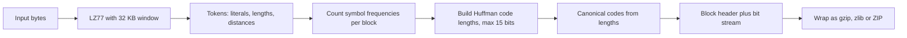

## The hook

Every time a web page loads, there is a good chance its HTML, CSS and JavaScript travelled across the network squeezed by gzip. Every ZIP file you have opened, and every PNG image on your screen, used the same compressor inside. It was designed in the early 1990s by Phil Katz for his PKZIP program and written down as RFC 1951, and it is still everywhere: DEFLATE.

DEFLATE is not one clever trick but two ordinary ones chained together. Understanding why both are needed, and what each one removes, is the clearest way to understand lossless compression in general.

## Where you meet it every day

- **gzip and HTTP compression**: `Content-Encoding: gzip` is DEFLATE inside a small gzip wrapper (RFC 1952).
- **ZIP archives** store most files with DEFLATE.
- **PNG images** compress pixel rows with zlib, which is DEFLATE inside a zlib wrapper (RFC 1950).
- **Software packages and backups**: `.tar.gz` files, Java `.jar` files and many installers are DEFLATE-compressed.

## The intuition

:::analogy
Think of a student taking fast lecture notes. First, whenever the lecturer repeats a phrase already written, the student writes "see above, line 3" instead of copying it out: that removes repetition. Second, the student notices that some words and marks appear constantly, like "the" or "see above", and invents ultra-short abbreviations for exactly those, while rare words keep longer spellings. Shorthand first, then shorter shorthand for the most common pieces.
:::

The first habit is LZ77, explained in [Writing Ditto Marks Instead of Repeating Yourself](article:famous-algos-lz77). The second is [[entropy coding]], and DEFLATE uses [[Huffman coding]] for it. Each removes a different kind of waste, which is why the pair works so much better than either alone.

## How it works

### Stage 1: LZ77 turns bytes into tokens

The input is scanned with a 32 KB sliding window. Each position becomes either:

- a **literal**: one byte copied as is, or
- a **match**: "copy *length* bytes from *distance* bytes back", with lengths from 3 to 258 and distances from 1 to 32,768.

Repeated phrases are gone, but the token stream still has waste: every literal would naively cost 8 bits even though some letters are far more common than others, and short distances are more common than long ones.

### Stage 2: Huffman codes for the tokens

Huffman coding builds a [[prefix code]] from frequencies:

1. Put every symbol in a pool, weighted by how often it appears.
2. Repeatedly take the two lightest items, join them under a new parent whose weight is their sum, and put the parent back.
3. When one tree remains, each symbol's code is the path from the root: left = 0, right = 1.

Frequent symbols end up near the root with short codes; rare ones end up deep with long codes. Because codes are leaves of one tree, no code is a prefix of another, so the decoder reads bits until it reaches a leaf and never needs separators.

### How DEFLATE packages it

DEFLATE uses two Huffman alphabets:

- The **[[literal/length alphabet]]**: symbols 0 to 255 are literal bytes, 256 means "end of block", and 257 to 285 encode match lengths, some followed by a few extra raw bits to pin down the exact length.
- The **distance alphabet**: 30 codes, again with extra bits, for the match distance.

The output is a sequence of [[block]]s. Each block header says one of three things: stored (raw bytes, for data that will not compress), fixed Huffman (predefined codes, no table needed), or dynamic Huffman (codes built for this block). Dynamic blocks send only the code length of each symbol, because DEFLATE uses a [[canonical Huffman code]]: sort symbols by (length, symbol) and hand out consecutive binary numbers, so the lengths alone determine every code. Even those lengths are themselves Huffman-coded to keep the header small.



:::insight
LZ77 exploits repetition of whole phrases; Huffman coding exploits uneven frequencies of individual symbols. They are different kinds of redundancy, so neither stage can do the other's job, and running them in sequence captures both.
:::

### Decoding is fast

A decoder reads a block header, rebuilds the canonical codes from the lengths, then repeatedly decodes one symbol: a literal is output directly, a length-distance pair copies bytes from the already-decoded output, and 256 ends the block. No searching is needed, which is why decompression is much faster than compression.

## Walk through an example

Compress **"abracadabra"** (11 bytes, 88 bits uncompressed).

**Stage 1, LZ77.** No three-byte sequence repeats until position 7, where "abra" matches the start, 7 bytes back. Tokens: literals a, b, r, a, c, a, d, then the match ⟨length 4, distance 7⟩. Eleven bytes became eight tokens.

**Stage 2, Huffman.** To see the code construction clearly, take the letter frequencies of the whole word: a 5, b 2, r 2, c 1, d 1.

| Step | Take the two lightest | New weight |
|---|---|---|
| 1 | c (1), d (1) | 2 |
| 2 | b (2), r (2) | 4 |
| 3 | {c, d} (2), {b, r} (4) | 6 |
| 4 | a (5), {b, r, c, d} (6) | 11 |

Resulting lengths: a 1 bit; b, c, d and r 3 bits each. Canonical codes, sorted by length then letter: a = 0, b = 100, c = 101, d = 110, r = 111.

Total: 5 × 1 + 6 × 3 = **23 bits**, against 33 bits with a fixed 3-bit code and 88 bits as plain bytes. Ties during merging can produce different lengths (for example a 1, r 2, b 3, c 4, d 4), but every Huffman code gives the same optimal total, 23 bits.

:::try-this
Using the canonical codes above, decode the bits 0 100 111 0. (0 is a, 100 is b, 111 is r, 0 is a: "abra". Because no code is a prefix of another, the spaces are not needed.)
:::

## The code

```pseudo
huffman_lengths(freq):
    pool = min-heap of (weight, [symbol])
    length[s] = 0 for every symbol
    while size(pool) > 1:
        (w1, s1) = pop(pool); (w2, s2) = pop(pool)
        for s in s1 + s2: length[s] += 1      // one level deeper
        push(pool, (w1 + w2, s1 + s2))
    return length

canonical_codes(length):
    code = 0; prev = 0
    for s in symbols sorted by (length[s], s):
        code = code << (length[s] - prev); prev = length[s]
        assign code to s; code += 1

deflate_block(bytes):
    tokens = lz77(bytes, window = 32 KB, min match 3, max 258)
    build lengths for literal/length and distance symbols
    write header (dynamic), code lengths, then Huffman bits for each token, then 256
```

```cpp
#include <bits/stdc++.h>
using namespace std;

int main() {
    string s = "abracadabra";
    map<char, int> freq;
    for (char ch : s) freq[ch]++;
    // Total Huffman cost = sum of the weights of all merged nodes.
    priority_queue<long long, vector<long long>, greater<long long>> pq;
    for (auto& [ch, f] : freq) pq.push(f);
    long long totalBits = 0;
    while (pq.size() > 1) {
        long long a = pq.top(); pq.pop();
        long long b = pq.top(); pq.pop();
        totalBits += a + b;                 // every symbol below gains one bit
        pq.push(a + b);
    }
    cout << totalBits << " bits vs " << s.size() * 8 << " bits\n";  // 23 bits vs 88 bits
}
```

The program uses a neat fact: each merge pushes every symbol beneath it one level deeper, so the total encoded size equals the sum of all merged weights: 2 + 4 + 6 + 11 = 23.

## Why it is clever

DEFLATE combines two simple, well-understood ideas into something greater than either. It needs only 32 KB of history to decode, so it works on tiny devices and in streams. Canonical codes make the per-block tables tiny, and per-block dynamic codes let the compressor adapt as data changes from, say, text to binary. It is also unencumbered and fully specified in a short RFC, which is a large part of why it spread into gzip, ZIP, PNG and HTTP.

## Where it falls short

:::warning
Common misconception: "one stage does all the compressing." LZ77 alone leaves every literal at a full 8 bits, and Huffman alone cannot see that "abra" repeats as a phrase. The ratio comes from the combination, and each stage typically contributes a substantial part.
:::

- **Small window**: a 32 KB window misses repeats farther back. Newer formats such as Zstandard and Brotli use larger windows and better entropy coders, and usually compress better at similar speed.
- **Huffman codes use whole bits**: a symbol with probability 0.9 ideally needs about 0.15 bits but gets at least 1. Arithmetic coding and ANS avoid this loss.
- **Already compressed data** (JPEG, MP4, ZIP) does not shrink further; DEFLATE falls back to stored blocks.
- **Compression can be slow** at high levels, because finding the best matches takes search effort; decompression stays fast.

### Interview follow-ups

**"Where would you meet DEFLATE in a system?"** gzip on HTTP responses, ZIP archives and PNG images all use it. For an API, compressing JSON responses often cuts their size several times over at modest CPU cost.

**"gzip, Brotli or Zstandard for a new service?"** gzip is supported everywhere. Brotli usually compresses web text better and is widely supported by browsers. Zstandard offers a wide speed-ratio range and fast decompression, popular for internal storage and logs. Measure on your own data.

**"When should you not compress?"** For already compressed media such as JPEG or MP4, for tiny payloads where headers dominate, and when CPU, not bandwidth, is the bottleneck.

## Key takeaways

- DEFLATE chains LZ77, which replaces repeated phrases with back-references, and Huffman coding, which gives frequent symbols shorter codes.
- Huffman coding builds an optimal prefix code by repeatedly merging the two least frequent symbols.
- DEFLATE codes literals, match lengths and distances with Huffman alphabets inside blocks that can be stored, fixed or dynamic.
- Canonical Huffman codes let a block send only code lengths, which keeps headers small.
- gzip, ZIP and PNG all wrap DEFLATE, while newer formats beat it with larger windows and finer-grained entropy coding.
