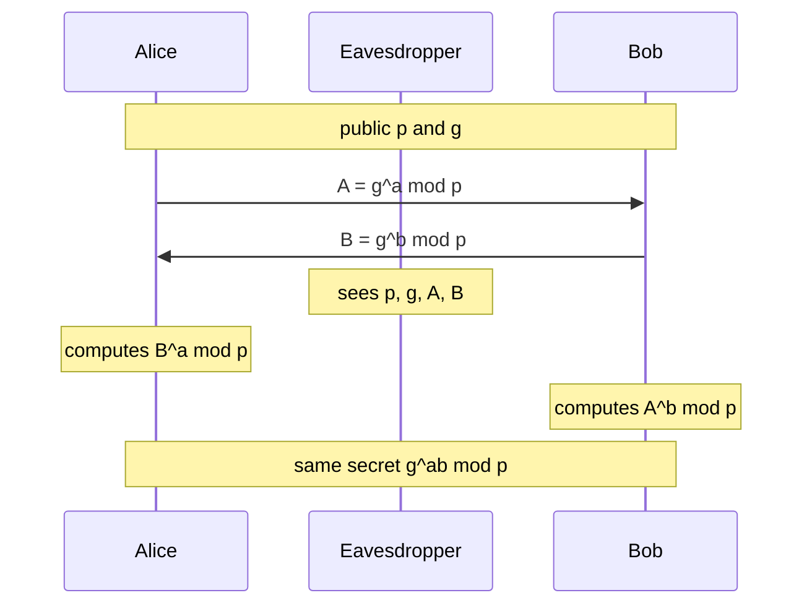

## The hook

You open a website you have never visited. Within a fraction of a second, your browser and a server on another continent agree on a secret key that encrypts everything you send. They have never met, they share no password, and every message they exchanged to agree on that key crossed networks where anyone could read it.

How can two strangers agree on a secret in public? Before 1976, the answer was "they can't": keys had to be delivered in advance, by courier or in person. That year, Whitfield Diffie and Martin Hellman published "New Directions in Cryptography" with a method that made it possible. A version of their idea runs inside almost every HTTPS connection today.

## Where you meet it every day

- **HTTPS (TLS 1.3)**: every handshake performs an ephemeral Diffie-Hellman exchange, usually over elliptic curves, to create the session key.
- **SSH**: logging into a server starts with a Diffie-Hellman exchange.
- **Messaging apps** with end-to-end encryption use Diffie-Hellman-style exchanges to derive keys between devices.
- **VPNs** such as WireGuard and IPsec use it to set up tunnels.

## The intuition

:::analogy
Think of mixing paint. Alice and Bob publicly agree on a common colour, say yellow. Each secretly picks a private colour: Alice red, Bob blue. Each mixes their private colour into the yellow and sends the mixture across the room, where everyone can see it. Alice now adds her red to Bob's yellow-blue mix; Bob adds his blue to Alice's yellow-red mix. Both end up with yellow + red + blue, the same brown. An observer saw yellow, yellow-red and yellow-blue, but separating a mixture back into its colours is practically impossible, so they cannot make the brown.
:::

The paint mixes are numbers, and "mixing" is modular exponentiation: easy to do, very hard to undo. The common colour is a public base, the private colours are secret exponents, and the final brown is the shared key.

## How it works

1. **Public parameters**: a large prime p and a [[generator]] g. Everyone, including attackers, knows them.
2. **Private choices**: Alice picks a secret number a; Bob picks a secret b.
3. **Public values**: Alice sends A = gᵃ mod p; Bob sends B = gᵇ mod p over the [[public channel]].
4. **Shared secret**: Alice computes Bᵃ mod p; Bob computes Aᵇ mod p. Both equal gᵃᵇ mod p, because

$$B^a = (g^b)^a = g^{ab} = (g^a)^b = A^b \pmod p$$

5. The shared value is fed through a key derivation function to produce the actual encryption key.



### Why the listener is stuck

The eavesdropper knows p, g, A and B. To get gᵃᵇ, the obvious route is to recover a from A = gᵃ mod p. That is the [[discrete logarithm problem]]. Computing gᵃ mod p takes about log a multiplications using fast exponentiation from [Raising to the Power of a Billion in Thirty Steps](article:cp-binary-exponentiation), but no known classical method reverses it efficiently for well-chosen primes of 2048 bits or more, or for good elliptic curves. Modular exponentiation is the paint mixing: fast forward, practically irreversible.

:::insight
Diffie-Hellman works because of an asymmetry. Each side combines its secret with the other's public value, and exponentiation commutes, so both arrive at the same number. The listener has only public values, and combining two public values gives nothing useful; it would need one secret, which is hidden behind a discrete logarithm.
:::

### What it does not do: authentication

Diffie-Hellman makes a secret between "me" and "whoever sent me B". It does not prove who that is. In a [[man-in-the-middle attack]], Mallory intercepts Alice's A, sends Bob her own value M, intercepts Bob's B, and sends Alice M too. Now Alice shares a key with Mallory and so does Bob; Mallory decrypts, reads and re-encrypts everything in between.

The fix is to authenticate the exchange: in TLS, the server signs its Diffie-Hellman value with the private key behind its certificate, and the browser checks that certificate chain. The key exchange gives secrecy; the signatures give identity.

### Ephemeral keys and forward secrecy

If a, b are fresh random numbers for each session and are deleted afterwards, then stealing the server's long-term certificate key later reveals nothing about past sessions. This is [[forward secrecy]], and it is why TLS 1.3 only allows ephemeral Diffie-Hellman for key exchange.

## Walk through an example

Toy numbers, far too small for real use: p = 23, g = 5. (5 is a generator mod 23: its powers produce all of 1 to 22.)

| Step | Alice | Public | Bob |
|---|---|---|---|
| Secret | a = 4 | | b = 3 |
| Compute | A = 5⁴ mod 23 = 625 mod 23 = **4** | | B = 5³ mod 23 = 125 mod 23 = **10** |
| Exchange | | A = 4, B = 10 | |
| Shared | 10⁴ mod 23 = 10000 mod 23 = **18** | | 4³ mod 23 = 64 mod 23 = **18** |

Both get 18. The eavesdropper sees 23, 5, 4 and 10. With numbers this small, they can simply try every exponent: 5¹ = 5, 5² = 2, 5³ = 10, so b = 3, and then 4³ mod 23 = 18. With a 2048-bit prime there are about 2²⁰⁴⁸ possible exponents, and no shortcut is known that comes anywhere near practical.

:::try-this
Keep p = 23 and g = 5, but let Alice pick a = 6 and Bob b = 2. What is the shared secret? (A = 5⁶ mod 23 = 8, B = 5² mod 23 = 2. Alice computes 2⁶ mod 23 = 64 mod 23 = 18; Bob computes 8² mod 23 = 64 mod 23 = 18. The shared secret is 18 again, a coincidence of these toy numbers.)
:::

## The code

```pseudo
power_mod(base, exp, mod):            // fast exponentiation
    result = 1
    while exp > 0:
        if exp is odd: result = result * base mod mod
        base = base * base mod mod
        exp = exp / 2
    return result

alice:  a = random secret;  send A = power_mod(g, a, p)
bob:    b = random secret;  send B = power_mod(g, b, p)
alice:  key = KDF(power_mod(B, a, p))
bob:    key = KDF(power_mod(A, b, p))     // same key
```

```cpp
#include <bits/stdc++.h>
using namespace std;

long long powMod(long long b, long long e, long long m) {
    long long r = 1; b %= m;
    while (e > 0) {
        if (e & 1) r = r * b % m;
        b = b * b % m;
        e >>= 1;
    }
    return r;
}

int main() {
    long long p = 23, g = 5, a = 4, b = 3;               // toy values only
    long long A = powMod(g, a, p), B = powMod(g, b, p);
    cout << A << ' ' << B << ' ' << powMod(B, a, p) << ' ' << powMod(A, b, p) << '\n';  // 4 10 18 18
}
```

## Why it is clever

It solved a problem that seemed impossible: creating a shared secret without any prior shared secret, over a channel the enemy controls. It needs nothing but exponentiation and one hard-to-reverse function. It introduced the idea of public-key cryptography, which RSA, digital signatures and modern TLS all build on. And because the keys can be thrown away after each session, it gives forward secrecy almost for free.

## Where it falls short

:::warning
Common misconception: "Diffie-Hellman makes the connection secure by itself." It only protects against passive listeners. Without authentication, an active attacker in the middle can run two exchanges and read everything. Real protocols always pair it with signatures and certificates.
:::

- **Parameter choice matters**: small primes, or primes with weak structure, make discrete logarithms tractable. Use standard, vetted groups or curves.
- **Elliptic curves** (ECDH, such as X25519) give the same security with much smaller numbers and faster operations, which is why modern TLS prefers them.
- **Quantum computers**: Shor's algorithm would solve discrete logarithms efficiently, so post-quantum key exchanges are being deployed alongside or in place of classic Diffie-Hellman.
- **It only creates a key**: actual encryption uses a symmetric cipher such as AES with that key.

### Interview follow-ups

**"What is forward secrecy and how does Diffie-Hellman give it?"** Forward secrecy means stealing a server's long-term key later does not unlock past recorded sessions. Use a fresh (ephemeral) Diffie-Hellman key pair per session and throw it away; the long-term key only signs the exchange. TLS 1.3 key exchange is always ephemeral.

**"How does a man-in-the-middle attack work here?"** The attacker runs one exchange with Alice and another with Bob, posing as each to the other, and relays traffic while reading it. The fix is authentication: the server signs its Diffie-Hellman share and the client checks the signature against a certificate.

**"Why do modern systems prefer elliptic curves?"** ECDH reaches similar security with far smaller keys and faster maths, so handshakes are cheaper. X25519 is a widely used choice.

**"Diffie-Hellman versus RSA key transport?"** With RSA key transport, the client encrypts a secret to the server's long-term key, so stealing that key later decrypts old sessions. Ephemeral Diffie-Hellman avoids this, which is why TLS 1.3 removed RSA key transport.

## Key takeaways

- Diffie-Hellman lets two parties create a shared secret over a public channel without any prior shared key.
- Each side sends g to the power of its secret mod p, then raises the other's value to its own secret, and both reach g^(ab) mod p.
- Security rests on the discrete logarithm problem: exponentiation mod p is fast, but recovering the exponent is believed infeasible for good parameters.
- Plain Diffie-Hellman has no authentication, so TLS signs the exchange with certificate keys to stop man-in-the-middle attacks.
- Fresh ephemeral keys per session give forward secrecy, and modern systems use elliptic-curve versions for speed.
