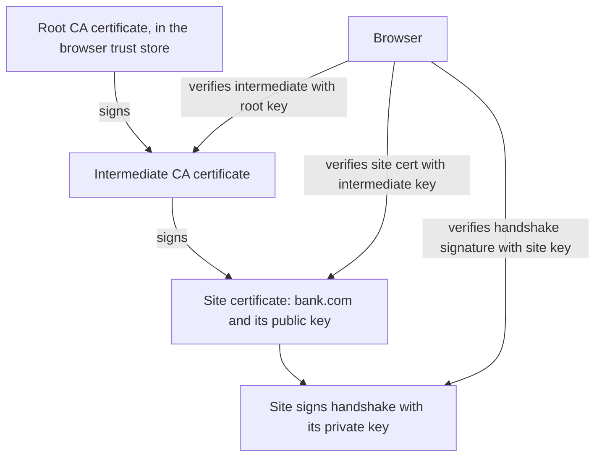

## The hook

You type your bank's address and a padlock appears. Your browser has never met this server, and the network in between could be a café's Wi-Fi run by anyone. Yet within a fraction of a second it decided: this really is the bank, not someone pretending.

That decision rests on two ideas. A digital signature lets anyone check that a message came from the holder of a particular private key and was not changed. A certificate, itself a signed document, says which public key belongs to which domain. Chain a few of those together, starting from a short list of authorities built into your device, and you get the system that secures the web, software updates and app stores.

## Where you meet it every day

- **HTTPS**: the server proves its identity with a certificate chain and signs part of the handshake.
- **Software updates and app stores**: your phone and computer refuse to install updates whose signatures do not verify against the publisher's key.
- **Git commit and package signing**: developers sign commits and releases so others can verify their origin.
- **Digital documents**: signed PDFs and e-signature services rely on the same mechanism.

## The intuition

:::analogy
Think of a notarised document. You sign a contract, and a notary stamps it, confirming the signature is really yours. A stranger abroad does not know the notary, but the notary's commission is certified by a regional office, whose authority is certified by a national government that every country recognises. The stranger checks each stamp up the chain until reaching an authority they already trust. If any stamp is fake, or the document changed after stamping, the chain breaks.
:::

The stamp is a [[digital signature]]. The notary's commission is a [[certificate]], and the recognised authorities at the top are [[root certificate]]s. Walking up the stamps is following the [[chain of trust]].

## How it works

### Signing and verifying

A signature scheme has three operations:

1. **Key generation**: create a private key (kept secret) and a public key (shared).
2. **Sign**: hash the message with a cryptographic hash, then transform the hash with the private key to get the signature.
3. **Verify**: anyone with the public key, the message and the signature checks that they match.

With RSA, from [A Padlock Anyone Can Close but Only You Can Open](article:famous-algos-rsa), signing is s = hᵈ mod n and verifying checks sᵉ mod n = h. Modern alternatives such as ECDSA and Ed25519 use elliptic curves for much smaller keys, but the interface is the same: sign with private, verify with public.

Hashing first matters. The signature covers the fingerprint from [A Fingerprint You Cannot Fake](article:famous-algos-cryptographic-hashing), so changing even one byte of the message changes the hash and the signature no longer verifies. That gives integrity, authenticity and [[non-repudiation]] at once.

### Certificates

A signature proves "the holder of public key K signed this". But which key belongs to `bank.com`? A certificate answers that: a document containing the domain name, the site's public key, a validity period and other details, signed by a [[certificate authority (CA)]] after it checks that the requester controls the domain.

### Chains of trust

Browsers and operating systems ship a trust store of a limited number of root certificates. Roots rarely sign websites directly; they sign intermediate CA certificates, and intermediates sign site certificates. The server sends its certificate plus the intermediates; the browser verifies each signature with the public key one level up, until it reaches a root it already trusts. It also checks names, dates and revocation status.



Keeping root private keys offline and doing daily signing with intermediates limits damage: a compromised intermediate can be revoked without replacing roots on billions of devices.

:::insight
A signature moves trust, it does not create it. You trust the site's key because the intermediate vouched for it, and the intermediate because the root vouched for it, and the root because your device shipped with it. Every link is a signature you can check mathematically; only the last link is a decision made in advance.
:::

### Proving key ownership live

A certificate is public, so anyone can copy it. During the TLS handshake the server must also sign data unique to this connection with its private key. An impostor with a copied certificate but no private key cannot produce that signature.

## Walk through an example

Toy RSA keys, reusing small numbers so every step can be checked:

- **Root CA**: n = 187, e = 7, private d = 23.
- **Site**: n = 55, e = 3, private d = 27.

| Step | Who | Computation | Result |
|---|---|---|---|
| 1 | CA signs the site certificate, whose toy hash is 100 | 100²³ mod 187 | signature 144 |
| 2 | Browser verifies the certificate with the CA public key | 144⁷ mod 187 | 100, matches the hash ✓ |
| 3 | Site signs this connection's handshake hash 13 | 13²⁷ mod 55 | signature 7 |
| 4 | Browser verifies with the site key from the certificate | 7³ mod 55 | 13, matches ✓ |

Now suppose an attacker edits the certificate to insert their own key. The certificate's hash changes from 100 to something else, but the CA signature still decodes to 100. Step 2 fails and the browser shows a warning. If instead they copy the genuine certificate but lack the site's private key 27, they cannot produce a signature whose cube mod 55 equals the new handshake hash, and step 4 fails.

:::try-this
With the toy CA key above, a certificate's hash is 100 and someone presents signature 145. Should the browser accept it? (145⁷ mod 187 = 172, not 100, so verification fails and the certificate is rejected. Only 144 works for this hash.)
:::

## The code

```pseudo
sign(message, private_key):
    h = hash(message)
    return signature_transform(h, private_key)     // e.g. padded h^d mod n

verify(message, signature, public_key):
    return check(signature, hash(message), public_key)

verify_chain(chain, trust_store):                  // chain[0] = site certificate
    for i in 0 .. len(chain) - 2:
        cert = chain[i]; issuer = chain[i + 1]
        if not verify(cert.body, cert.signature, issuer.public_key): return false
        if cert expired or revoked: return false
    return chain[-1] is in trust_store and its name, dates and usage checks pass
```

## Why it is clever

Signatures need no shared secret and no live contact with the signer: a signature made once can be checked by anyone, anywhere, forever after, using only public information. Certificates turn that into a scalable identity system: a small set of roots, shipped once, lets billions of devices trust millions of sites they have never seen. And splitting roots from intermediates keeps the most valuable keys offline.

## Where it falls short

:::warning
Common misconception: "a signed message is an encrypted message." Signing proves who wrote something and that it was not altered; it does not hide the content. HTTPS gets secrecy from a separate key exchange and symmetric encryption, and uses signatures only for authentication. Likewise, a valid certificate only proves control of a domain, not that the site is honest.
:::

- **CA compromise**: if any trusted CA misissues a certificate, it can be valid for any domain. Certificate Transparency logs make issued certificates publicly auditable to catch this.
- **Revocation is hard**: checking whether a certificate was revoked adds latency and can fail, which is one reason certificate lifetimes keep getting shorter.
- **Private key theft** lets an attacker sign as you until the key is revoked; keys are often kept in hardware security modules.
- **Quantum computers** would break RSA and elliptic-curve signatures, so post-quantum signature schemes are being standardised.

### Interview follow-ups

**"What exactly does a browser check before showing the padlock?"** That the server's certificate names the domain, is within its validity dates, and has a signature chain up to a root certificate the browser already trusts. Then, during the handshake, the server proves it holds the certificate's private key by signing handshake data.

**"Why sign a hash instead of the whole message?"** Signature operations are slow and work on small inputs. Hashing first turns any size of message into a short digest; collision resistance means signing the digest is as good as signing the message.

**"What is certificate pinning and its risk?"** A mobile app accepts only a specific certificate or public key for its API, so a rogue certificate from some other CA is rejected. The risk: if you rotate keys without updating the pins, every installed app stops connecting.

**"Signature versus MAC?"** A MAC (such as HMAC) uses one shared secret: fast, but anyone who can verify can also forge. A signature uses a private key to sign and a public key to verify, so anyone can check it and only the owner can produce it.

## Key takeaways

- A digital signature is made with a private key over a hash of the message and verified by anyone with the matching public key.
- Signatures prove origin and integrity, but they do not keep the message secret.
- A certificate is a CA's signature binding a public key to a name, such as a domain.
- Browsers verify a chain of certificates up to a root certificate already in their trust store.
- During TLS the server also signs connection-specific data, proving it holds the private key and not just a copied certificate.
